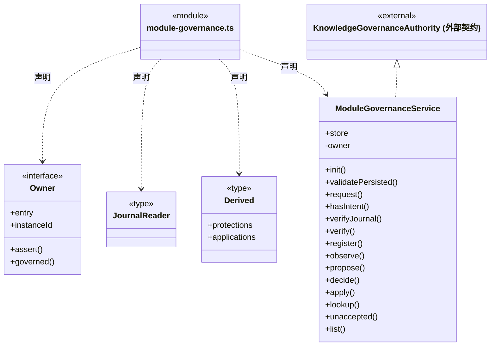
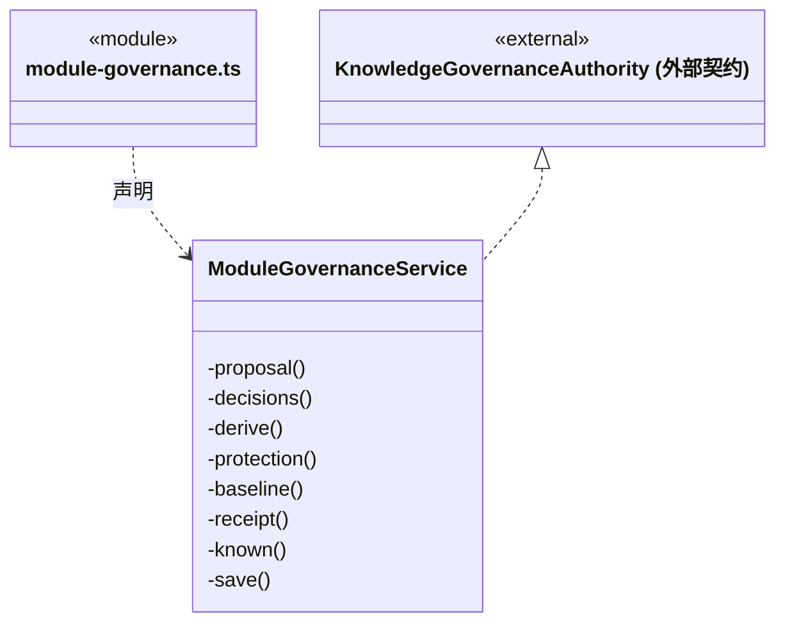

# src/backend/main/governance 架构

## 目录定位

工作区模块知识治理服务及可信桌面操作。登记、提案、决定和显式实施经知识事务屏障核实，读取不启动执行或重放未知操作。

本文描述当前实现。通过分析目录边界后维护的 [源码架构脚本](../../../../scripts/source-architecture.mjs) 同步清单和声明；代码变更时仍须核对职责、关键成员与关系。

## 代码清单

| 文件 | 当前职责 |
| --- | --- |
| [module-governance.ts](module-governance.ts) | 桌面单模块治理服务，组织保护、观察、精确提案、本机决定和独立实施。 |

## 架构类图

### module-governance.ts

成员 1/2（同名节点为同一声明，跨图合并阅读）。

成员 2/2（同名节点为同一声明，跨图合并阅读）。

直接依赖：[../../core/foundation/serialization.ts](../../core/foundation/serialization.ts)、[../../core/foundation/errors.ts](../../core/foundation/errors.ts)、[../../core/knowledge/types.ts](../../core/knowledge/types.ts)、[../../core/governance/module-governance.ts](../../core/governance/module-governance.ts)、[../../core/governance/module-governance-rules.ts](../../core/governance/module-governance-rules.ts)、[../persistence/governance/module-governance-store.ts](../persistence/governance/module-governance-store.ts)、[../persistence/knowledge/governance-port.ts](../persistence/knowledge/governance-port.ts)。

## 子目录导航

无子目录。

[返回上层](../ARCHITECTURE.md)。

每次修改本目录代码，同步维护文件头、关键契约说明及本图。未实现的治理、证据验收和自动编排能力不列入当前类图。

## 设计契约 v1 与落地范围

以下内容区分已接通能力与后续设计；以各节的实现状态为准，不将目标图当作现状图。维护源：[CONTRACT.md](CONTRACT.md)；生成类图时同步附加，勿直接修改本附录。

# 单模块知识治理服务

`ModuleGovernanceService` 是每个工作区唯一的桌面治理门面，同时实现知识提交所需的私有授权端口。服务不拥有第二个队列；登记、观察、提案、决定、实施和回执读取都通过 `Workspace.governed` 进入 `KnowledgeStore` 的同一串行屏障。回调内只能使用未再次排队的事务端口，不得重入公开 `commit/preview`。

用户明确登记真实 Module 的定义和 overview；首片没有解除、移动、删除或定义修改入口。观察保存当时的结构校验和原正文，提案固定唯一 overview 差异及理由、替代方案、不变量、恢复说明。决定仅接受可信桌面闭包的 `local_desktop / explicit_submit`，它不代表认证负责人或业务验收。批准、驳回和暂缓只保存记录，不写正式知识。

`apply` 重新核当前知识、保护、提案和最新批准，先持久化精确原 ChangeRequest 与意图，再调用事务端口 `apply(intentId)`。普通 ChangeRequest 不接受 permit；原始 CRUD、架构表单、资源整包和索引刷新都经过同一最终投影门禁，不能以 ignore 隐藏受保护模块。

账本中的 apply 永久保留原 pending 意图。公开 `committed` 和保护新 revision/hash 从匹配的原知识 journal 派生；必须核前后正文、请求指纹、治理关联及真实 changed 集合，不凭当前文件相同推断成功。旧实例的意图完全没有 journal 时显示 `not_applied`，不冒称回滚；当前实例未知或尚在提交仍显示 pending。准备/提交中、回滚和恢复冲突分别保留原事实，不自动实施。

`receipt` 只查询原命令，可返回旧实例身份；重复命令不同内容拒绝。`unaccepted` 仅在旧实例退役、同队列排空、账本和原 journal 都无记录时为 true。不存在、通信错误或版本错误本身不是未受理证明。重新打开只校验历史并恢复元数据，不能唤醒模型、调用业务执行或重放知识写入。
