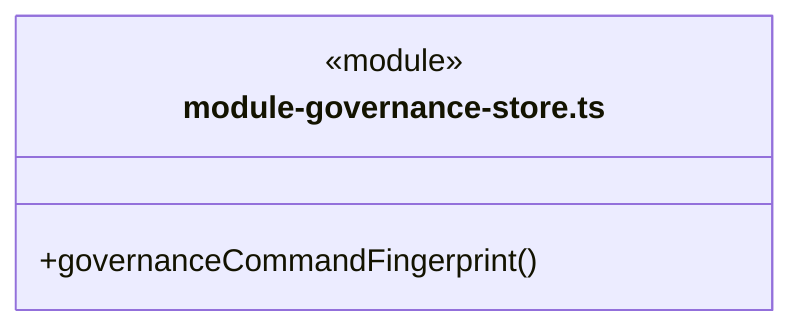
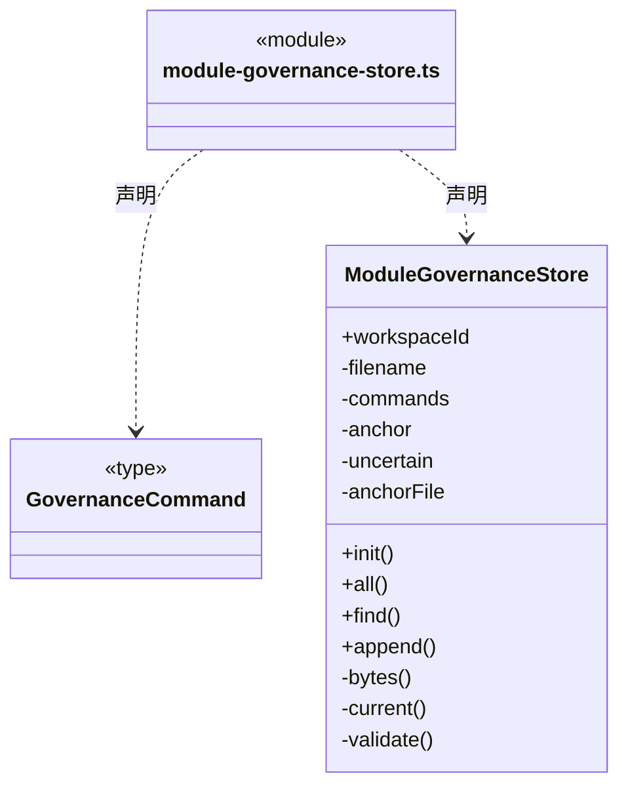

# src/backend/main/governance/storage 架构

## 目录定位

知识治理记录的物理持久化；业务规则和不可变意见契约在 Core，应用治理服务在父目录。

本文描述当前实现。通过分析目录边界后维护的 [源码架构脚本](../../../../../scripts/source-architecture.mjs) 同步清单和声明；代码变更时仍须核对职责、关键成员与关系。

## 代码清单

| 文件 | 当前职责 |
| --- | --- |
| [module-governance-store.ts](module-governance-store.ts) | 保存工作区私有的保护登记、观察、提案、决定及原实施意图。 |

## 架构类图

### module-governance-store.ts

直接依赖：[../../../core/foundation/files/index.ts](../../../core/foundation/files/index.ts)、[../../../core/foundation/serialization.ts](../../../core/foundation/serialization.ts)、[../../../core/foundation/errors.ts](../../../core/foundation/errors.ts)、[../../../core/governance/module-governance.ts](../../../core/governance/module-governance.ts)、[../../../core/governance/module-governance-rules.ts](../../../core/governance/module-governance-rules.ts)、[../../../core/governance/module-governance-feedback.ts](../../../core/governance/module-governance-feedback.ts)。

## 子目录导航

无子目录。

[返回上层](../ARCHITECTURE.md)。

每次修改本目录代码，同步维护文件头、关键契约说明及本图。未实现的治理、证据验收和自动编排能力不列入当前类图。
