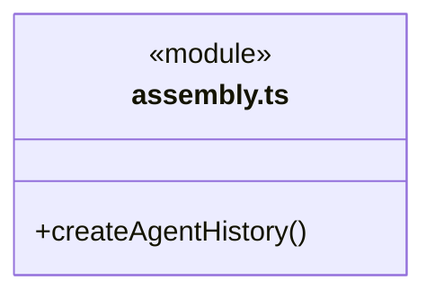
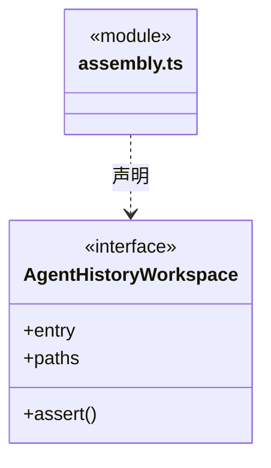
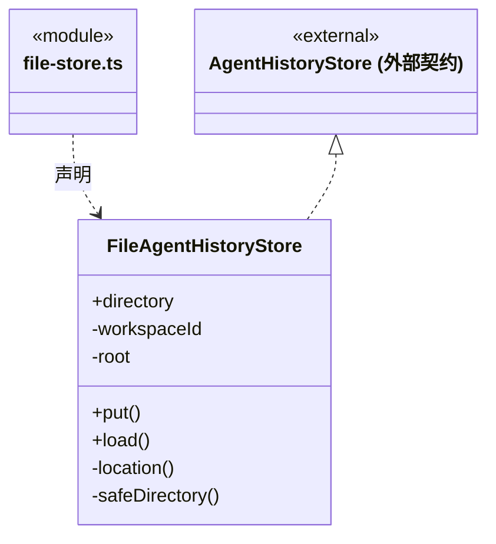
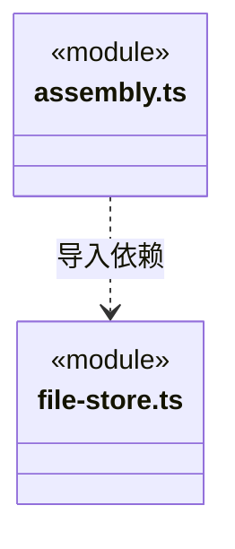

# src/backend/main/history 架构

## 目录定位

履历应用装配与文件索引。assembly.ts 连接角色/运行来源，file-store.ts 只实现 SessionHistoryStorage；文件存储不得反向依赖装配或工作区服务。

本文描述当前实现。通过分析目录边界后维护的 [源码架构脚本](../../../../scripts/source-architecture.mjs) 同步清单和声明；代码变更时仍须核对职责、关键成员与关系。

## 代码清单

| 文件 | 当前职责 |
| --- | --- |
| [assembly.ts](assembly.ts) | 在已持锁的工作区中组合角色历史服务、文件索引及 canonical 日志读取端口。 |
| [file-store.ts](file-store.ts) | 把静态 Agent 的 Session 派生索引保存到应用用户目录，只负责索引读写和目录校验。 |

## 架构类图

### assembly.ts

直接依赖：[../../../logic/execution/ports/identity.ts](../../../logic/execution/ports/identity.ts)、[../../scheduler-engine/history/agent-history.ts](../../scheduler-engine/history/agent-history.ts)、[file-store.ts](file-store.ts)、[../run-storage/run-storage.ts](../run-storage/run-storage.ts)。

### file-store.ts

直接依赖：[../../../core/platform/node/serialization.ts](../../../core/platform/node/serialization.ts)、[../../../core/platform/node/files/index.ts](../../../core/platform/node/files/index.ts)、[../../../logic/team/rules/session-history-storage.ts](../../../logic/team/rules/session-history-storage.ts)。

### 本目录调用边界

## 子目录导航

无子目录。

[返回上层](../ARCHITECTURE.md)。

每次修改本目录代码，同步维护文件头、关键契约说明及本图。未实现的治理、证据验收和自动编排能力不列入当前类图。

## 设计契约 v1 与落地范围

以下内容区分已接通能力与后续设计；以各节的实现状态为准，不将目标图当作现状图。维护源：[CONTRACT.md](CONTRACT.md)；生成类图时同步附加，勿直接修改本附录。

# history 持久化契约

### 静态 Agent 会话归档索引

`FileAgentHistoryStore` 保存到应用用户目录 `paths.project(workspaceId)/agent-history/<角色摘要>/sessions/<会话摘要>/<运行摘要>.json`。名称摘要由可信静态角色、会话及 task/run 标识生成；外部请求不能提供目录或文件路径。每个轮次独立原子提交并同步文件，目录/条目符号链接及身份不匹配拒绝，损坏条目保留诊断且不影响其他记录读取。

归档文件只保存公开任务摘要、明确身份、生命周期状态和后端日志来源；不复制消息、工具正文、workflowContext 或原生会话文件。完整执行事实继续保存在原 `loop-engine/tasks` 和 `dispatch/runs/tasks`，不迁移、不合并、不写入可共享 `.cbim` 知识。执行实例释放、静态角色定义删除、正常工作区关闭都不删除归档。

装配入口位于 `../../agent-history.ts:createAgentHistory`，将固定运行根及 `FileRunStorage` 注入查询服务；本目录 `agent-history.ts` 只导出 `FileAgentHistoryStore`，不导入具体 Workspace 或调度服务。详情仅根据已核验索引的 source/task/run 定位，检查真实目录边界、符号链接及日志身份；首次读取后由已落盘观察维护增量。模型启动前已持久化但尚未创建 canonical 的派发意图也可归档，详情只呈现真实空前缀与失败状态。

启动时先核工作区路径、持有工程锁，再通过可信 `beforeDispatchLoad` 阶段加载历史索引；完成后唯一 Store 才首次读取，loaded 与来源恢复的 committed 都不会抢在历史装载之前。`WorkspaceRuntimeMonitor` 随后在原有两套日志扫描中幂等回补，并同时消费派发 loaded/committed 与主/成员事件；没有第二套定时全量扫描，也不为启动顺序放宽持久索引重复检测。列表只查轻量索引。异步索引错误进入服务及全局诊断，不阻断已提交的执行；关闭顺序为执行收尾、撤销观察、排空索引写入、释放工作区。
