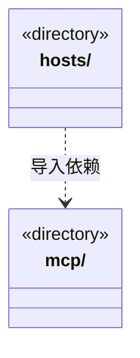

# src/backend/main/integrations 架构

## 目录定位

可选外部接入，隔离 MCP 传输与外部宿主兼容。内部 Loop 不依赖外部服务连接。

本文描述当前实现。通过分析目录边界后维护的 [源码架构脚本](../../../../scripts/source-architecture.mjs) 同步清单和声明；代码变更时仍须核对职责、关键成员与关系。

## 代码清单

本层无直接代码文件。

## 架构类图

各图中的同名节点表示同一目录边界；跨组及完整直接依赖如下（无边不代表继承）：

- `hosts` → `mcp`：导入。

## 子目录导航

- [hosts/](hosts/ARCHITECTURE.md)：外部宿主的 stdio 桥、配置、启动指引和保护 Hook。访问判断复用 platform/tool-guard，不参与内部大脑编排。
- [mcp/](mcp/ARCHITECTURE.md)：可选 MCP 发布、发现、鉴权、调用日志及心跳。复用调度知识工具适配，不维护领域规则副本。

[返回上层](../ARCHITECTURE.md)。

每次修改本目录代码，同步维护文件头、关键契约说明及本图。未实现的治理、证据验收和自动编排能力不列入当前类图。
