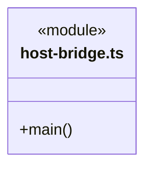
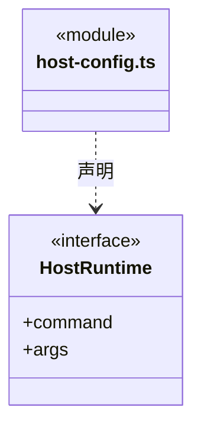
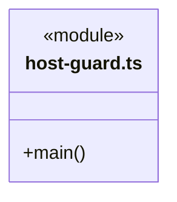
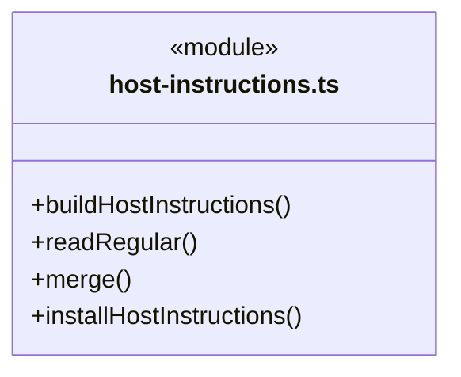
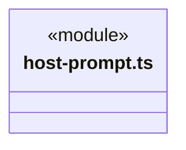
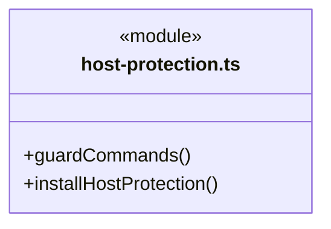
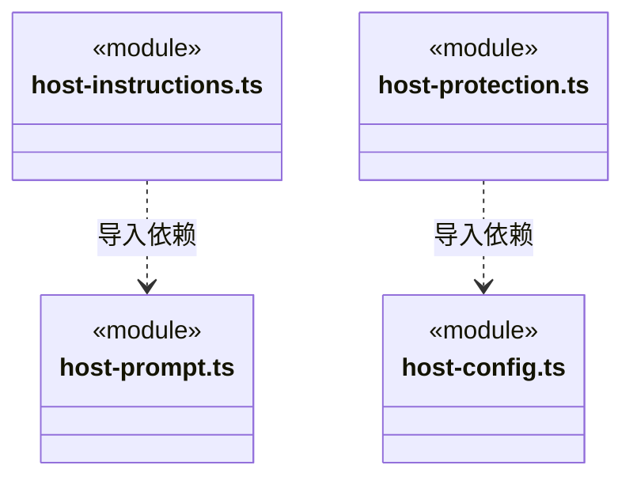

# src/backend/main/integrations/hosts 架构

## 目录定位

外部宿主的 stdio 桥、配置、启动指引和保护 Hook。访问判断复用 platform/tool-guard，不参与内部大脑编排。

本文描述当前实现。通过分析目录边界后维护的 [源码架构脚本](../../../../../scripts/source-architecture.mjs) 同步清单和声明；代码变更时仍须核对职责、关键成员与关系。

## 代码清单

| 文件 | 当前职责 |
| --- | --- |
| [host-bridge.ts](host-bridge.ts) | 宿主启动的 stdio MCP 桥；逐次连接当前工作区服务，不自动重放写入。 |
| [host-config.ts](host-config.ts) | 生成工作区唯一的 Codex/Claude MCP 配置并保留已有无关配置。 |
| [host-guard.ts](host-guard.ts) | 宿主 Hook 命令入口：读取 stdin、执行访问策略并返回拒绝或放行。 |
| [host-instructions.ts](host-instructions.ts) | 生成与同步 AGENTS/CLAUDE 托管启动区块，备份并清理已知旧入口。 |
| [host-prompt.ts](host-prompt.ts) | 由 CBIM 维护的宿主启动提示词正文，通过 MCP 查询和修改知识。 |
| [host-protection.ts](host-protection.ts) | 安装 ignore、宿主权限与 Hook 配置，保留原有规则并返回可见警告。 |

## 架构类图

### host-bridge.ts

直接依赖：[../../platform/paths.ts](../../platform/paths.ts)、[../mcp/discovery.ts](../mcp/discovery.ts)。

### host-config.ts

直接依赖：[../../platform/paths.ts](../../platform/paths.ts)、[../../../core/foundation/files.ts](../../../core/foundation/files.ts)、[../../../core/foundation/errors.ts](../../../core/foundation/errors.ts)、[../../../../bridge/contracts/workspace.ts](../../../../bridge/contracts/workspace.ts)。

### host-guard.ts

直接依赖：[../../platform/tool-guard.ts](../../platform/tool-guard.ts)。

### host-instructions.ts

直接依赖：[../../platform/paths.ts](../../platform/paths.ts)、[../../../core/foundation/files.ts](../../../core/foundation/files.ts)、[../../../core/foundation/errors.ts](../../../core/foundation/errors.ts)、[host-prompt.ts](host-prompt.ts)、[../../../core/knowledge/builtins.ts](../../../core/knowledge/builtins.ts)、[../../../../bridge/contracts/workspace.ts](../../../../bridge/contracts/workspace.ts)。

### host-prompt.ts

### host-protection.ts

直接依赖：[../../platform/paths.ts](../../platform/paths.ts)、[../../../core/foundation/files.ts](../../../core/foundation/files.ts)、[../../../core/foundation/errors.ts](../../../core/foundation/errors.ts)、[../../../../bridge/contracts/workspace.ts](../../../../bridge/contracts/workspace.ts)、[host-config.ts](host-config.ts)。

### 本目录调用边界

## 子目录导航

无子目录。

[返回上层](../ARCHITECTURE.md)。

每次修改本目录代码，同步维护文件头、关键契约说明及本图。未实现的治理、证据验收和自动编排能力不列入当前类图。
