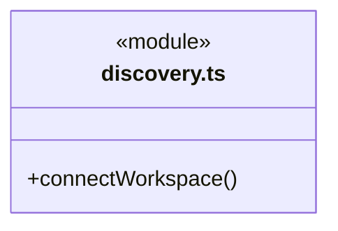
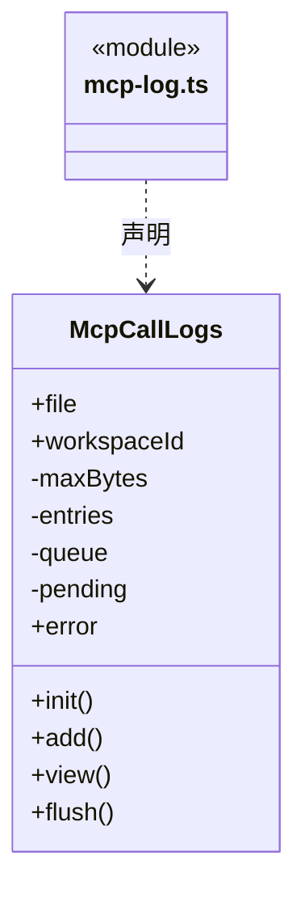
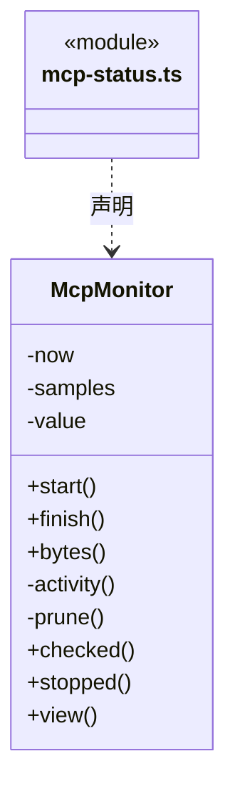
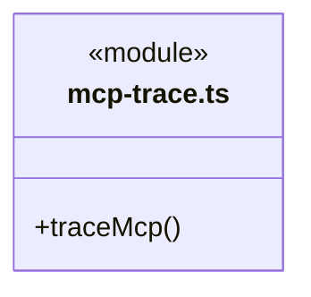
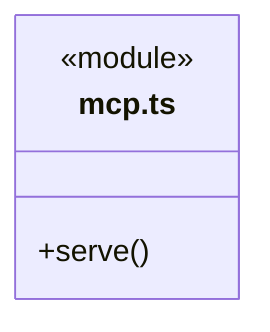
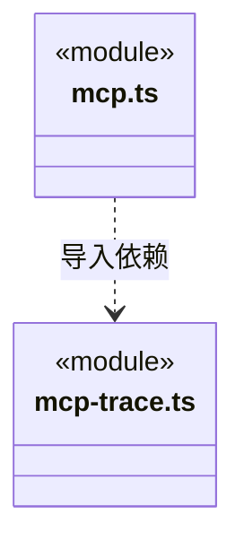

# src/backend/main/integrations/mcp 架构

## 目录定位

可选 MCP 发布、发现、鉴权、调用日志及心跳。复用调度知识工具适配，不维护领域规则副本。

本文描述当前实现。通过分析目录边界后维护的 [源码架构脚本](../../../../../scripts/source-architecture.mjs) 同步清单和声明；代码变更时仍须核对职责、关键成员与关系。

## 代码清单

| 文件 | 当前职责 |
| --- | --- |
| [discovery.ts](discovery.ts) | 校验发现文件、凭据与实际 MCP 实例，建立绑定指定工作区的连接。 |
| [mcp-log.ts](mcp-log.ts) | McpCallLogs：每工作区独立的有界调用日志与落盘队列。 |
| [mcp-status.ts](mcp-status.ts) | McpMonitor：维护健康、请求、错误、耗时及上下行统计快照。 |
| [mcp-trace.ts](mcp-trace.ts) | 将 HTTP/MCP 请求与响应接入调用日志和流量统计。 |
| [mcp.ts](mcp.ts) | 将内部知识服务发布为 MCP，处理传输鉴权、调用日志与心跳。 |

## 架构类图

### discovery.ts

直接依赖：[../../platform/paths.ts](../../platform/paths.ts)、[../../../core/foundation/files.ts](../../../core/foundation/files.ts)、[../../../core/foundation/errors.ts](../../../core/foundation/errors.ts)。

### mcp-log.ts

直接依赖：[../../../../bridge/contracts/workspace.ts](../../../../bridge/contracts/workspace.ts)。

### mcp-status.ts

直接依赖：[../../../../bridge/contracts/workspace.ts](../../../../bridge/contracts/workspace.ts)。

### mcp-trace.ts

直接依赖：[../../workspace/workspace.ts](../../workspace/workspace.ts)。

### mcp.ts

直接依赖：[../../workspace/workspace.ts](../../workspace/workspace.ts)、[../../../core/foundation/errors.ts](../../../core/foundation/errors.ts)、[mcp-trace.ts](mcp-trace.ts)、[../../../scheduler-engine/tools/knowledge-tools.ts](../../../scheduler-engine/tools/knowledge-tools.ts)。

### 本目录调用边界

## 子目录导航

无子目录。

[返回上层](../ARCHITECTURE.md)。

每次修改本目录代码，同步维护文件头、关键契约说明及本图。未实现的治理、证据验收和自动编排能力不列入当前类图。
