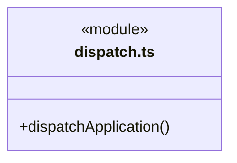
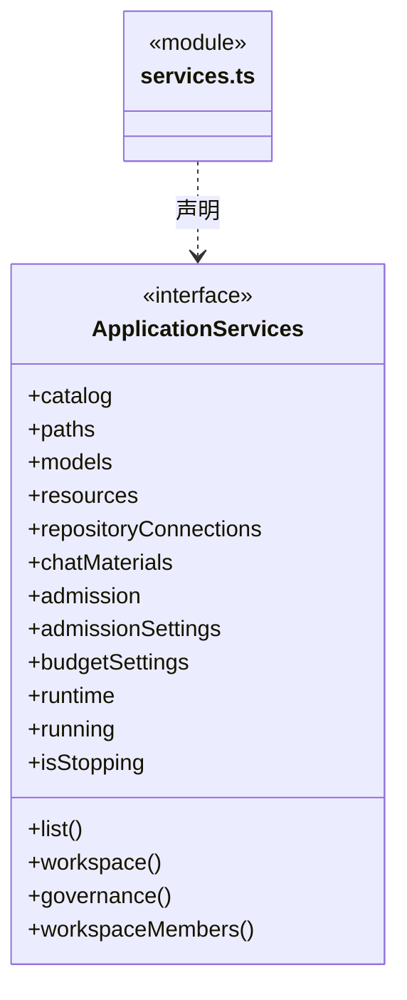
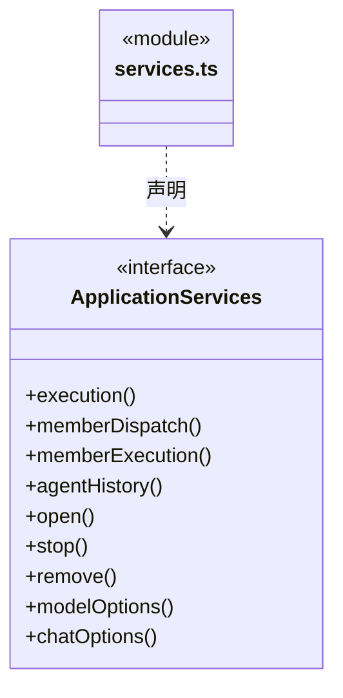
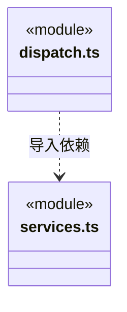

# src/backend/main/ipc 架构

## 目录定位

应用 action 路由；等待资料独立导入/目录/取消入口不启动模型，受理只读保存快照。队列插入传递原expectedRunId，由调度拒绝缺失、过期及停止。公开准入游标读取和版本化设置，不开放许可领取/撤销。报告、核实和业务重规划保持独立；启动额度不足明确未受理，桌面发送方在 Electron 接入处核验。 人工提交参数不接受 actor，保存不启动模型；查询保留历史身份。

本文描述当前实现。通过分析目录边界后维护的 [源码架构脚本](../../../../scripts/source-architecture.mjs) 同步清单和声明；代码变更时仍须核对职责、关键成员与关系。

## 代码清单

| 文件 | 当前职责 |
| --- | --- |
| [dispatch.ts](dispatch.ts) | 将经过主进程接入的 action 路由到明确的工作区和应用服务。 |
| [services.ts](services.ts) | 定义 IPC 路由需要的执行审批、静态角色履历、独立岗位登记、全局监管、配额、桌面资源导入、模块治理和工作区生命周期入口。 |

## 架构类图

### dispatch.ts

直接依赖：[services.ts](services.ts)、[../persistence/tasks/chat-inputs.ts](../persistence/tasks/chat-inputs.ts)、[../workspace/architecture-service.ts](../workspace/architecture-service.ts)、[../resources/workspace-packages.ts](../resources/workspace-packages.ts)、[../../core/foundation/errors.ts](../../core/foundation/errors.ts)。

### services.ts

成员 1/2（同名节点为同一声明，跨图合并阅读）。

成员 2/2（同名节点为同一声明，跨图合并阅读）。

直接依赖：[../workspace/catalog.ts](../workspace/catalog.ts)、[../workspace/workspace.ts](../workspace/workspace.ts)、[../platform/paths.ts](../platform/paths.ts)、[../persistence/settings/llm-profiles.ts](../persistence/settings/llm-profiles.ts)、[../resources/resource-repository.ts](../resources/resource-repository.ts)、[../resources/repository-connections.ts](../resources/repository-connections.ts)、[../governance/module-governance.ts](../governance/module-governance.ts)、[../../scheduler-engine/execution/execution-manager.ts](../../scheduler-engine/execution/execution-manager.ts)、[../../scheduler-engine/execution/dispatch-service.ts](../../scheduler-engine/execution/dispatch-service.ts)、[../../scheduler-engine/execution/member-execution.ts](../../scheduler-engine/execution/member-execution.ts)、[../../scheduler-engine/runtime/agent-history.ts](../../scheduler-engine/runtime/agent-history.ts)、[../../core/runtime/types.ts](../../core/runtime/types.ts)、[../../../bridge/contracts/workspace.ts](../../../bridge/contracts/workspace.ts)、[../persistence/settings/admission-settings.ts](../persistence/settings/admission-settings.ts)、[../persistence/settings/budget-settings.ts](../persistence/settings/budget-settings.ts)、[../workspace/workspace-members.ts](../workspace/workspace-members.ts)、[../persistence/tasks/chat-material-imports.ts](../persistence/tasks/chat-material-imports.ts)、[../../core/runtime/admission.ts](../../core/runtime/admission.ts)。

### 本目录调用边界

## 子目录导航

无子目录。

[返回上层](../ARCHITECTURE.md)。

每次修改本目录代码，同步维护文件头、关键契约说明及本图。未实现的治理、证据验收和自动编排能力不列入当前类图。

## 设计契约 v1 与落地范围

以下内容区分已接通能力与后续设计；以各节的实现状态为准，不将目标图当作现状图。维护源：[CONTRACT.md](CONTRACT.md)；生成类图时同步附加，勿直接修改本附录。

### 工作区岗位登记

`workspace.members.list/get/preview/commit/receipt` 仅为桌面提供岗位摘要、实时差异、预览、明确提交与原命令查询。前四项绑定当前 workspaceId/instanceId；receipt 只带 workspaceId/commandId，允许读旧实例回执。提交的 actor 由可信主 Frame 路由固定为 local_desktop/explicit_submit，请求不能自报模型快照、能力正文或签署者。

列表和详情不创建运行；提交仅在原 DispatchStore 追加岗位审计。未知通信、存储错误或命令冲突须保留原命令查询；只有首次明确的输入、身份、版本、basis、来源、无变化、退休或容量拒绝能确认没有本次提交。回执不存在仍是未知，不授权自动换 ID。模型工具没有这五个入口，岗位 active 不是执行或审批许可。

### 单模块知识治理

`governance.list/register/observe/propose/decide/apply/receipt/unaccepted` 显式绑定工作区；写动作还绑定实例、稳定命令及对应版本。模型没有此工具族。主 Frame 守卫核实发送方，register/decide 在后端注入 `local_desktop / explicit_submit`；保存决定和实施知识是两个独立动作，无额外模型、业务执行或权限提升。

统一回执包含原 identity、commandId、action 和对应 record。apply 的 committed 必须有原知识 result；pending、not_applied、rolled_back 和 recovery_required 保持各自事实。receipt 允许查询退役实例的原记录，不执行写入；unaccepted 只有旧实例且账本/原 journal 无命令才为 true。通信未知必须保留原命令，不将再次收到前置错误当作取消原受理的依据。

### 桌面资源仓库只读连接

`resources.connection.list / preview / commit / grant / revoke / check` 显式绑定工作区实例。登记经知识事务，授权独立保存；只有当前应用已显式开启的共享仓库可连接，请求不接受 URL 或令牌。`check` 才显式核验网络并返回受限目录摘要，主 Frame 接入规则继续适用，入口不注册到模型工具清单。

`receipt` 按 workspaceId/commandId 查询原授权命令；`commitReceipt` 按 workspaceId/planId 只读查询真实原知识事务，可保留旧实例身份。查询不到仍为未知，不触发提交。`unaccepted` 使用原实例/action/ID，只在后端证明旧实例退役且原请求未持久受理时返回 true；前端不能把一般报错或 undefined 当成该证明。退出拒绝新授权，关闭排空已进入的工作。

### 本机人工决定的独立入口

`dispatch.humanPreview / humanDecide / humanReceipt / humanHistory` 仅按明确 workspace/root/scope 访问人工决定服务。预览显式选择 criterion 与基线，提交还须携带稳定 commandId、expectedBasis、expectedDecisionRevision、决定和 comment；actor、proof、路径及文件哈希不属于请求。

Electron 接入仍核对本窗口与主 Frame；`humanDecide` 在可信闭包注入 `local_desktop / explicit_submit`，不冒充登录认证、不增加二次原生弹窗，模型工具表不注册此入口。保存只追加 waiting 周期历史，不调用模型、补充/恢复入口或批准普通队列。退出前拒绝新提交；通信未知保留原命令查询，不把查询未找到解释成可以换 ID 重发。

`loop.humanContinue` 是另外的显式运行入口，严格接收 scope/wait 与 goal/input/decision 版本、最新决定 ID 全集、固定 commandId 和实际模型/权限配置；不接 message、actor 或伪造依据。执行管理器先查原回执，再在真实 beforeRun 内消费一次等待。`loop.humanContinuation` 只查三层身份与 commandId，返回当前 scopeStatus 和不可变 human_decisions 意图；不启动、不续队列，也不把 closed/active 回执解释为正在运行。CONFLICT/UNKNOWN/REPLAY 保持原命令核实，不能自动换 ID。

### 文件基线的独立只读复核

`dispatch.artifactReport` 交当前工作区 `MemberExecutionManager.artifactReport`，必须明确 workspace/root/task/run。未指定 baselineId 只读取 canonical 日志中的已确认引用，不猜最新基线且不读业务文件；指定基线才取得短期业务读占用并有界核实。结果不包含原生会话路径、文件正文或未经核实的模型声明。

该入口与执行回执分页分开，不写日志、不领模型名额、不确认候选或启动恢复。缺失、损坏、在途及前后基线变化都明确保留未知；匹配指纹不代表整个工作区未变或业务验收通过。

### 全局并发准入与设置

`admission.read({cursor})` 仅读应用内准入器，独立于历史监管索引；返回 snapshot 或同版本 noop，不启动运行、不扫描日志。`admission.settings` 返回已经生效的策略；`admission.configure({revision,maxConcurrentRuns})` 经串行版本校验和可靠写盘后生效，关闭期间拒绝改配。IPC 不公开 attempt、withdraw 或 release，页面和模型不能自行签发或伪造归还名额。

### 正式业务重规划

`dispatch.replans.preview` 只读复核指定主会话已完成核实周期的可信证据，返回覆盖模块、继承人工约束和可核对的依据版本；不是模型已生成的执行计划，也不批准业务写入。

`loop.replanStart` 接收严格的新目标、ask/execute 配置、来源核实周期、依据版本和稳定 commandId，交执行管理器在真实运行租约内重新核验并保存启动意图。不能提交旧工具参数、执行实例或原生路径，也不修改原只读周期。`loop.replanReceipt` 只查询同一命令的持久受理事实，未知响应不允许自动改换命令。停止、重复提交和重启不重放已受理目标。

### 显式新只读核实与历史诊断

`loop.recoveryStart` 将严格 `RecoveryRequest` 交执行管理器，创建独立的只读核实周期，不通过普通 resume 恢复旧日志。`loop.recoveryReceipt` 只按工作区、主会话和稳定 commandId 查持久意图；查询、重开页面或重启都不再次执行。

`loop.threadView` 返回 `ConversationThreadView`：全部可读历史、坏记录的通用问题提示和后端核实的可续聊头。缺少可续聊头时界面不能使用较早可读轮次代替。既有 `loop.thread` 保留严格执行预检语义，不把异常转为空列表。

### 显式目标补充

`chat.materialTargets({id})` 只返回当前工作区已授权、共享就绪的仓库目标，不访问 HTTP。`chat.materialList` 使用 importId、connectorId、connectionId 及可选分页/expectedRevision 读取真实目录。`chat.import` 只接受 link/web URL 或 repository_resource 的 connectorId、connectionId、expectedRevision、resourceId；不接受路径、proof、token 或授权字段。所有参数严格校验，七类仓库正文均作为静态资料保存。

`chat.importCancel({id,importId})` 取消同一在途操作并保留墓碑，不能用于撤销已保存文件或业务事务。原生 `chat.pick` 的 importId 走同一取消表。未知导入结果不自动重做；每个新显式导入使用新 ID，已保存但未返回的快照不会自动进入等待请求。`chat.attach` 的旧 connector 分支仍是定义引用，安全等待必须重新选择真实资料来源。

`loop.goalContinue` 接收完整 `GoalContinuationRequest`，纯文本、明确模型配置与权限、scope/wait/input 版本和稳定 commandId 交执行管理器。不能提交原生会话路径、来源或人工批准字段。相同请求查询原回执，不再启动；原等待已消费时换 ID 拒绝。

`loop.goalContinuation` 只读查询同一工作区/主会话/scope/commandId 的回执。返回 undefined 不保证旧请求从未在途，客户端仍须复用原 ID；回执含完整身份、当前 scopeStatus 和原补充记录，不代表模型正在运行或验收通过。普通 `loop.resume/enqueue` 不变成此入口。

### 主会话目标与任务图读取

`dispatchApplication` 将 `dispatch.sessionRead` 路由到 `app.memberDispatch(args.identity.workspaceId).sessionRead(args)`。身份、两个独立游标、所选周期和缓存 stamp 由调度服务严格校验；不从界面选中状态推断目标工作区，不返回全工作区派发存储。

该入口只读，在同一个已提交屏障读取任务图、周期摘要和选中详情。审批、任务开始/停止及信封确认保留各自命令入口；图读取不能触发它们。既有 `dispatch.graphSnapshot / dispatch.graphDelta` 保持兼容。
### 成员执行的只读核实

`dispatch.executionReport` 路由到当前工作区 `MemberExecutionManager.report`，按主会话、任务与可选明确运行查询。省略 runId 只核实领取记录，不猜最新轮次。报告包含核实基线、完整性、受限工具回执和未验收候选；不调用启动、确认、恢复或改派。分页必须绑定同一基线，服务严格校验身份。

### 队列插入绑定原主轮

`loop.queueInsert` 将 `taskId/queueId/expectedRunId` 原样传入执行管理器。路由不查询并替换客户端原 run，不给旧请求补字段；缺失、非法或已变化的主运行统一由后台拒绝，原排队消息保留。停止请求仍走独立入口，后端判断发送前拒绝、原生已接受或结果未知，IPC 不将迟到停止解释为消息未被接受或自动重发依据。
