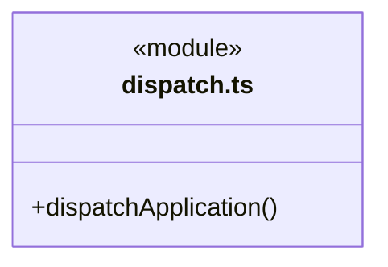
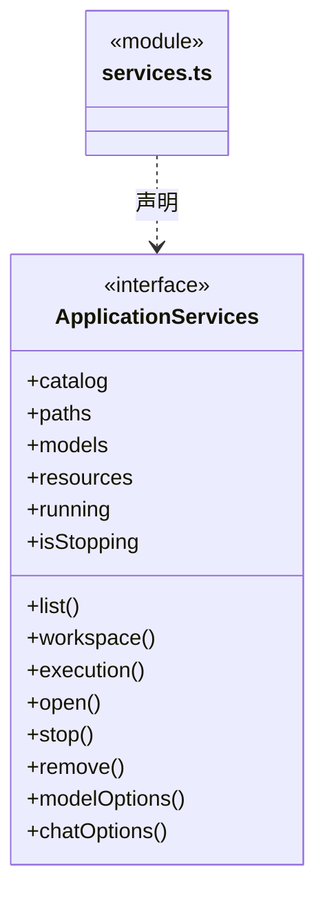
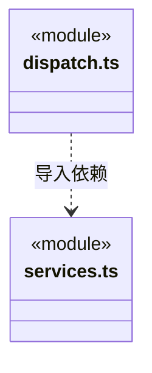

# src/backend/main/ipc 架构

## 目录定位

应用 action 路由。调用显式携带工作区和任务身份，桌面发送方核验仍在 Electron 接入处执行。

本文描述当前实现。通过分析目录边界后维护的 [源码架构脚本](../../../../scripts/source-architecture.mjs) 同步清单和声明；代码变更时仍须核对职责、关键成员与关系。

## 代码清单

| 文件 | 当前职责 |
| --- | --- |
| [dispatch.ts](dispatch.ts) | 将经过主进程接入的 action 路由到明确的工作区和应用服务。 |
| [services.ts](services.ts) | 定义 IPC 路由需要的应用服务及工作区生命周期入口。 |

## 架构类图

### dispatch.ts

直接依赖：[services.ts](services.ts)、[../persistence/tasks/chat-inputs.ts](../persistence/tasks/chat-inputs.ts)、[../../core/foundation/errors.ts](../../core/foundation/errors.ts)、[../../core/foundation/files.ts](../../core/foundation/files.ts)。

### services.ts

直接依赖：[../workspace/catalog.ts](../workspace/catalog.ts)、[../workspace/workspace.ts](../workspace/workspace.ts)、[../platform/paths.ts](../platform/paths.ts)、[../persistence/settings/llm-profiles.ts](../persistence/settings/llm-profiles.ts)、[../resources/resource-repository.ts](../resources/resource-repository.ts)、[../../scheduler-engine/execution/execution-manager.ts](../../scheduler-engine/execution/execution-manager.ts)、[../../../bridge/contracts/workspace.ts](../../../bridge/contracts/workspace.ts)。

### 本目录调用边界

## 子目录导航

无子目录。

[返回上层](../ARCHITECTURE.md)。

每次修改本目录代码，同步维护文件头、关键契约说明及本图。未实现的治理、证据验收和自动编排能力不列入当前类图。
