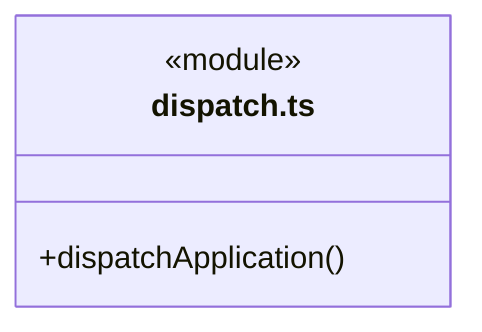
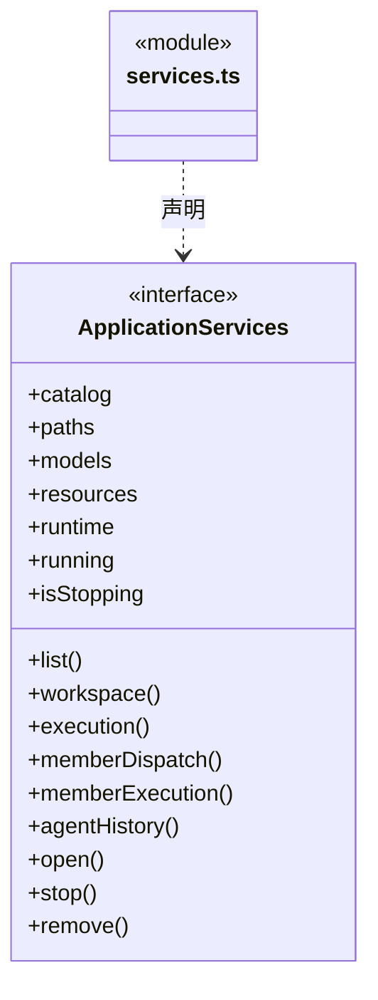
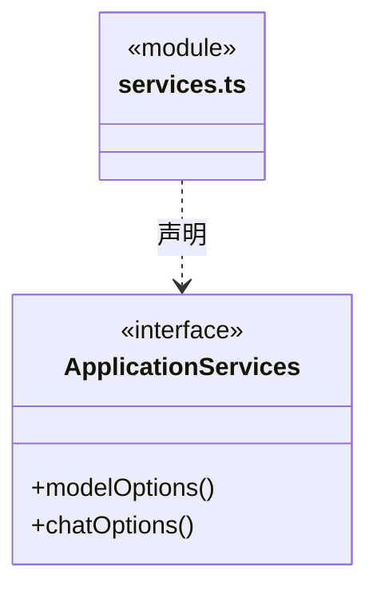
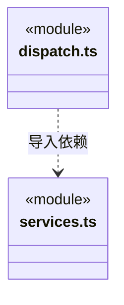

# src/backend/main/ipc 架构

## 目录定位

应用 action 路由。运行、目标与角色历史请求显式绑定工作区和主会话身份；sessionRead 只读同屏障下的图/目标增量及选中详情，不新建或启动任务。桌面发送方在 Electron 接入处核验。

本文描述当前实现。通过分析目录边界后维护的 [源码架构脚本](../../../../scripts/source-architecture.mjs) 同步清单和声明；代码变更时仍须核对职责、关键成员与关系。

## 代码清单

| 文件 | 当前职责 |
| --- | --- |
| [dispatch.ts](dispatch.ts) | 将经过主进程接入的 action 路由到明确的工作区和应用服务。 |
| [services.ts](services.ts) | 定义 IPC 路由需要的应用服务、成员派发及执行审批、静态角色履历、全局运行只读投影与工作区生命周期入口。 |

## 架构类图

### dispatch.ts

直接依赖：[services.ts](services.ts)、[../persistence/tasks/chat-inputs.ts](../persistence/tasks/chat-inputs.ts)、[../workspace/architecture-service.ts](../workspace/architecture-service.ts)、[../resources/workspace-packages.ts](../resources/workspace-packages.ts)、[../../core/foundation/errors.ts](../../core/foundation/errors.ts)。

### services.ts

成员 1/2（同名节点为同一声明，跨图合并阅读）。

成员 2/2（同名节点为同一声明，跨图合并阅读）。

直接依赖：[../workspace/catalog.ts](../workspace/catalog.ts)、[../workspace/workspace.ts](../workspace/workspace.ts)、[../platform/paths.ts](../platform/paths.ts)、[../persistence/settings/llm-profiles.ts](../persistence/settings/llm-profiles.ts)、[../resources/resource-repository.ts](../resources/resource-repository.ts)、[../../scheduler-engine/execution/execution-manager.ts](../../scheduler-engine/execution/execution-manager.ts)、[../../scheduler-engine/execution/dispatch-service.ts](../../scheduler-engine/execution/dispatch-service.ts)、[../../scheduler-engine/execution/member-execution.ts](../../scheduler-engine/execution/member-execution.ts)、[../../scheduler-engine/runtime/agent-history.ts](../../scheduler-engine/runtime/agent-history.ts)、[../../core/runtime/types.ts](../../core/runtime/types.ts)、[../../../bridge/contracts/workspace.ts](../../../bridge/contracts/workspace.ts)。

### 本目录调用边界

## 子目录导航

无子目录。

[返回上层](../ARCHITECTURE.md)。

每次修改本目录代码，同步维护文件头、关键契约说明及本图。未实现的治理、证据验收和自动编排能力不列入当前类图。

## 设计契约 v1 与落地范围

以下内容区分已接通能力与后续设计；以各节的实现状态为准，不将目标图当作现状图。维护源：[CONTRACT.md](CONTRACT.md)；生成类图时同步附加，勿直接修改本附录。

### 主会话目标与任务图读取

`dispatchApplication` 将 `dispatch.sessionRead` 路由到 `app.memberDispatch(args.identity.workspaceId).sessionRead(args)`。身份、两个独立游标、所选周期和缓存 stamp 由调度服务严格校验；不从界面选中状态推断目标工作区，不返回全工作区派发存储。

该入口只读，在同一个已提交屏障读取任务图、周期摘要和选中详情。审批、任务开始/停止及信封确认保留各自命令入口；图读取不能触发它们。既有 `dispatch.graphSnapshot / dispatch.graphDelta` 保持兼容。
