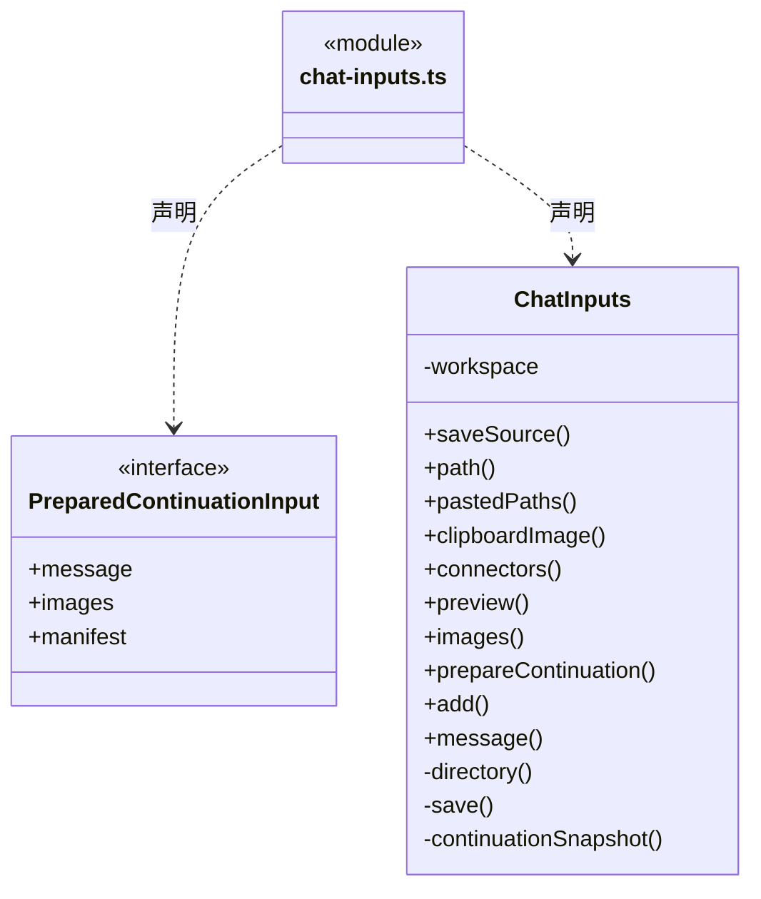
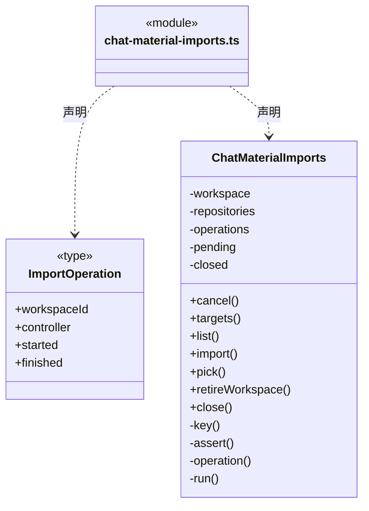
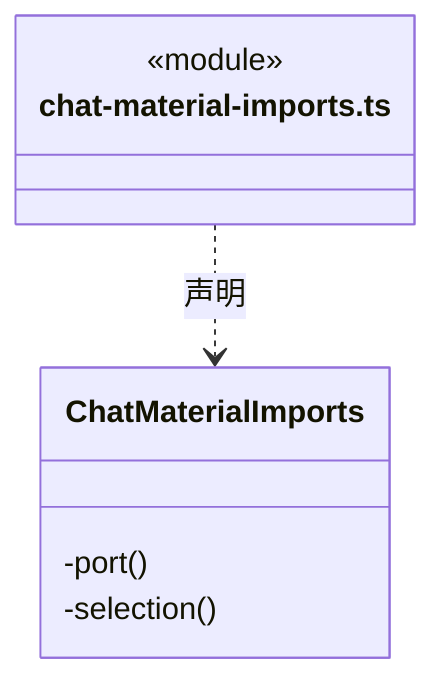
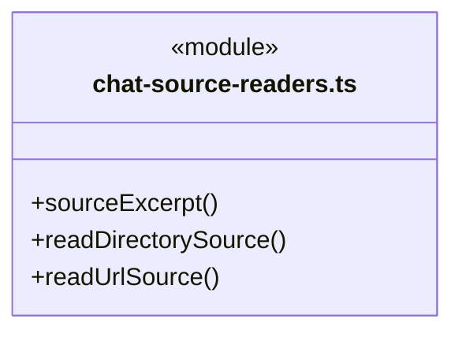
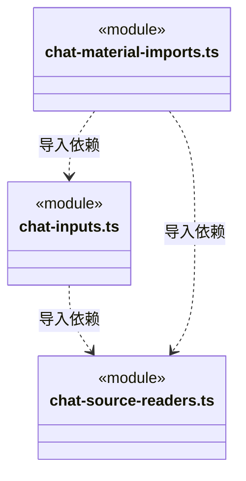

# src/backend/main/materials 架构

## 目录定位

聊天输入、附件与引用材料的本机采集/持久化；保存的快照不自动证明当前来源有效。

本文描述当前实现。通过分析目录边界后维护的 [源码架构脚本](../../../../scripts/source-architecture.mjs) 同步清单和声明；代码变更时仍须核对职责、关键成员与关系。

## 代码清单

| 文件 | 当前职责 |
| --- | --- |
| [chat-inputs.ts](chat-inputs.ts) | 将用户明确添加的文件、文件夹、链接、网页与链接器定义保存为本机对话输入快照。 |
| [chat-material-imports.ts](chat-material-imports.ts) | 应用内显式资料导入的取消、工作区归属及真实资源仓库读取入口。 |
| [chat-source-readers.ts](chat-source-readers.ts) | 桌面明确导入目录、URL 指针和网页时，生成有界文本及真实来源事实。 |

## 架构类图

### chat-inputs.ts

直接依赖：[../../core/foundation/files.ts](../../core/foundation/files.ts)、[../../core/foundation/serialization.ts](../../core/foundation/serialization.ts)、[../../core/foundation/errors.ts](../../core/foundation/errors.ts)、[../../core/tasks/scope-continuation-attachments.ts](../../core/tasks/scope-continuation-attachments.ts)、[../../core/execution/types.ts](../../core/execution/types.ts)、[../../core/knowledge/ports.ts](../../core/knowledge/ports.ts)、[../../../bridge/contracts/chat.ts](../../../bridge/contracts/chat.ts)、[../../core/tasks/continuation-source-snapshot.ts](../../core/tasks/continuation-source-snapshot.ts)、[chat-source-readers.ts](chat-source-readers.ts)。

### chat-material-imports.ts

成员 1/2（同名节点为同一声明，跨图合并阅读）。

成员 2/2（同名节点为同一声明，跨图合并阅读）。

直接依赖：[../../core/foundation/errors.ts](../../core/foundation/errors.ts)、[../../core/foundation/serialization.ts](../../core/foundation/serialization.ts)、[../../core/knowledge/ports.ts](../../core/knowledge/ports.ts)、[../../core/connectors/repository-tools.ts](../../core/connectors/repository-tools.ts)、[../resources/repository-connections.ts](../resources/repository-connections.ts)、[chat-inputs.ts](chat-inputs.ts)、[chat-source-readers.ts](chat-source-readers.ts)。

### chat-source-readers.ts

直接依赖：[../../core/foundation/errors.ts](../../core/foundation/errors.ts)、[../../core/foundation/serialization.ts](../../core/foundation/serialization.ts)、[../../core/tasks/continuation-source-snapshot.ts](../../core/tasks/continuation-source-snapshot.ts)。

### 本目录调用边界

## 子目录导航

无子目录。

[返回上层](../ARCHITECTURE.md)。

每次修改本目录代码，同步维护文件头、关键契约说明及本图。未实现的治理、证据验收和自动编排能力不列入当前类图。

## 设计契约 v1 与落地范围

以下内容区分已接通能力与后续设计；以各节的实现状态为准，不将目标图当作现状图。维护源：[CONTRACT.md](CONTRACT.md)；生成类图时同步附加，勿直接修改本附录。

# materials 持久化契约

### 剪贴板图片与路径快照

ChatInputs.clipboardImage 只接受 PNG/JPEG/GIF/WebP、规范 base64、签名匹配且不超过5 MiB的原字节。source 保存唯一 clipboard URI 和原名称，note 保存采集时间；不伪造磁盘路径，文本不夹带base64。视觉输入、排队、等待补充共用已保存图片，仍受模型视觉能力和总20 MiB限制。

pastedPaths 只接受显式的绝对本地路径/file URL，拒绝相对、UNC/设备与 .cbim；先校验全选路径存在和种类，文件/目录仍复用原快照及目录首层200项限制。source 保留真实路径，正文为导入时快照，后续源文件变化不静默进入发送。preview 只按当前工作区UUID有界读取私有快照，并验证图片；不接受预览磁盘路径。路径/图片导入不自动发消息，孤立快照不自动进入模型。

### 安全等待的附件快照

`ChatInputs.prepareContinuation` 只读取当前工作区已保存的附件 ID，每份私有 JSON 只打开一次；读取前后核对普通文件身份、大小与时间，并受停止信号及有界读取限制。正文、图片和清单从同一份字节派生，不重新打开原始 source 路径或联网。仅文件/图片继续使用原 v1 清单；混入真实新来源使用严格 v2。跨工作区、缺失、损坏、无来源版本的旧非文件或超限附件在消费等待前明确拒绝；旧文本补充不生成空清单。

每次最多 12 项、私有快照单项 8 MiB、图片单项 5 MiB/合计 20 MiB、展开消息 512 KiB；超过总额度不截断后假装完整。清单仅保存 ID、名称、种类、字节数、哈希及新来源的紧凑 proof，不含原目录路径、正文或 base64。`snapshotHash` 绑定私有 JSON 原字节，`contentHash` 绑定这次送入模型的保存文本或解码图片；文件文本明确是可能截取的保存快照，不证明当前源文件全文。

`ChatMaterialImports` 是安全等待资料的显式导入/取消入口；普通聊天选择器/拖放和图片/路径粘贴另由 ChatInputs 保存快照。`importId` 在本次应用内只执行一次，取消先到仍保留墓碑；目录、网页或仓库读取迟到后不能返回给新目标。工作区退役先 abort，应用关闭排空真实操作；原生选择器不能强制关闭，但取消立即结束导入，之后返回的路径不读取。已原子写入后取消不冒称磁盘回滚，未被表单接收的孤立快照不会自动进入任何模型输入。每次应用最多 4096 个导入/取消标识，不自动淘汰后重放旧 ID。

目录由原生选择器指定真实路径，拒绝 `.cbim`，有界枚举首层最多 200 项及溢出哨兵，不递归、不读取文件正文或链接目标；同时受 64 KiB UTF-8 保存上限，真实部分性写入 proof。URL 指针零 fetch。网页仅一次 HTTP(S) GET，不使用登录凭据、不跟随重定向或执行脚本；15 秒超时/显式取消贯穿正文，完整响应最多 1 MiB，支持 UTF-8 `text/*` 或 `application/json`。完整有界原字节 hash 与实际文本摘录 hash 分开，摘录最多 64 KiB UTF-8，不切断字符；不是浏览器渲染、登录页面读取或公网 IP 隔离。

仓库资料仅通过已授权 `resource_repository_v1` 当前共享闭包读取，冻结连接代次和资源版本，一次实际 HTTP 返回后保存七类静态资源正文。proof 记录当时定义、授权 revision、仓库/资源身份、全文 hash/字节数和真实截取状态；落盘后交付前再次核实授权。正文不会安装、应用或执行。后续撤权/停止共享禁止新导入，不篡改已经保存的历史资料；安全等待准备只读取原快照，不重新联网、换源或复活授权。旧 connector 附件仍只是静态定义，不能冒充真实仓库资料。
