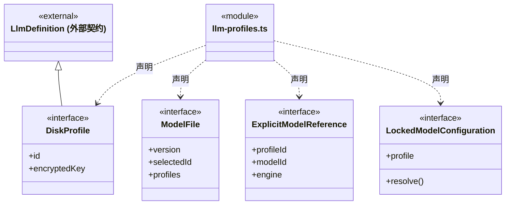
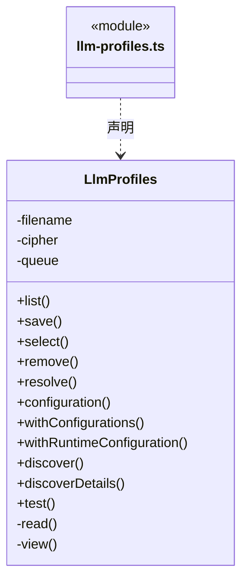
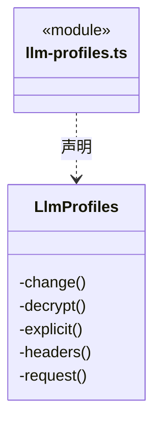
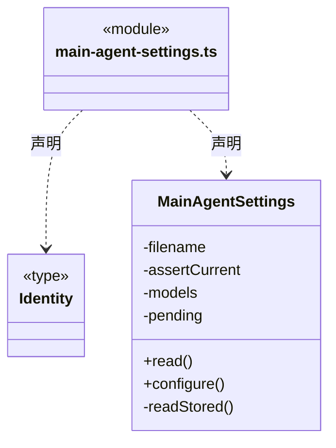
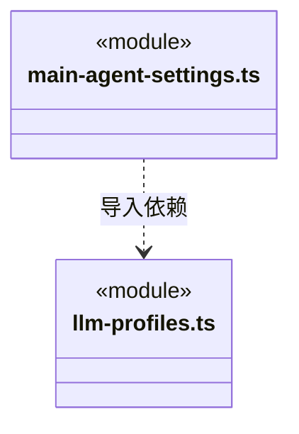

# src/backend/main/models 架构

## 目录定位

模型配置、密钥保护、认证与参数迁移。持有本机配置和凭据，公开能力契约位于 Core/models。

本文描述当前实现。通过分析目录边界后维护的 [源码架构脚本](../../../../scripts/source-architecture.mjs) 同步清单和声明；代码变更时仍须核对职责、关键成员与关系。

## 代码清单

| 文件 | 当前职责 |
| --- | --- |
| [llm-profiles.ts](llm-profiles.ts) | 本机供应商配置持久化、默认模型选择和连接检测。 |
| [main-agent-settings.ts](main-agent-settings.ts) | 保存工作区主 Agent 的引擎和模型，两处界面共用这一份配置。 |

## 架构类图

### llm-profiles.ts

成员 1/2（同名节点为同一声明，跨图合并阅读）。

成员 2/2（同名节点为同一声明，跨图合并阅读）。

直接依赖：[../../core/models/engine.ts](../../core/models/engine.ts)、[../../core/models/catalog.ts](../../core/models/catalog.ts)、[../../core/foundation/files.ts](../../core/foundation/files.ts)、[../../core/foundation/errors.ts](../../core/foundation/errors.ts)、[../../core/models/config.ts](../../core/models/config.ts)、[../../core/models/ports.ts](../../core/models/ports.ts)。

### main-agent-settings.ts

直接依赖：[../../core/foundation/files.ts](../../core/foundation/files.ts)、[../../core/foundation/errors.ts](../../core/foundation/errors.ts)、[../../core/models/engine.ts](../../core/models/engine.ts)、[../../core/team/agent-runtime.ts](../../core/team/agent-runtime.ts)、[llm-profiles.ts](llm-profiles.ts)。

### 本目录调用边界

## 子目录导航

无子目录。

[返回上层](../ARCHITECTURE.md)。

每次修改本目录代码，同步维护文件头、关键契约说明及本图。未实现的治理、证据验收和自动编排能力不列入当前类图。
