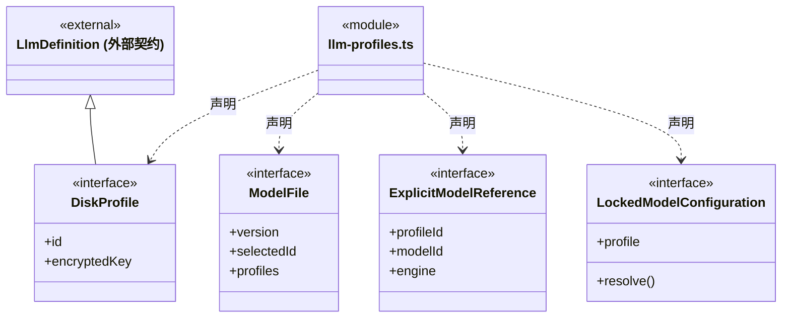
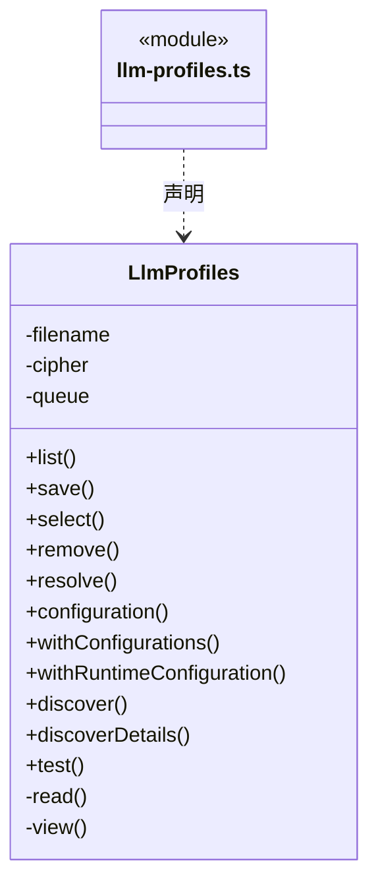
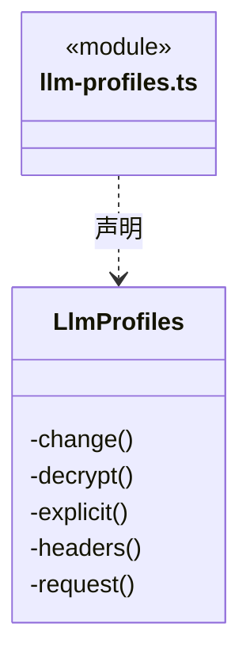
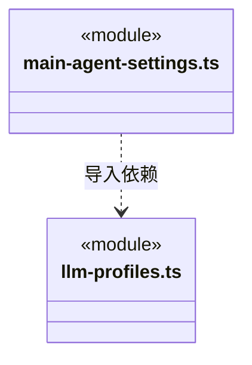

# src/backend/main/models 架构

## 目录定位

模型配置、密钥保护、认证与参数迁移。持有本机配置和凭据，公开能力契约位于 Core/models。

本文描述当前实现。通过分析目录边界后维护的 [源码架构脚本](../../../../scripts/source-architecture.mjs) 同步清单和声明；代码变更时仍须核对职责、关键成员与关系。

## 代码清单

| 文件 | 当前职责 |
| --- | --- |
| [llm-profiles.ts](llm-profiles.ts) | 本机供应商配置持久化、默认模型选择和连接检测。 |
| [main-agent-settings.ts](main-agent-settings.ts) | 保存工作区主 Agent 的引擎和模型，两处界面共用这一份配置。 |

## 架构类图

### llm-profiles.ts

成员 1/2（同名节点为同一声明，跨图合并阅读）。

成员 2/2（同名节点为同一声明，跨图合并阅读）。

直接依赖：[../../../foundations/concurrency/index.ts](../../../foundations/concurrency/index.ts)、[../../core/models/engine.ts](../../core/models/engine.ts)、[../../core/models/provider-connections.ts](../../core/models/provider-connections.ts)、[../../core/models/catalog.ts](../../core/models/catalog.ts)、[../../../foundations/files/index.ts](../../../foundations/files/index.ts)、[../../core/foundation/errors.ts](../../core/foundation/errors.ts)、[../../core/models/config.ts](../../core/models/config.ts)、[../../core/models/ports.ts](../../core/models/ports.ts)。

### main-agent-settings.ts

直接依赖：[../../../foundations/concurrency/index.ts](../../../foundations/concurrency/index.ts)、[../../../foundations/files/index.ts](../../../foundations/files/index.ts)、[../../core/foundation/errors.ts](../../core/foundation/errors.ts)、[../../core/models/engine.ts](../../core/models/engine.ts)、[../../core/team/agent-runtime.ts](../../core/team/agent-runtime.ts)、[llm-profiles.ts](llm-profiles.ts)。

### 本目录调用边界

## 子目录导航

无子目录。

[返回上层](../ARCHITECTURE.md)。

每次修改本目录代码，同步维护文件头、关键契约说明及本图。未实现的治理、证据验收和自动编排能力不列入当前类图。

## 设计契约 v1 与落地范围

以下内容区分已接通能力与后续设计；以各节的实现状态为准，不将目标图当作现状图。维护源：[CONTRACT.md](CONTRACT.md)；生成类图时同步附加，勿直接修改本附录。

# 模型配置与接口解析

## 通用机制与模型决策

`LlmProfiles` 与 `MainAgentSettings` 分别拥有 `foundations/concurrency` 的 `SerialQueue`，组合 `foundations/files` 进行文件替换。串行执行与临时文件清理是基础机制；选型校验、历史快照兼容、密钥、revision 和锁内解析仍由模型服务持有。调用者能观察本次失败，后续任务继续排队；不改变现有回调期间持锁范围，不引入跨实例互斥或自动重试。

LlmProfiles 持有供应商目录与唯一 encryptedKey；Core 的 connectionForEngine 只做公开接口投影。configuration、withConfigurations、withRuntimeConfiguration 与 resolve 在同一选型入口核实型号、启用状态和目标引擎接口，再形成不带候选地址的单次运行快照。只有 resolve 或受控锁内 resolve 解密，选择模型或读取目录不联网。

主接口改动及新增/更改自定义兼容地址时，保存必须重新输入 Key；仅改名、改型号范围或移除兼容接口可保留已保存密钥。自动识别只匹配 provider-presets 的精确官方地址，旧文件无需迁移或复制供应商，特殊套餐、地区及代理不会被品牌名覆盖。实际请求固定选中的地址，失败不切换协议、不重发，也不删除目录。

test(id, modelId?, engine?) 与运行共用解析，省略引擎保持原主接口。它只向已保存接口发送短文本，回执带实际引擎、协议、地址和耗时；错误仅提供安全地址、HTTP 状态与建议，不公开上游正文。测试不保存“全能力兼容”状态，不证明真实引擎工具、流式、额度或业务验收。设置队列、岗位配置锁与延迟解密的生命周期保持原有规则。
