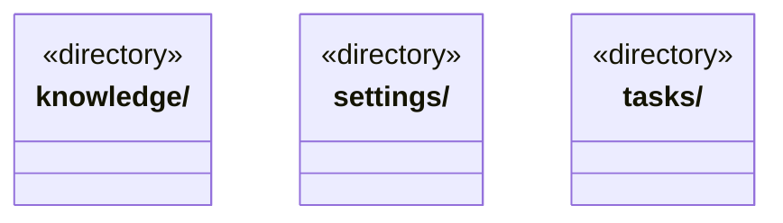

# src/backend/main/persistence 架构

## 目录定位

本机持久化适配：知识事务、运行日志、对话附件、模型配置。保留原数据路径与格式，目录调整不迁移用户数据。

本文描述当前实现。通过分析目录边界后维护的 [源码架构脚本](../../../../scripts/source-architecture.mjs) 同步清单和声明；代码变更时仍须核对职责、关键成员与关系。

## 代码清单

本层无直接代码文件。

## 架构类图

各图中的同名节点表示同一目录边界；跨组及完整直接依赖如下（无边不代表继承）：

本层无目录间直接导入关系。

## 子目录导航

- [knowledge/](knowledge/ARCHITECTURE.md)：正式知识文件读取、初始化、事务恢复和对象计划缓存。提交串行化，回滚不覆盖外部修改，清理仅删除空目录。
- [settings/](settings/ARCHITECTURE.md)：应用级供应商和模型配置存储。密钥经注入的系统加密端口保存，不在公开 IPC 返回。
- [tasks/](tasks/ARCHITECTURE.md)：执行日志、附件快照、派发事务与角色履历。目标摘要增量从既有事务重放派生，保留有界增量窗及完整原日志；同屏障读取图/目标/详情，无变化不重传原文。身份与哈希链异常拒绝，未知操作不自动重放。

[返回上层](../ARCHITECTURE.md)。

每次修改本目录代码，同步维护文件头、关键契约说明及本图。未实现的治理、证据验收和自动编排能力不列入当前类图。
