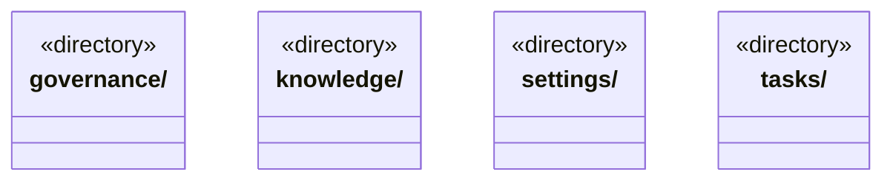

# src/backend/main/persistence 架构

## 目录定位

本机持久化适配：知识事务、运行日志、对话附件、模型配置。保留原数据路径与格式，目录调整不迁移用户数据。

本文描述当前实现。通过分析目录边界后维护的 [源码架构脚本](../../../../scripts/source-architecture.mjs) 同步清单和声明；代码变更时仍须核对职责、关键成员与关系。

## 代码清单

本层无直接代码文件。

## 架构类图

各图中的同名节点表示同一目录边界；跨组及完整直接依赖如下（无边不代表继承）：

本层无目录间直接导入关系。

## 子目录导航

- [governance/](governance/ARCHITECTURE.md)：私有治理记录的有界严格持久化，核对真实来源、原命令指纹与不可变提案；旧数据不补造来源，不反向调用知识事务或创建第二条提交队列。
- [knowledge/](knowledge/ARCHITECTURE.md)：正式知识文件、事务恢复与私有计划缓存。完整原journal先于来源pending，获准后才写知识；成功后仅补来源结算，不因回包失败回滚。未获准prepared只核before而不覆盖外部文件；来源历史缺日志保持故障。Knowledge队列在Dispatch事务之前，清理仅删除空目录。
- [settings/](settings/ARCHITECTURE.md)：应用级模型、并发与新目标软限额存储。密钥系统加密；策略串行版本校验与原子保存，缺文件才使用默认值。软限额只冻结新周期，设置恢复不重放模型或改变既有目标。 公开配置批量短锁与运行配置捕获使用同一设置队列；解密只在领取准入成功后，捕获后编辑不热替换本段。
- [tasks/](tasks/ARCHITECTURE.md)：执行日志、附件快照、派发事务与角色履历。目录首层、URL指针、真实有界网页及授权仓库资料快照分别保存，导入取消与等待受理分离；来源变化不改历史。日志只读完整前缀并报告未完整尾行，损坏不透传原始片段、不截断修复。图/目标/详情同屏障读取，未知操作不自动重放。同日志追加岗位审计并派生独立registry游标，原命令可只读核实，不将长期岗位计为运行实例。 新事务标记由Store生成，旧日志前缀可读而不能在新协议后降级；新任务/准备与历史岗位审计严格对应。 原命令证据索引从真实已保存事务前态派生，保留原根修订与日志协议；不重写历史或按当前图补造依据。

[返回上层](../ARCHITECTURE.md)。

每次修改本目录代码，同步维护文件头、关键契约说明及本图。未实现的治理、证据验收和自动编排能力不列入当前类图。
