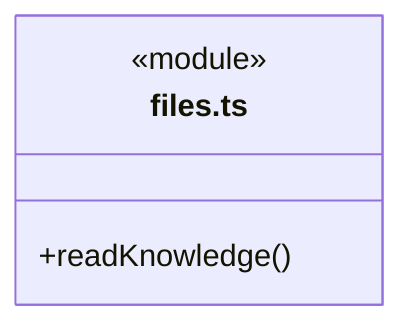
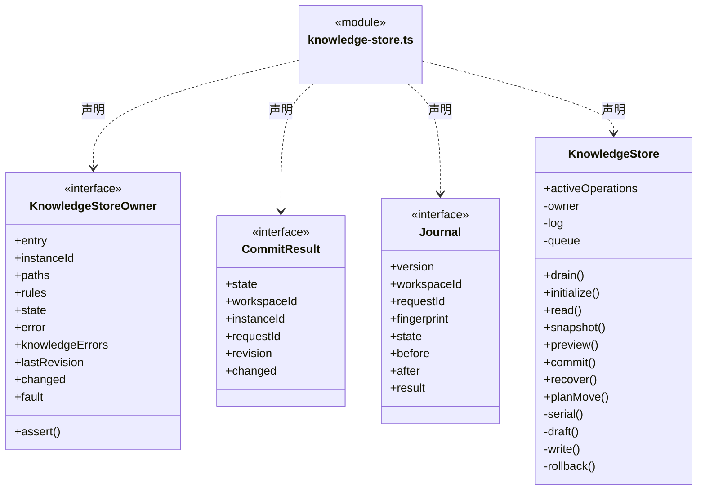
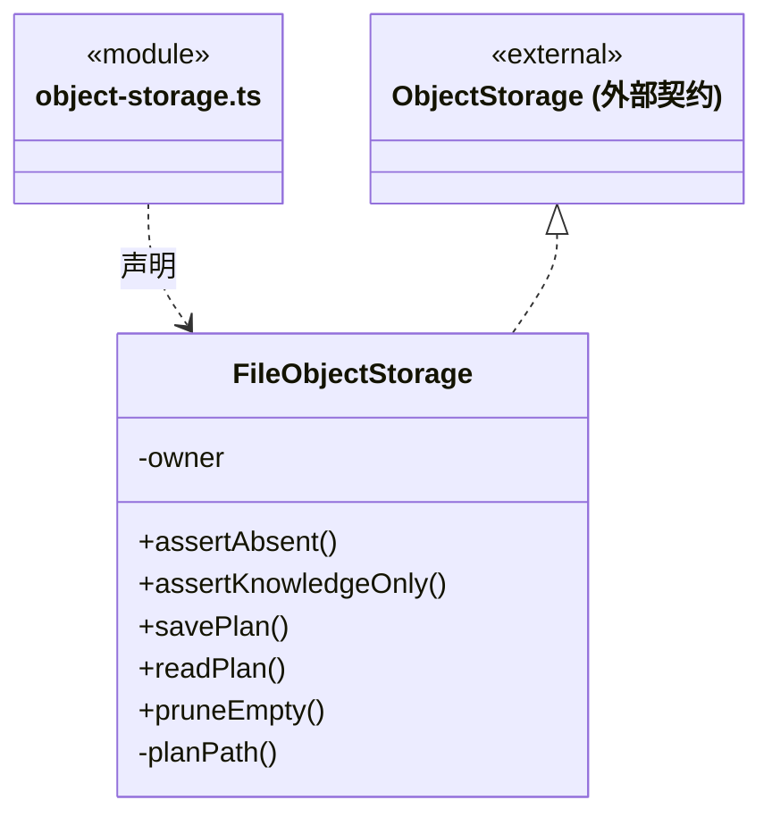
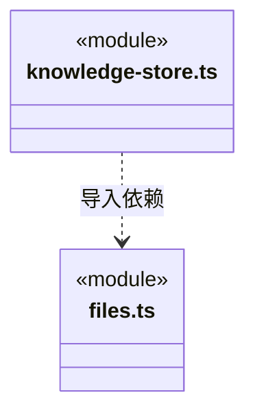

# src/backend/main/persistence/knowledge 架构

## 目录定位

正式知识文件读取、初始化、事务恢复和对象计划缓存。提交串行化，回滚不覆盖外部修改，清理仅删除空目录。

本文描述当前实现。通过分析目录边界后维护的 [源码架构脚本](../../../../../scripts/source-architecture.mjs) 同步清单和声明；代码变更时仍须核对职责、关键成员与关系。

## 代码清单

| 文件 | 当前职责 |
| --- | --- |
| [files.ts](files.ts) | 从本机项目读取受控的正式知识文件。 |
| [knowledge-store.ts](knowledge-store.ts) | 本机知识存储，承担初始化、快照、预览、串行事务、索引写入和崩溃恢复。 |
| [object-storage.ts](object-storage.ts) | 对象预览缓存、目录存在性检查和提交后空目录清理的本机实现。 |

## 架构类图

### files.ts

直接依赖：[../../../core/foundation/paths.ts](../../../core/foundation/paths.ts)、[../../../core/knowledge/types.ts](../../../core/knowledge/types.ts)、[../../../core/knowledge/knowledge.ts](../../../core/knowledge/knowledge.ts)、[../../../core/foundation/errors.ts](../../../core/foundation/errors.ts)、[../../../core/foundation/serialization.ts](../../../core/foundation/serialization.ts)、[../../../core/foundation/files.ts](../../../core/foundation/files.ts)。

### knowledge-store.ts

直接依赖：[files.ts](files.ts)、[../../../core/foundation/files.ts](../../../core/foundation/files.ts)、[../../../core/foundation/serialization.ts](../../../core/foundation/serialization.ts)、[../../../core/foundation/errors.ts](../../../core/foundation/errors.ts)、[../../../core/foundation/paths.ts](../../../core/foundation/paths.ts)、[../../../core/knowledge/knowledge.ts](../../../core/knowledge/knowledge.ts)、[../../../core/knowledge/types.ts](../../../core/knowledge/types.ts)。

### object-storage.ts

直接依赖：[../../../core/knowledge/object-storage.ts](../../../core/knowledge/object-storage.ts)、[../../../core/knowledge/types.ts](../../../core/knowledge/types.ts)、[../../../core/foundation/paths.ts](../../../core/foundation/paths.ts)、[../../../core/foundation/files.ts](../../../core/foundation/files.ts)、[../../../core/foundation/serialization.ts](../../../core/foundation/serialization.ts)、[../../../core/foundation/errors.ts](../../../core/foundation/errors.ts)。

### 本目录调用边界

## 子目录导航

无子目录。

[返回上层](../ARCHITECTURE.md)。

每次修改本目录代码，同步维护文件头、关键契约说明及本图。未实现的治理、证据验收和自动编排能力不列入当前类图。
