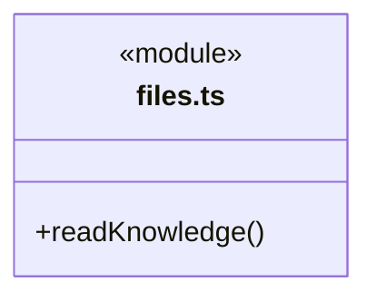
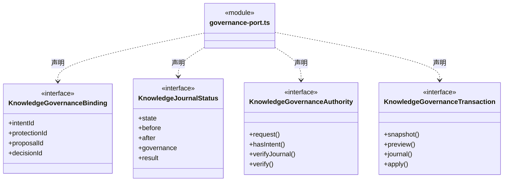
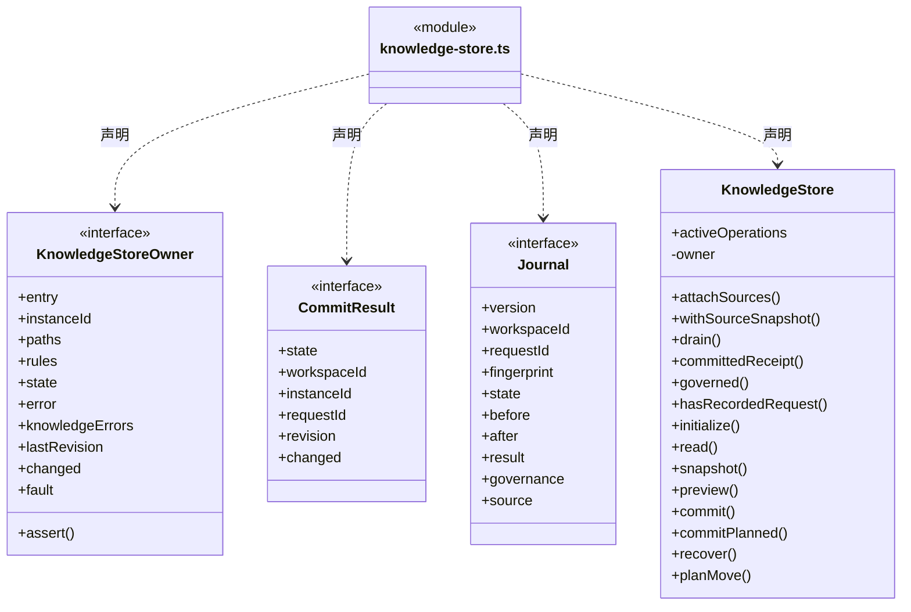
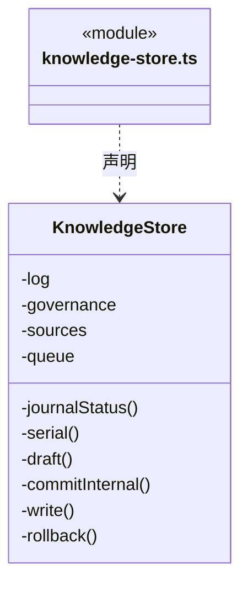
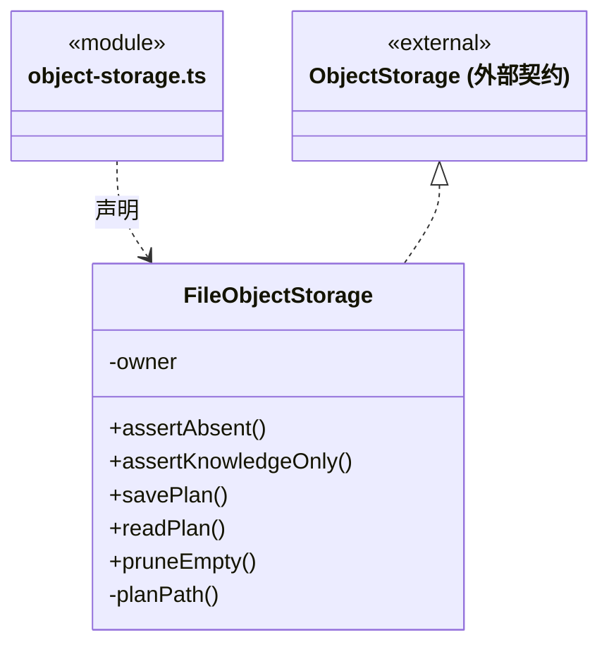
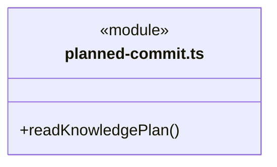
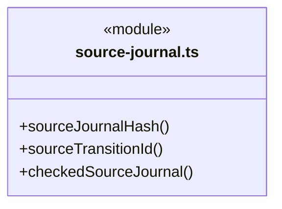
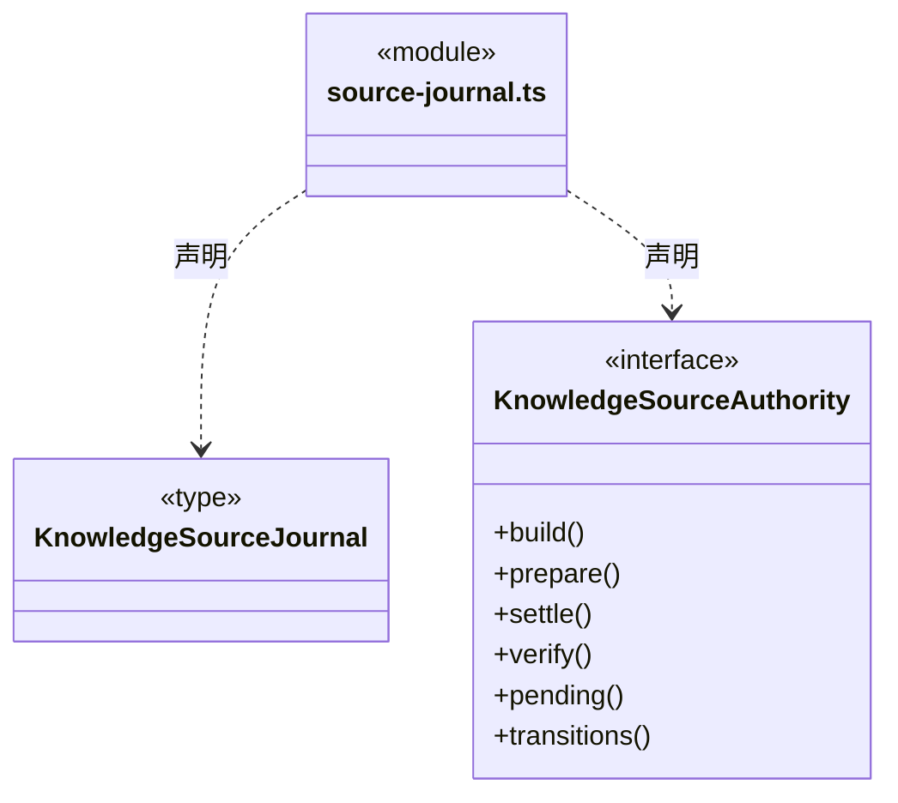
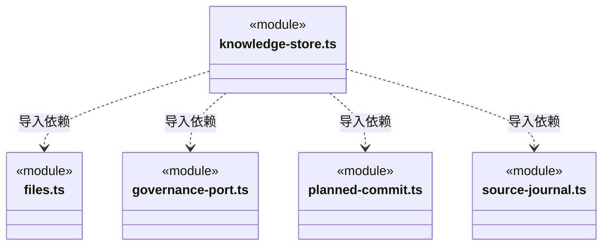

# src/backend/main/persistence/knowledge 架构

## 目录定位

正式知识文件、事务恢复与私有计划缓存。完整原journal先于来源pending，获准后才写知识；成功后仅补来源结算，不因回包失败回滚。未获准prepared只核before而不覆盖外部文件；来源历史缺日志保持故障。Knowledge队列在Dispatch事务之前，清理仅删除空目录。

本文描述当前实现。通过分析目录边界后维护的 [源码架构脚本](../../../../../scripts/source-architecture.mjs) 同步清单和声明；代码变更时仍须核对职责、关键成员与关系。

## 代码清单

| 文件 | 当前职责 |
| --- | --- |
| [files.ts](files.ts) | 从本机项目读取受控的正式知识文件。 |
| [governance-port.ts](governance-port.ts) | 知识物理事务与私有治理账本之间的窄端口；仅供 Main 的可信工作区装配。 |
| [knowledge-store.ts](knowledge-store.ts) | 本机知识存储，承担初始化、快照、预览、串行事务、索引写入和崩溃恢复。 |
| [object-storage.ts](object-storage.ts) | 对象预览缓存、目录存在性检查和提交后空目录清理的本机实现。 |
| [planned-commit.ts](planned-commit.ts) | 从固定私有缓存读取对象及资源包计划，向知识事务提供原请求与经过核实的不可变语义。 |
| [source-journal.ts](source-journal.ts) | 知识 journal 的来源绑定与完整性核实，独立于两个存储队列。 |

## 架构类图

### files.ts

直接依赖：[../../../core/foundation/paths.ts](../../../core/foundation/paths.ts)、[../../../core/knowledge/types.ts](../../../core/knowledge/types.ts)、[../../../core/knowledge/knowledge.ts](../../../core/knowledge/knowledge.ts)、[../../../core/foundation/errors.ts](../../../core/foundation/errors.ts)、[../../../core/foundation/serialization.ts](../../../core/foundation/serialization.ts)、[../../../core/foundation/files.ts](../../../core/foundation/files.ts)。

### governance-port.ts

直接依赖：[../../../core/knowledge/types.ts](../../../core/knowledge/types.ts)、[../../../core/knowledge/ports.ts](../../../core/knowledge/ports.ts)。

### knowledge-store.ts

成员 1/2（同名节点为同一声明，跨图合并阅读）。

成员 2/2（同名节点为同一声明，跨图合并阅读）。

直接依赖：[files.ts](files.ts)、[../../../core/foundation/files.ts](../../../core/foundation/files.ts)、[../../../core/foundation/serialization.ts](../../../core/foundation/serialization.ts)、[../../../core/foundation/errors.ts](../../../core/foundation/errors.ts)、[../../../core/foundation/paths.ts](../../../core/foundation/paths.ts)、[../../../core/knowledge/knowledge.ts](../../../core/knowledge/knowledge.ts)、[../../../core/knowledge/types.ts](../../../core/knowledge/types.ts)、[governance-port.ts](governance-port.ts)、[planned-commit.ts](planned-commit.ts)、[../../../core/knowledge/planned-commit.ts](../../../core/knowledge/planned-commit.ts)、[source-journal.ts](source-journal.ts)。

### object-storage.ts

直接依赖：[../../../core/knowledge/object-storage.ts](../../../core/knowledge/object-storage.ts)、[../../../core/knowledge/types.ts](../../../core/knowledge/types.ts)、[../../../core/foundation/paths.ts](../../../core/foundation/paths.ts)、[../../../core/foundation/files.ts](../../../core/foundation/files.ts)、[../../../core/foundation/serialization.ts](../../../core/foundation/serialization.ts)、[../../../core/foundation/errors.ts](../../../core/foundation/errors.ts)。

### planned-commit.ts

直接依赖：[../../../core/foundation/errors.ts](../../../core/foundation/errors.ts)、[../../../core/foundation/serialization.ts](../../../core/foundation/serialization.ts)、[../../../core/knowledge/planned-commit.ts](../../../core/knowledge/planned-commit.ts)、[../../../core/foundation/paths.ts](../../../core/foundation/paths.ts)、[../../../core/knowledge/types.ts](../../../core/knowledge/types.ts)。

### source-journal.ts

直接依赖：[../../../core/foundation/serialization.ts](../../../core/foundation/serialization.ts)、[../../../core/foundation/errors.ts](../../../core/foundation/errors.ts)、[../../../core/knowledge/planned-commit.ts](../../../core/knowledge/planned-commit.ts)、[../../../core/workspace/knowledge-source.ts](../../../core/workspace/knowledge-source.ts)、[../../../core/workspace/knowledge-source-rules.ts](../../../core/workspace/knowledge-source-rules.ts)、[../../../core/knowledge/types.ts](../../../core/knowledge/types.ts)。

### 本目录调用边界

## 子目录导航

无子目录。

[返回上层](../ARCHITECTURE.md)。

每次修改本目录代码，同步维护文件头、关键契约说明及本图。未实现的治理、证据验收和自动编排能力不列入当前类图。

## 设计契约 v1 与落地范围

以下内容区分已接通能力与后续设计；以各节的实现状态为准，不将目标图当作现状图。维护源：[CONTRACT.md](CONTRACT.md)；生成类图时同步附加，勿直接修改本附录。

# 正式知识物理事务

`KnowledgeStore` 是正式知识写入的唯一串行队列。所有普通提交继续核实例、读取版本、完整结构、逐文件外部冲突及原请求幂等；治理登记和决定通过 `governed` 共享此队列，避免批准检查与提交之间出现其他决定或写入。

`governance-port.ts` 只声明 Main 内部端口，不进入 ChangeRequest 或模型工具输入。普通 `commit(request)` 永远不接 permit。可信 `apply(intentId)` 由私有治理账本解析精确请求，最终投影门禁在 prepared journal 之前执行；任何准备失败都不取得额外权限。

Journal 的可选 governance 绑定保留 intent/protection/proposal/decision ID；旧无治理日志保持兼容。只读原回执同时核完整请求指纹、before/after 键和值、请求差异、派生索引范围及 committed.changed。治理日志再核私有提案的精确前后正文；仅形状合法的 result 不代表真实知识已提交。

新提交在进入队列和开始时仍要求 running。已经开始事务、正在验证投影或治理门禁时，close/restart 只进入 closing 并等待 drain；门禁返回后继续核原身份和知识版本，不把 closing 当成取消已受理提交。治理实施在进入实际知识事务之后遵循同一规则；尚未开始的旧意图不会因此自动执行。

重开对原未完成事务执行既有安全回滚，不重放实施意图。治理记录按文件 ID 和私有 intent 双向识别，在回滚前验证来源；删除 journal 内的 governance 字段不能绕过核验。已提交之后的展示或响应失败不会撤销知识结果，后续查询只读取原日志。关闭等待队列排空再释放工作区锁。

## 来源代次握手与原日志恢复

固定 `planned-commit.ts` 加载器只读取本工作区 object-plans/resource-imports 的原计划；`source-journal.ts` 绑定完整原请求、不可变计划、before/after 哈希及同一 DispatchStore 的过渡。知识串行队列先校验与预留来源容量，再写 prepared journal、可靠保存 Store pending，之后才允许 committing 与知识文件写入。知识队列可等待 Store，Store 回调不重新排队知识操作。

原 committed 落盘后，来源 final 与 committed 通知在文件回滚 catch 之外。结算失败保留真实知识成果；重开只按同一 journal 补原 resolved，不再执行请求。原日志缺失、被删除来源标记、身份/指纹/正文不符或 committing/committed 缺原 pending 都拒绝恢复。

prepared 保存或 Store prepare 异常时，只有严格核实原 Store 屏障才能继续提供只读诊断；否则实例进入 recovery_required，防止后来事务覆盖未核实的 before。重开遇 prepared 且无 Store 受理，只能在全部文件仍等 before 时标 rolled_back，绝不把外部恰等 after 的内容写回；冲突零文件写并保留证据。旧无来源 journal 保留原恢复协议，不自动升级或补造来源。

`withSourceSnapshot` 为明确岗位/责任采纳固定知识快照，再进入唯一 Store；关闭先 drain 该队列与来源结算，再关闭 Store 和释放工作区锁。
