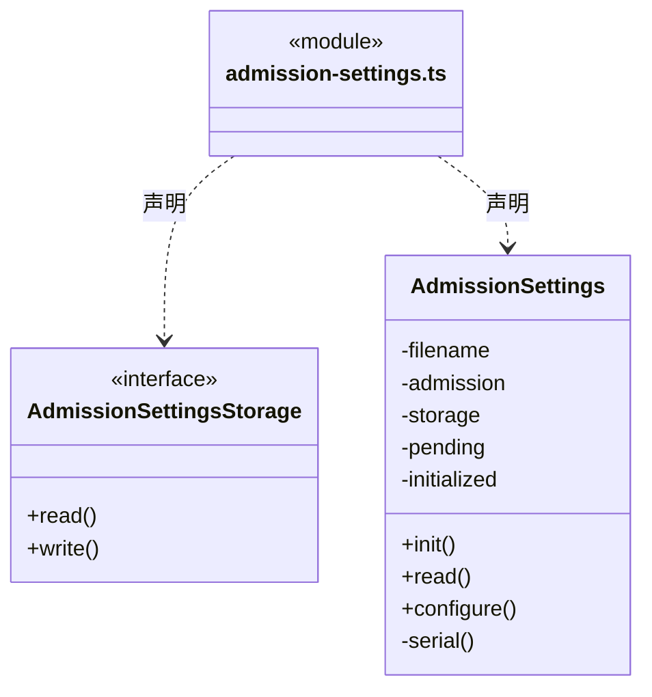
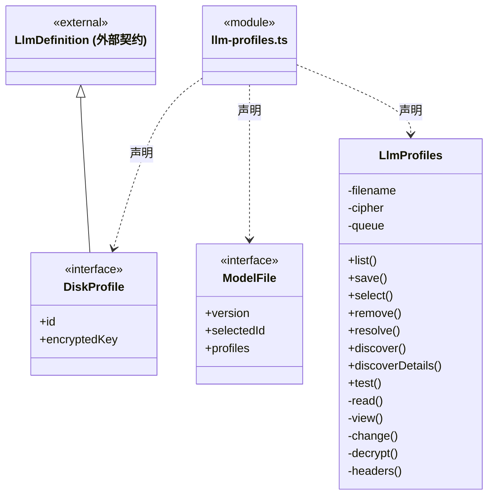
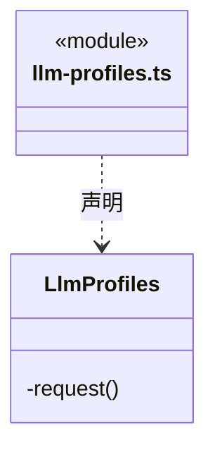

# src/backend/main/persistence/settings 架构

## 目录定位

应用级模型及并发设置存储。密钥由系统加密；并发策略版本化串行保存，写盘成功才应用，失败保留旧上限；工作区打开前恢复设置，不恢复排队模型。

本文描述当前实现。通过分析目录边界后维护的 [源码架构脚本](../../../../../scripts/source-architecture.mjs) 同步清单和声明；代码变更时仍须核对职责、关键成员与关系。

## 代码清单

| 文件 | 当前职责 |
| --- | --- |
| [admission-settings.ts](admission-settings.ts) | 持久化应用级并发上限，并在工作区装配前恢复准入策略。 |
| [llm-profiles.ts](llm-profiles.ts) | 本机供应商配置持久化、默认模型选择和连接检测。 |

## 架构类图

### admission-settings.ts

直接依赖：[../../../core/foundation/files.ts](../../../core/foundation/files.ts)、[../../../core/foundation/errors.ts](../../../core/foundation/errors.ts)、[../../../core/runtime/admission.ts](../../../core/runtime/admission.ts)、[../../../scheduler-engine/runtime/run-admission.ts](../../../scheduler-engine/runtime/run-admission.ts)。

### llm-profiles.ts

成员 1/2（同名节点为同一声明，跨图合并阅读）。

成员 2/2（同名节点为同一声明，跨图合并阅读）。

直接依赖：[../../../core/brain/llm/catalog.ts](../../../core/brain/llm/catalog.ts)、[../../../core/foundation/files.ts](../../../core/foundation/files.ts)、[../../../core/foundation/errors.ts](../../../core/foundation/errors.ts)、[../../../core/brain/llm/config.ts](../../../core/brain/llm/config.ts)、[../../../core/brain/llm/ports.ts](../../../core/brain/llm/ports.ts)。

## 子目录导航

无子目录。

[返回上层](../ARCHITECTURE.md)。

每次修改本目录代码，同步维护文件头、关键契约说明及本图。未实现的治理、证据验收和自动编排能力不列入当前类图。

## 设计契约 v1 与落地范围

以下内容区分已接通能力与后续设计；以各节的实现状态为准，不将目标图当作现状图。维护源：[CONTRACT.md](CONTRACT.md)；生成类图时同步附加，勿直接修改本附录。

# 本机设置持久化边界

`LlmProfiles` 管理供应商和模型配置，凭据通过平台注入的加密接口保存，运行时才解密。`AdmissionSettings` 独立管理全局执行并发配置，不能读取或修改模型凭据。

并发设置文件只保存 `version:1` 与 `policy:{revision,maxConcurrentRuns}`。默认 4，允许 1～32；应用在打开工作区前初始化一次，缺文件使用默认值，损坏文件明确失败而不覆盖。`read()` 只读已生效策略，`configure()` 用原版本串行校验，原子写盘成功后同步交给准入器。写入失败保持原限额，版本冲突要求刷新；降低上限不结束现有执行。

此目录不保存等待票据或执行许可。票据只属于当前进程的可信启动安排；重启不能通过设置文件自动恢复任务。并发数与 token/费用预算不同，后者尚未实现。
