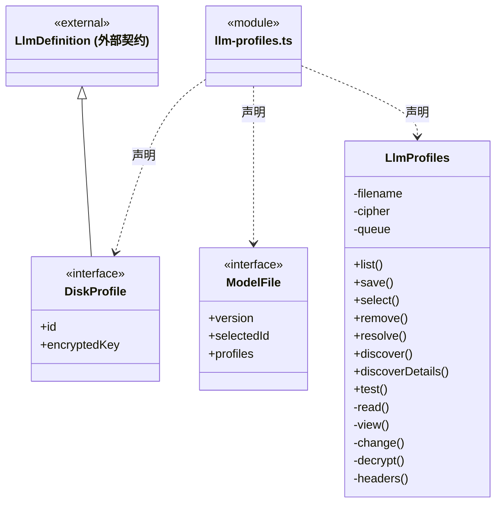
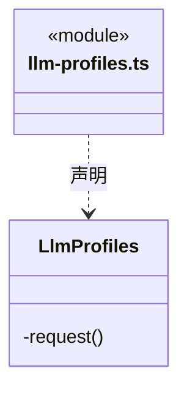

# src/backend/main/persistence/settings 架构

## 目录定位

应用级供应商和模型配置存储。密钥经注入的系统加密端口保存，不在公开 IPC 返回。

本文描述当前实现。通过分析目录边界后维护的 [源码架构脚本](../../../../../scripts/source-architecture.mjs) 同步清单和声明；代码变更时仍须核对职责、关键成员与关系。

## 代码清单

| 文件 | 当前职责 |
| --- | --- |
| [llm-profiles.ts](llm-profiles.ts) | 本机供应商配置持久化、默认模型选择和连接检测。 |

## 架构类图

### llm-profiles.ts

成员 1/2（同名节点为同一声明，跨图合并阅读）。

成员 2/2（同名节点为同一声明，跨图合并阅读）。

直接依赖：[../../../core/brain/llm/catalog.ts](../../../core/brain/llm/catalog.ts)、[../../../core/foundation/files.ts](../../../core/foundation/files.ts)、[../../../core/foundation/errors.ts](../../../core/foundation/errors.ts)、[../../../core/brain/llm/config.ts](../../../core/brain/llm/config.ts)、[../../../core/brain/llm/ports.ts](../../../core/brain/llm/ports.ts)。

## 子目录导航

无子目录。

[返回上层](../ARCHITECTURE.md)。

每次修改本目录代码，同步维护文件头、关键契约说明及本图。未实现的治理、证据验收和自动编排能力不列入当前类图。
