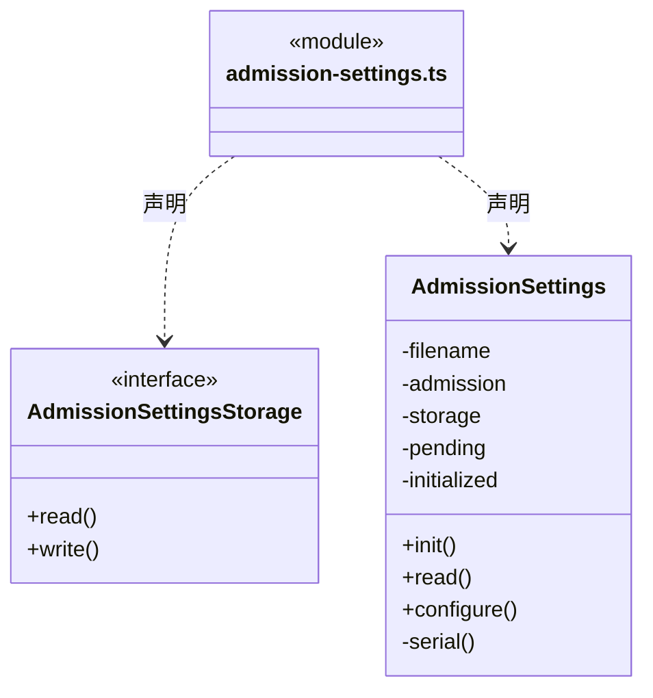
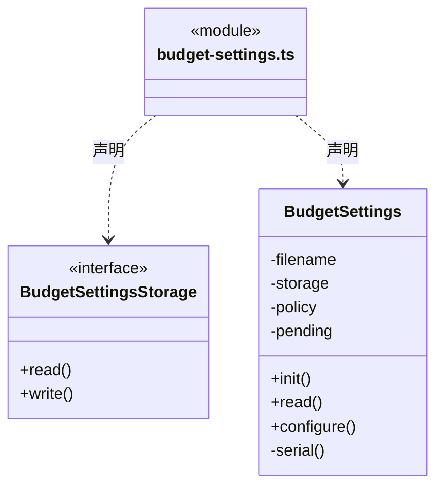
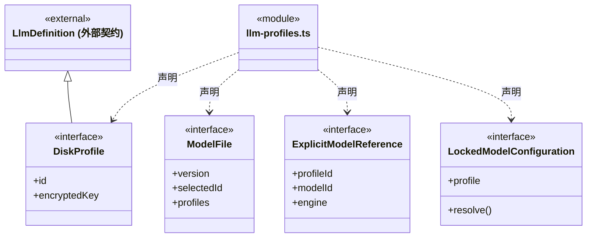
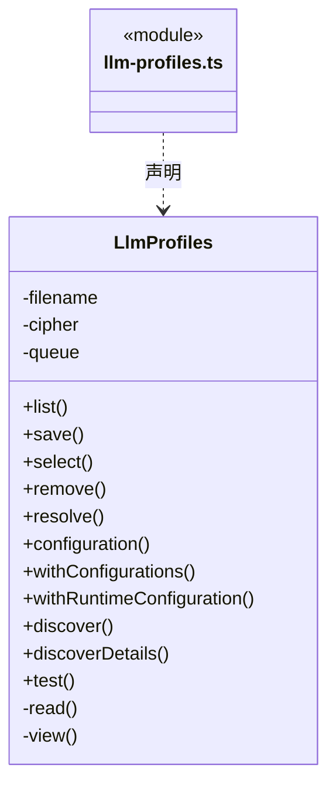
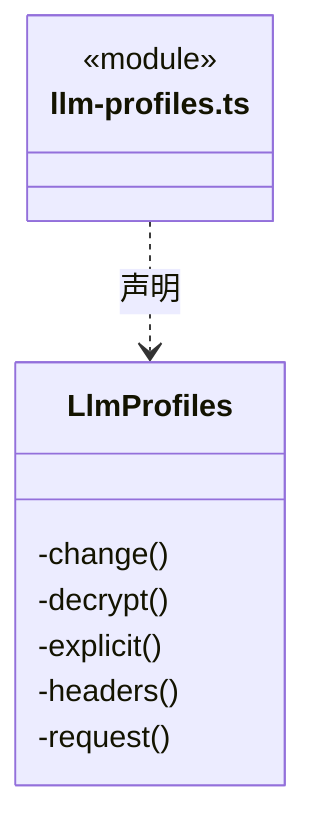
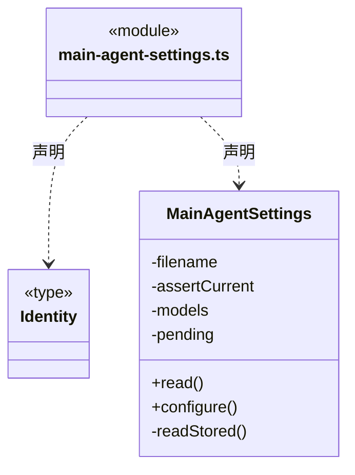
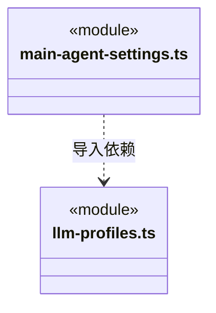

# src/backend/main/persistence/settings 架构

## 目录定位

应用级模型、并发与新目标软限额存储。密钥系统加密；策略串行版本校验与原子保存，缺文件才使用默认值。软限额只冻结新周期，设置恢复不重放模型或改变既有目标。 公开配置批量短锁与运行配置捕获使用同一设置队列；解密只在领取准入成功后，捕获后编辑不热替换本段。

本文描述当前实现。通过分析目录边界后维护的 [源码架构脚本](../../../../../scripts/source-architecture.mjs) 同步清单和声明；代码变更时仍须核对职责、关键成员与关系。

## 代码清单

| 文件 | 当前职责 |
| --- | --- |
| [admission-settings.ts](admission-settings.ts) | 持久化应用级并发上限，并在工作区装配前恢复准入策略。 |
| [budget-settings.ts](budget-settings.ts) | 可靠保存新目标的额度及显式逐请求模式，供调度器创建周期时冻结，缺省模式保留原软限额语义。 |
| [llm-profiles.ts](llm-profiles.ts) | 本机供应商配置持久化、默认模型选择和连接检测。 |
| [main-agent-settings.ts](main-agent-settings.ts) | 保存工作区主 Agent 的引擎和模型，两处界面共用这一份配置。 |

## 架构类图

### admission-settings.ts

直接依赖：[../../../core/foundation/files.ts](../../../core/foundation/files.ts)、[../../../core/foundation/errors.ts](../../../core/foundation/errors.ts)、[../../../core/runtime/admission.ts](../../../core/runtime/admission.ts)、[../../../scheduler-engine/runtime/run-admission.ts](../../../scheduler-engine/runtime/run-admission.ts)。

### budget-settings.ts

直接依赖：[../../../core/foundation/files.ts](../../../core/foundation/files.ts)、[../../../core/foundation/errors.ts](../../../core/foundation/errors.ts)、[../../../core/tasks/scope-budget.ts](../../../core/tasks/scope-budget.ts)。

### llm-profiles.ts

成员 1/2（同名节点为同一声明，跨图合并阅读）。

成员 2/2（同名节点为同一声明，跨图合并阅读）。

直接依赖：[../../../core/brain/llm/engine.ts](../../../core/brain/llm/engine.ts)、[../../../core/brain/llm/catalog.ts](../../../core/brain/llm/catalog.ts)、[../../../core/foundation/files.ts](../../../core/foundation/files.ts)、[../../../core/foundation/errors.ts](../../../core/foundation/errors.ts)、[../../../core/brain/llm/config.ts](../../../core/brain/llm/config.ts)、[../../../core/brain/llm/ports.ts](../../../core/brain/llm/ports.ts)。

### main-agent-settings.ts

直接依赖：[../../../core/foundation/files.ts](../../../core/foundation/files.ts)、[../../../core/foundation/errors.ts](../../../core/foundation/errors.ts)、[../../../core/brain/llm/engine.ts](../../../core/brain/llm/engine.ts)、[../../../core/team/agent-runtime.ts](../../../core/team/agent-runtime.ts)、[llm-profiles.ts](llm-profiles.ts)。

### 本目录调用边界

## 子目录导航

无子目录。

[返回上层](../ARCHITECTURE.md)。

每次修改本目录代码，同步维护文件头、关键契约说明及本图。未实现的治理、证据验收和自动编排能力不列入当前类图。

## 设计契约 v1 与落地范围

以下内容区分已接通能力与后续设计；以各节的实现状态为准，不将目标图当作现状图。维护源：[CONTRACT.md](CONTRACT.md)；生成类图时同步附加，勿直接修改本附录。

# 本机设置持久化边界

`LlmProfiles` 管理供应商和模型配置，凭据通过平台注入的加密接口保存，运行时才解密。`AdmissionSettings` 独立管理全局执行并发配置，不能读取或修改模型凭据。

`configuration(profileId,modelId,engine?)` 供岗位登记读取明确选定的公开模型快照，与真实运行共用同一纯选型函数。必须给出两个标识，不使用默认选择，不解密、不调用网络；无供应商、缺模型或禁用模型会拒绝。输出只包含实际运行公开 profile 字段，不含 apiKey、encryptedKey、hasKey 或默认选择。配置可读不代表凭据有效或模型可执行。

`withConfigurations` 在与 save/remove/select 相同的队列中一次固定多岗位公开配置，供 Knowledge → 模型配置 → DispatchStore 的短事务使用。`withRuntimeConfiguration` 另提供限回调期间使用的 resolve，预算和占用通过后只解密该已捕获定义，不读盘、不重新排队、不联网。领取提交后放锁，真正引擎沿原闭包启动；后来的配置修改不热替换已领取运行。凭据不进入任务、绑定、公开指纹或运行日志。

并发设置文件只保存 `version:1` 与 `policy:{revision,maxConcurrentRuns}`。默认 4，允许 1～32；应用在打开工作区前初始化一次，缺文件使用默认值，损坏文件明确失败而不覆盖。`read()` 只读已生效策略，`configure()` 用原版本串行校验，原子写盘成功后同步交给准入器。写入失败保持原限额，版本冲突要求刷新；降低上限不结束现有执行。

`BudgetSettings` 独立保存新周期默认软限额 `version:1 + policy:{revision,enabled,limits}`。默认关闭，启用须明确正整数 Token 或正数估算美元；应用装配前恢复，只有缺文件可默认关闭。损坏配置明确失败；串行版本校验和原子写入通过后才更新内存，读取返回深拷贝。新周期冻结策略，已有周期不跟随设置改变，设置本身不保存或更改用量。

此目录不保存等待票据或执行许可。票据只属于当前进程的可信启动安排；重启不能通过设置文件自动恢复任务。并发数与周期软限额不同，后者仅在真实运行之间核实，不保证一次 Pi 内多个请求、重试和摘要的硬账单上限。

## 逐请求预算（R06）

额度策略新增显式 `enforcement: request`；字段缺省继续表示运行间软限额，相同配置判断包含模式。设置版本可靠原子保存，旧目标冻结策略不随全局修改。

### Agent 独立选型与历史兼容

显式连接测试失败返回安全端点（不含用户信息、查询串、片段）、HTTP 状态及鉴权/权限/端点/限流建议，不返回供应商错误正文；失败不写模型目录。模型 ID 不按品牌枚举转换，Claude Code 仅要求 Anthropic Messages 协议。

LlmProfiles 忽略旧供应商 engine，由调用方传入独立引擎，先核协议兼容性再生成公开快照；未传引擎不补 Pi 字段。岗位读取沿已经采纳的 snapshot.engine，保证旧原生岗位和缺省 Pi 的配置哈希可核实。无效、禁用或不兼容的选择明确拒绝。

MainAgentSettings 为每个工作区的 cbim:main 保存唯一选型，复用自定义 Agent 的 AgentModelSelection 契约。对话栏和团队页面共享 read/configure，不再把选型存入会话 localStorage；内置主 Agent 的能力文件不因此可编辑。文件保存 version、revision、selection，null 采用 Pi 与本机默认模型。configure 在当前实例和 revision 校验后持有模型短锁原子写盘；读写失败保留原文件，版本冲突不得自动覆盖。配置本身不触发执行，新发送冻结配置，已受理队列和运行保持原快照。
