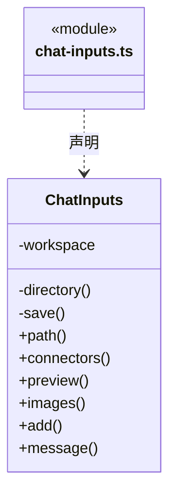
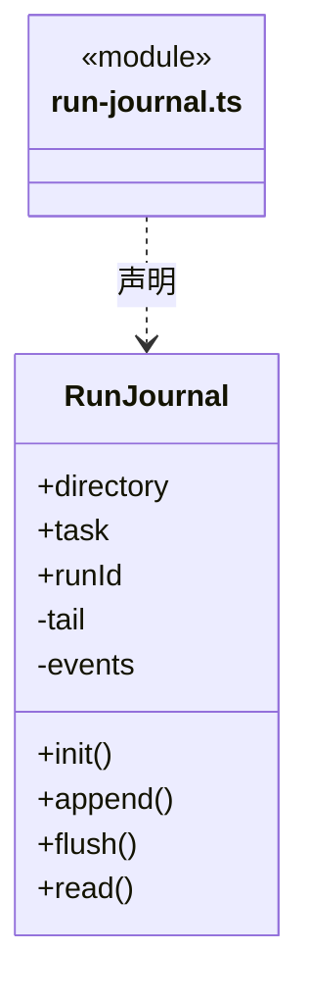
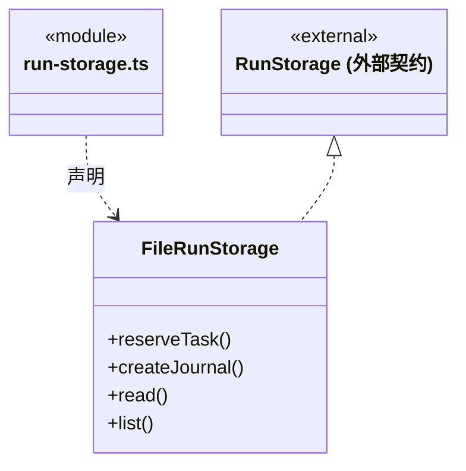
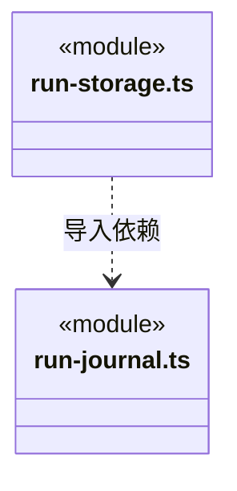

# src/backend/main/persistence/tasks 架构

## 目录定位

执行事件日志、存储端口实现及不可变附件快照。日志 fsync 后发布，图片独立保存并恢复为视觉输入。

本文描述当前实现。通过分析目录边界后维护的 [源码架构脚本](../../../../../scripts/source-architecture.mjs) 同步清单和声明；代码变更时仍须核对职责、关键成员与关系。

## 代码清单

| 文件 | 当前职责 |
| --- | --- |
| [chat-inputs.ts](chat-inputs.ts) | 将用户明确添加的文件、文件夹、链接、网页与链接器定义保存为本机对话输入快照。 |
| [run-journal.ts](run-journal.ts) | 本机执行事件日志，顺序追加并 fsync，从记录恢复摘要和未确认工具。 |
| [run-storage.ts](run-storage.ts) | 将本机运行目录和 RunJournal 装配为大脑及调度共享的存储端口。 |

## 架构类图

### chat-inputs.ts

直接依赖：[../../../core/foundation/files.ts](../../../core/foundation/files.ts)、[../../../core/knowledge/ports.ts](../../../core/knowledge/ports.ts)、[../../../../bridge/contracts/chat.ts](../../../../bridge/contracts/chat.ts)。

### run-journal.ts

直接依赖：[../../../core/brain/types.ts](../../../core/brain/types.ts)。

### run-storage.ts

直接依赖：[../../../core/brain/storage.ts](../../../core/brain/storage.ts)、[../../../core/tasks/types.ts](../../../core/tasks/types.ts)、[../../../core/foundation/identity.ts](../../../core/foundation/identity.ts)、[run-journal.ts](run-journal.ts)。

### 本目录调用边界

## 子目录导航

无子目录。

[返回上层](../ARCHITECTURE.md)。

每次修改本目录代码，同步维护文件头、关键契约说明及本图。未实现的治理、证据验收和自动编排能力不列入当前类图。
