# src/backend/main/persistence/tasks 架构

## 目录定位

执行日志、附件快照、派发事务与角色履历。目录首层、URL指针、真实有界网页及授权仓库资料快照分别保存，导入取消与等待受理分离；来源变化不改历史。日志只读完整前缀并报告未完整尾行，损坏不透传原始片段、不截断修复。图/目标/详情同屏障读取，未知操作不自动重放。同日志追加岗位审计并派生独立registry游标，原命令可只读核实，不将长期岗位计为运行实例。

本文描述当前实现。通过分析目录边界后维护的 [源码架构脚本](../../../../../scripts/source-architecture.mjs) 同步清单和声明；代码变更时仍须核对职责、关键成员与关系。

## 代码清单

| 文件 | 当前职责 |
| --- | --- |
| [agent-history.ts](agent-history.ts) | 把静态 Agent 的 Session 归档索引保存到应用用户目录，并为只读详情定位原运行日志。 |
| [chat-inputs.ts](chat-inputs.ts) | 将用户明确添加的文件、文件夹、链接、网页与链接器定义保存为本机对话输入快照。 |
| [chat-material-imports.ts](chat-material-imports.ts) | 应用内显式资料导入的取消、工作区归属及真实资源仓库读取入口。 |
| [chat-source-readers.ts](chat-source-readers.ts) | 桌面明确导入目录、URL 指针和网页时，生成有界文本及真实来源事实。 |
| [dispatch-store.ts](dispatch-store.ts) | 将长期岗位审计、执行实例、独立会话、任务图批次、领取意图和结果信封可靠保存到同一工作区日志。 |
| [run-journal.ts](run-journal.ts) | 本机执行事件日志，顺序追加并 fsync，从记录恢复摘要和未确认工具。 |
| [run-storage.ts](run-storage.ts) | 将本机运行目录和 RunJournal 装配为大脑及调度共享的存储端口。 |

## 架构类图

### agent-history.ts

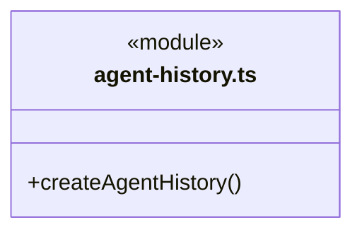

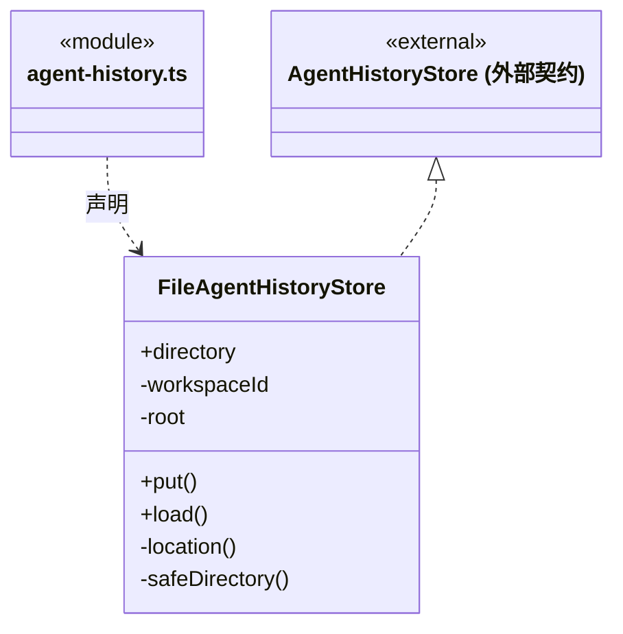

直接依赖：[../../../core/foundation/serialization.ts](../../../core/foundation/serialization.ts)、[../../../core/foundation/files.ts](../../../core/foundation/files.ts)、[../../../core/foundation/identity.ts](../../../core/foundation/identity.ts)、[../../../core/team/session-history-storage.ts](../../../core/team/session-history-storage.ts)、[../../../scheduler-engine/runtime/agent-history.ts](../../../scheduler-engine/runtime/agent-history.ts)、[../../workspace/workspace.ts](../../workspace/workspace.ts)、[run-storage.ts](run-storage.ts)。

### chat-inputs.ts

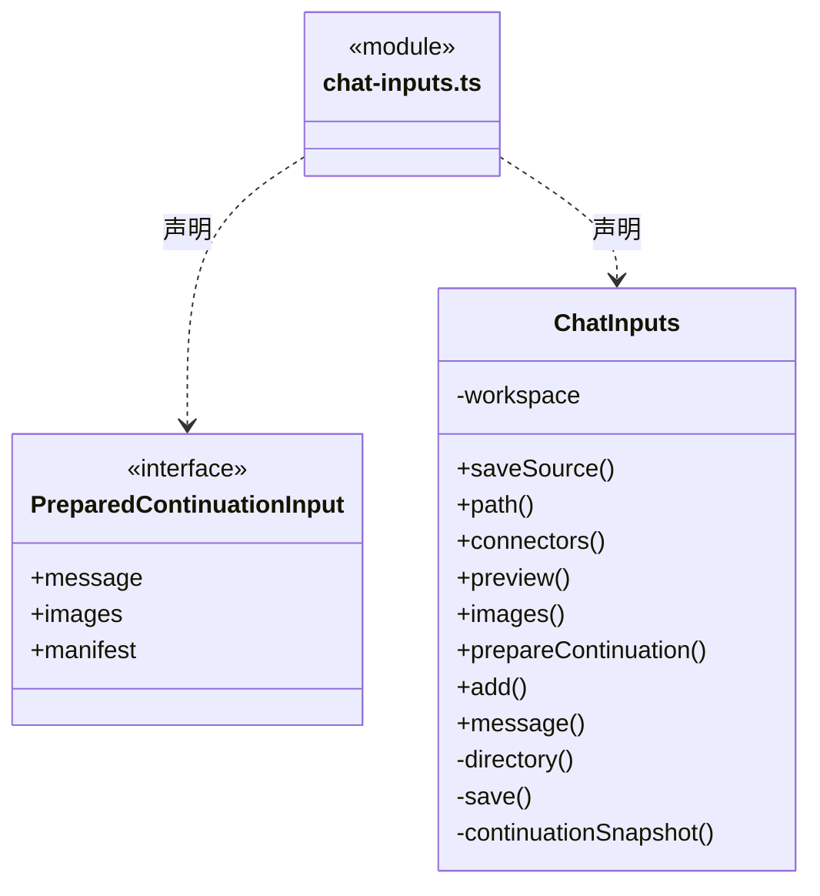

直接依赖：[../../../core/foundation/files.ts](../../../core/foundation/files.ts)、[../../../core/foundation/serialization.ts](../../../core/foundation/serialization.ts)、[../../../core/foundation/errors.ts](../../../core/foundation/errors.ts)、[../../../core/tasks/scope-continuation-attachments.ts](../../../core/tasks/scope-continuation-attachments.ts)、[../../../core/brain/types.ts](../../../core/brain/types.ts)、[../../../core/knowledge/ports.ts](../../../core/knowledge/ports.ts)、[../../../../bridge/contracts/chat.ts](../../../../bridge/contracts/chat.ts)、[../../../core/tasks/continuation-source-snapshot.ts](../../../core/tasks/continuation-source-snapshot.ts)、[chat-source-readers.ts](chat-source-readers.ts)。

### chat-material-imports.ts

成员 1/2（同名节点为同一声明，跨图合并阅读）。

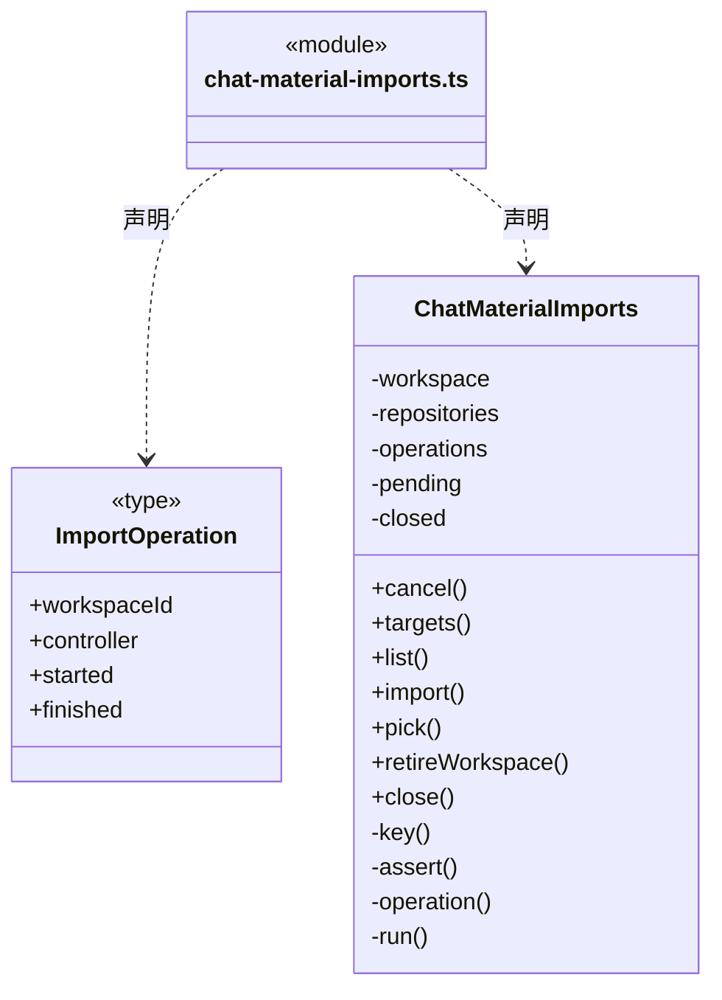

成员 2/2（同名节点为同一声明，跨图合并阅读）。

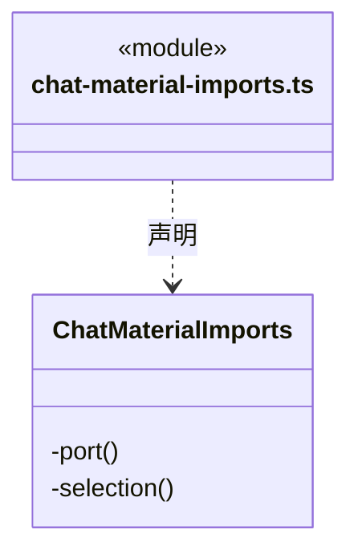

直接依赖：[../../../core/foundation/errors.ts](../../../core/foundation/errors.ts)、[../../../core/foundation/serialization.ts](../../../core/foundation/serialization.ts)、[../../../core/knowledge/ports.ts](../../../core/knowledge/ports.ts)、[../../../core/connectors/repository-tools.ts](../../../core/connectors/repository-tools.ts)、[../../resources/repository-connections.ts](../../resources/repository-connections.ts)、[chat-inputs.ts](chat-inputs.ts)、[chat-source-readers.ts](chat-source-readers.ts)。

### chat-source-readers.ts

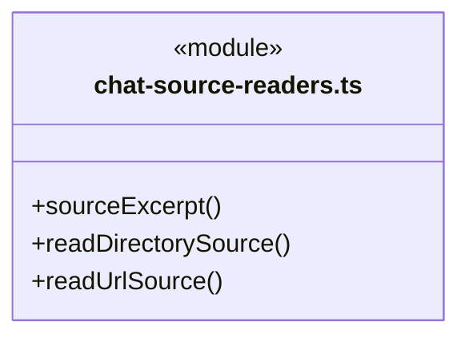

直接依赖：[../../../core/foundation/errors.ts](../../../core/foundation/errors.ts)、[../../../core/foundation/serialization.ts](../../../core/foundation/serialization.ts)、[../../../core/tasks/continuation-source-snapshot.ts](../../../core/tasks/continuation-source-snapshot.ts)。

### dispatch-store.ts

成员 1/2（同名节点为同一声明，跨图合并阅读）。

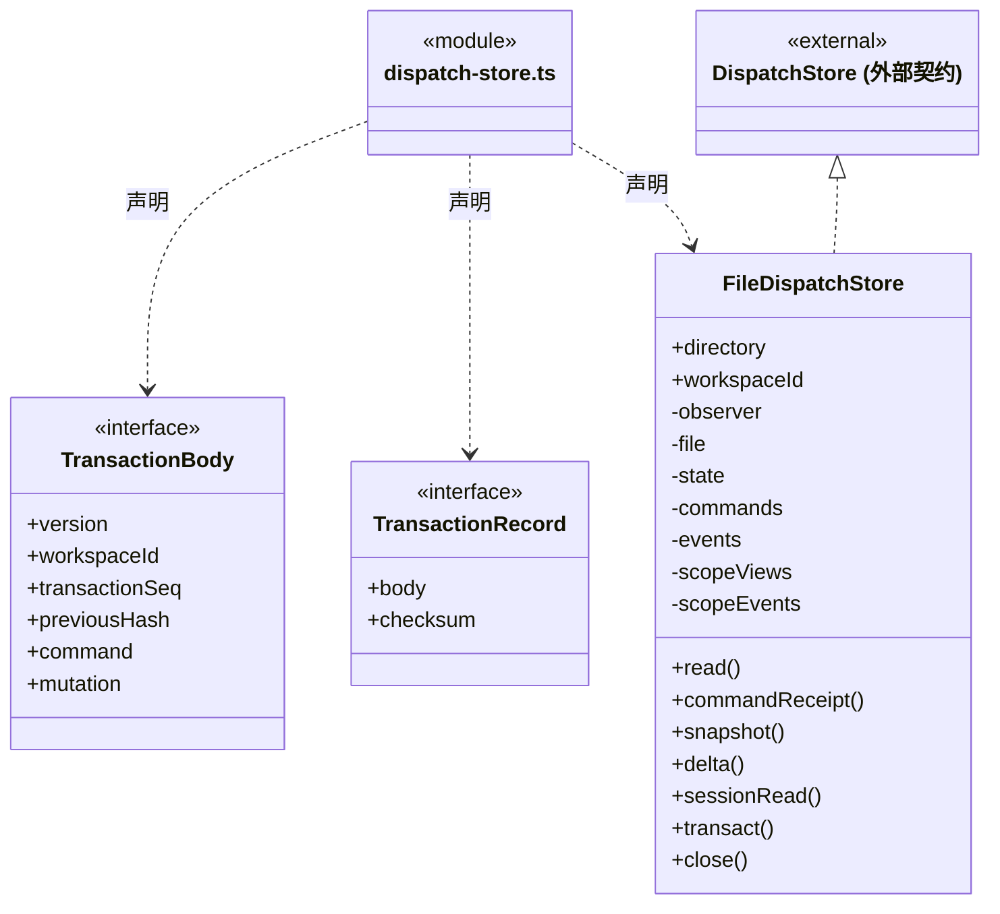

成员 2/2（同名节点为同一声明，跨图合并阅读）。

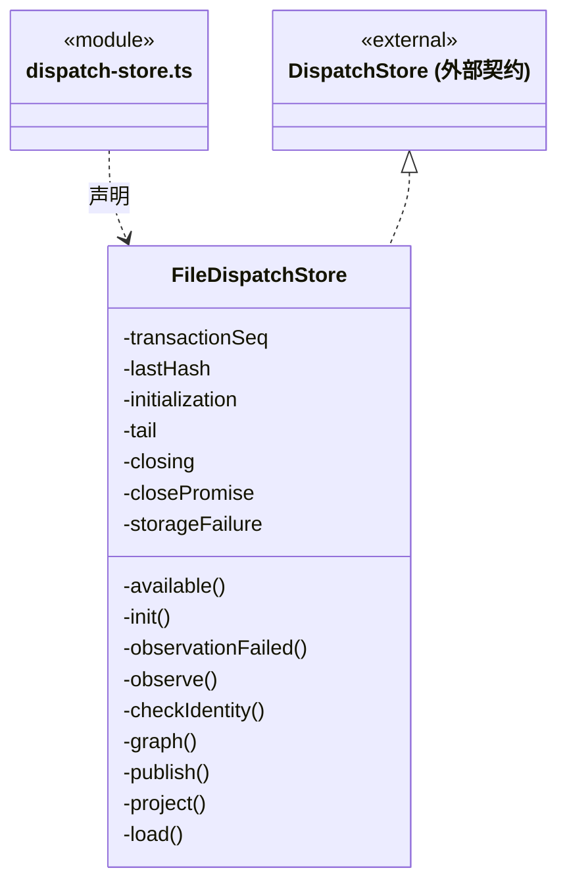

直接依赖：[../../../core/foundation/errors.ts](../../../core/foundation/errors.ts)、[../../../core/foundation/serialization.ts](../../../core/foundation/serialization.ts)、[../../../core/tasks/graph-reducer.ts](../../../core/tasks/graph-reducer.ts)、[../../../core/tasks/dispatch-invariants.ts](../../../core/tasks/dispatch-invariants.ts)、[../../../core/tasks/dispatch-scope-invariants.ts](../../../core/tasks/dispatch-scope-invariants.ts)、[../../../core/tasks/workspace-member-invariants.ts](../../../core/tasks/workspace-member-invariants.ts)、[../../../core/tasks/dispatch-storage.ts](../../../core/tasks/dispatch-storage.ts)、[../../../core/tasks/graph-types.ts](../../../core/tasks/graph-types.ts)、[../../../core/tasks/scope-view.ts](../../../core/tasks/scope-view.ts)、[../../../core/tasks/dispatch-scope.ts](../../../core/tasks/dispatch-scope.ts)。

### run-journal.ts

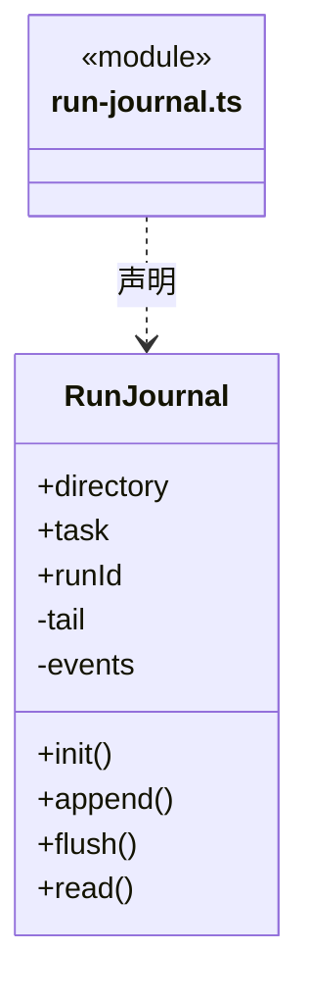

直接依赖：[../../../core/brain/types.ts](../../../core/brain/types.ts)、[../../../core/tools/types.ts](../../../core/tools/types.ts)、[../../../core/brain/member-run.ts](../../../core/brain/member-run.ts)、[../../../core/brain/input-source.ts](../../../core/brain/input-source.ts)、[../../../core/brain/conversation-binding.ts](../../../core/brain/conversation-binding.ts)、[../../../core/foundation/errors.ts](../../../core/foundation/errors.ts)。

### run-storage.ts

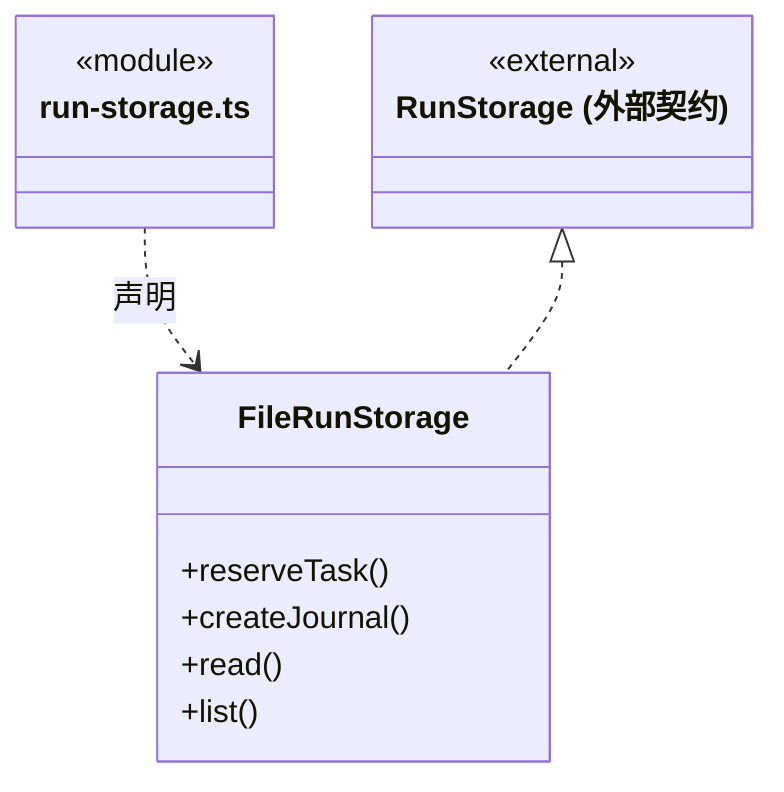

直接依赖：[../../../core/brain/storage.ts](../../../core/brain/storage.ts)、[../../../core/tasks/types.ts](../../../core/tasks/types.ts)、[../../../core/foundation/identity.ts](../../../core/foundation/identity.ts)、[run-journal.ts](run-journal.ts)。

### 本目录调用边界

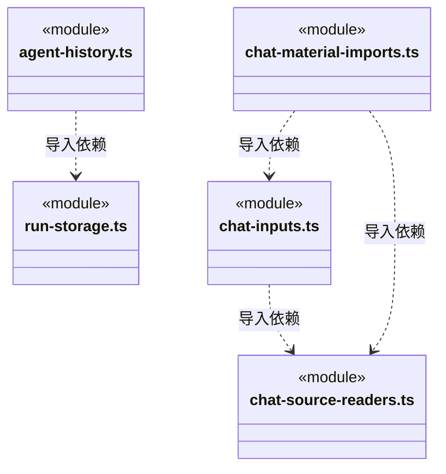

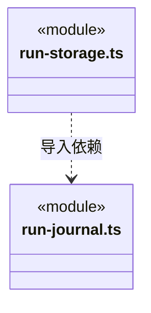


## 子目录导航

无子目录。

[返回上层](../ARCHITECTURE.md)。

每次修改本目录代码，同步维护文件头、关键契约说明及本图。未实现的治理、证据验收和自动编排能力不列入当前类图。

## 设计契约 v1 与落地范围

以下内容区分已接通能力与后续设计；以各节的实现状态为准，不将目标图当作现状图。维护源：[CONTRACT.md](CONTRACT.md)；生成类图时同步附加，勿直接修改本附录。

### 安全等待的附件快照

`ChatInputs.prepareContinuation` 只读取当前工作区已保存的附件 ID，每份私有 JSON 只打开一次；读取前后核对普通文件身份、大小与时间，并受停止信号及有界读取限制。正文、图片和清单从同一份字节派生，不重新打开原始 source 路径或联网。仅文件/图片继续使用原 v1 清单；混入真实新来源使用严格 v2。跨工作区、缺失、损坏、无来源版本的旧非文件或超限附件在消费等待前明确拒绝；旧文本补充不生成空清单。

每次最多 12 项、私有快照单项 8 MiB、图片单项 5 MiB/合计 20 MiB、展开消息 512 KiB；超过总额度不截断后假装完整。清单仅保存 ID、名称、种类、字节数、哈希及新来源的紧凑 proof，不含原目录路径、正文或 base64。`snapshotHash` 绑定私有 JSON 原字节，`contentHash` 绑定这次送入模型的保存文本或解码图片；文件文本明确是可能截取的保存快照，不证明当前源文件全文。

`ChatMaterialImports` 是应用唯一的显式导入/取消入口。`importId` 在本次应用内只执行一次，取消先到仍保留墓碑；目录、网页或仓库读取迟到后不能返回给新目标。工作区退役先 abort，应用关闭排空真实操作；原生选择器不能强制关闭，但取消立即结束导入，之后返回的路径不读取。已原子写入后取消不冒称磁盘回滚，未被表单接收的孤立快照不会自动进入任何模型输入。每次应用最多 4096 个导入/取消标识，不自动淘汰后重放旧 ID。

目录由原生选择器指定真实路径，拒绝 `.cbim`，有界枚举首层最多 200 项及溢出哨兵，不递归、不读取文件正文或链接目标；同时受 64 KiB UTF-8 保存上限，真实部分性写入 proof。URL 指针零 fetch。网页仅一次 HTTP(S) GET，不使用登录凭据、不跟随重定向或执行脚本；15 秒超时/显式取消贯穿正文，完整响应最多 1 MiB，支持 UTF-8 `text/*` 或 `application/json`。完整有界原字节 hash 与实际文本摘录 hash 分开，摘录最多 64 KiB UTF-8，不切断字符；不是浏览器渲染、登录页面读取或公网 IP 隔离。

仓库资料仅通过已授权 `resource_repository_v1` 当前共享闭包读取，冻结连接代次和资源版本，一次实际 HTTP 返回后保存七类静态资源正文。proof 记录当时定义、授权 revision、仓库/资源身份、全文 hash/字节数和真实截取状态；落盘后交付前再次核实授权。正文不会安装、应用或执行。后续撤权/停止共享禁止新导入，不篡改已经保存的历史资料；安全等待准备只读取原快照，不重新联网、换源或复活授权。旧 connector 附件仍只是静态定义，不能冒充真实仓库资料。

### 静态 Agent 会话归档索引

`FileAgentHistoryStore` 保存到应用用户目录 `paths.project(workspaceId)/agent-history/<角色摘要>/sessions/<会话摘要>/<运行摘要>.json`。名称摘要由可信静态角色、会话及 task/run 标识生成；外部请求不能提供目录或文件路径。每个轮次独立原子提交并同步文件，目录/条目符号链接及身份不匹配拒绝，损坏条目保留诊断且不影响其他记录读取。

归档文件只保存公开任务摘要、明确身份、生命周期状态和后端日志来源；不复制消息、工具正文、workflowContext 或原生会话文件。完整执行事实继续保存在原 `loop-engine/tasks` 和 `dispatch/runs/tasks`，不迁移、不合并、不写入可共享 `.cbim` 知识。执行实例释放、静态角色定义删除、正常工作区关闭都不删除归档。

`createAgentHistory` 将固定运行根及 `FileRunStorage` 注入查询服务。详情仅根据已核验索引的 source/task/run 定位，检查真实目录边界、符号链接及日志身份；首次读取后由已落盘观察维护增量。模型启动前已持久化但尚未创建 canonical 的派发意图也可归档，详情只呈现真实空前缀与失败状态。

启动加载索引后，`WorkspaceRuntimeMonitor` 在原有两套日志扫描中幂等回补，并同时消费派发 loaded/committed 与主/成员事件；没有第二套定时全量扫描。列表只查轻量索引。异步索引错误进入服务及全局诊断，不阻断已提交的执行；关闭顺序为执行收尾、撤销观察、排空索引写入、释放工作区。

### 任务派发图持久化职责

已实现 `FileDispatchStore`：工作区单写入者串行事务、哈希链追加日志、fsync 后发布、幂等回执、成员/通道/图/执行意图/结果信封原子恢复，以及内存 Snapshot/Delta。日志位于应用用户目录的工作区 dispatch/dispatch.jsonl，不写入目标项目 .cbim。成员运行、领取、启动、结算与消息确认共用事务，跨对象约束交给 Core 的 `dispatch-invariants.ts`；本存储不启动模型或自动重试。`RunJournal.seq` 与整图序号仍分别维护。

成员运行日志保存并校验成员、通道、任务与预分配 runId 的绑定；旧日志可无此字段，不把 completed 直接视作结果就绪。

主对话日志另从 `run.started.conversationBinding` 恢复 `ConversationAgentBinding`：只允许 `chat / cbim:main`，工作区与日志任务一致，根会话等于原聊天 taskId，字段及标识由 Core 严格校验。该绑定与成员任务绑定互斥，但可与可信回注来源并存；不创建正式业务任务，也不影响主对话原有 `sessionFile` 恢复链。旧日志缺省时不按角色名补造主实例或改写历史，首次显式续聊的绑定只保存在新轮次。登记实例与图根的一致性由调度保证，本读取层不自行选择实例或合并聊天、任务通道。

主会话接续时，`RunJournal` 从 `run.started.source` 恢复经过校验的 `RunInputSource`：批次 ID、结果消息集合和任务集合必须符合 Core 契约，来源只能存在于带 resumeFrom 的普通 chat 运行中，不能与成员运行绑定混用。日志保留回注尝试，供调度按 continuationId / messageIds 去重；读取本身不确认信封、不启动模型，也不把来源字段视为业务验收。旧用户日志 source 仍为空，不由文本猜测补造。

本目录负责图提交的可靠落盘、幂等检查、快照、增量读取与恢复。Core 定义节点、边及状态约束；调度层核验成员、模块维护关系、权限、依赖与状态迁移。本目录不替模型分析目标，不自行决定派给哪个成员。

### 图身份与存储端口

```ts
interface GraphIdentity {
  workspaceId: string;
  rootSessionId: string;
}

interface GraphCursor extends GraphIdentity {
  streamId: string;
  seq: number;
}

interface GraphEventBatch {
  version: 1;
  identity: GraphIdentity;
  streamId: string;
  seq: number;
  eventId: string;
  commandId: string;
  cause: GraphCause;
  committedAt: string;
  changes: GraphChange[];
}
```

- `workspaceId + rootSessionId` 唯一定位主 Agent 会话的派发图。新的派发由主根发出；执行实例使用自己的 `agentSessionId`，不得把接收会话替换为图根会话，执行成员不递归派工。
- `streamId` 在创建图时产生并持久化，正常进程重启不更换；它区别图流重建或迁移后的序号空间。
- `seq` 是原子提交批次序号，从 1 递增；0 仅为内部空前缀。graph.created 在 seq=1 原子保存根及主成员投影，公开快照始终有根。一个命令引起的多个节点、边、成员状态变化属于同一批次。不能用时间戳排序，也不能把一个批次拆成多个可见中间状态。
- `eventId` 唯一标识已提交批次；`commandId` 关联请求与幂等结果。`cause` 是 Core 定义的 `GraphCause` 事实枚举，由可信调度上下文形成。用户或成员的可信发送者身份另记内部命令审计，不由模型冒充发送人。
- `committedAt` 为 UTC ISO 8601 时间。`GraphChange` 只包含本批次发生变化的对象完整新快照；不包含私有推理、密钥、原始凭据或执行进程环境。

当前存储端口位于 Core 的 `dispatch-storage.ts`：

```ts
interface DispatchStore {
  read(): Promise<DispatchState>;
  snapshot(identity: GraphIdentity): Promise<GraphSnapshot>;
  delta(identity: GraphIdentity, cursor?: GraphCursor, limit?: number): Promise<GraphDelta>;
  transact<T>(command: DispatchCommand,
    prepare: (state: DispatchState) => Promise<DispatchMutation<T>>): Promise<T>;
  close(): Promise<void>;
}
```

`DispatchCommand` 含 commandId 与规范化请求 fingerprint，`DispatchMutation` 包含成员、Session、图批次、assignment/result 消息、runs、scopes 和回执。只有调度层生成 mutation；模型或前端不能直接提交它。公开图查询不返回 read() 的全工作区状态、冻结知识正文或私有原生会话路径。`runs/scopes` 是 v1 日志的可选兼容扩展；旧记录按空集合恢复，不重写历史记录与校验和，`read()` 总是返回数组。

成员唯一键按生命周期区分：主实例使用 `mainRootSessionId`，周期执行实例使用 `executionScopeId + executionTaskId`，旧无周期角色使用 agentId。已有实例的范围和通道用途不可重绑；释放只标记历史记录，不删除节点或证据。周期、执行实例和任务的联合约束由 `validateDispatchScopes` 核验，关闭与取消、租约递增、实例 released 在同一 fsync 事务里保存。已释放实例、通道与闭周期任务拒绝迟到写入。

`DispatchRun` 保存 `MemberRunBinding`、assignmentMessageId、starting/running/终态、完整知识快照、冻结前置候选 prerequisites、无密钥模型参数、ChatPermission、可选超时和原生会话定位。首次领取检查 prerequisites 与全部入向依赖及锁定的 resultId 一致，此后不拿上游最新结果覆盖冻结输入。已有运行的身份与输入不得改变；sessionFile 只允许从未知补为确定值，不能重新绑定。私有路径只能存在 runs 中，公开 AgentSessionBinding 拒绝该字段。

### 原子提交与幂等

一次派发至少需要原子保存：新任务、派发/依赖边、接收方待投递消息和该命令的提交回执。结果返回同样将有效结果记录、请求方待投递消息和图状态变化一起提交，避免出现“图上已派发，但成员永远收不到任务”。只有携带有效候选的 completed 运行可提交 result_ready；无候选时任务 blocked，运行仍诚实记录 completed。模型自动 staged 结果/等待及递归恢复不在当前实现范围。内部事务没有可见对象变化时不分配 graph seq；例如单独确认结果消息不会发布空图批次。

提交顺序：

1. 在工作区唯一写入者及串行提交边界中核验图身份。
2. 在整个工作区内按 `commandId` 查找已提交命令；指纹包含操作、可信发送者和完整输入（含图身份）。同 ID、同指纹返回原回执，不再次投递；跨图复用同 ID 或改变请求内容均返回 `COMMAND_ID_CONFLICT`。这个检查先于预期版本检查，避免正常重试被后来版本错误拒绝。
3. 对未提交的新命令核验对象版本与状态前置条件；节点及边必须引用同一张图，DAG 约束由调度验证并在同一提交快照上成立。
4. 将完整事务记录追加并 `fsync`，可靠保存后才更新内存投影、返回成功并发布增量。
5. 显式执行入口消费已提交 outbox。模型副作用发生前须可靠保存 starting 意图；执行的成功、失败或中断不能因消息重投而重复启动。

事务记录应包含完整 `GraphEventBatch` 和关联的邮箱/执行数据，采用可识别完整提交边界的日志格式。不能先修改图文件、再独立写消息文件。派生快照不是另一份权威状态；快照缺失时必须能从提交日志恢复。

写失败不更新可发布投影，不返回成功；当前写入链停止接受后续相关变更，直到明确恢复。调度调用方收到超时或连接中断时，可以使用原 `commandId` 查回执，不能换 ID 直接重复派发。

### 快照、增量与事件发布

`GraphSnapshot` 包含 `version:1、identity、cursor、root、tasks、edges、agents`，其对象内容必须对应同一个已提交 `cursor.seq`。读取旧游标必须返回完整批次，`limit` 按批次数计数，不按对象数截断；单批次大小由命令入口限制。

增量返回采用 `mode: 'noop' | 'delta' | 'reset'`，完整公开形状见 [Bridge 契约](../../../../bridge/contracts/CONTRACT.md)。无变化时不重复读取和传输全图正文。订阅只发布已落盘批次；消费者掉线或丢包后，用最后成功应用的游标补读。

正常重启从持久化头恢复同一 `streamId` 与最后 `seq`，不回到 0。目前恢复并保留全部已提交图批次，未实现日志压缩或历史裁剪。若后续引入压缩，须先可靠生成带游标快照并建立保留区间；过期游标再按协议返回 `reset`。身份不匹配始终拒绝，不能用 reset 悄悄切换工作区或会话。

### 联合读取图与周期目标

`FileDispatchStore.sessionRead` 先等待原事务队列，再同步读取 graph delta、scope summary delta 与选中 scope detail，不在三份响应之间执行异步读取。此接口不创建根/周期、不读知识、不启动成员、不确认信封；原 `snapshot / delta` 接口保持兼容。

周期投影只由已落盘 `scopes` 变更派生，和正常重放共用 `publish`。每主会话独立编号，不受其他会话事务、图事件或幂等回执重发影响。scope 摘要保存在内存，事件和重放证明最多保留 256 批；超窗客户端 reset 到摘要快照。原 `dispatch.jsonl` 不变，不另建权威记录；正常重启重建相同 streamId、seq 和详情 stamp。单独 plan/review/block/close 不制造图批次，因此不会让已保存的审阅证据自行过期。

公开请求可选择本会话历史周期；缺省优先 active，再选最后创建的周期。无目标旧记录不补造。列表仅传小摘要，完整原始输入/计划/审阅在所选 stamp 变化时才返回；每秒无变化轮询只返回三份游标/noop。原始业务文本本身不做自动敏感内容识别，详情不包含运行私有路径、冻结知识或邮箱。

### 执行、邮箱与恢复

每个成员的 Session 通道按消息 ID 去重。同一信封只能更新 delivery/claim，来源、接收方、任务、版本及创建命令固定。assignment 为 pending → claimed → processed；claim 保存 runId 与 leaseEpoch 并在消费后保留。尚未领取的取消可以 pending → processed，不伪造运行。result 为 pending → processed，没有 claim；可信确认入口核验图与接收方，不凭确认操作创建新的业务 run。`ack` 不等于任务成功或业务验收。

在启动任何可能产生副作用的执行之前，先原子保存 starting、信封领取与 task/member 的 activeRunId。此时任务仍 queued、成员 communicating；收到真实启动事实后才记录 startedAt，转为 task.running/member.working。成员在所有根会话间共用一个活动执行槽。终态必须原子保存 settledAt、清除活动占用并消费信封；迟到回调不能改写已结算运行或旧租约。

恢复顺序：校验日志与身份 → 重建图、执行记录和邮箱投影 → 调度核对活动执行 → 保存中断事实并发布恢复状态。存储读取本身不会重启任何模型。调度接管未知 starting/running 时将任务与运行标为 interrupted，释放占用、消费信封并增加成员 leaseEpoch；文件写入、命令或外部操作结果不得盲目重放。

主 Agent 接收执行结果后可追加后续任务，执行成员没有递归派发权；结果不生成“任务 → 根”的反向依赖边。已实现的结果信封使用 `taskId/replyTo/messageId` 关联，与 `runId` 的执行尝试身份分开。恢复先核实并结算旧 starting/running，再将遗留 active 周期标为 interrupted 并释放执行实例；不自动重放模型、队列或未知副作用。

### 错误语义与迁移边界

| 情况 | 行为 |
| --- | --- |
| 工作区或根会话身份不同 | `GRAPH_IDENTITY_MISMATCH`，拒绝读取或提交 |
| 图不存在 | `GRAPH_NOT_FOUND`；读取不能自动创建图 |
| 对象预期版本过期 | `GRAPH_REVISION_CONFLICT`；调用方须重新查询当前图或任务，不自动合并，也不附带当前对象快照 |
| 同命令 ID 不同内容或发送者 | `COMMAND_ID_CONFLICT`，不产生新批次 |
| 写入失败 | `GRAPH_STORAGE_FAILED`，不发布未提交变化 |
| 日志中间损坏、序号断裂或身份不一致 | `GRAPH_LOG_CORRUPT`，拒绝伪装成空图或完成；仅可忽略明确未提交的崩溃尾部 |
| 未知协议版本 | `GRAPH_VERSION_UNSUPPORTED`，不猜测解析 |
| 未确认的执行结果 | 保留中断/待核实状态，不自动重试副作用 |

现有 `loop` 对话 `taskId`、`RunJournal` 及 `TaskProgress` 保留原意。引入 `rootSessionId` 和图任务 ID 时需要显式适配关联，不能根据名称相同直接等同；旧历史没有派发证据时不补造任务、消息或团队协作过程。
### 运行日志的只读完整性诊断

`RunJournal.read` 仅解析完整行并报告 `logIntegrity.partialTail`，保留未完成尾行的原始字节、不截断或修复。零字节文件返回 `RUN_LOG_EMPTY`；结构、绑定或 JSON 损坏返回 `RUN_LOG_INVALID`，错误不包含原始片段。文件系统错误保留系统码，缺失日志不能解释为未执行。正常读取依旧重建可信回执、未知工具与终态，完成前缀不代表尾行也完整。

### 岗位登记沿用同一日志与提交屏障

`FileDispatchStore` 使用原 `dispatch.jsonl` 追加单条 `workspaceMemberChanges`，不再保存第二份权威岗位文件。`projectWorkspaceMemberMutation` 核验不可变审计后派生当前岗位及独立登记游标；登记 mutation 只能包含审计和回执，不能同事务修改任何执行数据。正文只保存在审计 `next`，当前岗位是内存投影，回执只含紧凑引用。没有图或周期变化时，其既有增量游标不推进。

加载和新提交使用同一领域校验；即使重算外层日志校验和，伪造版本、源快照指纹、actor、命令、回执或直接岗位头仍拒绝。旧 v1 日志没有登记字段时按空数组/null 恢复，不写迁移记录、不修改旧字节。正常重开恢复相同岗位 ID、原采纳、全部审计与登记游标。

`commandReceipt(commandId)` 从已恢复的命令索引等待提交屏障后返回深拷贝，不调用事务回调、知识或模型端口；未找到不是“肯定未受理”的证明。岗位命令仍遵循先查原指纹的幂等规则。fsync 或写入结果未确认时封闭当前 Store，不能返回过时投影；重新打开只按原完整日志核实，不自动重放登记。
