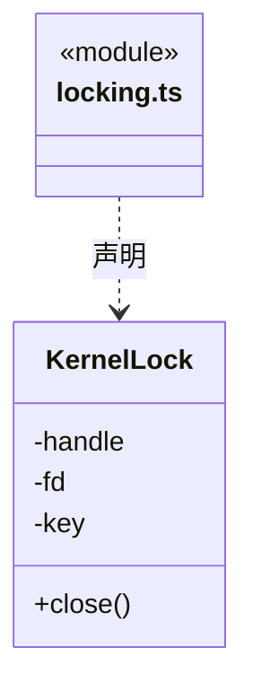
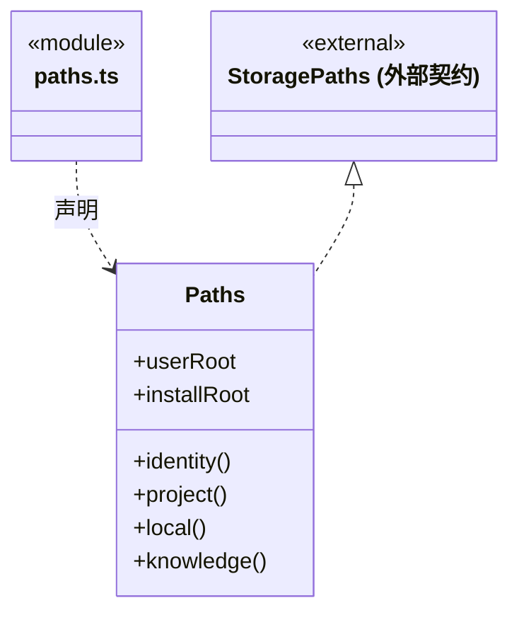
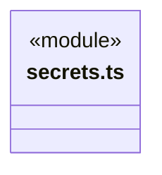
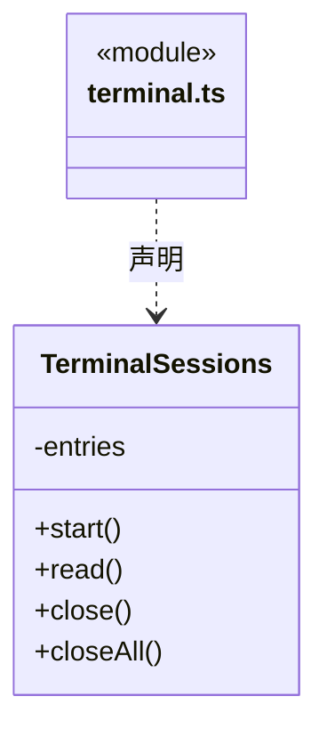
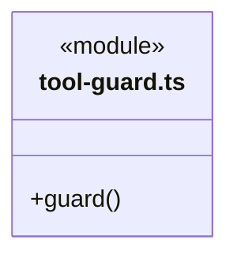

# src/backend/main/platform 架构

## 目录定位

本机路径、系统锁、凭据加密、命令终端及原生工具访问检查。路径策略不是操作系统沙箱。

本文描述当前实现。通过分析目录边界后维护的 [源码架构脚本](../../../../scripts/source-architecture.mjs) 同步清单和声明；代码变更时仍须核对职责、关键成员与关系。

## 代码清单

| 文件 | 当前职责 |
| --- | --- |
| [locking.ts](locking.ts) | KernelLock：使用 Windows mutex 或 POSIX flock，防止跨进程并发持有。 |
| [paths.ts](paths.ts) | 本机应用目录、工程身份和知识路径的实际解析。 |
| [secrets.ts](secrets.ts) | 用 Electron 系统加密能力保护 LLM 凭据。 |
| [terminal.ts](terminal.ts) | 桌面扩展区的命令模式终端，按工作区/页签隔离手动命令与输出。 |
| [tool-guard.ts](tool-guard.ts) | 对显式知识库访问和部分路径别名做前置拒绝；属于防误操作策略而非 OS 沙箱。 |

## 架构类图

### locking.ts

直接依赖：[../../core/foundation/errors.ts](../../core/foundation/errors.ts)。

### paths.ts

直接依赖：[../../core/foundation/serialization.ts](../../core/foundation/serialization.ts)、[../../core/foundation/errors.ts](../../core/foundation/errors.ts)、[../../core/foundation/paths.ts](../../core/foundation/paths.ts)。

### secrets.ts

直接依赖：[../../core/brain/llm/ports.ts](../../core/brain/llm/ports.ts)。

### terminal.ts

### tool-guard.ts

## 子目录导航

无子目录。

[返回上层](../ARCHITECTURE.md)。

每次修改本目录代码，同步维护文件头、关键契约说明及本图。未实现的治理、证据验收和自动编排能力不列入当前类图。
