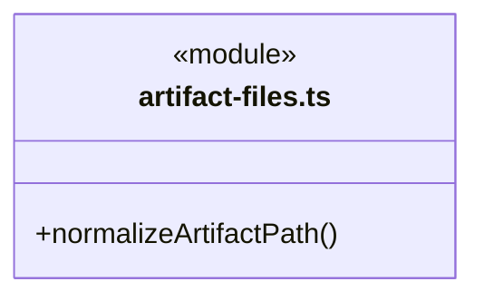
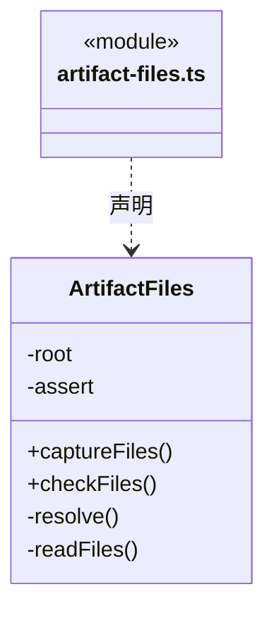
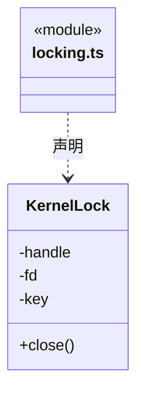
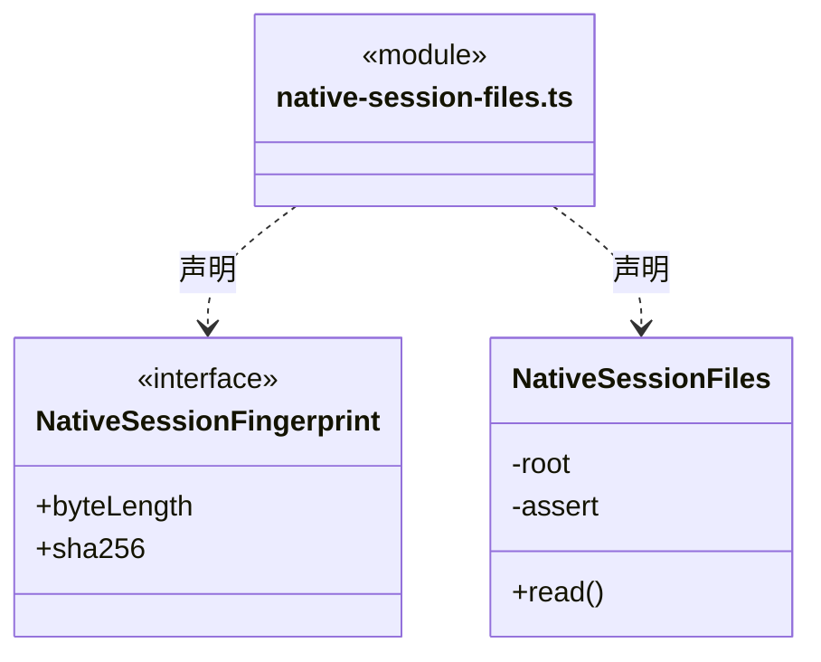
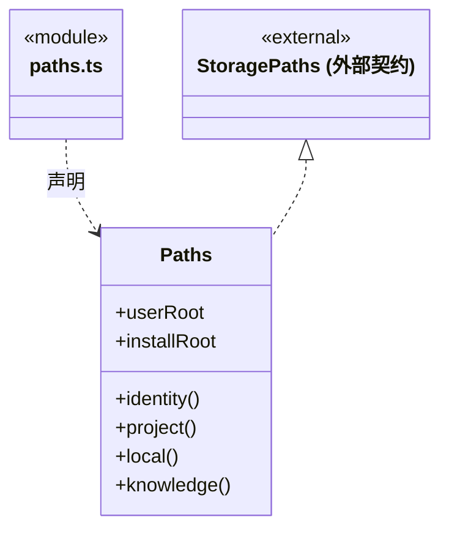
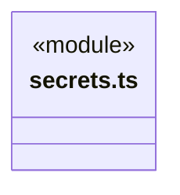
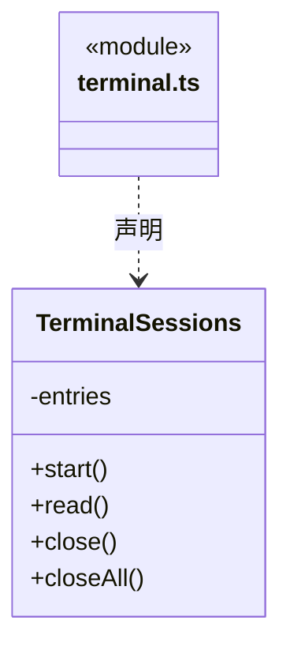
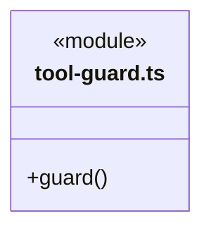

# src/backend/main/platform 架构

## 目录定位

本机路径、系统锁、凭据加密、终端与工具访问检查。业务文件及受管原生会话各用固定根、有界读取与前后身份核实，拒绝链接、越界和 Windows 备用数据流；原生历史不完整则拒绝恢复，不修补原文件或承诺外部原子隔离。

本文描述当前实现。通过分析目录边界后维护的 [源码架构脚本](../../../../scripts/source-architecture.mjs) 同步清单和声明；代码变更时仍须核对职责、关键成员与关系。

## 代码清单

| 文件 | 当前职责 |
| --- | --- |
| [artifact-files.ts](artifact-files.ts) | 在固定工作区根内有界读取普通业务文件的字节指纹，供成员采集与显式复核共用。 |
| [locking.ts](locking.ts) | KernelLock：使用 Windows mutex 或 POSIX flock，防止跨进程并发持有。 |
| [native-session-files.ts](native-session-files.ts) | 在本工作区受管 Pi 会话目录内核实已关闭的原生上下文，供成员检查点与续执行使用。 |
| [paths.ts](paths.ts) | 本机应用目录、工程身份和知识路径的实际解析。 |
| [secrets.ts](secrets.ts) | 用 Electron 系统加密能力保护 LLM 凭据。 |
| [terminal.ts](terminal.ts) | 桌面扩展区的命令模式终端，按工作区/页签隔离手动命令与输出。 |
| [tool-guard.ts](tool-guard.ts) | 对显式知识库访问和部分路径别名做前置拒绝；属于防误操作策略而非 OS 沙箱。 |

## 架构类图

### artifact-files.ts

直接依赖：[../../core/foundation/errors.ts](../../core/foundation/errors.ts)、[../../core/tasks/artifact-baseline.ts](../../core/tasks/artifact-baseline.ts)。

### locking.ts

直接依赖：[../../core/foundation/errors.ts](../../core/foundation/errors.ts)。

### native-session-files.ts

直接依赖：[../../core/foundation/errors.ts](../../core/foundation/errors.ts)。

### paths.ts

直接依赖：[../../core/foundation/serialization.ts](../../core/foundation/serialization.ts)、[../../core/foundation/errors.ts](../../core/foundation/errors.ts)、[../../core/foundation/paths.ts](../../core/foundation/paths.ts)。

### secrets.ts

直接依赖：[../../core/brain/llm/ports.ts](../../core/brain/llm/ports.ts)。

### terminal.ts

### tool-guard.ts

## 子目录导航

无子目录。

[返回上层](../ARCHITECTURE.md)。

每次修改本目录代码，同步维护文件头、关键契约说明及本图。未实现的治理、证据验收和自动编排能力不列入当前类图。

## 设计契约 v1 与落地范围

以下内容区分已接通能力与后续设计；以各节的实现状态为准，不将目标图当作现状图。维护源：[CONTRACT.md](CONTRACT.md)；生成类图时同步附加，勿直接修改本附录。

### 有界业务文件观察

`ArtifactFiles` 固定当前工作区根和所有者有效性检查，供成员采集与显式历史复核共用。`normalizeArtifactPath` 仅做路径格式匹配，保持相对文件名大小写；实际读取逐级核对真实路径、普通文件、句柄身份和读取前后元信息。目录、越界、`.cbim`、设备路径、备用数据流、符号链接、目录联接及硬链接均拒绝。

一次最多 16 个文件，单文件最多 8 MiB，整次实际读取最多 32 MiB。复核中的每个文件及失败前已读字节共用总额度，不因逐文件捕获错误重新计数。超过上限不截断作证；端口只返回路径、长度、SHA-256 与受限错误，不返回正文或运行命令。

AbortSignal、工作区退役与文件变化在异步读取期间持续核对，句柄在 finally 释放。读占用阻止本应用的业务写入竞争，文件系统外部竞争只能尽力发现；这不是操作系统沙箱、全工作区扫描或原子产物快照。

### 私有原生会话指纹

`NativeSessionFiles` 固定当前成员运行的受管 Pi sessions 根，只接受调度保存的 nativeSessionId/sessionFile。逐组件拒绝越界、链接、Windows ADS/设备名/尾点空格歧义，文件须为单硬链接普通文件。逐块读取最多 64 MiB，读取前后句柄/路径身份和元信息一致才返回长度及 SHA-256，不返回正文。

原生 JSONL 必须有效 UTF-8、完整换行、对象行和匹配的 session 头，最多 100000 行；null/数组/截断或错身份均明确拒绝。AbortSignal 与工作区有效性贯穿读取。指纹只供检查点私有证明，不成为公开文件查询、任意历史恢复或文件系统原子锁。
