# src/backend/main/platform 架构

## 目录定位

本机路径、系统锁、凭据加密、终端与工具访问检查。固定根有界读取并核前后句柄/路径，拒绝链接、越界和Windows备用数据流；JSON验证由同一Buffer计算指纹和结构结论，正文不出端口。原生历史不完整拒绝恢复，不承诺外部原子隔离。 ArtifactFileService 只观察明确原调用的有界文件，独立返回缺失、不可信和当前字节；路径与链接检查不宣称操作系统隔离。 独立 utility 持有 Win32 目录与文件句柄，执行单次有界替换、flush 与读回；私有 blob 保留真实 before，进程退出不表示内容回滚。

本文描述当前实现。通过分析目录边界后维护的 [源码架构脚本](../../../../scripts/source-architecture.mjs) 同步清单和声明；代码变更时仍须核对职责、关键成员与关系。

## 代码清单

| 文件 | 当前职责 |
| --- | --- |
| [artifact-files.ts](artifact-files.ts) | 在固定工作区根内安全读取业务文件，供指纹采集、复核、无基线当前观察及冻结 JSON 结构验证共用。 |
| [controlled-file-blobs.ts](controlled-file-blobs.ts) | 保存受控写入的私有 before/intended-after 字节，公开回执只引用 UUID 与哈希。 |
| [controlled-file-child.ts](controlled-file-child.ts) | 独立 Electron utility 文件工人入口，只接收固定私有消息，不启动 Application 或模型。 |
| [controlled-file-protocol.ts](controlled-file-protocol.ts) | Main 与专用文件 utility 子进程之间的严格私有消息及不透明会话端口。 |
| [controlled-file-transport.ts](controlled-file-transport.ts) | Electron 主进程为每次受控内容替换或删除/移动创建专用 utility 子进程，并返回不透明会话。 |
| [controlled-file-win32.ts](controlled-file-win32.ts) | 专用 utility 子进程的同步 Win32 单文件实现；全程拥有文件及目录句柄。 |
| [locking.ts](locking.ts) | KernelLock：使用 Windows mutex 或 POSIX flock，防止跨进程并发持有。 |
| [native-session-files.ts](native-session-files.ts) | 在本工作区受管 Pi 会话目录内核实已关闭的原生上下文，供成员检查点与续执行使用。 |
| [output-manifest-files.ts](output-manifest-files.ts) | 在固定工作区内枚举声明范围的全部目录和普通文件，生成完整产物观察并按原集合复核。 |
| [paths.ts](paths.ts) | 本机应用目录、工程身份和知识路径的实际解析。 |
| [secrets.ts](secrets.ts) | 用 Electron 系统加密能力保护 LLM 凭据。 |
| [terminal.ts](terminal.ts) | 桌面扩展区的命令模式终端，按工作区/页签隔离手动命令与输出。 |
| [tool-guard.ts](tool-guard.ts) | 对显式知识库访问和部分路径别名做前置拒绝；属于防误操作策略而非 OS 沙箱。 |

## 架构类图

### artifact-files.ts

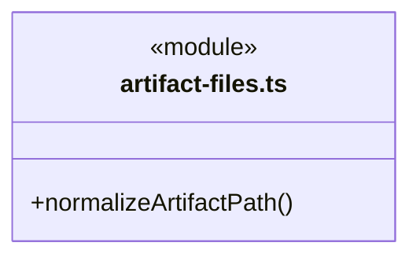

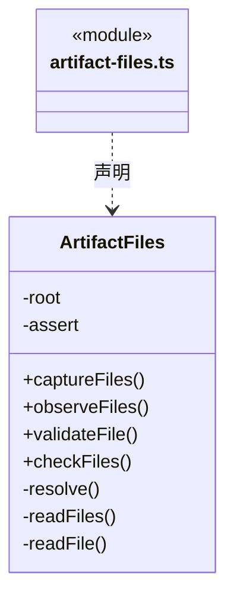

直接依赖：[../../core/foundation/errors.ts](../../core/foundation/errors.ts)、[../../core/tasks/artifact-baseline.ts](../../core/tasks/artifact-baseline.ts)、[../../core/workspace/json-validation-schema.ts](../../core/workspace/json-validation-schema.ts)、[../../core/tasks/effect-observation.ts](../../core/tasks/effect-observation.ts)。

### controlled-file-blobs.ts

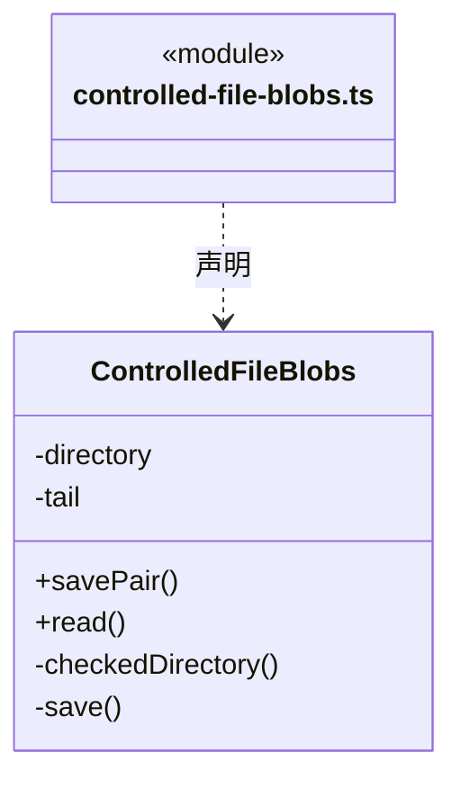

直接依赖：[../../core/foundation/errors.ts](../../core/foundation/errors.ts)、[../../core/tasks/controlled-file-operation.ts](../../core/tasks/controlled-file-operation.ts)、[../../core/tasks/controlled-file-event.ts](../../core/tasks/controlled-file-event.ts)。

### controlled-file-child.ts

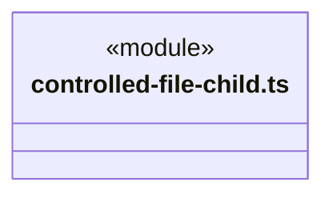
直接依赖：[controlled-file-protocol.ts](controlled-file-protocol.ts)、[controlled-file-win32.ts](controlled-file-win32.ts)。

### controlled-file-protocol.ts

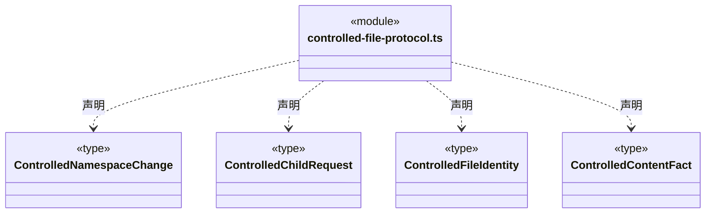

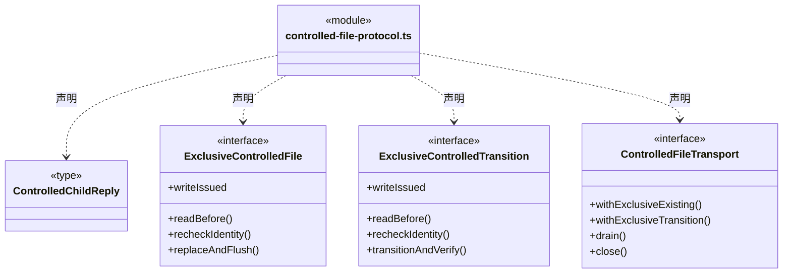

### controlled-file-transport.ts

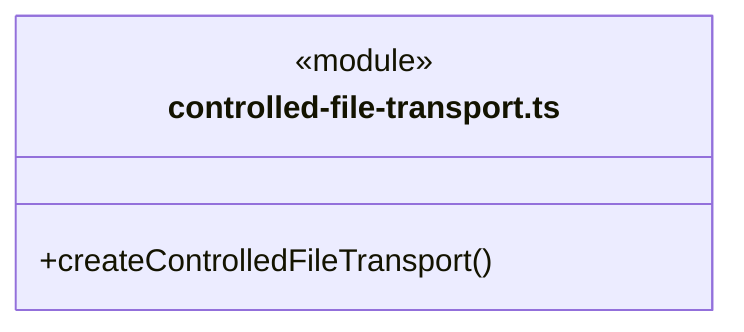

成员 1/2（同名节点为同一声明，跨图合并阅读）。

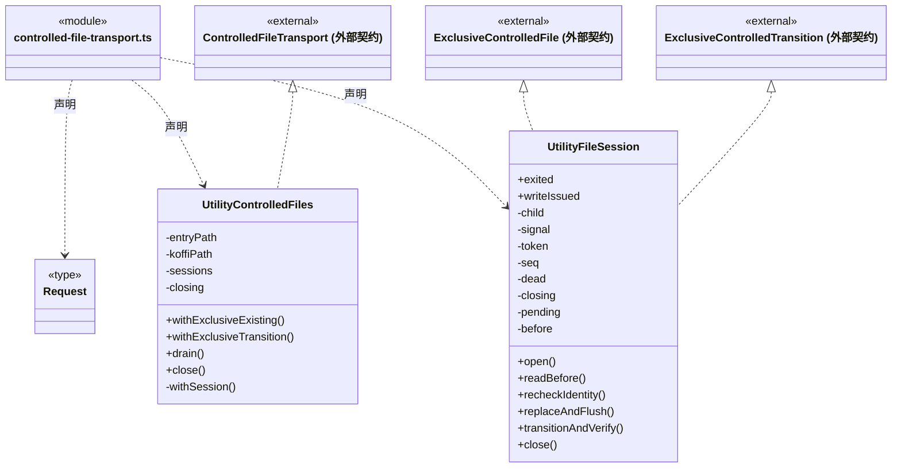

成员 2/2（同名节点为同一声明，跨图合并阅读）。

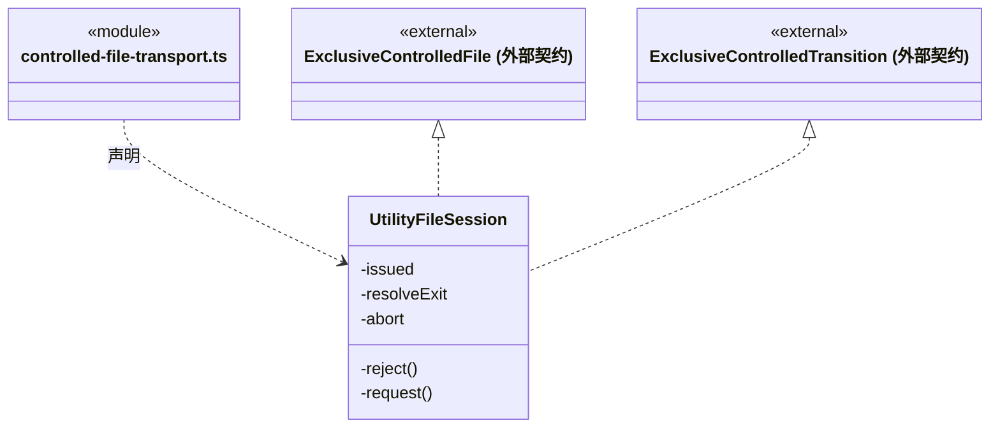

直接依赖：[../../core/foundation/errors.ts](../../core/foundation/errors.ts)、[controlled-file-protocol.ts](controlled-file-protocol.ts)。

### controlled-file-win32.ts

成员 1/2（同名节点为同一声明，跨图合并阅读）。

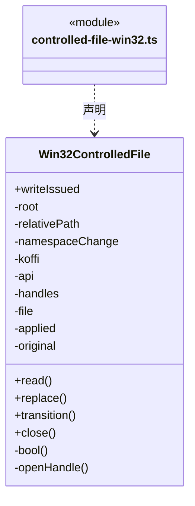

成员 2/2（同名节点为同一声明，跨图合并阅读）。

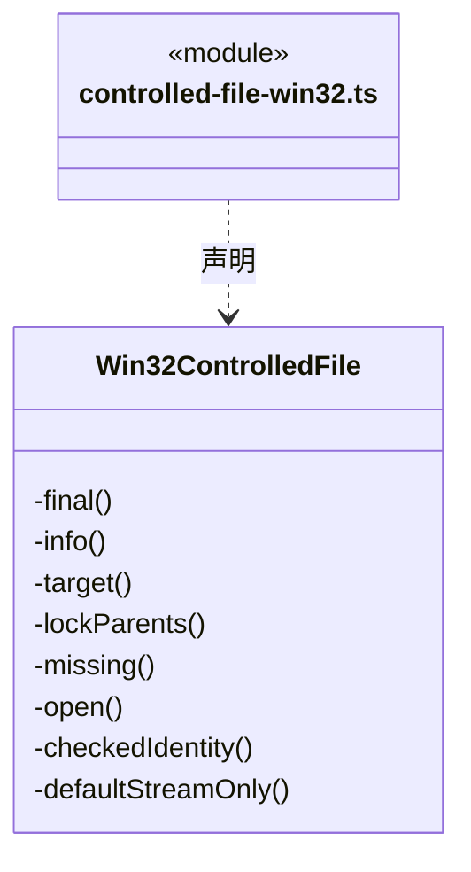

直接依赖：[controlled-file-protocol.ts](controlled-file-protocol.ts)。

### locking.ts

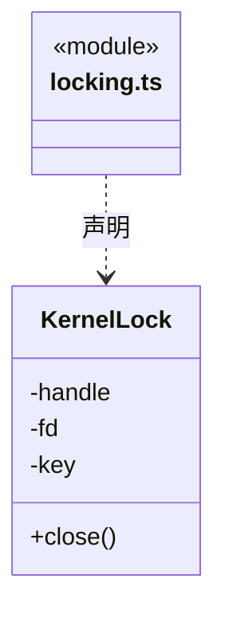

直接依赖：[../../core/foundation/errors.ts](../../core/foundation/errors.ts)。

### native-session-files.ts

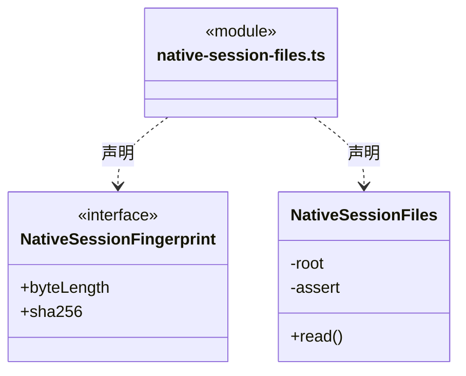

直接依赖：[../../core/foundation/errors.ts](../../core/foundation/errors.ts)。

### output-manifest-files.ts

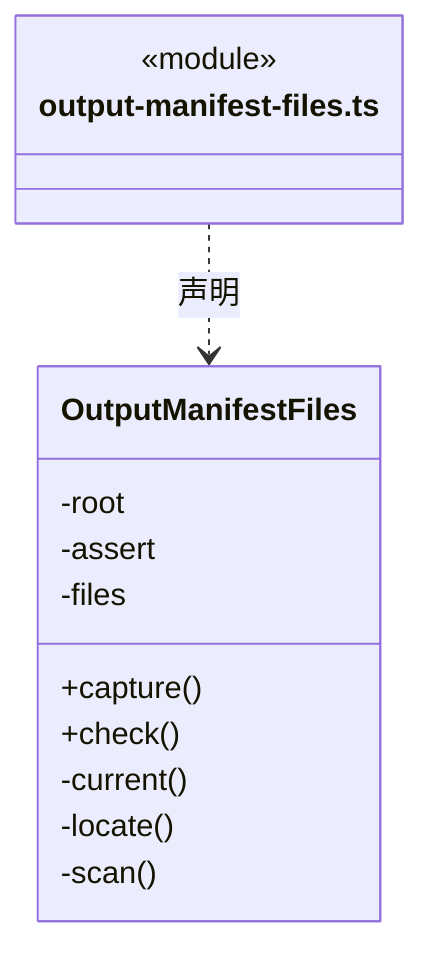

直接依赖：[../../core/foundation/errors.ts](../../core/foundation/errors.ts)、[../../core/workspace/artifact-scope.ts](../../core/workspace/artifact-scope.ts)、[../../core/tasks/output-manifest.ts](../../core/tasks/output-manifest.ts)、[../../core/tasks/output-manifest-evidence.ts](../../core/tasks/output-manifest-evidence.ts)、[artifact-files.ts](artifact-files.ts)。

### paths.ts

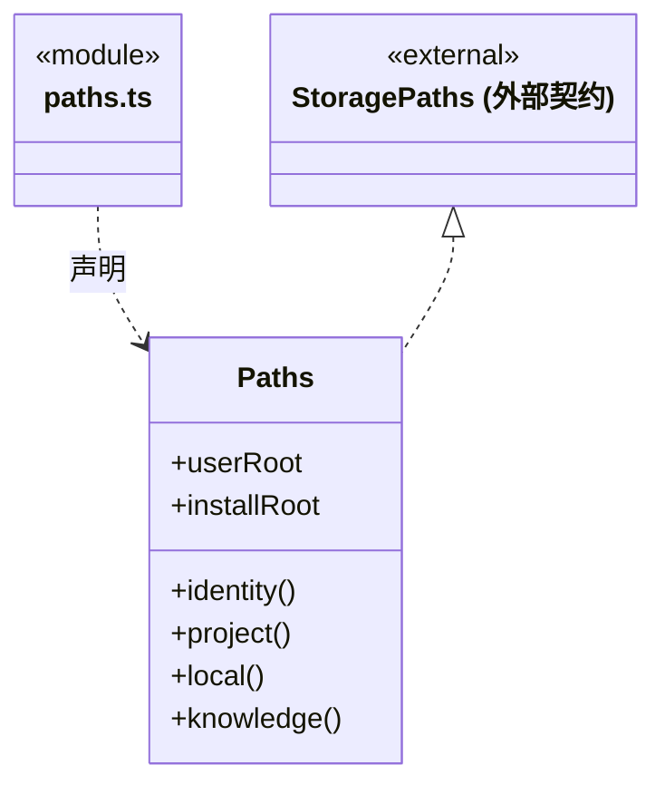

直接依赖：[../../core/foundation/serialization.ts](../../core/foundation/serialization.ts)、[../../core/foundation/errors.ts](../../core/foundation/errors.ts)、[../../core/foundation/paths.ts](../../core/foundation/paths.ts)。

### secrets.ts

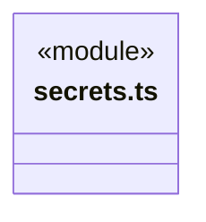
直接依赖：[../../core/brain/llm/ports.ts](../../core/brain/llm/ports.ts)。

### terminal.ts

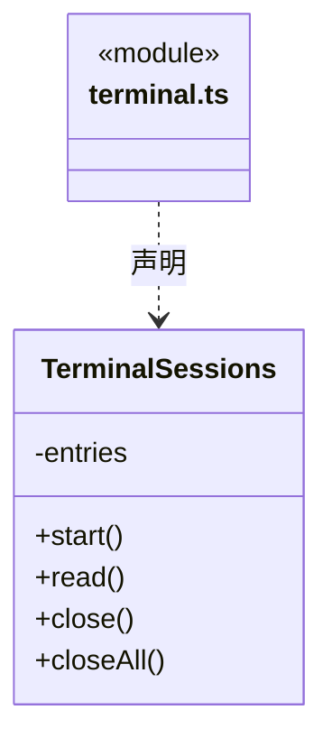

### tool-guard.ts

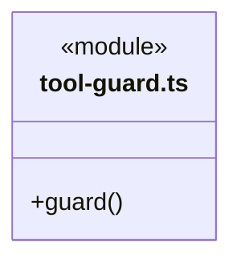

### 本目录调用边界

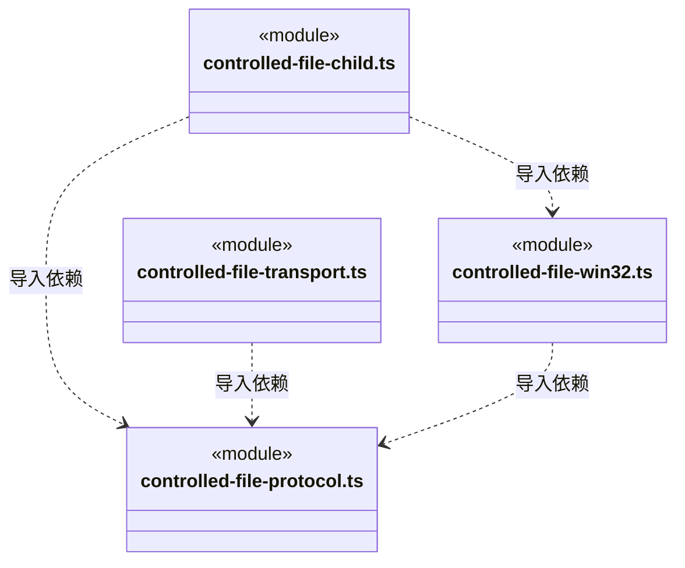

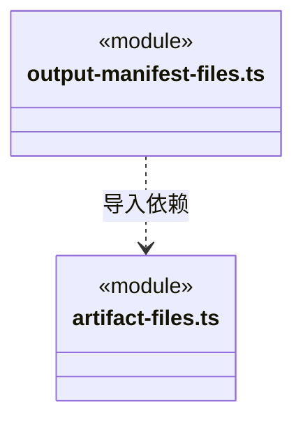

## 子目录导航

无子目录。

[返回上层](../ARCHITECTURE.md)。

每次修改本目录代码，同步维护文件头、关键契约说明及本图。未实现的治理、证据验收和自动编排能力不列入当前类图。

## 设计契约 v1 与落地范围

以下内容区分已接通能力与后续设计；以各节的实现状态为准，不将目标图当作现状图。维护源：[CONTRACT.md](CONTRACT.md)；生成类图时同步附加，勿直接修改本附录。

### 有界业务文件观察

`ArtifactFiles` 固定当前工作区根和所有者有效性检查，供成员采集与显式历史复核共用。`normalizeArtifactPath` 仅做路径格式匹配，保持相对文件名大小写；实际读取逐级核对真实路径、普通文件、句柄身份和读取前后元信息。目录、越界、`.cbim`、设备路径、备用数据流、符号链接、目录联接及硬链接均拒绝。

一次最多 16 个文件，单文件最多 8 MiB，整次实际读取最多 32 MiB。复核中的每个文件及失败前已读字节共用总额度，不因逐文件捕获错误重新计数。超过上限不截断作证；端口只返回路径、长度、SHA-256 与受限错误，不返回正文或运行命令。

AbortSignal、工作区退役与文件变化在异步读取期间持续核对，句柄在 finally 释放。读占用阻止本应用的业务写入竞争，文件系统外部竞争只能尽力发现；这不是操作系统沙箱、全工作区扫描或原子产物快照。

### 同字节 JSON 结构验证

`ArtifactFiles.validateFile` 复用安全打开与读取循环，但单文件上限收紧为 1 MiB。同一次句柄读取的字节同时产生 SHA-256 和受限解释器输入；先与明确基线的路径、长度和哈希一致，再严格解析 UTF-8/JSON 与冻结 Schema。无二次打开、命令、网络引用或脚本编译，返回指纹及有界判定，不返回原文或对象值。

语法、重复键和结构不符合产生 `rejected`，这是验证已经执行的事实；文件缺失、基线变化、超限、读取竞争或停止产生错误，不伪装结构拒绝或通过。原采集的 8 MiB/32 MiB 限额及不保留正文行为不变；交付与审阅使用同一个 `checkFiles` 端口重新核对通过时的字节。

### 私有原生会话指纹

`NativeSessionFiles` 固定当前成员运行的受管 Pi sessions 根，只接受调度保存的 nativeSessionId/sessionFile。逐组件拒绝越界、链接、Windows ADS/设备名/尾点空格歧义，文件须为单硬链接普通文件。逐块读取最多 64 MiB，读取前后句柄/路径身份和元信息一致才返回长度及 SHA-256，不返回正文。

原生 JSONL 必须有效 UTF-8、完整换行、对象行和匹配的 session 头，最多 100000 行；null/数组/截断或错身份均明确拒绝。AbortSignal 与工作区有效性贯穿读取。指纹只供检查点私有证明，不成为公开文件查询、任意历史恢复或文件系统原子锁。

### 无基线的当前文件观察

`ArtifactFiles.observeFiles` 复用同一安全文件读取，每次最多 16 个路径、每文件 8 MiB、共享 32 MiB，只返回 present/missing/unverifiable、长度和 SHA-256。路径由 Scheduler 已核原调用推导，平台再次拒绝越界、链接、硬链接、设备和受管知识路径；不接受 UI 任意路径，不输出正文。取消或工作区失效终止读取，前后身份变化不交付确定哈希；此观察不证明原操作成功，也不生成成功产物基线。

## 受控单文件写入与显式补偿

utility entry 允许在 app.asar 中，进程 cwd 必须通过 original-fs 解析为 process.execPath 所在的真实目录。不能将 ASAR 内虚拟目录交给原生进程，也不以业务工程为 cwd；目录不可用在 fork 和任何文件意图保存前拒绝。

受控文件能力仅由 Electron 桌面装配，独立 utilityProcess 在同一线程持有 Win32 独占句柄。普通 Node 宿主没有该能力。只允许现有 UTF-8 普通单文件；原 native write/edit 不因此获得自动撤销能力。

Runtime 在自己的 beforeTool 可靠保存 allowed 后签发一次性授权，短门闩排除其它工具/审批；模型与 emit 事件不能签发许可。Main 在 Store 外取得文件句柄和可靠 before/intended-after 私有备份，单条 prepared→executing→terminal 附录由唯一 Store 保存。只有可靠 applied 返回成功；进入 executing 后的 IO/截断/进程退出均可能部分写入，不自动回滚或重发。

停止先中断原进程，排空实际文件操作并确认 child 退出后才释放工作区占用。退出码不证明写成功。补偿是桌面明确提交的新命令，仅原 applied、原周期已关闭、当前同一文件仍等于原 after 才可恢复保存的 before。原日志、unknown 和原操作不改写；原命令查询先于今日配置，任何保存未知只查原记录。

## 完整目录清单读取（R07-A）

`OutputManifestFiles` 从冻结范围完整枚举文件与目录，缺失根明确记录；两次完整扫描共用15秒期限，摘要一致才返回。每次最多512条、32层、单文件8 MiB及总计32 MiB，无忽略或分页截断。文件复用真实句柄指纹，目录前后核身份和元信息；链接、硬链接、特殊对象、范围外路径或不稳定读取失败，不返回局部清单。显式复核重新枚举整个范围，新增条目也使旧依据失效。外部竞争仅尽力检测，不宣称操作系统隔离或原子快照。

## 受控文件命名空间操作（R07-B2 平台端口）

`withExclusiveTransition` 在 open 时固定删除或不覆盖移动，和内容替换共享真实 utility 退出屏障，但不能在同一会话互换操作。当前限 Windows x64 / NTFS、已有普通 UTF-8 文件和已存在父目录；单文件 1 MiB，拒绝链接、硬链接及默认流外的其它数据流。移动两端父目录均持句柄，不创建目标父目录，不覆盖目标；平台事实含原文件身份/字节与源已缺失。

删除使用 `SetFileInformationByHandle(FileDispositionInfo)`，关闭原文件句柄后核缺失；移动使用 `FileRenameInfo` 且不设替换标志，同句柄核目标身份/字节及源缺失。发出请求即记录 writeIssued，取消/断桥/回包丢失不等于未操作。调用方仍须先可靠保存执行意图，并等进程退出后核完整集合；平台成功自身不签发业务验收或重试许可。官方结构依据：[SetFileInformationByHandle](https://learn.microsoft.com/en-us/windows/win32/api/fileapi/nf-fileapi-setfileinformationbyhandle)、[FILE_RENAME_INFO](https://learn.microsoft.com/en-us/windows/win32/api/winbase/ns-winbase-file_rename_info)、[FILE_STREAM_INFO](https://learn.microsoft.com/en-us/windows/win32/api/winbase/ns-winbase-file_stream_info)。
