# src/backend/main/platform/files 架构

## 目录定位

受控文件平台：主进程传输、utility 子进程、Win32 文件实现及结果协议。打包产物仍在原输出位置，__dirname 相邻子进程入口约定不变。

本文描述当前实现。通过分析目录边界后维护的 [源码架构脚本](../../../../../scripts/source-architecture.mjs) 同步清单和声明；代码变更时仍须核对职责、关键成员与关系。

## 代码清单

| 文件 | 当前职责 |
| --- | --- |
| [artifact-files.ts](artifact-files.ts) | 在固定工作区根内安全读取业务文件，供指纹采集、复核、无基线观察及冻结 JSON/CSV/PNG 验证共用。 |
| [controlled-file-blobs.ts](controlled-file-blobs.ts) | 保存受控写入的私有 before/intended-after 字节，公开回执只引用 UUID 与哈希。 |
| [controlled-file-child.ts](controlled-file-child.ts) | 独立 Electron utility 文件工人入口，只接收固定私有消息，不启动 Application 或模型。 |
| [controlled-file-protocol.ts](controlled-file-protocol.ts) | Main 与专用文件 utility 子进程之间的严格私有消息及不透明会话端口。 |
| [controlled-file-transport.ts](controlled-file-transport.ts) | Electron 主进程为每次受控内容替换或删除/移动创建专用 utility 子进程，并返回不透明会话。 |
| [controlled-file-win32.ts](controlled-file-win32.ts) | 专用 utility 子进程的同步 Win32 单文件实现；全程拥有文件及目录句柄。 |
| [output-manifest-files.ts](output-manifest-files.ts) | 在固定工作区内枚举声明范围的全部目录和普通文件，生成完整产物观察并按原集合复核。 |
| [png-validator.ts](png-validator.ts) | 安全文件端口后的有界静态 PNG 解码器，核全部块及压缩数据并还原实际像素。 |
| [scoped-execution-files.ts](scoped-execution-files.ts) | 正式成员冻结范围的实际 Win32 文件读取与 LPAC 执行端口。 |

## 架构类图

### artifact-files.ts

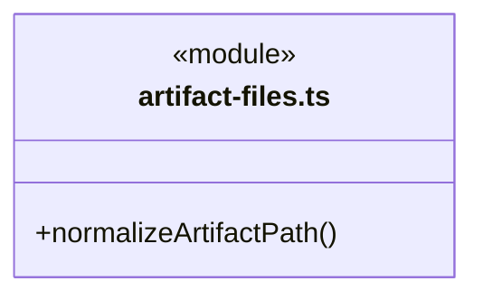

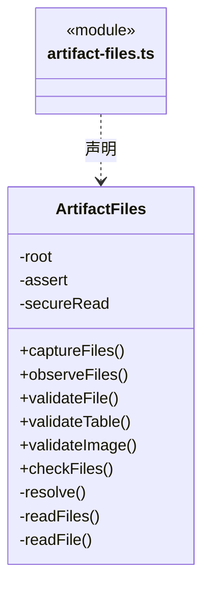

直接依赖：[../../../core/foundation/errors.ts](../../../core/foundation/errors.ts)、[../../../core/evidence/artifact-baseline.ts](../../../core/evidence/artifact-baseline.ts)、[../../../core/workspace/json-validation-schema.ts](../../../core/workspace/json-validation-schema.ts)、[../../../core/workspace/csv-validation-schema.ts](../../../core/workspace/csv-validation-schema.ts)、[../../../core/workspace/png-validation-schema.ts](../../../core/workspace/png-validation-schema.ts)、[png-validator.ts](png-validator.ts)、[../../../core/tasks/effect-observation.ts](../../../core/tasks/effect-observation.ts)。

### controlled-file-blobs.ts

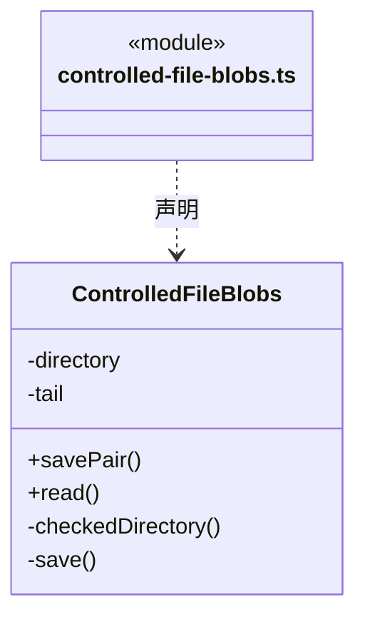

直接依赖：[../../../core/foundation/errors.ts](../../../core/foundation/errors.ts)、[../../../core/file-operations/controlled-file-operation.ts](../../../core/file-operations/controlled-file-operation.ts)、[../../../core/file-operations/controlled-file-event.ts](../../../core/file-operations/controlled-file-event.ts)。

### controlled-file-child.ts

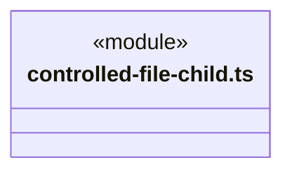
直接依赖：[controlled-file-protocol.ts](controlled-file-protocol.ts)、[controlled-file-win32.ts](controlled-file-win32.ts)。

### controlled-file-protocol.ts

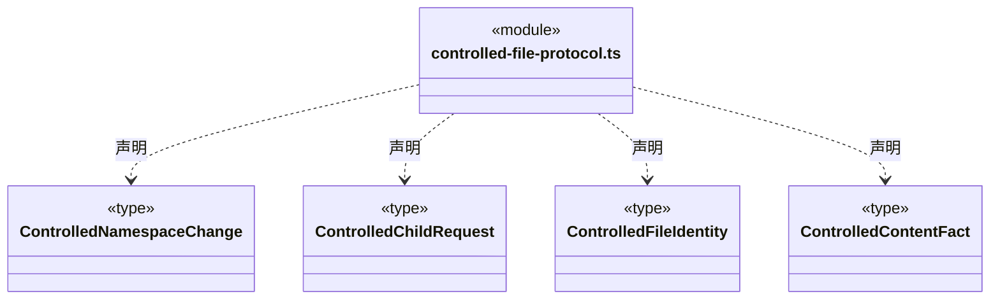

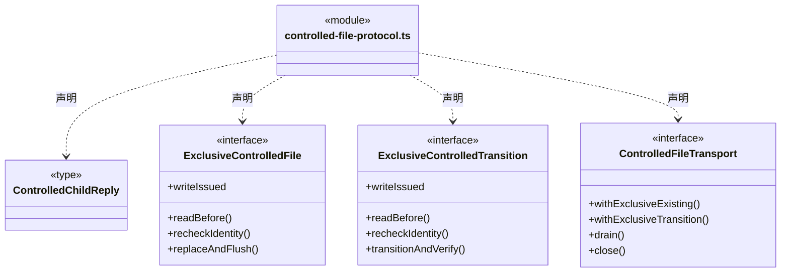

### controlled-file-transport.ts

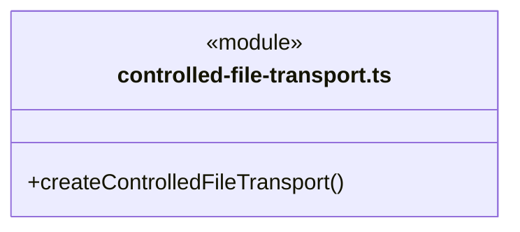

成员 1/2（同名节点为同一声明，跨图合并阅读）。

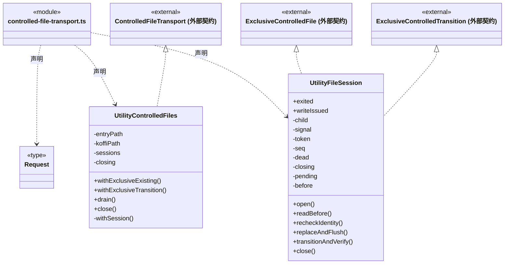

成员 2/2（同名节点为同一声明，跨图合并阅读）。

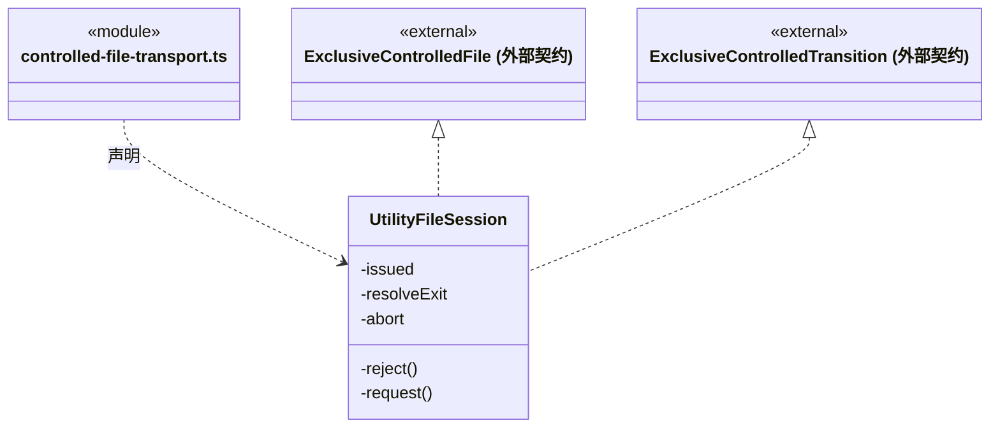

直接依赖：[../../../core/foundation/errors.ts](../../../core/foundation/errors.ts)、[controlled-file-protocol.ts](controlled-file-protocol.ts)。

### controlled-file-win32.ts

成员 1/2（同名节点为同一声明，跨图合并阅读）。

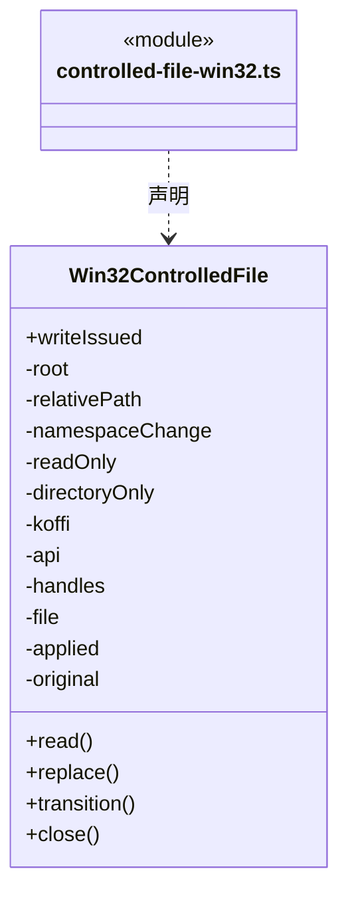

成员 2/2（同名节点为同一声明，跨图合并阅读）。

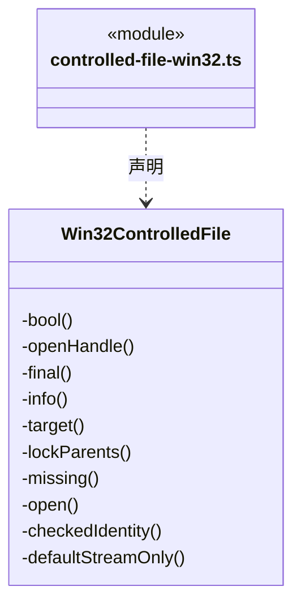

直接依赖：[controlled-file-protocol.ts](controlled-file-protocol.ts)。

### output-manifest-files.ts

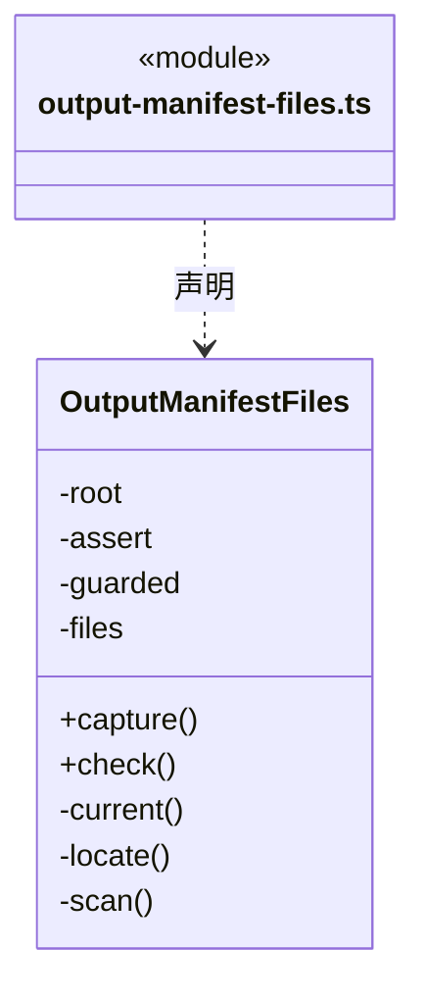

直接依赖：[../../../core/foundation/errors.ts](../../../core/foundation/errors.ts)、[../../../core/workspace/artifact-scope.ts](../../../core/workspace/artifact-scope.ts)、[../../../core/evidence/output-manifest.ts](../../../core/evidence/output-manifest.ts)、[../../../core/evidence/output-manifest-evidence.ts](../../../core/evidence/output-manifest-evidence.ts)、[artifact-files.ts](artifact-files.ts)。

### png-validator.ts

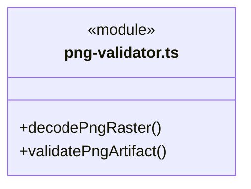

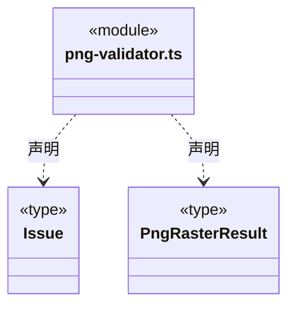

直接依赖：[../../../core/foundation/errors.ts](../../../core/foundation/errors.ts)、[../../../core/workspace/png-validation-schema.ts](../../../core/workspace/png-validation-schema.ts)。

### scoped-execution-files.ts

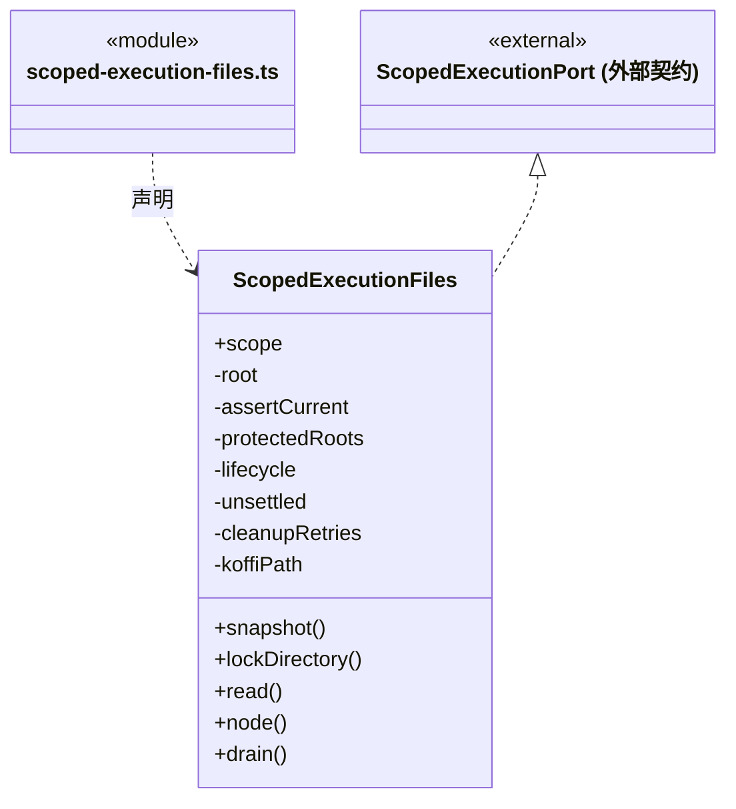

直接依赖：[../../../core/workspace/execution-scope.ts](../../../core/workspace/execution-scope.ts)、[../../../core/file-operations/scoped-execution.ts](../../../core/file-operations/scoped-execution.ts)、[../../../core/execution/capabilities/run-scoped-execution.ts](../../../core/execution/capabilities/run-scoped-execution.ts)、[controlled-file-win32.ts](controlled-file-win32.ts)、[../isolation/isolated-node.ts](../isolation/isolated-node.ts)、[../../../core/foundation/errors.ts](../../../core/foundation/errors.ts)、[../../../core/file-operations/isolated-execution-recovery.ts](../../../core/file-operations/isolated-execution-recovery.ts)、[../isolation/isolation-record.ts](../isolation/isolation-record.ts)。

### 本目录调用边界

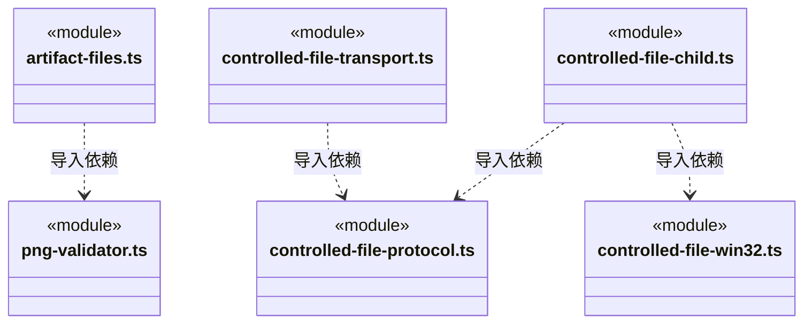

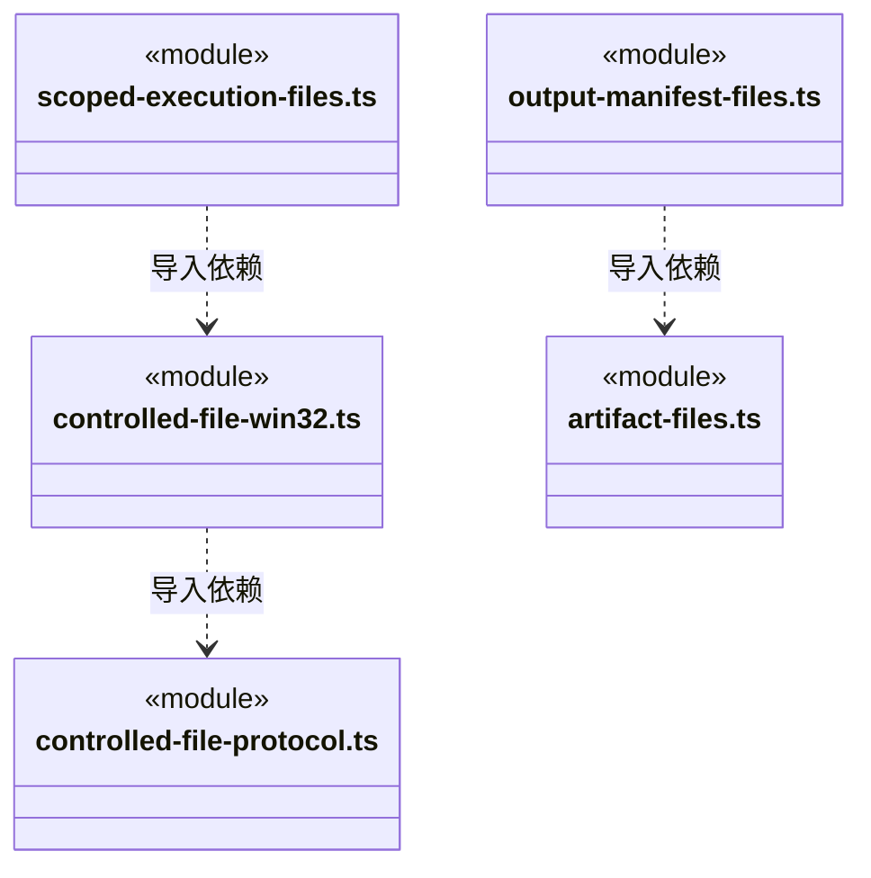

## 子目录导航

无子目录。

[返回上层](../ARCHITECTURE.md)。

每次修改本目录代码，同步维护文件头、关键契约说明及本图。未实现的治理、证据验收和自动编排能力不列入当前类图。
