# src/backend/main/platform/isolation 架构

## 目录定位

隔离执行平台：Win32/Job/LPAC、冻结输入、执行结果和恢复核实。权限和资源释放语义保持原有实现；目录整理不声称修复历史隔离恢复竞争。

本文描述当前实现。通过分析目录边界后维护的 [源码架构脚本](../../../../../scripts/source-architecture.mjs) 同步清单和声明；代码变更时仍须核对职责、关键成员与关系。

## 代码清单

| 文件 | 当前职责 |
| --- | --- |
| [isolated-node-protocol.ts](isolated-node-protocol.ts) | 声明平台隔离执行器的有界输入与返回事实，供可信装配和独立平台验收使用。 |
| [isolated-node-win32.ts](isolated-node-win32.ts) | 以 Win32 LPAC Token、显式 ACL 和 Job Object 启动并收束真实程序，属于 Main 平台边界。 |
| [isolated-node.ts](isolated-node.ts) | 复制可信字节快照与本机执行器到私有目录，用宿主预置标准流执行有界 LPAC 程序并返回真实平台事实。 |
| [isolation-record.ts](isolation-record.ts) | Main 私有的隔离资源身份和生命周期协议，连接执行器、可靠记录与核实平台。 |
| [isolation-records.ts](isolation-records.ts) | 原隔离执行的私有追加记录，保存启动前来源与资源清理阶段。 |
| [isolation-recovery-win32.ts](isolation-recovery-win32.ts) | 核实原宿主创建身份、命名 Job 和自有目录，并以固定 Win32 句柄回收残留。 |

## 架构类图

### isolated-node-protocol.ts

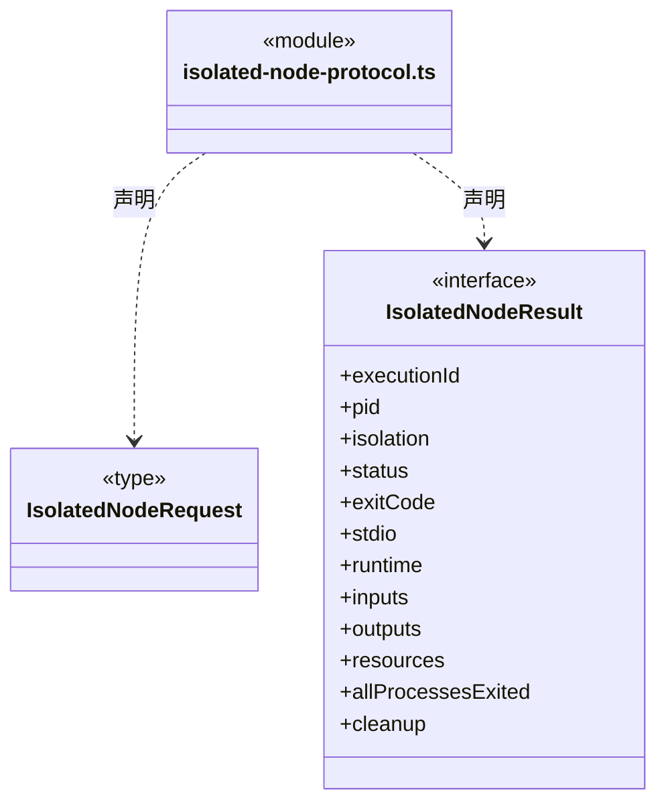

### isolated-node-win32.ts

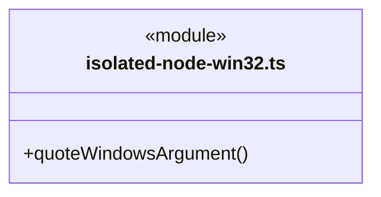

成员 1/3（同名节点为同一声明，跨图合并阅读）。

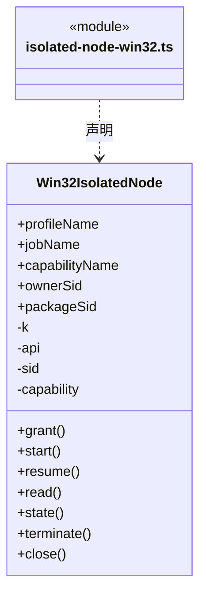

成员 2/3（同名节点为同一声明，跨图合并阅读）。

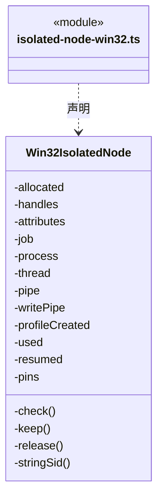

成员 3/3（同名节点为同一声明，跨图合并阅读）。

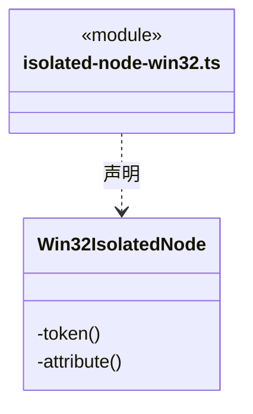

### isolated-node.ts

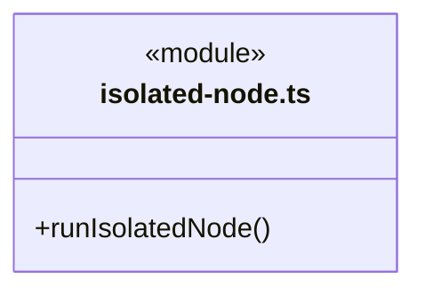

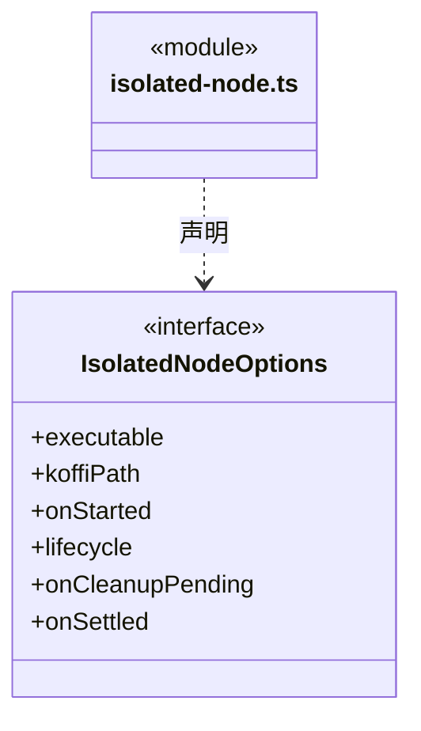

直接依赖：[isolated-node-win32.ts](isolated-node-win32.ts)、[isolation-recovery-win32.ts](isolation-recovery-win32.ts)、[isolation-record.ts](isolation-record.ts)、[isolated-node-protocol.ts](isolated-node-protocol.ts)。

### isolation-record.ts

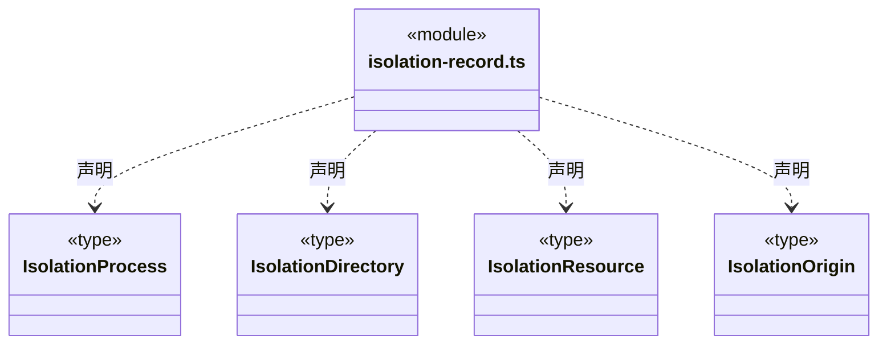

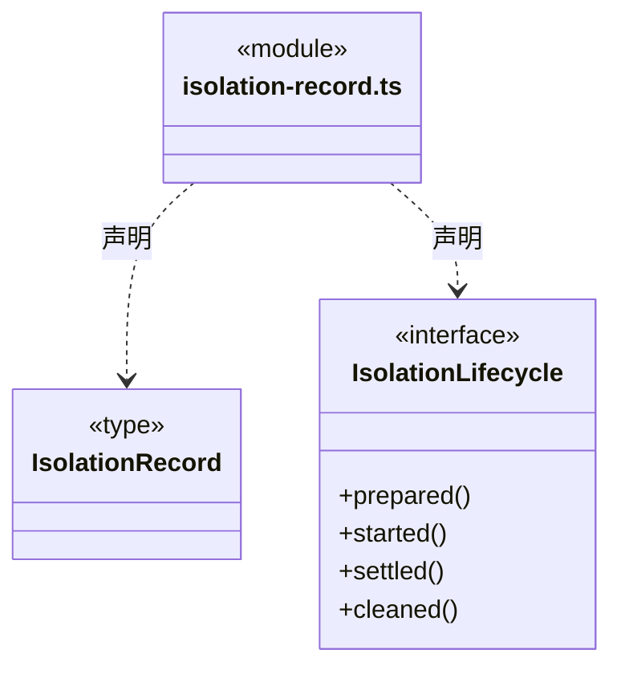

直接依赖：[../../../core/file-operations/controlled-file-operation.ts](../../../core/file-operations/controlled-file-operation.ts)、[../../../core/file-operations/isolated-execution-recovery.ts](../../../core/file-operations/isolated-execution-recovery.ts)。

### isolation-records.ts

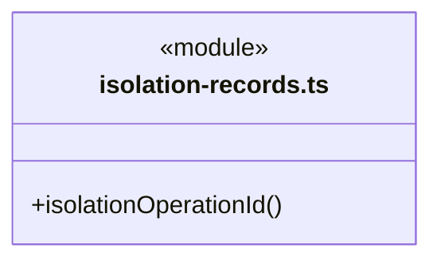

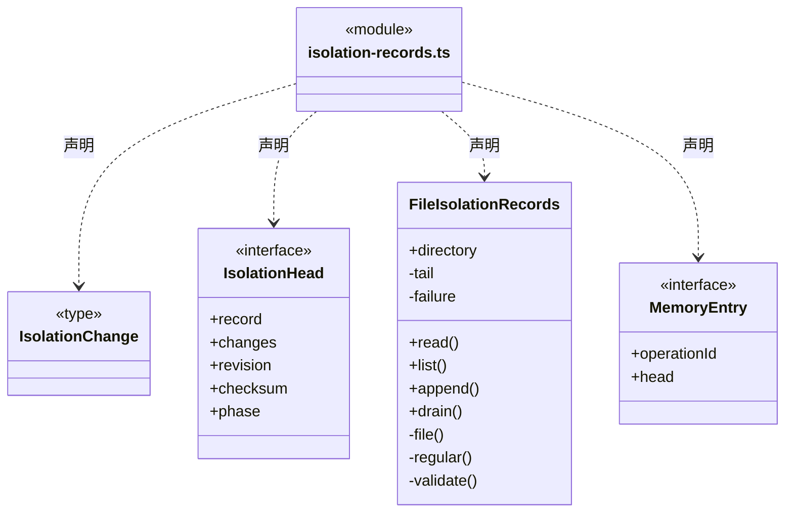

直接依赖：[../../../core/foundation/serialization.ts](../../../core/foundation/serialization.ts)、[../../../core/foundation/identity.ts](../../../core/foundation/identity.ts)、[../../../core/foundation/errors.ts](../../../core/foundation/errors.ts)、[isolation-record.ts](isolation-record.ts)。

### isolation-recovery-win32.ts

成员 1/2（同名节点为同一声明，跨图合并阅读）。

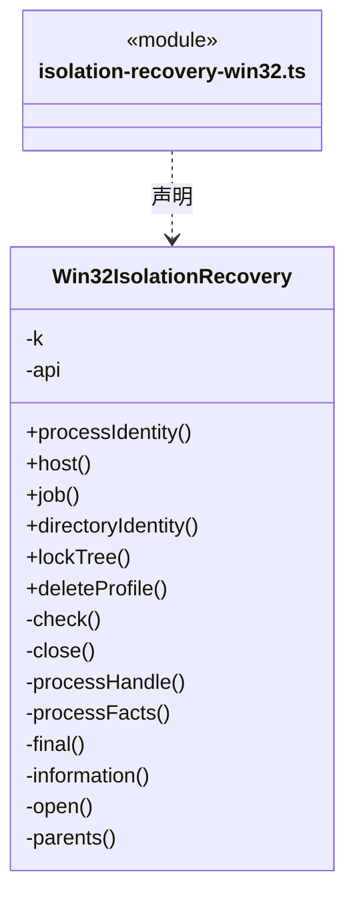

成员 2/2（同名节点为同一声明，跨图合并阅读）。

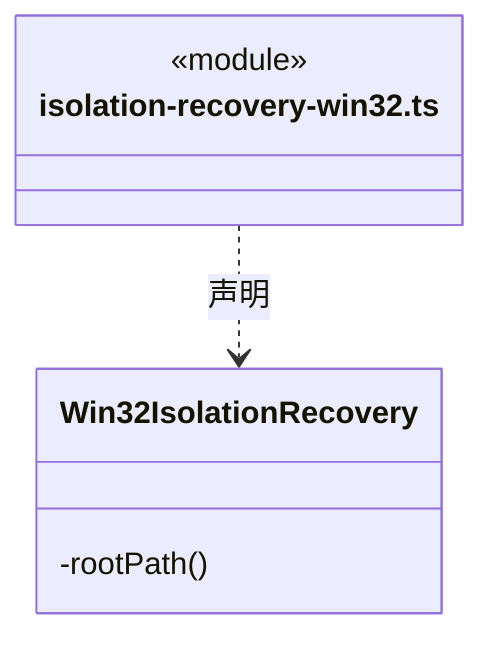

直接依赖：[isolation-record.ts](isolation-record.ts)。

### 本目录调用边界

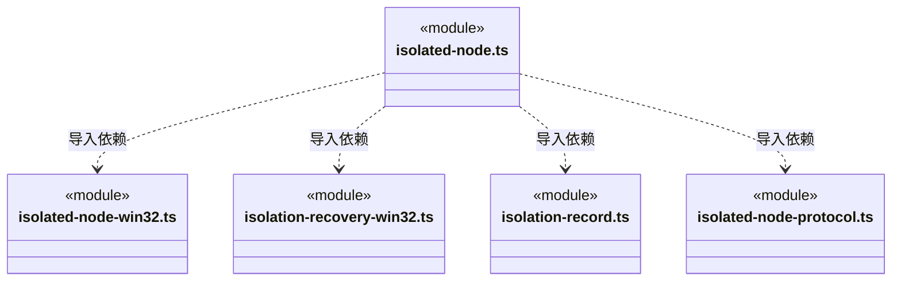

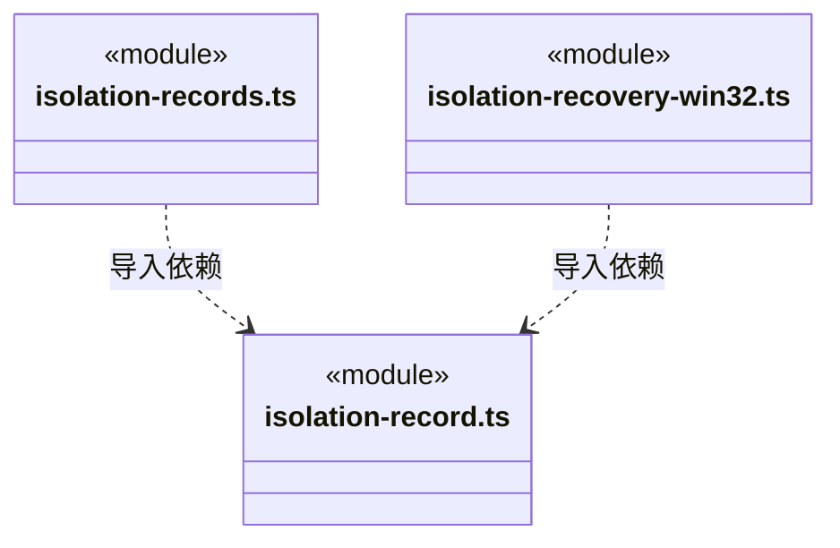

## 子目录导航

无子目录。

[返回上层](../ARCHITECTURE.md)。

每次修改本目录代码，同步维护文件头、关键契约说明及本图。未实现的治理、证据验收和自动编排能力不列入当前类图。
