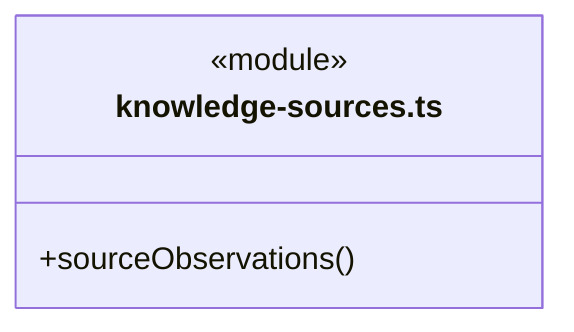
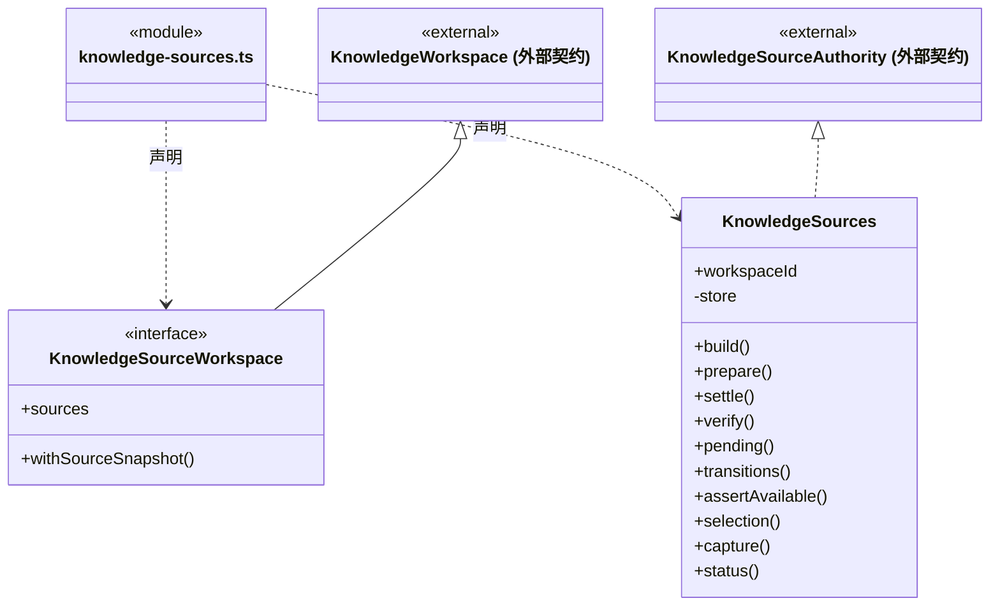
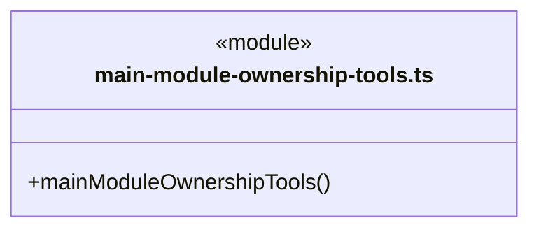
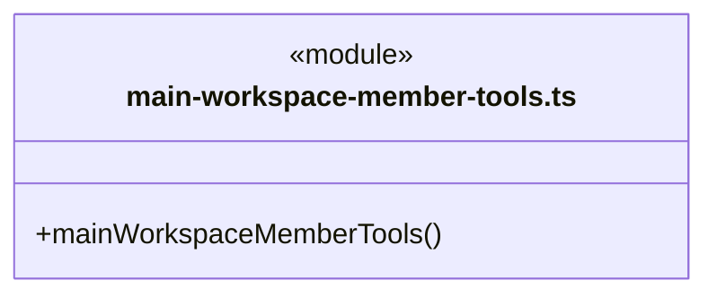
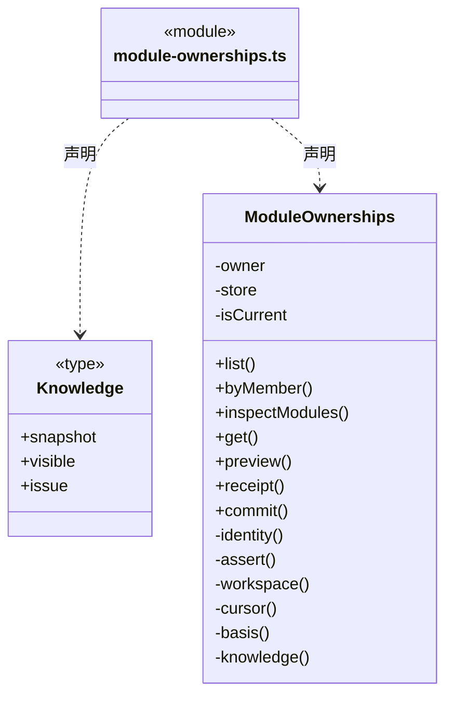
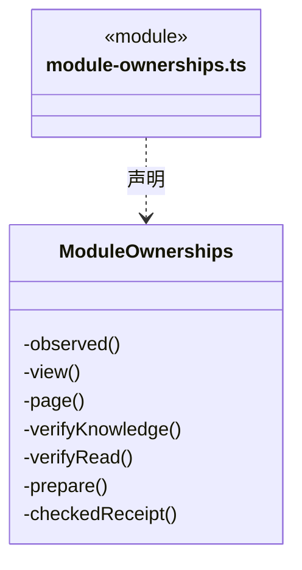
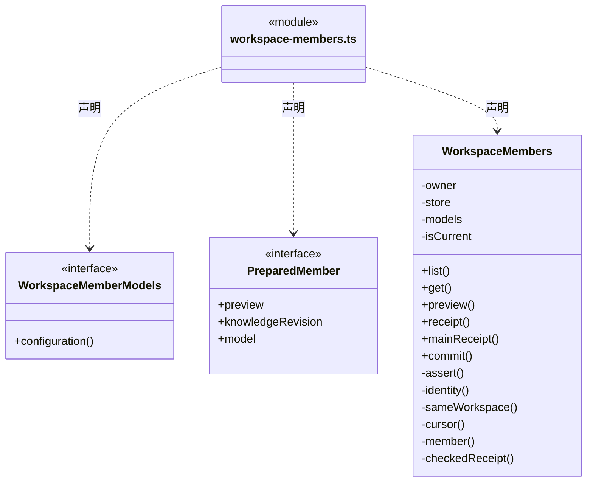
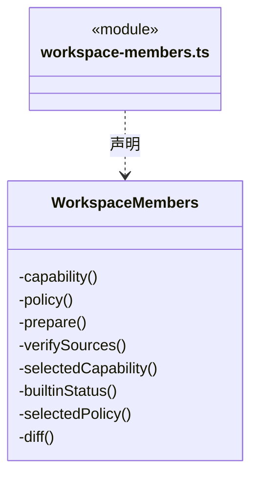
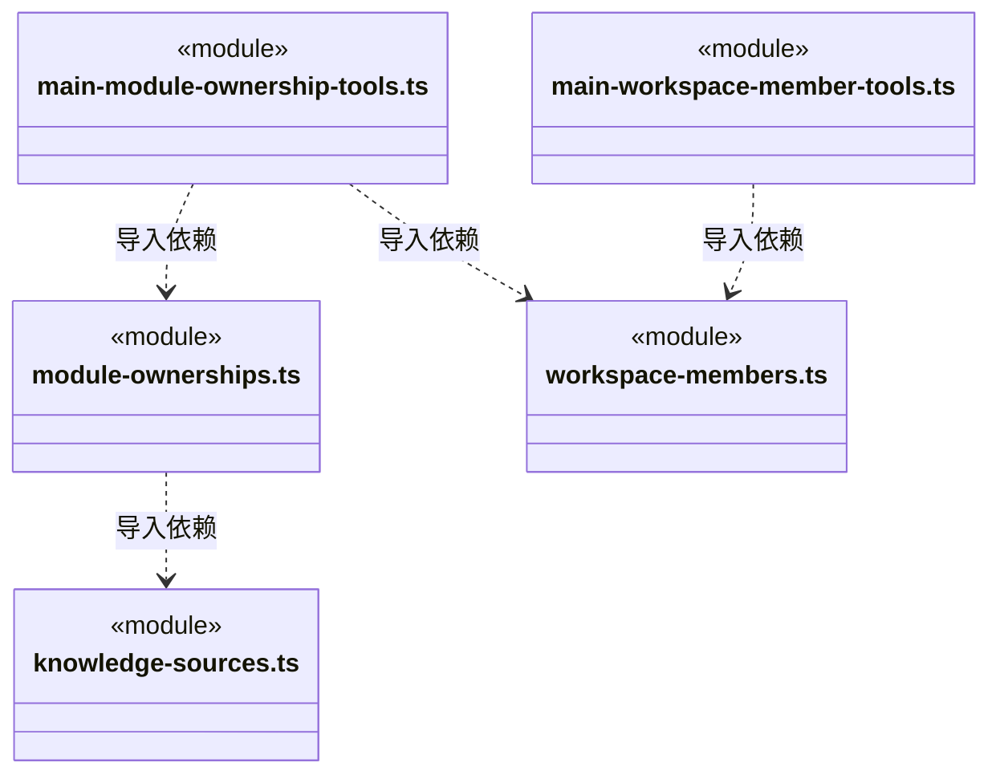
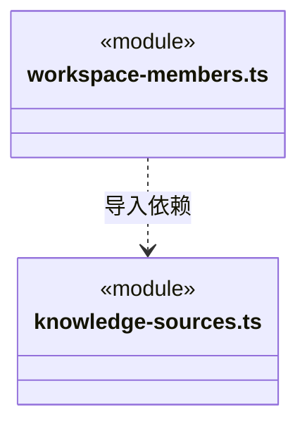

# src/backend/main/registry 架构

## 目录定位

岗位、来源与责任登记的应用服务；协调知识、文件实现和 Core 的规则，不拥有正式运行准入。

本文描述当前实现。通过分析目录边界后维护的 [源码架构脚本](../../../../scripts/source-architecture.mjs) 同步清单和声明；代码变更时仍须核对职责、关键成员与关系。

## 代码清单

| 文件 | 当前职责 |
| --- | --- |
| [knowledge-sources.ts](knowledge-sources.ts) | 将原知识事务的来源屏障与岗位/责任的明确来源采纳接到唯一 DispatchStore。 |
| [main-module-ownership-tools.ts](main-module-ownership-tools.ts) | 把工作区责任服务绑定真实主运行及当前协作周期，提供四项模型窄端口。 |
| [main-workspace-member-tools.ts](main-workspace-member-tools.ts) | 把岗位服务装配到真实主运行；工作区、actor 和命令身份由闭包持有。 |
| [module-ownerships.ts](module-ownerships.ts) | 桌面与真实主工具共用的模块负责人服务，关系和岗位在唯一 DispatchStore 内裁决。 |
| [workspace-members.ts](workspace-members.ts) | 将桌面岗位登记、采纳与当前差异查询接到工作区唯一 DispatchStore，公开模型配置由 Main 注入。 |

## 架构类图

### knowledge-sources.ts

直接依赖：[../../../core/platform/node/serialization.ts](../../../core/platform/node/serialization.ts)、[../../../core/json.ts](../../../core/json.ts)、[../../../core/errors.ts](../../../core/errors.ts)、[../../../logic/dispatch/rules/dispatch-storage.ts](../../../logic/dispatch/rules/dispatch-storage.ts)、[../../../logic/knowledge/rules/types.ts](../../../logic/knowledge/rules/types.ts)、[../../../logic/knowledge/rules/ports.ts](../../../logic/knowledge/rules/ports.ts)、[../../../logic/knowledge/rules/planned-commit.ts](../../../logic/knowledge/rules/planned-commit.ts)、[../../../logic/workspace/rules/knowledge-source.ts](../../../logic/workspace/rules/knowledge-source.ts)、[../../../logic/workspace/rules/knowledge-source-rules.ts](../../../logic/workspace/rules/knowledge-source-rules.ts)、[../knowledge/source-journal.ts](../knowledge/source-journal.ts)。

### main-module-ownership-tools.ts

直接依赖：[../../../core/errors.ts](../../../core/errors.ts)、[../../../logic/execution/rules/conversation-binding.ts](../../../logic/execution/rules/conversation-binding.ts)、[../../../logic/tasks/rules/types.ts](../../../logic/tasks/rules/types.ts)、[../../../logic/workspace/rules/module-ownership.ts](../../../logic/workspace/rules/module-ownership.ts)、[../../../logic/workspace/rules/module-ownership-rules.ts](../../../logic/workspace/rules/module-ownership-rules.ts)、[../../../logic/workspace/rules/module-ownership-tools.ts](../../../logic/workspace/rules/module-ownership-tools.ts)、[../../../logic/dispatch/runtime/auto-collaboration.ts](../../../logic/dispatch/runtime/auto-collaboration.ts)、[../../../logic/knowledge/rules/ports.ts](../../../logic/knowledge/rules/ports.ts)、[module-ownerships.ts](module-ownerships.ts)、[workspace-members.ts](workspace-members.ts)、[../../../logic/dispatch/runtime/owner-execution-service.ts](../../../logic/dispatch/runtime/owner-execution-service.ts)。

### main-workspace-member-tools.ts

直接依赖：[../../../core/errors.ts](../../../core/errors.ts)、[../../../logic/execution/rules/conversation-binding.ts](../../../logic/execution/rules/conversation-binding.ts)、[../../../logic/models/index.ts](../../../logic/models/index.ts)、[../../../logic/knowledge/rules/read-models/index.ts](../../../logic/knowledge/rules/read-models/index.ts)、[../../../logic/knowledge/rules/ports.ts](../../../logic/knowledge/rules/ports.ts)、[../../../logic/tasks/rules/types.ts](../../../logic/tasks/rules/types.ts)、[../../../logic/team/rules/workspace-member-rules.ts](../../../logic/team/rules/workspace-member-rules.ts)、[../../../logic/team/rules/workspace-member.ts](../../../logic/team/rules/workspace-member.ts)、[../../../logic/team/rules/workspace-member-tools.ts](../../../logic/team/rules/workspace-member-tools.ts)、[../../../logic/dispatch/runtime/auto-collaboration.ts](../../../logic/dispatch/runtime/auto-collaboration.ts)、[workspace-members.ts](workspace-members.ts)。

### module-ownerships.ts

成员 1/2（同名节点为同一声明，跨图合并阅读）。

成员 2/2（同名节点为同一声明，跨图合并阅读）。

直接依赖：[../../../core/errors.ts](../../../core/errors.ts)、[../../../core/platform/node/serialization.ts](../../../core/platform/node/serialization.ts)、[../../../logic/knowledge/rules/types.ts](../../../logic/knowledge/rules/types.ts)、[../../../logic/knowledge/rules/read-models/index.ts](../../../logic/knowledge/rules/read-models/index.ts)、[../../../logic/dispatch/rules/dispatch-storage.ts](../../../logic/dispatch/rules/dispatch-storage.ts)、[../../../logic/team/rules/workspace-member.ts](../../../logic/team/rules/workspace-member.ts)、[../../../logic/workspace/rules/module-ownership.ts](../../../logic/workspace/rules/module-ownership.ts)、[../../../logic/workspace/rules/module-ownership-rules.ts](../../../logic/workspace/rules/module-ownership-rules.ts)、[../../../logic/tasks/rules/module-ownership-invariants.ts](../../../logic/tasks/rules/module-ownership-invariants.ts)、[knowledge-sources.ts](knowledge-sources.ts)、[../../../logic/workspace/rules/knowledge-source-rules.ts](../../../logic/workspace/rules/knowledge-source-rules.ts)。

### workspace-members.ts

成员 1/2（同名节点为同一声明，跨图合并阅读）。

成员 2/2（同名节点为同一声明，跨图合并阅读）。

直接依赖：[../../../logic/knowledge/rules/read-models/index.ts](../../../logic/knowledge/rules/read-models/index.ts)、[../../../logic/models/index.ts](../../../logic/models/index.ts)、[../../../core/errors.ts](../../../core/errors.ts)、[../../../logic/dispatch/rules/dispatch-storage.ts](../../../logic/dispatch/rules/dispatch-storage.ts)、[../../../logic/team/rules/workspace-member.ts](../../../logic/team/rules/workspace-member.ts)、[../../../logic/team/rules/workspace-member-rules.ts](../../../logic/team/rules/workspace-member-rules.ts)、[../../../logic/execution/context/dispatch-context.ts](../../../logic/execution/context/dispatch-context.ts)、[../../../logic/knowledge/rules/types.ts](../../../logic/knowledge/rules/types.ts)、[../../../logic/workspace/rules/knowledge-source-rules.ts](../../../logic/workspace/rules/knowledge-source-rules.ts)、[../../../logic/workspace/rules/knowledge-source.ts](../../../logic/workspace/rules/knowledge-source.ts)、[knowledge-sources.ts](knowledge-sources.ts)。

### 本目录调用边界

## 子目录导航

无子目录。

[返回上层](../ARCHITECTURE.md)。

每次修改本目录代码，同步维护文件头、关键契约说明及本图。未实现的治理、证据验收和自动编排能力不列入当前类图。
