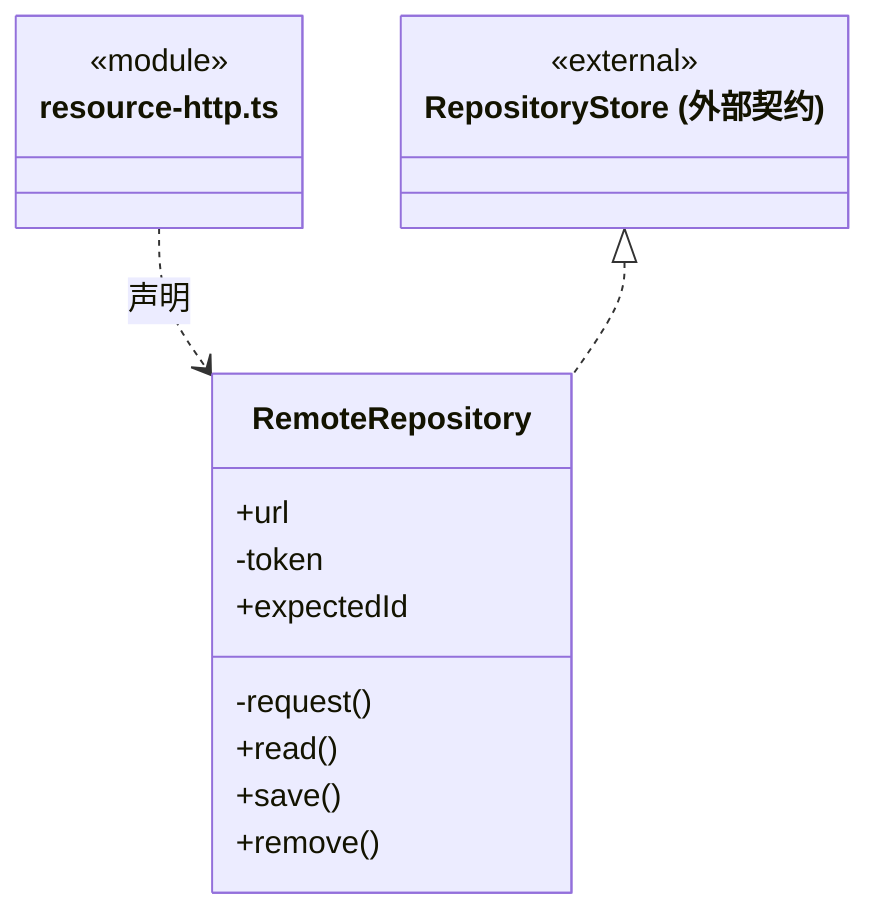
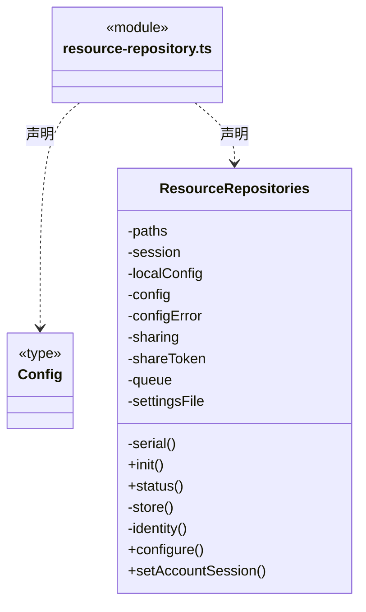
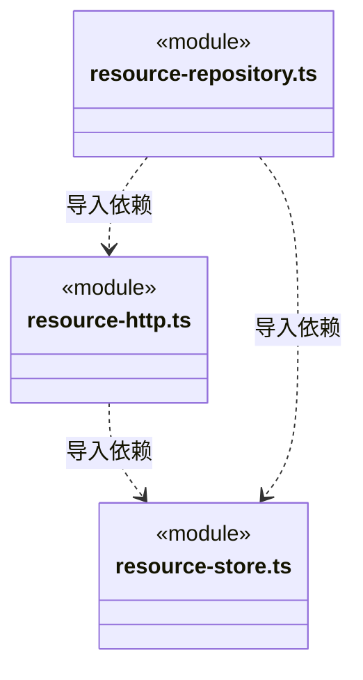

# src/backend/main/resources 架构

## 目录定位

链接器、人才和业务模板共用的本地/远端资源仓库实现。资源定义不等于已连接的可执行工具。

本文描述当前实现。通过分析目录边界后维护的 [源码架构脚本](../../../../scripts/source-architecture.mjs) 同步清单和声明；代码变更时仍须核对职责、关键成员与关系。

## 代码清单

| 文件 | 当前职责 |
| --- | --- |
| [resource-http.ts](resource-http.ts) | RemoteRepository 与 serveRepository：HTTP 客户端和本机仓库共享服务。 |
| [resource-repository.ts](resource-repository.ts) | ResourceRepositories：统一三类资源的仓库选择、账号占位与共享生命周期。 |
| [resource-store.ts](resource-store.ts) | RepositoryStore 与 LocalRepository：本地资源仓库校验、版本检查及原子更新。 |

## 架构类图

### resource-http.ts

直接依赖：[../../core/foundation/errors.ts](../../core/foundation/errors.ts)、[../../core/foundation/serialization.ts](../../core/foundation/serialization.ts)、[resource-store.ts](resource-store.ts)。

### resource-repository.ts

直接依赖：[../platform/paths.ts](../platform/paths.ts)、[../../core/foundation/files.ts](../../core/foundation/files.ts)、[../../core/foundation/errors.ts](../../core/foundation/errors.ts)、[../../core/foundation/serialization.ts](../../core/foundation/serialization.ts)、[resource-store.ts](resource-store.ts)、[resource-http.ts](resource-http.ts)、[../../../bridge/contracts/resources.ts](../../../bridge/contracts/resources.ts)。

### resource-store.ts

直接依赖：[../platform/locking.ts](../platform/locking.ts)、[../../core/foundation/files.ts](../../core/foundation/files.ts)、[../../core/foundation/errors.ts](../../core/foundation/errors.ts)、[../../core/foundation/serialization.ts](../../core/foundation/serialization.ts)、[../../../bridge/contracts/resources.ts](../../../bridge/contracts/resources.ts)。

### 本目录调用边界

## 子目录导航

无子目录。

[返回上层](../ARCHITECTURE.md)。

每次修改本目录代码，同步维护文件头、关键契约说明及本图。未实现的治理、证据验收和自动编排能力不列入当前类图。
