# src/backend/main/resources 架构

## 目录定位

链接器、人才和完整业务模板共用的本地/远端资源仓库。静态资料单次HTTP捕获前后核授权与共享代际，正文快照不安装执行。静态发布与导入同时核对源仓库和目标知识版本，显式提交复用知识事务；资源定义不等于可执行工具。

本文描述当前实现。通过分析目录边界后维护的 [源码架构脚本](../../../../scripts/source-architecture.mjs) 同步清单和声明；代码变更时仍须核对职责、关键成员与关系。

## 代码清单

| 文件 | 当前职责 |
| --- | --- |
| [repository-connection-store.ts](repository-connection-store.ts) | 在应用用户目录保存工作区资源仓库只读授权及原命令回执。 |
| [repository-connections.ts](repository-connections.ts) | 桌面资源仓库连接的知识预览/登记、独立本机授权和显式 HTTP 只读核验。 |
| [resource-http.ts](resource-http.ts) | RemoteRepository 与 serveRepository：HTTP 客户端和本机仓库共享服务。 |
| [resource-repository.ts](resource-repository.ts) | ResourceRepositories：统一三类资源的仓库选择、账号占位与共享生命周期。 |
| [resource-store.ts](resource-store.ts) | RepositoryStore 与 LocalRepository：本地资源仓库校验、版本检查及原子更新。 |
| [workspace-packages.ts](workspace-packages.ts) | 把当前工作区的静态团队/业务架构发布到统一资源仓库，并提供持久化导入预览与显式提交。 |

## 架构类图

### repository-connection-store.ts

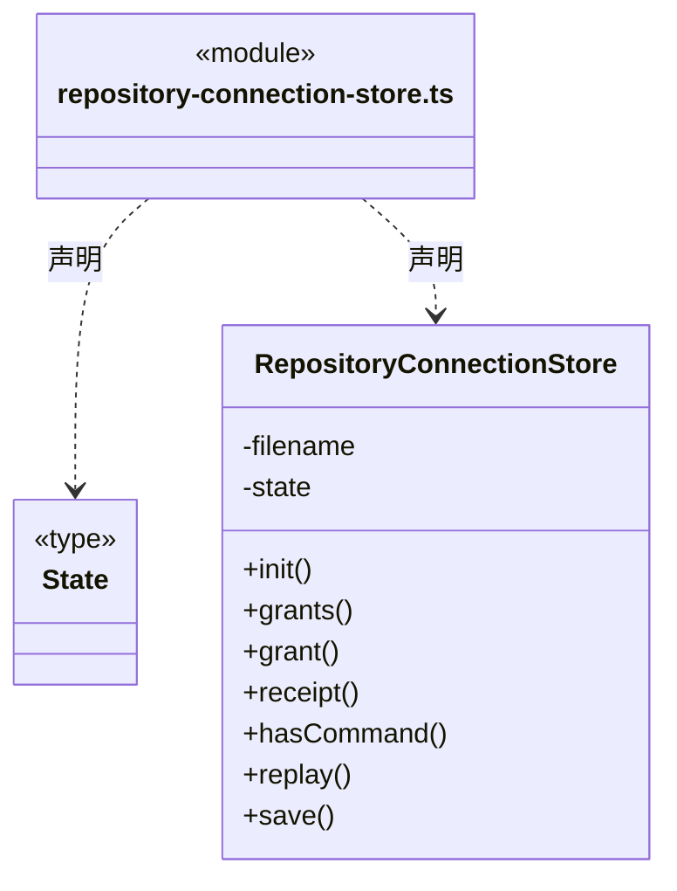

直接依赖：[../../core/foundation/files.ts](../../core/foundation/files.ts)、[../../core/foundation/serialization.ts](../../core/foundation/serialization.ts)、[../../core/foundation/errors.ts](../../core/foundation/errors.ts)、[../../core/connectors/repository-connection.ts](../../core/connectors/repository-connection.ts)。

### repository-connections.ts

成员 1/3（同名节点为同一声明，跨图合并阅读）。

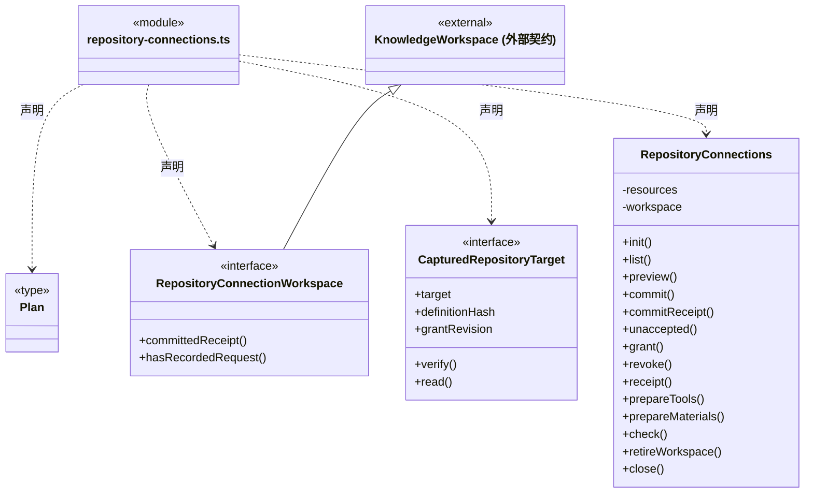

成员 2/3（同名节点为同一声明，跨图合并阅读）。

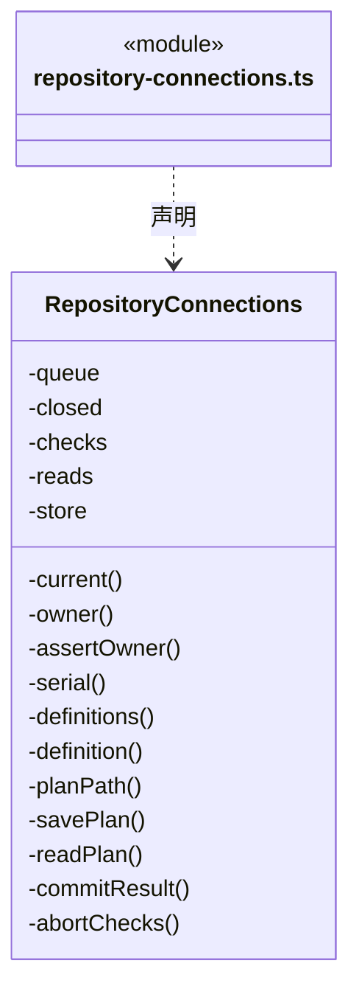

成员 3/3（同名节点为同一声明，跨图合并阅读）。

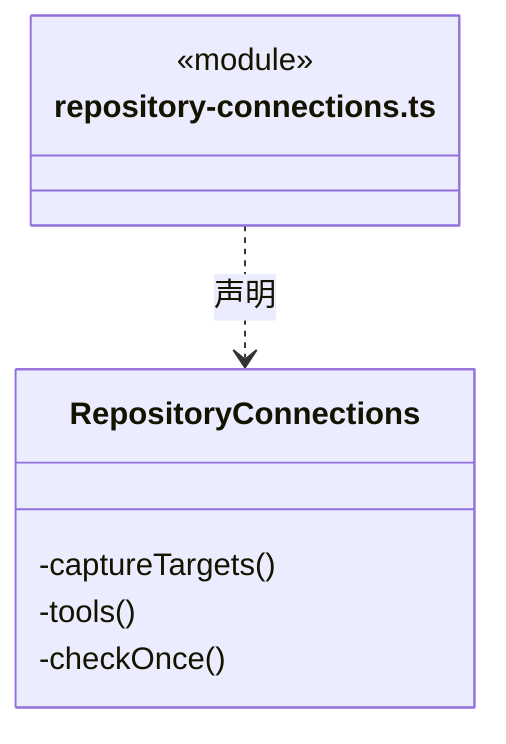

直接依赖：[../../core/foundation/files.ts](../../core/foundation/files.ts)、[../../core/foundation/serialization.ts](../../core/foundation/serialization.ts)、[../../core/foundation/errors.ts](../../core/foundation/errors.ts)、[../../core/knowledge/ports.ts](../../core/knowledge/ports.ts)、[../../core/knowledge/types.ts](../../core/knowledge/types.ts)、[../../core/connectors/definition.ts](../../core/connectors/definition.ts)、[../../core/connectors/repository-connection.ts](../../core/connectors/repository-connection.ts)、[repository-connection-store.ts](repository-connection-store.ts)、[resource-repository.ts](resource-repository.ts)、[../../core/connectors/repository-tools.ts](../../core/connectors/repository-tools.ts)。

### resource-http.ts

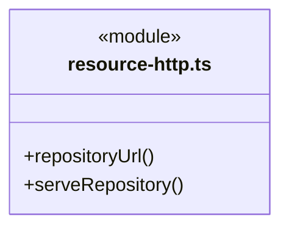

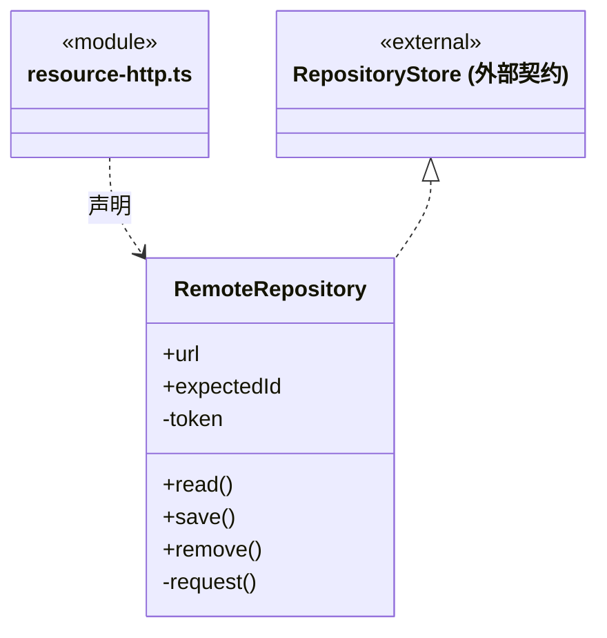

直接依赖：[../../core/foundation/errors.ts](../../core/foundation/errors.ts)、[../../core/foundation/serialization.ts](../../core/foundation/serialization.ts)、[resource-store.ts](resource-store.ts)。

### resource-repository.ts

成员 1/2（同名节点为同一声明，跨图合并阅读）。

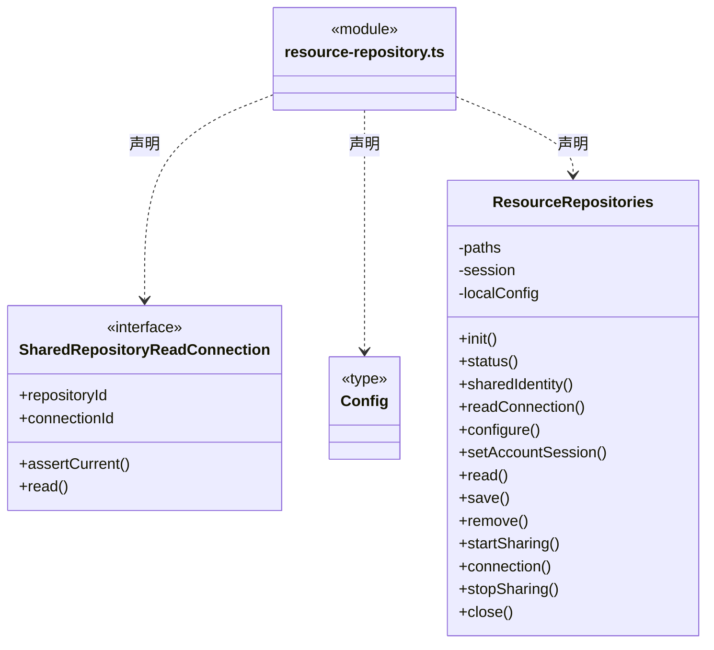

成员 2/2（同名节点为同一声明，跨图合并阅读）。

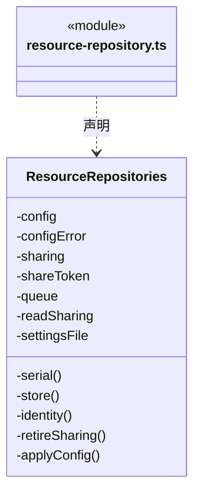

直接依赖：[../platform/paths.ts](../platform/paths.ts)、[../../core/foundation/files.ts](../../core/foundation/files.ts)、[../../core/foundation/errors.ts](../../core/foundation/errors.ts)、[../../core/foundation/serialization.ts](../../core/foundation/serialization.ts)、[resource-store.ts](resource-store.ts)、[resource-http.ts](resource-http.ts)、[../../../bridge/contracts/resources.ts](../../../bridge/contracts/resources.ts)。

### resource-store.ts

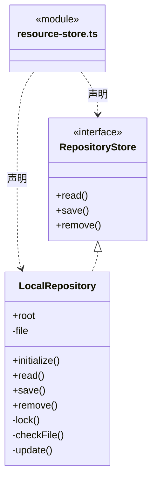

直接依赖：[../platform/locking.ts](../platform/locking.ts)、[../../core/foundation/files.ts](../../core/foundation/files.ts)、[../../core/foundation/errors.ts](../../core/foundation/errors.ts)、[../../core/foundation/serialization.ts](../../core/foundation/serialization.ts)、[../../../bridge/contracts/resources.ts](../../../bridge/contracts/resources.ts)。

### workspace-packages.ts

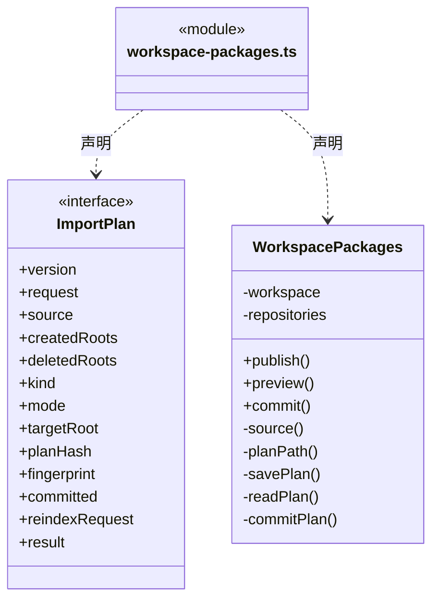

直接依赖：[../../core/foundation/files.ts](../../core/foundation/files.ts)、[../../core/foundation/serialization.ts](../../core/foundation/serialization.ts)、[../../core/foundation/errors.ts](../../core/foundation/errors.ts)、[../../core/knowledge/portable-package.ts](../../core/knowledge/portable-package.ts)、[../../core/knowledge/ports.ts](../../core/knowledge/ports.ts)、[../../core/knowledge/types.ts](../../core/knowledge/types.ts)、[../../core/knowledge/planned-commit.ts](../../core/knowledge/planned-commit.ts)、[../../../bridge/contracts/resources.ts](../../../bridge/contracts/resources.ts)、[resource-repository.ts](resource-repository.ts)。

### 本目录调用边界

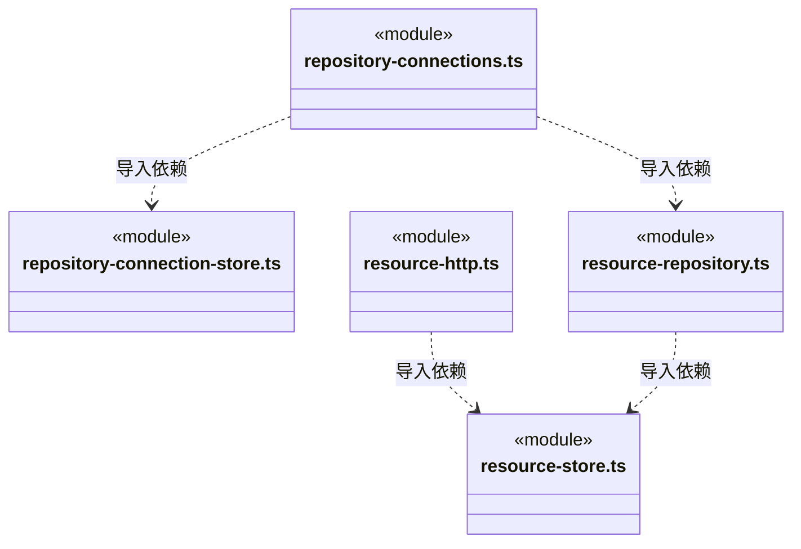

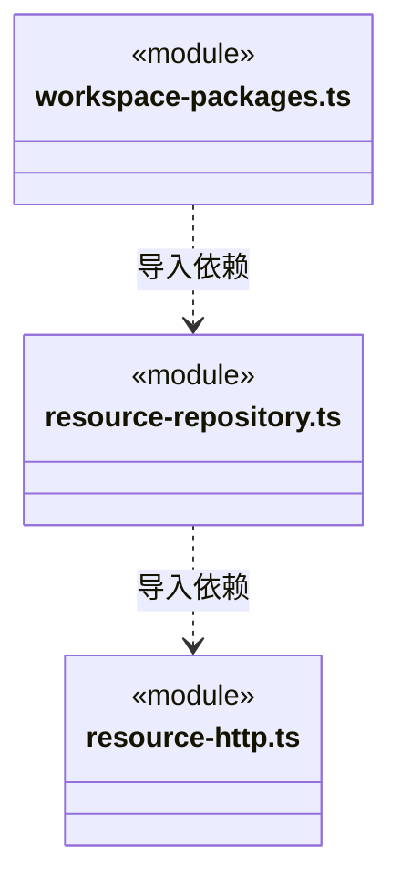

## 子目录导航

无子目录。

[返回上层](../ARCHITECTURE.md)。

每次修改本目录代码，同步维护文件头、关键契约说明及本图。未实现的治理、证据验收和自动编排能力不列入当前类图。

## 设计契约 v1 与落地范围

以下内容区分已接通能力与后续设计；以各节的实现状态为准，不将目标图当作现状图。维护源：[CONTRACT.md](CONTRACT.md)；生成类图时同步附加，勿直接修改本附录。

# 资源仓库与工作区架构传输

链接器、人才市场和业务模板共用 `ResourceRepositories` 的当前仓库。未登录使用本机目录；已连接服务器仓库沿用现有账号会话抽象。界面尚未实现的账户服务不会被本模块冒充为云上传。仓库快照绑定 `repositoryId` 与 `revision`，资源整体 JSON 最多 8 MiB、单项正文最多 2 MiB。

`WorkspacePackages` 只处理静态架构定义。`publish` 从工作区校验快照构建完整包，在用户明确发布操作后保存到当前仓库；源工作区、仓库身份或版本改变则拒绝。相同类型、名称、摘要和完整正文已存在时返回原资源，避免丢失回执后重复发布；不会按名称覆盖其他定义。

`preview` 同时固定工作区实例/版本与源仓库版本/资源哈希，调用原知识校验并将计划保存到工作区的应用缓存 `resource-imports`。预览只显示增删改清单、完整校验和清除绑定提示，不写正式知识。旧普通文本资源、单模块与单 Workflow 资源可继续浏览，不能作为整包应用。

`commit` 必须显式提供同工作区实例的 `planId`。首次写入前复核两端版本、源内容、目标目录冲突及未知资源；正式写入复用 `KnowledgeWorkspace.commit` 的事务、索引和请求幂等日志。跨 IPC 创建的多个门面共用按工作区排队的提交队列。同一计划成功后返回持久化回执；如果正式知识已写入但缓存回执失败，重试只能查询原请求的已提交回执，不能以新版本重放包内容。

整体替换后仅清理已经空的目录，不递归删除任何文件。旧小组物理目录清理后再次通过独立知识事务刷新派生索引；主提交回执和索引请求分别持久化。若并发治理导致索引版本冲突，主包不再执行，显式重试只重新准备索引。未知事务失败保留现场并沿用原恢复要求，不自动重放副作用。实例重启后旧计划不能复用，用户须基于当前知识重新预览。

主知识提交成功后的目录、索引或回执失败以 `RESOURCE_IMPORT_APPLIED` 明确报告“静态定义已应用，后续整理未完成”，附同一个计划 ID；不把部分完成描述成尚未写入或完全成功。完整 Team 替换在预览前按最终定义核对保留花名册的小组引用，不依赖仍在磁盘的旧空目录放行。

共享内容不绑定主会话：一个工作区的静态 Team/业务架构与多个主会话分别拥有的成员调度任务图相互独立。导入不启动 Agent、不派任务、不连接工具、不恢复会话、不继承来源项目的人员或维护授权。

## 显式资源仓库只读连接

`RepositoryConnections` 由桌面明确操作登记和授权，连接当前应用已显式开启共享的本机仓库。`preview / commit` 经原知识预览和事务登记 `resource_repository_v1` 定义，`grant / revoke` 另行修改用户目录中的本机授权；两种存储各自返回回执，不承诺跨存储原子提交。静态定义和导入资源不自动授予权限，旧 Cindy 映射仍为不可执行的静态声明，资源正文不会被自动安装、应用或执行。

授权绑定工作区、链接器、repositoryId、definitionHash 和连续授权 revision。写命令使用固定 commandId；同 ID 异参拒绝，旧 grant 重试只返回原回执，不复活后来已撤销的授权。`RepositoryConnectionStore` 将授权与命令回执同次原子保存，最多 1024 项授权、4096 条命令和 2 MiB；启动核实每条命令链连续且最终授权精确等于最新回执，缺失、孤立或矛盾记录拒绝加载，不能猜测恢复。

`ResourceRepositories.readConnection` 捕获当前共享代际和专用只读令牌，只暴露身份与读取闭包。实际 `RemoteRepository` 发起 HTTP GET，服务端拒绝该令牌的 POST/DELETE；页面不接触 URL、令牌或读写客户端。停止、重配或重新共享使旧代际永久失效；读取前后均核对工作区实例、定义、授权和共享身份。取消及 8 秒超时覆盖响应正文，不自动重试、开启共享、换源或回退本机文件。

`check` 显式读取后只返回最多 20 条目录摘要，无正文；列表和回执查询不发送网络。慢速核验不占授权写队列，撤销和工作区退役可取消在途请求，迟到结果不能通过版本屏障。授权重启后保留，共享服务与临时凭据不自动恢复；用户再次显式共享后使用新的连接代际。

登记计划缓存不是提交证明。`commitReceipt` 使用原 planId 和完整原请求只读核实知识 journal，支持查询旧实例原回执；`commit` 也不能仅凭缓存返回成功。已写正式知识但回执缓存失败报告 `REPOSITORY_CONNECTION_APPLIED`，沿原计划查询，不能用新请求猜测重做。

`unaccepted` 只在连接写队列排空、原实例已退役且原命令完全没有持久记录时返回明确未受理。知识事务的损坏、回滚或未终结记录都算存在；当前实例查询不到回执仍是未知。该只读证明不清历史、不提交原计划，供界面显式核实保存请求后尚未发送便退出的情况。

## 主运行捕获与有界资料读取

`prepareTools(identity)` 在主工厂创建本轮 Runtime 时读取正式定义和已持久授权，捕获原工作区实例、definitionHash、grantRevision 与共享 connectionId，不发送 HTTP。共享未开、没有就绪授权或静态注册表明确无效时不装工具，主会话仍可通过知识服务诊断；IO、关闭和实例错误不被吞成空能力。已有端口执行时的失败始终明确返回，不能降级、重新发现或切换来源。

捕获端口只公开安全目标摘要和 `list/get`，不公开私有指纹、权限版本、地址或令牌。实际网络前后均重新核对原定义、授权、实例与共享代际；撤销、工作区退役和退出取消在途读取，迟到结果不交付。后来的重新授权或共享只能由新主运行捕获，旧端口保持失效。

每次调用仍经过生产 Resource Repository v1 HTTP GET 和原 8 MiB 响应边界。模型目录最多返回 50 项摘要，续页固定 expectedRevision；正文最多 4096 个 Unicode codepoint，按明确 resourceId/revision/offset 读取。结果提供完整原文 SHA-256、总字符数、实际分块和 nextOffset，只有 offset=0 且包含全文才 complete=true。目录或正文版本变化拒绝原请求，不自动刷新版本重读。仓库资料不作为文件基线、成员交付或检查点证据。

桌面 `prepareMaterials(identity)` 与主运行共用同一授权捕获器，但提供独立的单次正文快照读取：用户指定原 connectionId、expectedRevision 和 resourceId，实际 HTTP 返回整份有界仓库后选出原资源。不能循环模型 get 分页拼出不同版本，也不开放 URL、token 或新授权。该端口额外给 Main 保存真实 definitionHash/grantRevision，并在快照落盘后再次核实原捕获；信息只作为当时来源，不成为可复用权限。支持 connector/team/agent/skill/architecture/module/workflow 七种正文，全部是静态资料，不安装、不执行、不导入正式知识。已保存本机快照后撤权不删除历史资料，续跑不再次调用仓库。

## 整包导入来源意图

`WorkspacePackages` 新预览保存 v2 完整不可变计划，源资源指纹、目标域和 add/replace 语义由真实包规划生成；原样 wire 指纹不经 Schema 键序重排。提交仅把计划引用交给固定知识加载器，不能用可变 committed/result 缓存证明来源结算或知识成功。

缓存回执必须与原知识 journal（含需要时的索引 journal）一致。重开后已提交旧计划仅查询并返回原真实回执，不续办旧实例清理、索引或替换；没有原成功日志的旧实例计划拒绝。全包净差异为空继续拒绝，实际整体 replace 中未变字节的对象仍按明确替换域轮换代次。
