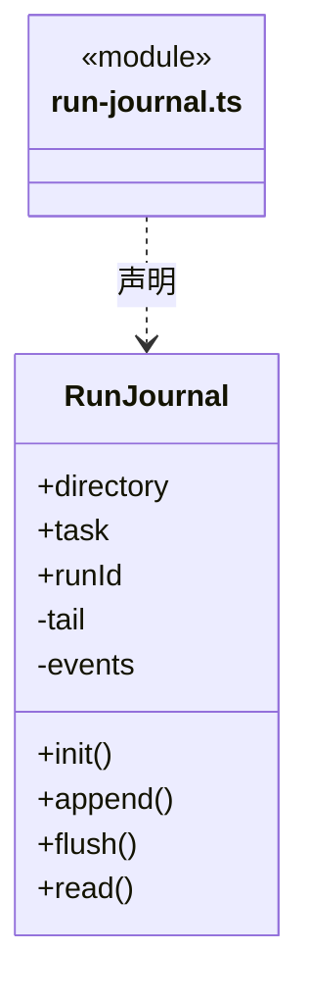
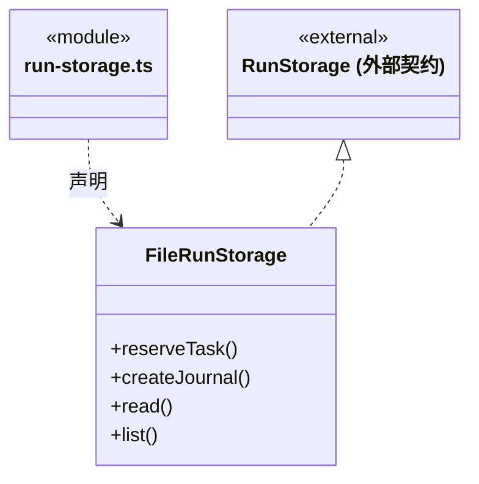
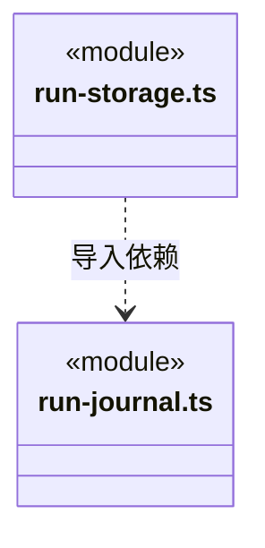

# src/backend/main/run-storage 架构

## 目录定位

运行日志、运行内输入和游标文件实现；按 RunStorage 等 Core 端口提供持久化，保留追加、未知和恢复语义。

本文描述当前实现。通过分析目录边界后维护的 [源码架构脚本](../../../../scripts/source-architecture.mjs) 同步清单和声明；代码变更时仍须核对职责、关键成员与关系。

## 代码清单

| 文件 | 当前职责 |
| --- | --- |
| [run-journal.ts](run-journal.ts) | 本机执行事件日志，顺序追加并 fsync，从记录恢复摘要和未确认工具。 |
| [run-storage.ts](run-storage.ts) | 将本机运行目录和 RunJournal 装配为大脑及调度共享的存储端口。 |

## 架构类图

### run-journal.ts

直接依赖：[../../core/execution/types.ts](../../core/execution/types.ts)、[../../core/tools/types.ts](../../core/tools/types.ts)、[../../core/execution/member-run.ts](../../core/execution/member-run.ts)、[../../core/execution/input-source.ts](../../core/execution/input-source.ts)、[../../core/execution/conversation-binding.ts](../../core/execution/conversation-binding.ts)、[../../core/foundation/errors.ts](../../core/foundation/errors.ts)。

### run-storage.ts

直接依赖：[../../core/execution/storage.ts](../../core/execution/storage.ts)、[../../core/tasks/types.ts](../../core/tasks/types.ts)、[../../core/foundation/identity.ts](../../core/foundation/identity.ts)、[run-journal.ts](run-journal.ts)。

### 本目录调用边界

## 子目录导航

无子目录。

[返回上层](../ARCHITECTURE.md)。

每次修改本目录代码，同步维护文件头、关键契约说明及本图。未实现的治理、证据验收和自动编排能力不列入当前类图。

## 设计契约 v1 与落地范围

以下内容区分已接通能力与后续设计；以各节的实现状态为准，不将目标图当作现状图。维护源：[CONTRACT.md](CONTRACT.md)；生成类图时同步附加，勿直接修改本附录。

# run-storage 持久化契约

### 运行日志的只读完整性诊断

`RunJournal.read` 仅解析完整行并报告 `logIntegrity.partialTail`，保留未完成尾行的原始字节、不截断或修复。零字节文件返回 `RUN_LOG_EMPTY`；结构、绑定或 JSON 损坏返回 `RUN_LOG_INVALID`，错误不包含原始片段。文件系统错误保留系统码，缺失日志不能解释为未执行。正常读取依旧重建可信回执、未知工具与终态，完成前缀不代表尾行也完整。
