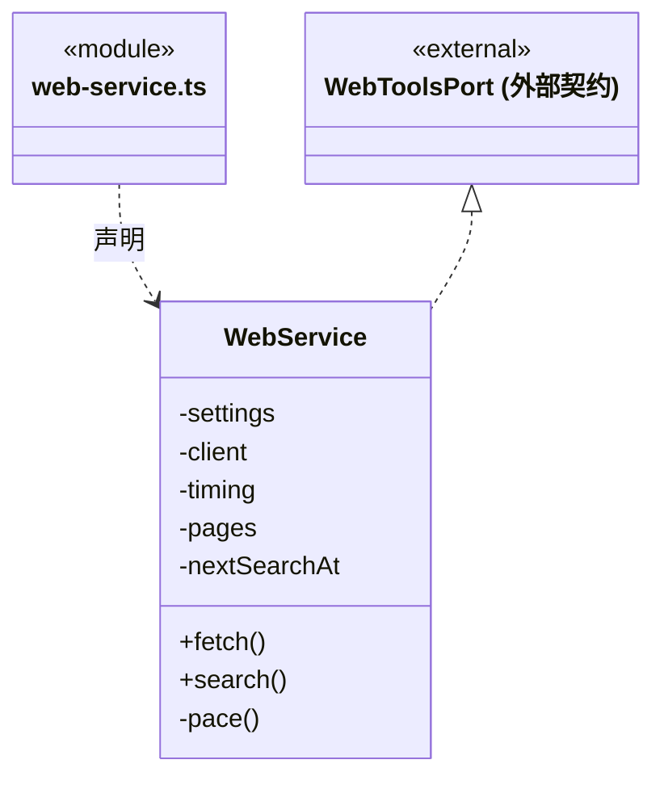

# src/backend/main/web 架构

## 目录定位

CBIM 网页工具的业务适配，组合 foundations/web 并添加来源不可信标记；独立处理 Brave 搜索配置与节流，不持有浏览器或 HTTP 实现。

本文描述当前实现。通过分析目录边界后维护的 [源码架构脚本](../../../../scripts/source-architecture.mjs) 同步清单和声明；代码变更时仍须核对职责、关键成员与关系。

## 代码清单

| 文件 | 当前职责 |
| --- | --- |
| [web-service.ts](web-service.ts) | 将基础网页读取方案适配到 CBIM 工具协议，并连接用户配置的 Brave 搜索。 |

## 架构类图

### web-service.ts

直接依赖：[../../core/connectors/web-tools.ts](../../core/connectors/web-tools.ts)、[../../../foundations/web/index.ts](../../../foundations/web/index.ts)、[../settings/web-settings.ts](../settings/web-settings.ts)。

## 子目录导航

无子目录。

[返回上层](../ARCHITECTURE.md)。

每次修改本目录代码，同步维护文件头、关键契约说明及本图。未实现的治理、证据验收和自动编排能力不列入当前类图。

## 设计契约 v1 与落地范围

以下内容区分已接通能力与后续设计；以各节的实现状态为准，不将目标图当作现状图。维护源：[CONTRACT.md](CONTRACT.md)；生成类图时同步附加，勿直接修改本附录。

# CBIM 网页工具适配

WebService 实现 Core 的 WebToolsPort；通过 `foundations/web` 公开入口组合 WebPageReader，不再实现 HTTP、正文解析、缓存、robots 或浏览器生命周期。基础类库不反向引用本服务。

`fetch` 保持原工具输入输出，基础读取结果附加 `untrusted:true`。Application 持有应用级读取器，桌面通过平台参数注入匿名浏览器；缺少浏览器适配时保留静态错误。

`search` 独立负责 Brave 用户设置和节流，凭据只发固定 API，不跟随重定向；只返回标题、URL 和摘要，不自动抓取结果。搜索密钥与用户身份不传入页面读取器。

读取失败的具体语义与限制见 [基础网页契约](../../../foundations/web/CONTRACT.md)。工具注册和权限仍在 Scheduler，配置与持久化仍在 Main/settings；协议没有新增浏览器控制、登录或任意脚本执行入口。
