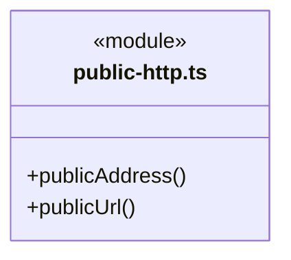
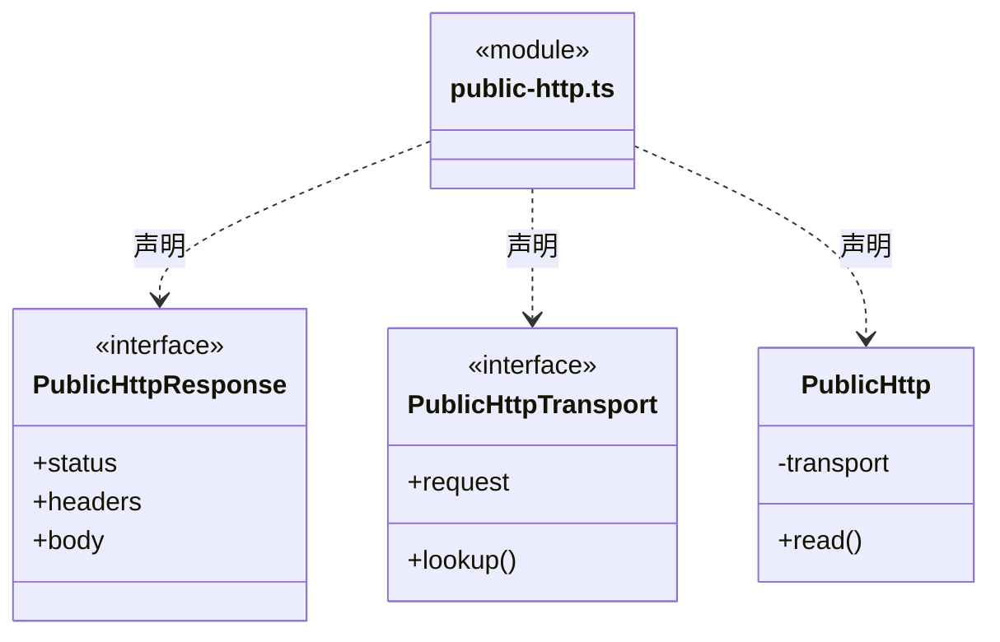
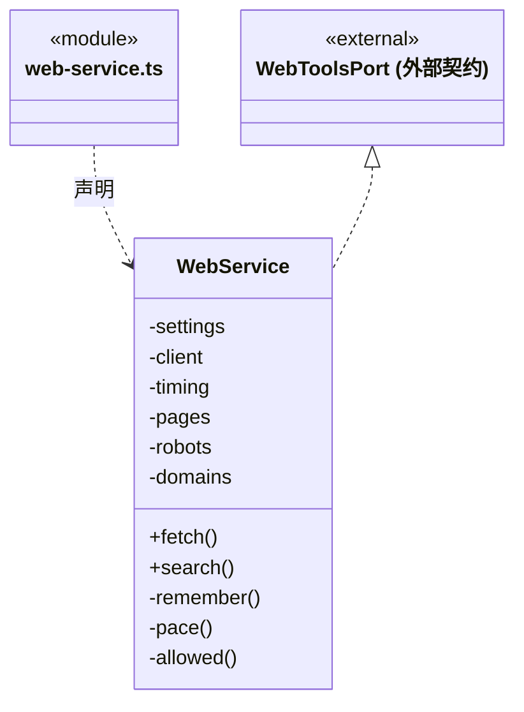
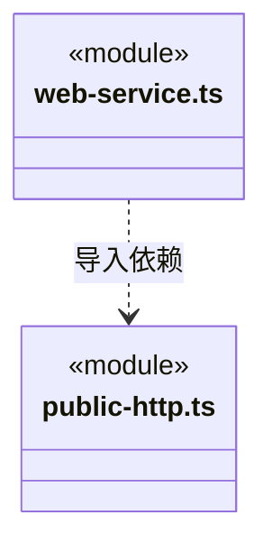

# src/backend/main/web 架构

## 目录定位

网页请求应用服务，封装访问与返回结果；上层通过端口调用。

本文描述当前实现。通过分析目录边界后维护的 [源码架构脚本](../../../../scripts/source-architecture.mjs) 同步清单和声明；代码变更时仍须核对职责、关键成员与关系。

## 代码清单

| 文件 | 当前职责 |
| --- | --- |
| [public-http.ts](public-http.ts) | 仅公开 HTTP/HTTPS 的有界传输，供网页工具使用。 |
| [web-service.ts](web-service.ts) | 网页工具的 robots、域名节流、短缓存与 Brave API 适配。 |

## 架构类图

### public-http.ts

直接依赖：[../../core/foundation/errors.ts](../../core/foundation/errors.ts)。

### web-service.ts

直接依赖：[../../core/connectors/web-tools.ts](../../core/connectors/web-tools.ts)、[public-http.ts](public-http.ts)、[../resources/web-content.ts](../resources/web-content.ts)、[../settings/web-settings.ts](../settings/web-settings.ts)。

### 本目录调用边界

## 子目录导航

无子目录。

[返回上层](../ARCHITECTURE.md)。

每次修改本目录代码，同步维护文件头、关键契约说明及本图。未实现的治理、证据验收和自动编排能力不列入当前类图。
