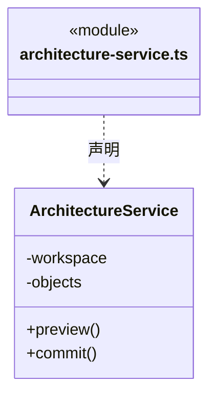
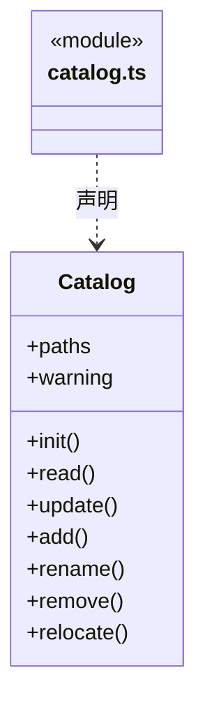
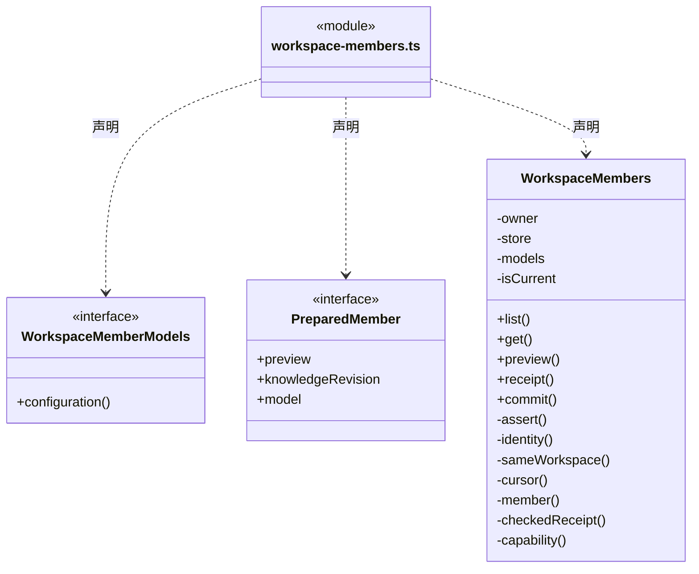
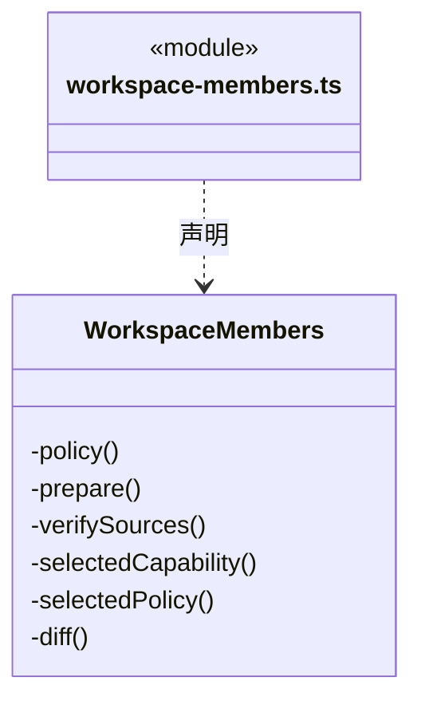
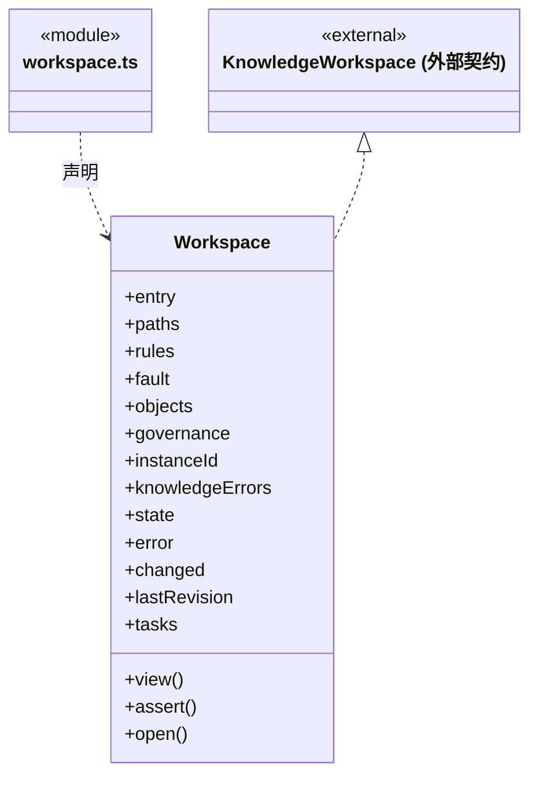
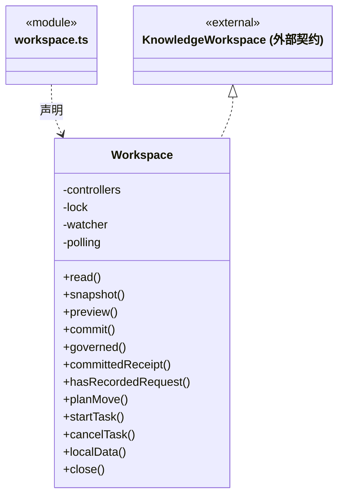
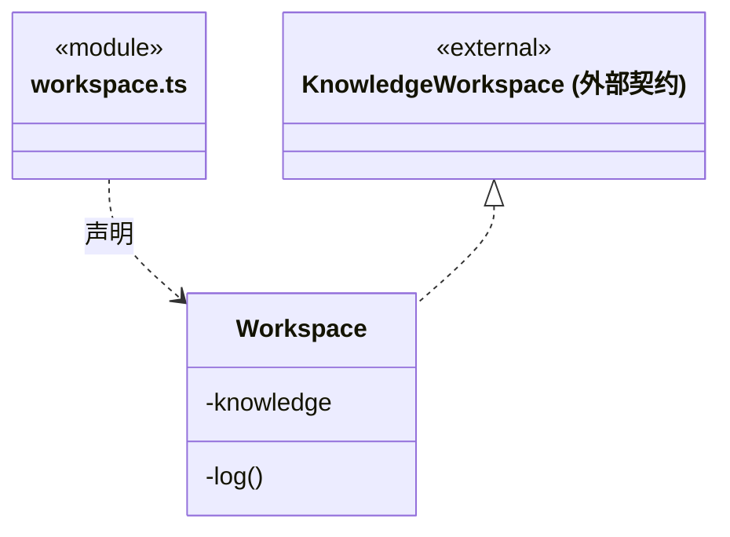
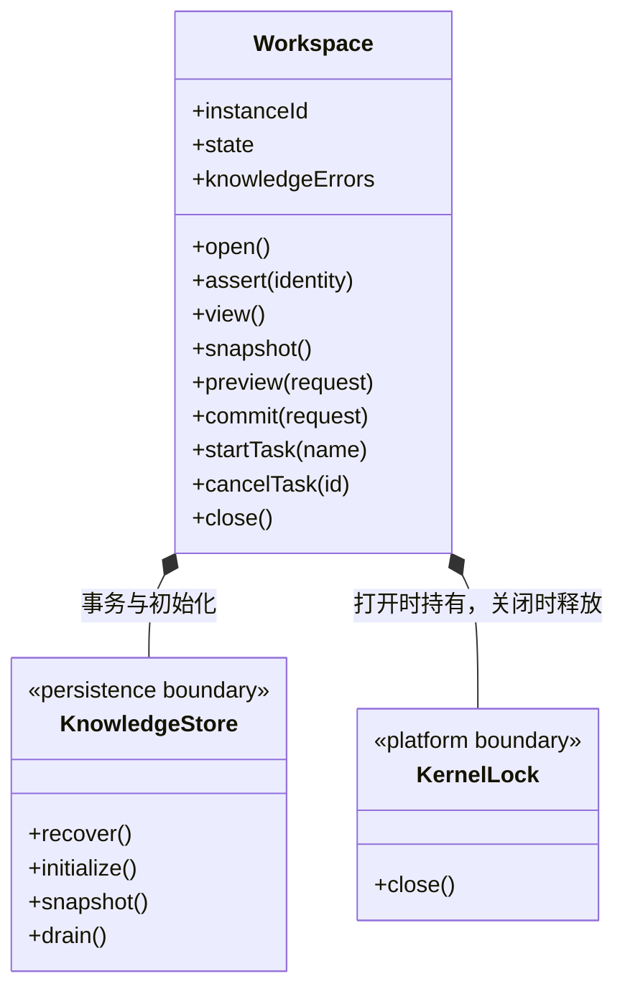

# src/backend/main/workspace 架构

## 目录定位

本机工作区登记、运行实例与可信桌面静态架构编辑。持锁打开、监听、关闭，知识事务委托 persistence/knowledge；模块维护确认和真人条目同事务，不变更动态任务图。岗位登记与当前差异共用工作区DispatchStore，明确选型仅读公开模型配置；不创建运行实例或任务。

本文描述当前实现。通过分析目录边界后维护的 [源码架构脚本](../../../../scripts/source-architecture.mjs) 同步清单和声明；代码变更时仍须核对职责、关键成员与关系。

## 代码清单

| 文件 | 当前职责 |
| --- | --- |
| [architecture-service.ts](architecture-service.ts) | 将团队/业务架构表单接到受控知识事务，作为可信桌面的预览与手动提交入口。 |
| [catalog.ts](catalog.ts) | Catalog：维护本机工作区清单、显示名称、路径身份、并发更新和重新定位。 |
| [workspace-members.ts](workspace-members.ts) | 将桌面岗位登记、采纳与当前差异查询接到工作区唯一 DispatchStore，公开模型配置由 Main 注入。 |
| [workspace.ts](workspace.ts) | 管理本机工作区的身份、独占锁、知识监听和维护任务。 |

## 架构类图

### architecture-service.ts

直接依赖：[../../core/knowledge/object-crud.ts](../../core/knowledge/object-crud.ts)、[../../core/knowledge/ports.ts](../../core/knowledge/ports.ts)、[../../core/foundation/errors.ts](../../core/foundation/errors.ts)、[../../../bridge/contracts/architecture.ts](../../../bridge/contracts/architecture.ts)。

### catalog.ts

直接依赖：[../platform/locking.ts](../platform/locking.ts)、[../platform/paths.ts](../platform/paths.ts)、[../../core/foundation/files.ts](../../core/foundation/files.ts)、[../../core/foundation/serialization.ts](../../core/foundation/serialization.ts)、[../../core/foundation/errors.ts](../../core/foundation/errors.ts)、[../../../bridge/contracts/workspace.ts](../../../bridge/contracts/workspace.ts)。

### workspace-members.ts

成员 1/2（同名节点为同一声明，跨图合并阅读）。

成员 2/2（同名节点为同一声明，跨图合并阅读）。

直接依赖：[../../core/foundation/errors.ts](../../core/foundation/errors.ts)、[../../core/knowledge/ports.ts](../../core/knowledge/ports.ts)、[../../core/tasks/dispatch-storage.ts](../../core/tasks/dispatch-storage.ts)、[../../core/team/workspace-member.ts](../../core/team/workspace-member.ts)、[../../core/team/workspace-member-rules.ts](../../core/team/workspace-member-rules.ts)、[../../scheduler-engine/context/dispatch-context.ts](../../scheduler-engine/context/dispatch-context.ts)。

### workspace.ts

成员 1/3（同名节点为同一声明，跨图合并阅读）。

成员 2/3（同名节点为同一声明，跨图合并阅读）。

成员 3/3（同名节点为同一声明，跨图合并阅读）。

直接依赖：[../persistence/knowledge/object-storage.ts](../persistence/knowledge/object-storage.ts)、[../../core/knowledge/ports.ts](../../core/knowledge/ports.ts)、[../platform/paths.ts](../platform/paths.ts)、[../../core/foundation/files.ts](../../core/foundation/files.ts)、[../../core/foundation/serialization.ts](../../core/foundation/serialization.ts)、[../../core/foundation/errors.ts](../../core/foundation/errors.ts)、[../platform/locking.ts](../platform/locking.ts)、[../../core/knowledge/knowledge.ts](../../core/knowledge/knowledge.ts)、[../persistence/knowledge/knowledge-store.ts](../persistence/knowledge/knowledge-store.ts)、[../governance/module-governance.ts](../governance/module-governance.ts)、[../persistence/knowledge/governance-port.ts](../persistence/knowledge/governance-port.ts)、[../../../bridge/contracts/workspace.ts](../../../bridge/contracts/workspace.ts)。

## 子目录导航

无子目录。

[返回上层](../ARCHITECTURE.md)。

每次修改本目录代码，同步维护文件头、关键契约说明及本图。未实现的治理、证据验收和自动编排能力不列入当前类图。

## 设计契约 v1 与落地范围

以下内容区分已接通能力与后续设计；以各节的实现状态为准，不将目标图当作现状图。维护源：[CONTRACT.md](CONTRACT.md)；生成类图时同步附加，勿直接修改本附录。

### 当前工作区生命周期

本目录实例只负责应用内部运行。`Application` 持有实例并装配执行管理器、成员调度与全局运行监控；界面选择不改变实例所有权。

- `open()` 校验真实路径身份、取得独占锁、恢复事务、初始化缺失知识并校验，之后进入 `running`。知识校验错误计入 `knowledgeErrors`，不伪装为生命周期失败。
- `assert(identity)` 拒绝未运行或旧实例请求。`instanceId` 每次创建变化，不能用旧预览跨实例提交。
- `snapshot/preview/commit` 委托知识存储；运行授权由上层调用边界核验，事务仍校验版本、结构和幂等请求。
- `governance` 使用私有账本保存显式模块保护、观察、提案、人工决定和实施意图；`governed` 与普通知识提交共用队列。打开先核账本完整性锚，再恢复原事务并核 journal 关联；损坏失败关闭，不默默解除保护。重开不执行旧实施意图。
- `committedReceipt/hasRecordedRequest` 由当前运行实例只读查询完整原知识请求的 journal。前者核验原指纹和已提交结果，后者仅报告任何记录是否存在；旧实例请求可查但不可重新提交，损坏或未完成记录不能作为“从未受理”证明。两者不写入、回滚或自动恢复。
- `startTask/cancelTask` 只管理当前实例的知识检查与索引维护任务。取消前核验运行态；未知、其他工作区、对话或成员派发任务 ID 返回 `TASK_NOT_FOUND`。取消请求不伪造终态：正在提交的事务可继续完成，已完成/失败/取消的任务重复调用保持真实结果。
- `close()` 停止监听、取消维护任务、排空知识事务，最后释放锁。应用先排空执行及成员调度，才关闭工作区。
- 工作区诊断只读展示状态与问题，不提供重启操作。打开流程不修改项目的其他开发工具配置。

知识存储与平台边界分别见 [persistence/knowledge](../persistence/knowledge/ARCHITECTURE.md)、[platform](../platform/ARCHITECTURE.md)。

### 长期岗位登记

`WorkspaceMembers` 与成员派发使用同一 `DispatchStore`，通过单条 `workspaceMemberChanges` 审计派生当前岗位；不另外建立 registry 文件，不创建 AgentInstance、Session、任务图、信封或模型运行。`memberId` 是长期岗位身份；静态 `agentId` 是采纳来源，二者均不等于执行实例身份。岗位的 active/suspended/retired 只表示登记状态，配置尚未接入实际派发，也不修改默认执行者回退。

`preview/commit` 接收明确实例、变更与版本。登记和能力采纳读取实际原则及有效继承 Skill；模型配置使用显式 profileId/modelId 的公开字段，不解密、不探测网络。预览不生成岗位或采纳 ID。提交在 Store 串行回调内重建预览并复验登记游标、basis 及选定来源；知识和模型配置是独立存储，前后读取复验不宣称跨存储原子锁。读取期间关闭或来源变更拒绝新提交。

元信息修改只改明确选择的字段；能力与模型必须分别采纳，相同模型引用的配置刷新不能夹在普通编辑中。能力内容 hash 不包含整库知识 revision，模型 hash 保守包含完整公开配置及名称。暂停和恢复不要求当前来源可用，仍保留实际 currentDiff；退休终态不可修改或复活。

`list` 只给摘要，按初次登记顺序分页，后续页必须绑定同登记游标。`get` 每次重新读取知识与公开模型配置，返回 same/changed/missing/invalid；外部来源变化不推进登记游标，也不覆盖已采纳正文。详情读取前后再次比较登记游标，发生并发变更时明确要求重读。

提交先以完整原请求指纹查 `commandReceipt`，已提交命令即使原实例退役或来源不可用也返回原紧凑回执。冲突不能覆盖；只读 receipt 不调用 transact、知识读取或模型解析。未查到不等于证明未受理；未知响应只核实原命令，不自动换 ID 或重做操作。容量累计计算退休岗位与历史审计，超限拒绝写入而不删历史。

### 桌面架构编辑

`ArchitectureService` 接收 `KnowledgeWorkspace` 端口，经严格 schema 和 `assert(identity)` 核实桌面请求。`preview` 要求 `workspaceId + instanceId + revision + operations`，可附真人 `peopleUpserts`；新增/编辑模块必须显式提交 `{moduleId?, maintainerPersonIds, confirmed:true}`。单次桌面预览最多新增/编辑一个模块，省略 moduleId 时由该操作推导。前端不能提供维护绑定、版本、确认时间或签署记录；后端生成这些字段并将花名册与对象放入同一受控预览。

`commit` 只接受 `workspaceId + instanceId + planId`，使用冻结计划复核并提交，不接受正文或维护关系覆盖。此服务是用户操作的桌面入口，不加入 Agent 工具注册表；运行中的知识工具仍执行逐次权限门禁。无模型调用、成员启动或业务文件修改副作用。

团队图和业务图是工作区共享的静态知识；多个主会话可同时持有各自独立的成员/目标/模块任务图。架构 CRUD 不创建动态成员，也不追改已派发任务中的角色或模块快照。知识版本变化后，由既有执行上下文检查拒绝过期基线，必须核实并重新准备任务。
