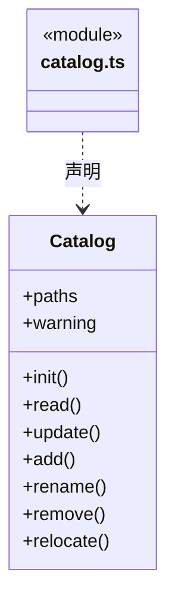
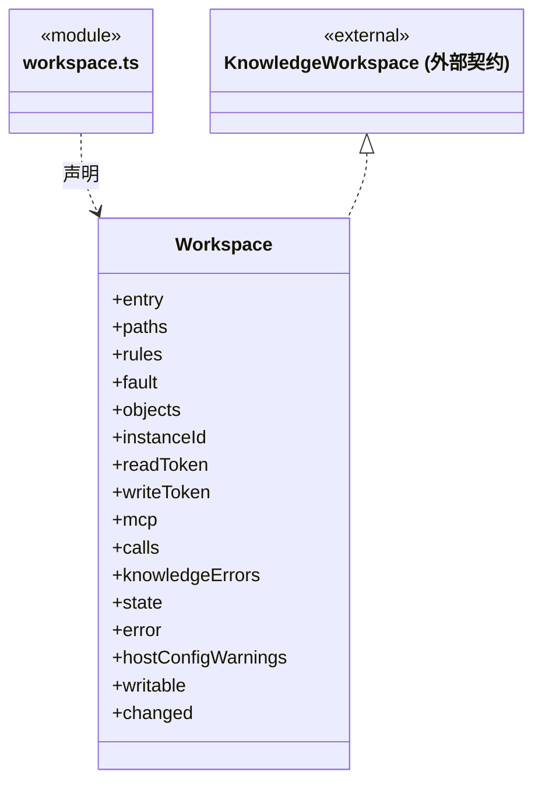

# src/backend/main/workspace 架构

## 目录定位

本机工作区登记与运行实例。持锁后打开、监听、协调关闭，知识事务委托 persistence/knowledge。

本文描述当前实现。通过分析目录边界后维护的 [源码架构脚本](../../../../scripts/source-architecture.mjs) 同步清单和声明；代码变更时仍须核对职责、关键成员与关系。

## 代码清单

| 文件 | 当前职责 |
| --- | --- |
| [catalog.ts](catalog.ts) | Catalog：维护本机工作区清单、显示名称、路径身份、并发更新和重新定位。 |
| [workspace.ts](workspace.ts) | 本机工作区实例：身份、锁、监听、维护任务及可选传输生命周期。 |

## 架构类图

### catalog.ts

直接依赖：[../platform/locking.ts](../platform/locking.ts)、[../platform/paths.ts](../platform/paths.ts)、[../../core/foundation/files.ts](../../core/foundation/files.ts)、[../../core/foundation/serialization.ts](../../core/foundation/serialization.ts)、[../../core/foundation/errors.ts](../../core/foundation/errors.ts)、[../../../bridge/contracts/workspace.ts](../../../bridge/contracts/workspace.ts)。

### workspace.ts

直接依赖：[../persistence/knowledge/object-storage.ts](../persistence/knowledge/object-storage.ts)、[../../core/knowledge/ports.ts](../../core/knowledge/ports.ts)、[../platform/paths.ts](../platform/paths.ts)、[../../core/foundation/files.ts](../../core/foundation/files.ts)、[../../core/foundation/serialization.ts](../../core/foundation/serialization.ts)、[../../core/foundation/errors.ts](../../core/foundation/errors.ts)、[../platform/locking.ts](../platform/locking.ts)、[../integrations/mcp/mcp-status.ts](../integrations/mcp/mcp-status.ts)、[../integrations/mcp/mcp-log.ts](../integrations/mcp/mcp-log.ts)、[../../core/knowledge/knowledge.ts](../../core/knowledge/knowledge.ts)、[../persistence/knowledge/knowledge-store.ts](../persistence/knowledge/knowledge-store.ts)、[../../../bridge/contracts/workspace.ts](../../../bridge/contracts/workspace.ts)。

## 子目录导航

无子目录。

[返回上层](../ARCHITECTURE.md)。

每次修改本目录代码，同步维护文件头、关键契约说明及本图。未实现的治理、证据验收和自动编排能力不列入当前类图。
