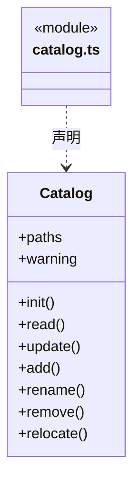
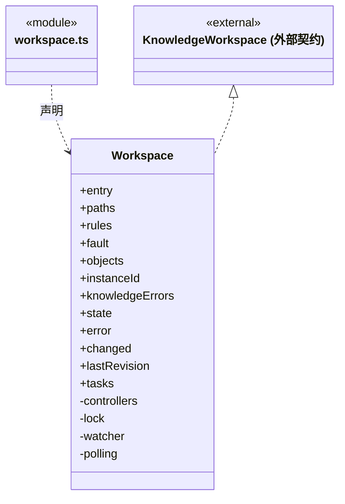
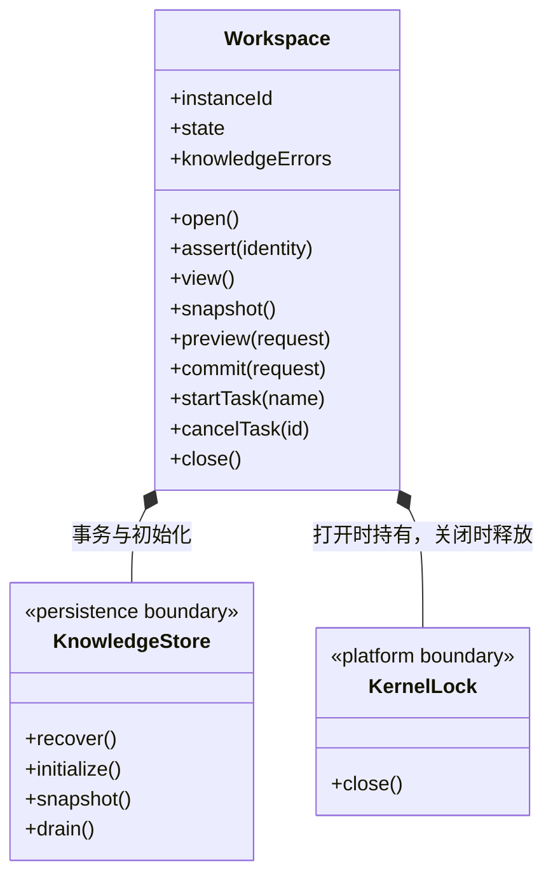

# src/backend/main/workspace 架构

## 目录定位

本机工作区登记与运行实例。持锁后打开、监听、协调关闭，知识事务委托 persistence/knowledge。

本文描述当前实现。通过分析目录边界后维护的 [源码架构脚本](../../../../scripts/source-architecture.mjs) 同步清单和声明；代码变更时仍须核对职责、关键成员与关系。

## 代码清单

| 文件 | 当前职责 |
| --- | --- |
| [catalog.ts](catalog.ts) | Catalog：维护本机工作区清单、显示名称、路径身份、并发更新和重新定位。 |
| [workspace.ts](workspace.ts) | 管理本机工作区的身份、独占锁、知识监听和维护任务。 |

## 架构类图

### catalog.ts

直接依赖：[../platform/locking.ts](../platform/locking.ts)、[../platform/paths.ts](../platform/paths.ts)、[../../core/foundation/files.ts](../../core/foundation/files.ts)、[../../core/foundation/serialization.ts](../../core/foundation/serialization.ts)、[../../core/foundation/errors.ts](../../core/foundation/errors.ts)、[../../../bridge/contracts/workspace.ts](../../../bridge/contracts/workspace.ts)。

### workspace.ts

直接依赖：[../persistence/knowledge/object-storage.ts](../persistence/knowledge/object-storage.ts)、[../../core/knowledge/ports.ts](../../core/knowledge/ports.ts)、[../platform/paths.ts](../platform/paths.ts)、[../../core/foundation/files.ts](../../core/foundation/files.ts)、[../../core/foundation/serialization.ts](../../core/foundation/serialization.ts)、[../../core/foundation/errors.ts](../../core/foundation/errors.ts)、[../platform/locking.ts](../platform/locking.ts)、[../../core/knowledge/knowledge.ts](../../core/knowledge/knowledge.ts)、[../persistence/knowledge/knowledge-store.ts](../persistence/knowledge/knowledge-store.ts)、[../../../bridge/contracts/workspace.ts](../../../bridge/contracts/workspace.ts)。

## 子目录导航

无子目录。

[返回上层](../ARCHITECTURE.md)。

每次修改本目录代码，同步维护文件头、关键契约说明及本图。未实现的治理、证据验收和自动编排能力不列入当前类图。

## 设计契约 v1 与落地范围

以下内容区分已接通能力与后续设计；以各节的实现状态为准，不将目标图当作现状图。维护源：[CONTRACT.md](CONTRACT.md)；生成类图时同步附加，勿直接修改本附录。

### 当前工作区生命周期

本目录实例只负责应用内部运行。`Application` 持有实例并装配执行管理器、成员调度与全局运行监控；界面选择不改变实例所有权。

- `open()` 校验真实路径身份、取得独占锁、恢复事务、初始化缺失知识并校验，之后进入 `running`。知识校验错误计入 `knowledgeErrors`，不伪装为生命周期失败。
- `assert(identity)` 拒绝未运行或旧实例请求。`instanceId` 每次创建变化，不能用旧预览跨实例提交。
- `snapshot/preview/commit` 委托知识存储；运行授权由上层调用边界核验，事务仍校验版本、结构和幂等请求。
- `startTask/cancelTask` 只管理当前实例的知识检查与索引维护任务。取消前核验运行态；未知、其他工作区、对话或成员派发任务 ID 返回 `TASK_NOT_FOUND`。取消请求不伪造终态：正在提交的事务可继续完成，已完成/失败/取消的任务重复调用保持真实结果。
- `close()` 停止监听、取消维护任务、排空知识事务，最后释放锁。应用先排空执行及成员调度，才关闭工作区。
- 工作区诊断只读展示状态与问题，不提供重启操作。打开流程不修改项目的其他开发工具配置。

知识存储与平台边界分别见 [persistence/knowledge](../persistence/knowledge/ARCHITECTURE.md)、[platform](../platform/ARCHITECTURE.md)。
