# src/backend/main/workspace 架构

## 目录定位

本机工作区、静态编辑与受控来源协调。获取工作区锁后在唯一DispatchStore核身份、恢复知识和来源，再发布服务。岗位和负责人以同知识快照明确采纳；首次真实观察与消费者同事务保存。来源、能力、模型分别展示，不以登记回执启动实例或改写旧任务。 负责岗位和模块责任只读发现供实际主工具调用；当前配置观察与历史执行事实分开。 原知识事务适配复用现有串行 journal 核验，固定计划与旧实例只读；不提交、刷新、恢复或修剪目录。 ControlledFiles 连接原成员授权、唯一 Store、文件平台与私有备份；原not_applied与真实退出才解除运行屏障，显式补偿重新核文件身份/摘要/关闭周期，未知不重试。

本文描述当前实现。通过分析目录边界后维护的 [源码架构脚本](../../../../scripts/source-architecture.mjs) 同步清单和声明；代码变更时仍须核对职责、关键成员与关系。

## 代码清单

| 文件 | 当前职责 |
| --- | --- |
| [architecture-service.ts](architecture-service.ts) | 将团队/业务架构表单接到受控知识事务，作为可信桌面的预览与手动提交入口。 |
| [artifact-transitions.ts](artifact-transitions.ts) | 把已打开工作区的真实文件 utility 能力装配为成员删除/移动端口，不暴露平台句柄到 Core。 |
| [catalog.ts](catalog.ts) | Catalog：维护本机工作区清单、显示名称、路径身份、并发更新和重新定位。 |
| [controlled-files.ts](controlled-files.ts) | 已打开工作区的受控写入与桌面补偿服务，连接运行许可、私有备份、独占子进程和唯一 DispatchStore。 |
| [isolated-executions.ts](isolated-executions.ts) | 正式成员隔离记录的可信装配，以及原运行的桌面核实／显式清理服务。 |
| [knowledge-effect-reader.ts](knowledge-effect-reader.ts) | 在已打开工作区内只读核实原知识工具请求和事务，向调度影响观察提供有界摘要。 |
| [knowledge-sources.ts](knowledge-sources.ts) | 将原知识事务的来源屏障与岗位/责任的明确来源采纳接到唯一 DispatchStore。 |
| [main-module-ownership-tools.ts](main-module-ownership-tools.ts) | 把工作区责任服务绑定真实主运行及当前协作周期，提供四项模型窄端口。 |
| [module-ownerships.ts](module-ownerships.ts) | 桌面与真实主工具共用的模块负责人服务，关系和岗位在唯一 DispatchStore 内裁决。 |
| [persistent-effect-reader.ts](persistent-effect-reader.ts) | 只读原治理命令与责任审计，向影响观察投影有界的“原记录已保存”证据。 |
| [workspace-members.ts](workspace-members.ts) | 将桌面岗位登记、采纳与当前差异查询接到工作区唯一 DispatchStore，公开模型配置由 Main 注入。 |
| [workspace.ts](workspace.ts) | 管理本机工作区的身份、独占锁、知识监听和维护任务。 |

## 架构类图

### architecture-service.ts

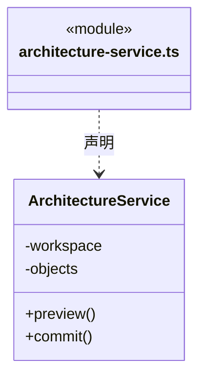

直接依赖：[../../core/knowledge/object-crud.ts](../../core/knowledge/object-crud.ts)、[../../core/knowledge/ports.ts](../../core/knowledge/ports.ts)、[../../../bridge/contracts/architecture.ts](../../../bridge/contracts/architecture.ts)。

### artifact-transitions.ts

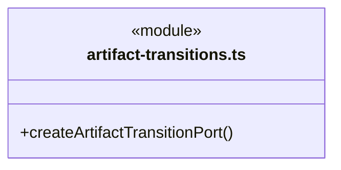

直接依赖：[../../core/foundation/errors.ts](../../core/foundation/errors.ts)、[../../core/brain/run-artifact-transition.ts](../../core/brain/run-artifact-transition.ts)、[../platform/controlled-file-protocol.ts](../platform/controlled-file-protocol.ts)、[workspace.ts](workspace.ts)。

### catalog.ts

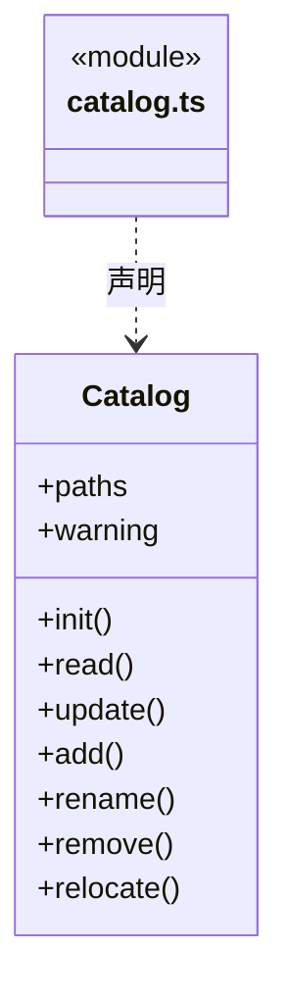

直接依赖：[../platform/locking.ts](../platform/locking.ts)、[../platform/paths.ts](../platform/paths.ts)、[../../core/foundation/files.ts](../../core/foundation/files.ts)、[../../core/foundation/serialization.ts](../../core/foundation/serialization.ts)、[../../core/foundation/errors.ts](../../core/foundation/errors.ts)、[../../../bridge/contracts/workspace.ts](../../../bridge/contracts/workspace.ts)。

### controlled-files.ts

成员 1/2（同名节点为同一声明，跨图合并阅读）。

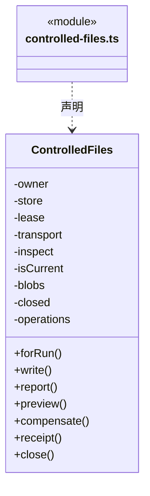

成员 2/2（同名节点为同一声明，跨图合并阅读）。

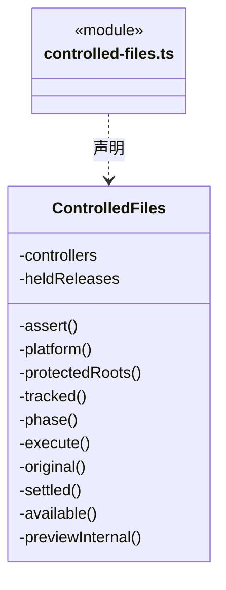

直接依赖：[../../core/foundation/errors.ts](../../core/foundation/errors.ts)、[../../core/foundation/serialization.ts](../../core/foundation/serialization.ts)、[workspace.ts](workspace.ts)、[../../core/tasks/dispatch-storage.ts](../../core/tasks/dispatch-storage.ts)、[../../core/tasks/dispatch-execution.ts](../../core/tasks/dispatch-execution.ts)、[../../core/brain/types.ts](../../core/brain/types.ts)、[../../core/brain/run-controlled-file.ts](../../core/brain/run-controlled-file.ts)、[../../core/tasks/controlled-file-operation.ts](../../core/tasks/controlled-file-operation.ts)、[../../core/tasks/controlled-file-event.ts](../../core/tasks/controlled-file-event.ts)、[../../core/tasks/controlled-file-rules.ts](../../core/tasks/controlled-file-rules.ts)、[../../core/tasks/controlled-file-invariants.ts](../../core/tasks/controlled-file-invariants.ts)、[../platform/controlled-file-blobs.ts](../platform/controlled-file-blobs.ts)、[../platform/controlled-file-protocol.ts](../platform/controlled-file-protocol.ts)、[../../scheduler-engine/execution/workspace-lease.ts](../../scheduler-engine/execution/workspace-lease.ts)。

### isolated-executions.ts

成员 1/2（同名节点为同一声明，跨图合并阅读）。

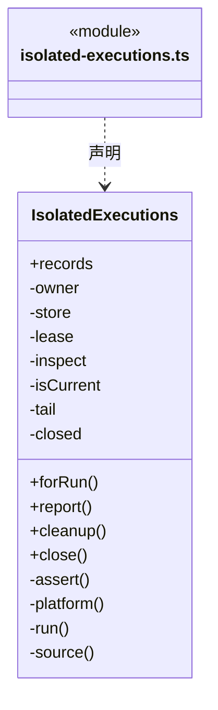

成员 2/2（同名节点为同一声明，跨图合并阅读）。

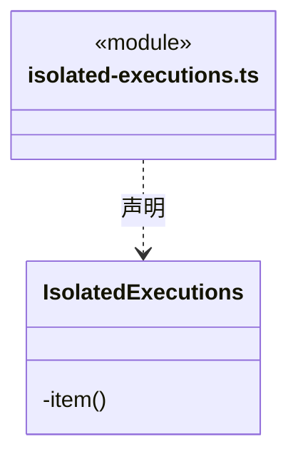

直接依赖：[../../core/foundation/serialization.ts](../../core/foundation/serialization.ts)、[../../core/foundation/errors.ts](../../core/foundation/errors.ts)、[../../core/tasks/dispatch-storage.ts](../../core/tasks/dispatch-storage.ts)、[../../core/tasks/dispatch-execution.ts](../../core/tasks/dispatch-execution.ts)、[../../core/brain/types.ts](../../core/brain/types.ts)、[../../core/workspace/execution-scope.ts](../../core/workspace/execution-scope.ts)、[../../core/tasks/scoped-execution.ts](../../core/tasks/scoped-execution.ts)、[../../core/tasks/isolated-execution-recovery.ts](../../core/tasks/isolated-execution-recovery.ts)、[../platform/isolation-record.ts](../platform/isolation-record.ts)、[../persistence/tasks/isolation-records.ts](../persistence/tasks/isolation-records.ts)、[../platform/isolation-recovery-win32.ts](../platform/isolation-recovery-win32.ts)、[workspace.ts](workspace.ts)、[../../scheduler-engine/execution/workspace-lease.ts](../../scheduler-engine/execution/workspace-lease.ts)。

### knowledge-effect-reader.ts

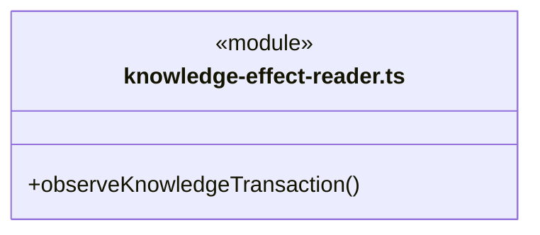

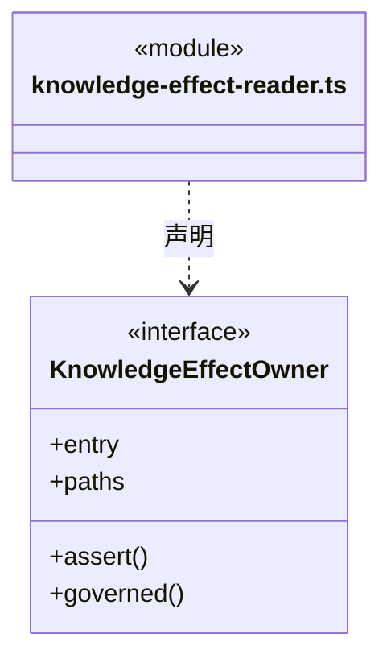

直接依赖：[../../core/foundation/serialization.ts](../../core/foundation/serialization.ts)、[../../core/foundation/errors.ts](../../core/foundation/errors.ts)、[../../core/foundation/paths.ts](../../core/foundation/paths.ts)、[../../core/knowledge/types.ts](../../core/knowledge/types.ts)、[../../core/knowledge/knowledge-write-observation.ts](../../core/knowledge/knowledge-write-observation.ts)、[../../core/knowledge/knowledge-write-input.ts](../../core/knowledge/knowledge-write-input.ts)、[../persistence/knowledge/governance-port.ts](../persistence/knowledge/governance-port.ts)、[../persistence/knowledge/planned-commit.ts](../persistence/knowledge/planned-commit.ts)。

### knowledge-sources.ts

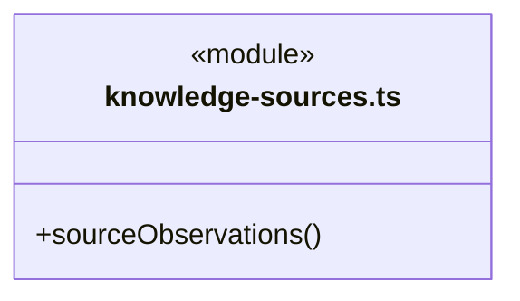

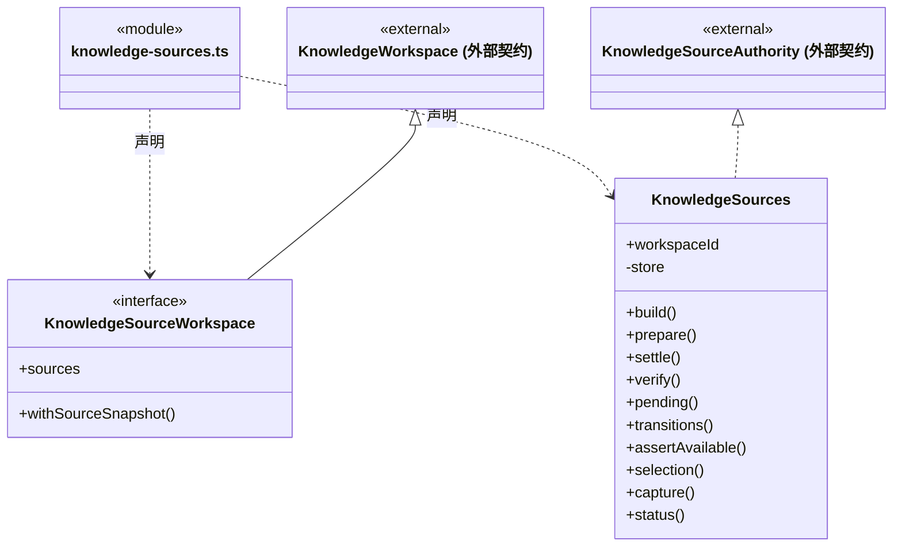

直接依赖：[../../core/foundation/serialization.ts](../../core/foundation/serialization.ts)、[../../core/foundation/json.ts](../../core/foundation/json.ts)、[../../core/foundation/errors.ts](../../core/foundation/errors.ts)、[../../core/tasks/dispatch-storage.ts](../../core/tasks/dispatch-storage.ts)、[../../core/knowledge/types.ts](../../core/knowledge/types.ts)、[../../core/knowledge/ports.ts](../../core/knowledge/ports.ts)、[../../core/knowledge/planned-commit.ts](../../core/knowledge/planned-commit.ts)、[../../core/workspace/knowledge-source.ts](../../core/workspace/knowledge-source.ts)、[../../core/workspace/knowledge-source-rules.ts](../../core/workspace/knowledge-source-rules.ts)、[../persistence/knowledge/source-journal.ts](../persistence/knowledge/source-journal.ts)。

### main-module-ownership-tools.ts

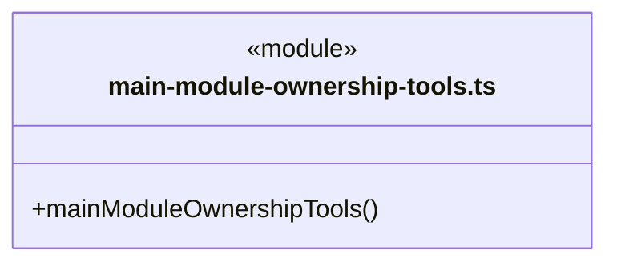

直接依赖：[../../core/foundation/errors.ts](../../core/foundation/errors.ts)、[../../core/brain/conversation-binding.ts](../../core/brain/conversation-binding.ts)、[../../core/tasks/types.ts](../../core/tasks/types.ts)、[../../core/workspace/module-ownership.ts](../../core/workspace/module-ownership.ts)、[../../core/workspace/module-ownership-rules.ts](../../core/workspace/module-ownership-rules.ts)、[../../core/workspace/module-ownership-tools.ts](../../core/workspace/module-ownership-tools.ts)、[../../scheduler-engine/execution/auto-collaboration.ts](../../scheduler-engine/execution/auto-collaboration.ts)、[../../core/knowledge/ports.ts](../../core/knowledge/ports.ts)、[module-ownerships.ts](module-ownerships.ts)、[workspace-members.ts](workspace-members.ts)、[../../scheduler-engine/execution/owner-execution-service.ts](../../scheduler-engine/execution/owner-execution-service.ts)。

### module-ownerships.ts

成员 1/2（同名节点为同一声明，跨图合并阅读）。

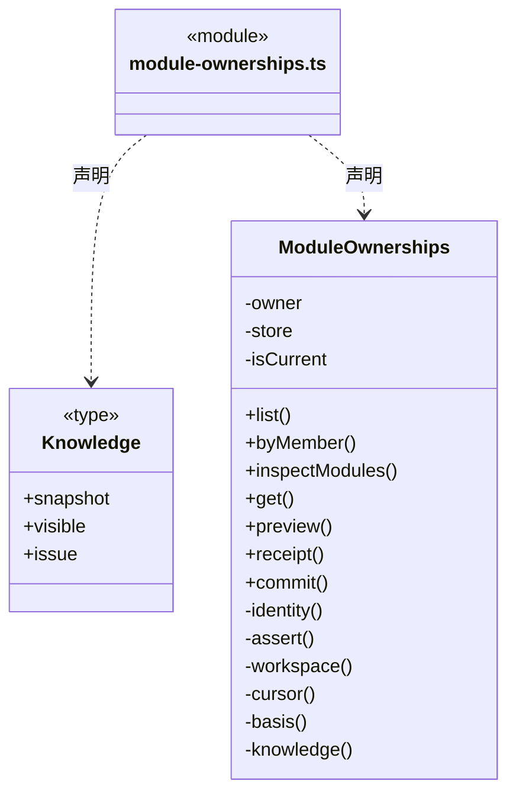

成员 2/2（同名节点为同一声明，跨图合并阅读）。

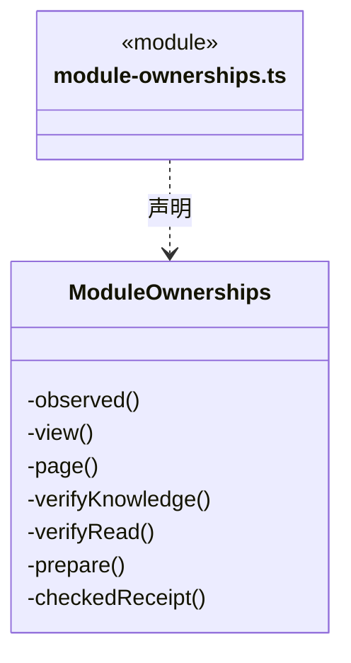

直接依赖：[../../core/foundation/errors.ts](../../core/foundation/errors.ts)、[../../core/foundation/serialization.ts](../../core/foundation/serialization.ts)、[../../core/knowledge/types.ts](../../core/knowledge/types.ts)、[../../core/workspace/model.ts](../../core/workspace/model.ts)、[../../core/tasks/dispatch-storage.ts](../../core/tasks/dispatch-storage.ts)、[../../core/team/workspace-member.ts](../../core/team/workspace-member.ts)、[../../core/workspace/module-ownership.ts](../../core/workspace/module-ownership.ts)、[../../core/workspace/module-ownership-rules.ts](../../core/workspace/module-ownership-rules.ts)、[../../core/tasks/module-ownership-invariants.ts](../../core/tasks/module-ownership-invariants.ts)、[knowledge-sources.ts](knowledge-sources.ts)、[../../core/workspace/knowledge-source-rules.ts](../../core/workspace/knowledge-source-rules.ts)。

### persistent-effect-reader.ts

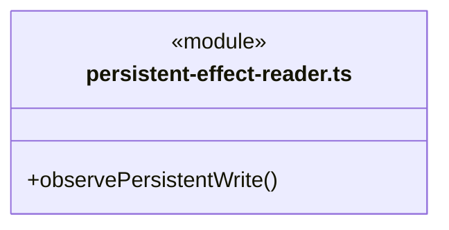

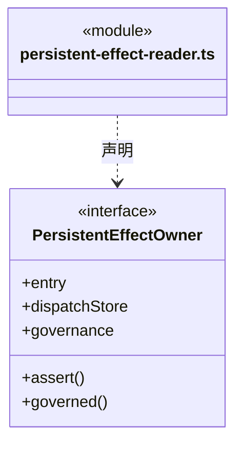

直接依赖：[../../core/foundation/serialization.ts](../../core/foundation/serialization.ts)、[../../core/foundation/errors.ts](../../core/foundation/errors.ts)、[../../core/tasks/persistent-write-observation.ts](../../core/tasks/persistent-write-observation.ts)、[../../core/tasks/persistent-write-input.ts](../../core/tasks/persistent-write-input.ts)、[../../core/governance/module-governance.ts](../../core/governance/module-governance.ts)、[../../core/workspace/module-ownership.ts](../../core/workspace/module-ownership.ts)、[../../core/workspace/module-ownership-rules.ts](../../core/workspace/module-ownership-rules.ts)、[../../core/tasks/dispatch-storage.ts](../../core/tasks/dispatch-storage.ts)、[../persistence/governance/module-governance-store.ts](../persistence/governance/module-governance-store.ts)。

### workspace-members.ts

成员 1/2（同名节点为同一声明，跨图合并阅读）。

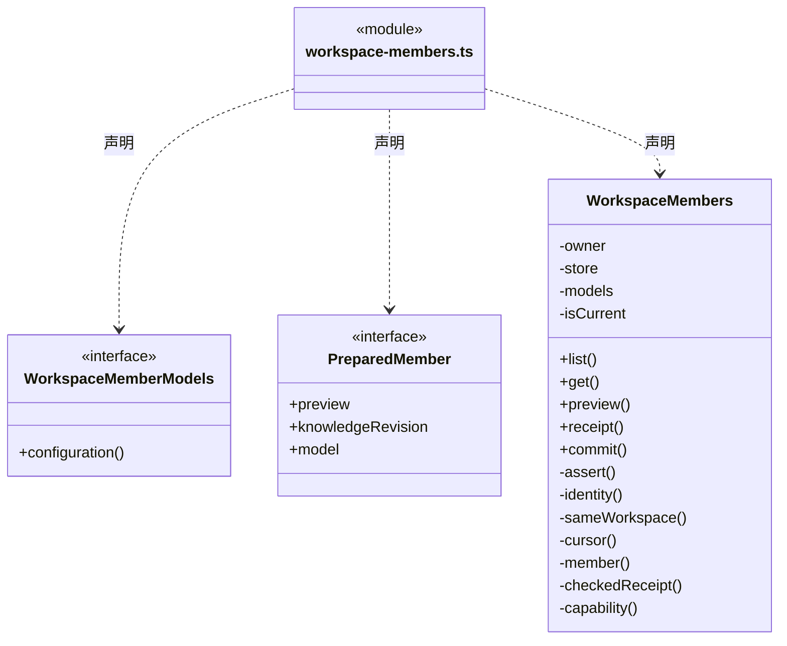

成员 2/2（同名节点为同一声明，跨图合并阅读）。

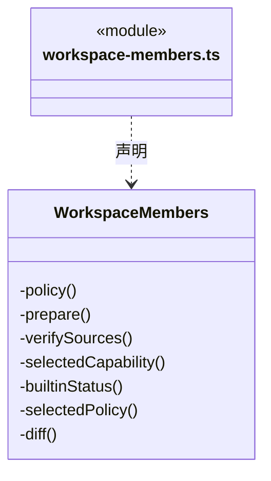

直接依赖：[../../core/foundation/errors.ts](../../core/foundation/errors.ts)、[../../core/tasks/dispatch-storage.ts](../../core/tasks/dispatch-storage.ts)、[../../core/team/workspace-member.ts](../../core/team/workspace-member.ts)、[../../core/team/workspace-member-rules.ts](../../core/team/workspace-member-rules.ts)、[../../scheduler-engine/context/dispatch-context.ts](../../scheduler-engine/context/dispatch-context.ts)、[../../core/knowledge/types.ts](../../core/knowledge/types.ts)、[../../core/workspace/knowledge-source-rules.ts](../../core/workspace/knowledge-source-rules.ts)、[../../core/workspace/knowledge-source.ts](../../core/workspace/knowledge-source.ts)、[knowledge-sources.ts](knowledge-sources.ts)。

### workspace.ts

成员 1/3（同名节点为同一声明，跨图合并阅读）。


成员 2/3（同名节点为同一声明，跨图合并阅读）。

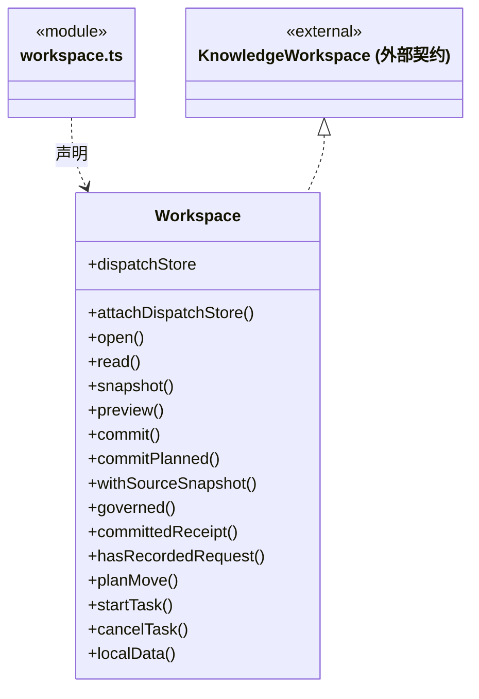

成员 3/3（同名节点为同一声明，跨图合并阅读）。

```mermaid
classDiagram
class N_src_backend_main_workspace_workspace_ts["workspace.ts"] {
  <<module>>
}
class N_src_backend_main_workspace_workspace_ts_Workspace["Workspace"] {
  +prepareClose()
  +close()
  -controllers
  -lock
  -watcher
  -polling
  -knowledge
  -closePreparation
  -sharedDispatch
  -log()
}
N_src_backend_main_workspace_workspace_ts ..> N_src_backend_main_workspace_workspace_ts_Workspace : 声明
class N_src_backend_main_workspace_workspace_ts_external_KnowledgeWorkspace["KnowledgeWorkspace (外部契约)"] {
  <<external>>
}
N_src_backend_main_workspace_workspace_ts_external_KnowledgeWorkspace <|.. N_src_backend_main_workspace_workspace_ts_Workspace
```

直接依赖：[../persistence/knowledge/object-storage.ts](../persistence/knowledge/object-storage.ts)、[../../core/knowledge/ports.ts](../../core/knowledge/ports.ts)、[../platform/paths.ts](../platform/paths.ts)、[../../core/foundation/files.ts](../../core/foundation/files.ts)、[../../core/foundation/serialization.ts](../../core/foundation/serialization.ts)、[../../core/foundation/errors.ts](../../core/foundation/errors.ts)、[../platform/locking.ts](../platform/locking.ts)、[../../core/knowledge/knowledge.ts](../../core/knowledge/knowledge.ts)、[../persistence/knowledge/knowledge-store.ts](../persistence/knowledge/knowledge-store.ts)、[../governance/module-governance.ts](../governance/module-governance.ts)、[../persistence/tasks/dispatch-store.ts](../persistence/tasks/dispatch-store.ts)、[knowledge-sources.ts](knowledge-sources.ts)、[../../core/knowledge/planned-commit.ts](../../core/knowledge/planned-commit.ts)、[../persistence/knowledge/governance-port.ts](../persistence/knowledge/governance-port.ts)、[../../../bridge/contracts/workspace.ts](../../../bridge/contracts/workspace.ts)。

### 本目录调用边界

```mermaid
classDiagram
class N_src_backend_main_workspace_artifact_transitions_ts["artifact-transitions.ts"] {
  <<module>>
}
class N_src_backend_main_workspace_workspace_ts["workspace.ts"] {
  <<module>>
}
class N_src_backend_main_workspace_controlled_files_ts["controlled-files.ts"] {
  <<module>>
}
class N_src_backend_main_workspace_isolated_executions_ts["isolated-executions.ts"] {
  <<module>>
}
class N_src_backend_main_workspace_main_module_ownership_tools_ts["main-module-ownership-tools.ts"] {
  <<module>>
}
class N_src_backend_main_workspace_module_ownerships_ts["module-ownerships.ts"] {
  <<module>>
}
N_src_backend_main_workspace_artifact_transitions_ts ..> N_src_backend_main_workspace_workspace_ts : 导入依赖
N_src_backend_main_workspace_controlled_files_ts ..> N_src_backend_main_workspace_workspace_ts : 导入依赖
N_src_backend_main_workspace_isolated_executions_ts ..> N_src_backend_main_workspace_workspace_ts : 导入依赖
N_src_backend_main_workspace_main_module_ownership_tools_ts ..> N_src_backend_main_workspace_module_ownerships_ts : 导入依赖
```

```mermaid
classDiagram
class N_src_backend_main_workspace_main_module_ownership_tools_ts["main-module-ownership-tools.ts"] {
  <<module>>
}
class N_src_backend_main_workspace_workspace_members_ts["workspace-members.ts"] {
  <<module>>
}
class N_src_backend_main_workspace_module_ownerships_ts["module-ownerships.ts"] {
  <<module>>
}
class N_src_backend_main_workspace_knowledge_sources_ts["knowledge-sources.ts"] {
  <<module>>
}
class N_src_backend_main_workspace_workspace_ts["workspace.ts"] {
  <<module>>
}
N_src_backend_main_workspace_main_module_ownership_tools_ts ..> N_src_backend_main_workspace_workspace_members_ts : 导入依赖
N_src_backend_main_workspace_module_ownerships_ts ..> N_src_backend_main_workspace_knowledge_sources_ts : 导入依赖
N_src_backend_main_workspace_workspace_members_ts ..> N_src_backend_main_workspace_knowledge_sources_ts : 导入依赖
N_src_backend_main_workspace_workspace_ts ..> N_src_backend_main_workspace_knowledge_sources_ts : 导入依赖
```


## 子目录导航

无子目录。

[返回上层](../ARCHITECTURE.md)。

每次修改本目录代码，同步维护文件头、关键契约说明及本图。未实现的治理、证据验收和自动编排能力不列入当前类图。

## 设计契约 v1 与落地范围

以下内容区分已接通能力与后续设计；以各节的实现状态为准，不将目标图当作现状图。维护源：[CONTRACT.md](CONTRACT.md)；生成类图时同步附加，勿直接修改本附录。

### 当前工作区生命周期

本目录实例只负责应用内部运行。`Application` 持有实例并装配执行管理器、成员调度与全局运行监控；界面选择不改变实例所有权。

```mermaid
classDiagram
class Workspace {
  +instanceId
  +state
  +knowledgeErrors
  +open()
  +assert(identity)
  +view()
  +snapshot()
  +preview(request)
  +commit(request)
  +startTask(name)
  +cancelTask(id)
  +close()
}
class KnowledgeStore {
  <<persistence boundary>>
  +recover()
  +initialize()
  +snapshot()
  +drain()
}
class KernelLock {
  <<platform boundary>>
  +close()
}
Workspace *-- KnowledgeStore : 事务与初始化
Workspace *-- KernelLock : 打开时持有，关闭时释放
```

- `open()` 校验真实路径身份、取得独占锁、核本地历史归属，再 await Main 注入的可信 `beforeDispatchLoad` 阶段，然后读取唯一 Store、恢复事务、初始化缺失知识并校验，之后进入 `running`。该阶段只为 Store 观察器提前恢复历史索引，不接 IPC/模型参数；失败不继续 Store 读取或事务恢复，沿原失败路径释放锁。知识校验错误计入 `knowledgeErrors`，不伪装为生命周期失败。
- `assert(identity)` 拒绝未运行或旧实例请求。`instanceId` 每次创建变化，不能用旧预览跨实例提交。
- `snapshot/preview/commit` 委托知识存储；运行授权由上层调用边界核验，事务仍校验版本、结构和幂等请求。
- `governance` 使用私有账本保存显式模块保护、观察、提案、人工决定和实施意图；`governed` 与普通知识提交共用队列。打开先核账本完整性锚，再恢复原事务并核 journal 关联；损坏失败关闭，不默默解除保护。重开不执行旧实施意图。
- `committedReceipt/hasRecordedRequest` 由当前运行实例只读查询完整原知识请求的 journal。前者核验原指纹和已提交结果，后者仅报告任何记录是否存在；旧实例请求可查但不可重新提交，损坏或未完成记录不能作为“从未受理”证明。两者不写入、回滚或自动恢复。
- `startTask/cancelTask` 只管理当前实例的知识检查与索引维护任务。取消前核验运行态；未知、其他工作区、对话或成员派发任务 ID 返回 `TASK_NOT_FOUND`。取消请求不伪造终态：正在提交的事务可继续完成，已完成/失败/取消的任务重复调用保持真实结果。
- `close()` 停止监听、取消维护任务、排空知识事务，最后释放锁。应用先排空执行及成员调度，才关闭工作区。
- 工作区诊断只读展示状态与问题，不提供重启操作。打开流程不修改项目的其他开发工具配置。

知识存储与平台边界分别见 [persistence/knowledge](../persistence/knowledge/ARCHITECTURE.md)、[platform](../platform/ARCHITECTURE.md)。

### 长期岗位登记

`WorkspaceMembers` 与成员派发使用同一 `DispatchStore`，通过单条 `workspaceMemberChanges` 审计派生当前岗位；登记不另外建立 registry 文件，也不创建 AgentInstance、Session、任务图、信封或模型运行。`memberId` 是长期岗位身份；静态 `agentId` 是采纳来源，二者均不等于执行实例身份。active/suspended/retired 是登记状态；正式派发另核当前模块责任、来源、能力及模型，不以 active 单独放行。

`preview/commit` 接收明确实例、变更与版本。登记和能力采纳读取实际原则及有效继承 Skill；模型配置使用显式 profileId/modelId 的公开字段，不解密、不探测网络。预览不生成岗位或采纳 ID。提交在 Store 串行回调内重建预览并复验登记游标、basis 及选定来源；知识和模型配置是独立存储，前后读取复验不宣称跨存储原子锁。读取期间关闭或来源变更拒绝新提交。

元信息修改只改明确选择的字段；能力与模型必须分别采纳，相同模型引用的配置刷新不能夹在普通编辑中。能力内容 hash 不包含整库知识 revision，模型 hash 保守包含完整公开配置及名称。暂停和恢复不要求当前来源可用，仍保留实际 currentDiff；退休终态不可修改或复活。

`list` 只给摘要，按初次登记顺序分页，后续页必须绑定同登记游标。`get` 每次重新读取知识与公开模型配置，返回 same/changed/missing/invalid；外部来源变化不推进登记游标，也不覆盖已采纳正文。详情读取前后再次比较登记游标，发生并发变更时明确要求重读。

提交先以完整原请求指纹查 `commandReceipt`，已提交命令即使原实例退役或来源不可用也返回原紧凑回执。冲突不能覆盖；只读 receipt 不调用 transact、知识读取或模型解析。未查到不等于证明未受理；未知响应只核实原命令，不自动换 ID 或重做操作。容量累计计算退休岗位与历史审计，超限拒绝写入而不删历史。

### 模块岗位负责人服务

`ModuleOwnerships` 与岗位和派发复用同一 Store，通过独立 ownershipChanges 保存单模块关系。指定或更换时从真实知识快照的模块注册表确认可见性，并从同一已验证树读取名称、从原 module.json 核实定义哈希；没有旧关系时返回 observed，不把同路径同字节当成来源代次证明。解除只核原关系与版本，知识缺失也可显式解除，不自动转派其他岗位。

列表、详情与反查每次重新读取来源及岗位状态；分页 basis 包含责任游标、岗位游标与知识版本。preview/commit 还冻结原关系、相关岗位版本和真实已派任务影响摘要。新提交在 Store 串行回调内重建依据，读取知识后再次核实来源、实例和停止信号；不在回调内重入 Store，也不声称知识与责任存储存在跨存储原子锁。已派任务只显示关联，不追改任务身份或流程。

原 commandReceipt 查询先于当前实例和来源校验；同原请求返回原回执，异参拒绝。持久提交后停止或输出失效保留原事实，不声称未受理。`main-module-ownership-tools.ts` 仅接实际当前主周期、主实例、conversation 通道、run 和工具调用；提交加入该周期在途集合，停止先撤销未受理操作再排空已在途事务。模型不能提供 actor，历史回执只查询同工作区同主根。

### 桌面架构编辑

`ArchitectureService` 接收 KnowledgeWorkspace 端口，经严格 schema 和 assert(identity) 核实桌面请求。preview 要求 workspaceId + instanceId + revision + operations，与对象工具复用同一操作；不接受 peopleUpserts、maintenance 或自报确认。不限制为单模块维护确认事务；岗位负责人由独立服务管理。

`commit` 只接受 `workspaceId + instanceId + planId`，使用冻结计划复核并提交，不接受正文覆盖。此服务是用户操作的桌面入口，不加入 Agent 工具注册表；运行中的知识工具仍执行逐次权限门禁。无模型调用、成员启动或业务文件修改副作用。

团队图和业务图是工作区共享的静态知识；多个主会话可同时持有各自独立的成员/目标/模块任务图。架构 CRUD 不创建动态成员，也不追改已派发任务中的角色或模块快照。知识版本变化后，由既有执行上下文检查拒绝过期基线，必须核实并重新准备任务。

## 受控知识来源与明确采纳

`KnowledgeSources` 只协调唯一 DispatchStore 的来源事件，不另建 registry。普通内容/方法编辑保留代次；实际创建、删除、可见性变化及可信对象/包重建范围才形成受控过渡。校验器省略无效定义不证明删除：原定义文件仍在时，普通修复保留已有代次，未追踪来源仍待明确采纳。不能识别没有受控事件的离线同字节重建。

`Workspace` 在持工程锁并核本地路径身份后加载同一 Store，先恢复来源握手再发布运行服务。能力或模块来源采纳使用 Knowledge→Store 单向锁序；新捕获和消费者审计在同一 Store 事务，预览不分配来源代次。旧岗位/责任不自动补引用，改名、状态、模型采纳及解除不采纳新能力/模块来源。

`WorkspaceMembers.get` 每次核当前来源并在返回前比较来源游标。责任列表依据额外绑定 `sourceCursor`，即使知识字节恢复相同也不能混用旧页；详情、预览最后复核岗位/责任/来源变化。`adopt_source` 保留原 bindingId 与负责人，要求当前负责人 active、精确原关系及当前预览，只提升关系版本与来源引用，不自动派发。原命令回执先于新实例、来源和状态判断。

主运行的 `mainModuleOwnershipTools` 对 moduleIds 查询同时调用 `OwnerExecutionService.discover`，两份读取的知识、岗位、责任和来源游标必须一致才返回。只读分组提供可提交的选择或具体缺口；实际计划/派发重新核实，发现结果不充当执行许可。岗位查询不返回解密凭据，原任务对照不覆盖历史绑定。

## 受控文件与显式补偿

forRun 的 confirmNotApplied 仅等待原平台排空并读原账本；核对冻结 binding、scope、workspaceInstanceId、toolCallId、inputHash 和 allowedSeq。只有可靠 not_applied 为 true；查无、applied、unknown、错身份、Store 读取或退出失败都不解除运行屏障，不启动新 child 或文件操作。

`ControlledFiles` 复用唯一 DispatchStore 保存每条文件阶段；原 member 工厂冻结 scope/run/岗位来源，Runtime 的可靠 allowed 序号只消费一次。文件/备份 IO 全在 Store 回调之外，prepared 和 executing 分别提交后才发送实际 apply；终态不因迟到停止、当前模型或知识变化被撤销。平台或保存未知不重做。原命令查询先于今日实例和文件校验。

`preview` 只取得短只读占用、打开独占句柄并核实原 applied/关闭周期/当前同文件 after/私有 before，返回只读摘要和 basis。`compensate` 是独立本机显式命令，重新持有写占用与同句柄，保存独立意图后恢复原 before；不改写原操作或原 canonical。`receipt` 仅读已有阶段，缺记录不推断未执行。首次确定预拒仅 FILE_COMPENSATION_PRE_ACCEPT_INPUT/REJECTED；任何 Store CAS/IO/保存后异常均保持未知。

关闭先 abort 在途文件会话并等待真实 child 退出；失败保留 lease/服务及 Store。再次关闭只确认原进程并释放占用，不触发 apply。文件身份证明不覆盖 ACL/ADS/外部恶意进程；readonly mapping 仍可能导致内容写后截断失败，unknown 不自动补偿。


### 原知识请求只读核实

knowledge-effect-reader.ts 在已打开工作区复用 governed 串行队列的 journal 读取，固定对象计划从原私有缓存加载并核原实例/requestId。来源、治理和前后正文核验仍由 KnowledgeStore 负责；查询不提交、刷新、恢复事务或修剪目录，不创建第二个存储。错误返回有界不可核实诊断，停止/关闭仍传播。当前实例身份不替换原请求，重开可只读原事务。

## 原治理与责任保存核实（Step39）

`persistent-effect-reader.ts` 只读已打开且验证通过的治理账本、唯一 DispatchStore 的责任审计与原回执。治理查询借用同一知识串行屏障，责任查询严格核完整事件、原输入、actor、指纹及派生回执；原实例来自匹配的持久请求，不换成当前实例。治理账本的整链完整性由原 init/append 校验，本查询不重读磁盘或初始化 Store。记录或端口未知均保留不可核实，不通过预览、当前保护/负责人、提交或模型来猜测。

## R07-B2 原删除与移动证明

artifact-transitions 将冻结定义适配为同一 production ControlledFileTransport.withExclusiveTransition；每个真实读取/操作前复核原工作区实例和当前运行，用户根与安装根仍受保护。平台身份及原字节回执严格对照固定操作，withExclusive 返回前必须确认 utility 已退出；不复制正文、不自建任务存储、不自动补偿。

## 原隔离执行核实与清理

IsolatedExecutions复核原冻结run/scope和唯一canonical proposed/allowed。报告只读；无旧记录不能认定未执行。显式清理要求当前实例、原报告basis、宿主创建身份已退出/复用且Job无活动进程。先持原目录对象，再可靠登记cleanup_requested，再删除profile与原对象，最后登记complete；中断后只接受原commandId/basis继续清理。原业务状态与日志不改。不同Windows登录会话、损坏来源、历史无协议资源或对象变化保留为不可核实。


### 自动与团队协作模式

ControlledFileService 接收岗位或自动兜底的冻结身份，按同一授权、原调用指纹和文件事务保存真实审计。fallback 不修改 read/ask/execute，不发明批准、不略过退出及补偿核实。
