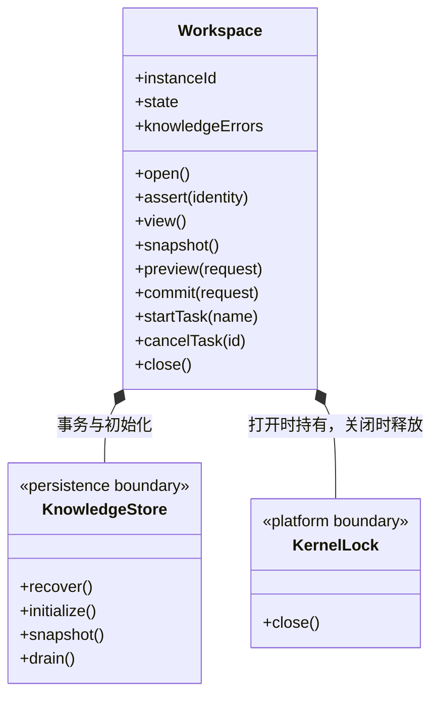

### 当前工作区生命周期

本目录实例只负责应用内部运行。`Application` 持有实例并装配执行管理器、成员调度与全局运行监控；界面选择不改变实例所有权。

- `open()` 校验真实路径身份、取得独占锁、恢复事务、初始化缺失知识并校验，之后进入 `running`。知识校验错误计入 `knowledgeErrors`，不伪装为生命周期失败。
- `assert(identity)` 拒绝未运行或旧实例请求。`instanceId` 每次创建变化，不能用旧预览跨实例提交。
- `snapshot/preview/commit` 委托知识存储；运行授权由上层调用边界核验，事务仍校验版本、结构和幂等请求。
- `startTask/cancelTask` 只管理当前实例的知识检查与索引维护任务。取消前核验运行态；未知、其他工作区、对话或成员派发任务 ID 返回 `TASK_NOT_FOUND`。取消请求不伪造终态：正在提交的事务可继续完成，已完成/失败/取消的任务重复调用保持真实结果。
- `close()` 停止监听、取消维护任务、排空知识事务，最后释放锁。应用先排空执行及成员调度，才关闭工作区。
- 工作区诊断只读展示状态与问题，不提供重启操作。打开流程不修改项目的其他开发工具配置。

知识存储与平台边界分别见 [persistence/knowledge](../persistence/knowledge/ARCHITECTURE.md)、[platform](../platform/ARCHITECTURE.md)。
