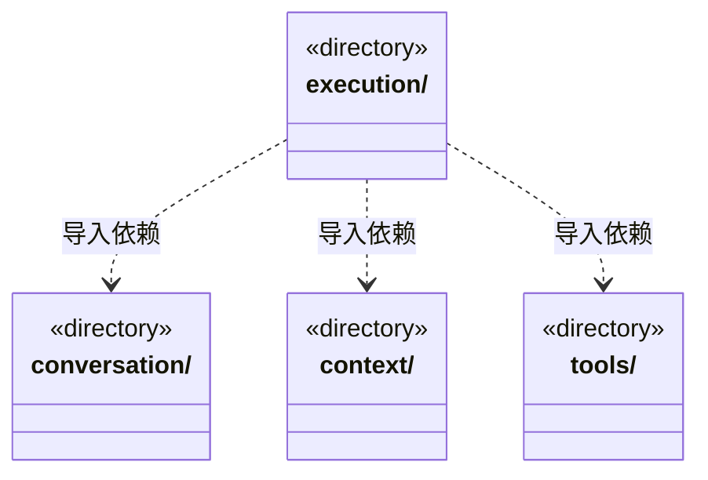

# src/backend/scheduler-engine 架构

## 目录定位

工作区调度。装配团队上下文与模型工具，协调会话、运行、用户问题和队列；只依赖自身及 Core。

本文描述当前实现。通过分析目录边界后维护的 [源码架构脚本](../../../scripts/source-architecture.mjs) 同步清单和声明；代码变更时仍须核对职责、关键成员与关系。

## 代码清单

本层无直接代码文件。

## 架构类图

各图中的同名节点表示同一目录边界；跨组及完整直接依赖如下（无边不代表继承）：

- `execution` → `conversation`：导入。
- `execution` → `context`：导入。
- `execution` → `tools`：导入。

## 子目录导航

- [context/](context/ARCHITECTURE.md)：准备并冻结明确选择的 Agent、模块、Skill 和 Workflow。直接调用领域查询，不经模型工具协议。
- [conversation/](conversation/ARCHITECTURE.md)：主 Agent 指引、用户问题、任务内操作确认及消息队列。业务与知识共用本轮审批，停止和结束清理临时授权；队列按提交版本发布增量。
- [execution/](execution/ARCHITECTURE.md)：执行工厂与工作区运行管理器。存储、租约和平台访问策略由应用注入；管理历史、队列续接、启动与恢复。
- [tools/](tools/ARCHITECTURE.md)：把 Core 知识能力暴露为 cbim_ 工具。内置 Loop 与可选 MCP 复用参数、身份和领域检查；内部 Loop 使用单次 gate 授权，外部 MCP 仍核验写凭据与实例开关。

[返回上层](../ARCHITECTURE.md)。

每次修改本目录代码，同步维护文件头、关键契约说明及本图。未实现的治理、证据验收和自动编排能力不列入当前类图。
