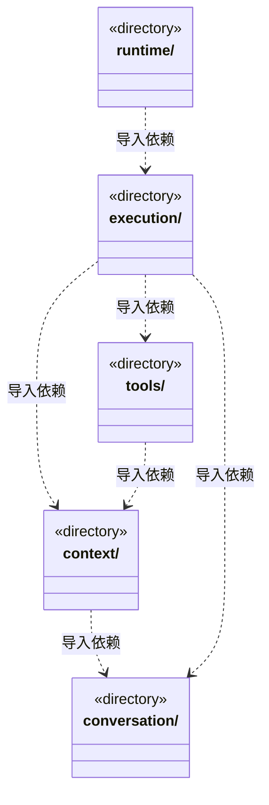

# src/backend/scheduler-engine 架构

## 目录定位

工作区调度。装配团队上下文与模型工具，协调会话、运行、用户问题和队列；只依赖自身及 Core。

本文描述当前实现。通过分析目录边界后维护的 [源码架构脚本](../../../scripts/source-architecture.mjs) 同步清单和声明；代码变更时仍须核对职责、关键成员与关系。

## 代码清单

本层无直接代码文件。

## 架构类图

各图中的同名节点表示同一目录边界；跨组及完整直接依赖如下（无边不代表继承）：

- `context` → `conversation`：导入。
- `execution` → `tools`：导入。
- `execution` → `context`：导入。
- `execution` → `conversation`：导入。
- `runtime` → `execution`：导入。
- `tools` → `context`：导入。

## 子目录导航

- [context/](context/ARCHITECTURE.md)：内置主角色诊断和治理知识，执行者冻结角色/Skill、模块/岗位责任、Workflow与规范。显式流程只从本模块挂载清单解析，准备按任务原选择重核，不回退默认或刷新旧绑定；前置替换保留原实例和流程；两种模式的主会话都可直接执行未配置自定义岗位的模块，不把主 Agent 派成独立成员。 KnowledgeQueries 只取快照读取端口，组合 Team/BusinessWorkspace；跨查询一致性由准备用例核版本，索引写入留在知识领域。 执行上下文同时冻结负责岗位、项目适配、采纳能力与模型身份，主模型不会替换成员配置。
- [conversation/](conversation/ARCHITECTURE.md)：主 Agent 的规划、审阅与团队管理指引，以及提问、审批和队列。原题与选项独立保存，公开待答列表返回副本，答案与取消只有一次消费；坏回包不重弹。主调度可安排求助补做、替换未启动前置或撤销待办；旧失败不改写，问答不替代人工决定或恢复。 两项反馈入口先读取对应内置 Skill 再引导填写；收集反馈不启动业务派工。 主提示在两种模式下都直接实现未配置模块，并只把已配置自定义岗位派发出去；完成里程碑后按事实沉淀团队与业务架构。 主调度将原检查点放弃、旧后继撤销和新负责岗位重新派发分开决策，真实新成果才可替代审阅。 收到坏回包可先核实原命令保存事实，查无回执不等于未执行，原业务仍沿实际任务和验收流程决策。
- [execution/](execution/ARCHITECTURE.md)：主实例与图根共享身份；依赖追加在同事务重验两端及后继的知识/流程/停止状态，成功后重纳当前周期跟踪，仍待主轮结束并按原领取链执行。补充发送前预留、ACK后登记新输入，与cycle在途操作一起结算；停止先作用引擎，旧计划不再领取，最终门禁核对接收日志。目标分工、派发及人工来源核对原流程选择；交付/审阅从canonical复核真实证据与当前文件。检查点与前置调整不改选；额度/准入等待不消费，停止和重启封存不重放。 可信工厂选择 PiEngine/ClaudeCodeEngine/CodexEngine；Claude/Codex 新成员首轮可延迟绑定原生文件，Codex 在启动确认时原子采纳实际线程 ID。 OwnerExecutionService 按知识→模型→任务事务核新派发及实际领取；原命令先查，锁释放后才启动。人工证据外部观察与最终知识快照/CAS 分离，避免反向串行等待。 CheckpointAbandonmentService 先读原命令，再核历史 canonical 与冻结证明，最后短事务裁决；不重读当前 native 或恢复旧模型，Auto 同步撤销旧恢复准入并等待处置收口。 原命令核实从固定主运行的 canonical 复原历史解析与指纹，比较读取前后依据；只返回严格公共摘要，不重发原命令或签发恢复资格。 EffectObservationService 复用原 canonical、控制面证据及平台单文件观察；恢复和重规划先在事务外取证，最终版本 CAS 后才建立独立周期，不自动重放原调用。 真实主调用原知识授权与请求先核实，再两次读取原事务阶段；变化使处置依据失效，未知不重放。 实际成员注入固定运行的受控文件端口；两种模式的主会话都按权限使用原生工具，不取得成员专属端口，租约保持到物理操作排空。 桌面捕获固定 GitHub 端口和授权交统一策略；成员不继承，公开投影无正文或凭据。
- [runtime/](runtime/ARCHITECTURE.md)：监管、履历与全局并发准入职责分离。可靠提交同步周期白名单，scope-only 更新独立游标，未变投影不重复发布；检查点计待办而不占活动名额，报告用量不授予额度或恢复权。
- [tools/](tools/ARCHITECTURE.md)：把知识、主调度及实际装配的用户交互注册为 cbim_ 工具。新增前置追加与已有主调度工具共用固定运行身份、原命令映射和严格单次编码输出，回执只证明保存；坏回包先核实原记录。QuestionTools冻结原题，严格核验答案或取消，坏回包不重问；维护和问答回执不算业务证据，执行者不获得调度权。 负责人发现和计划/派发选择共享严格协议，固定主运行身份，历史回执不签发新领取许可。 主工具显式放弃原检查点/预约，绑定原 run/call 命令，坏回包只核实原事实，不取得业务完成资格。 主 Agent 可按明确原 run/call 查询控制面事务；可信闭包固定工作区和根，读取本身无写命令且不触发成员执行。 知识提交和对象提交的执行参数与历史核实使用同一解析定义，权限及当前实例核验仍在实际执行入口。 FeedbackTools 只在桌面主会话实际连接后注册；严格解析反馈字段，未知只核实原提交，不能让模型改投目标或提供凭据。

[返回上层](../ARCHITECTURE.md)。

每次修改本目录代码，同步维护文件头、关键契约说明及本图。未实现的治理、证据验收和自动编排能力不列入当前类图。
