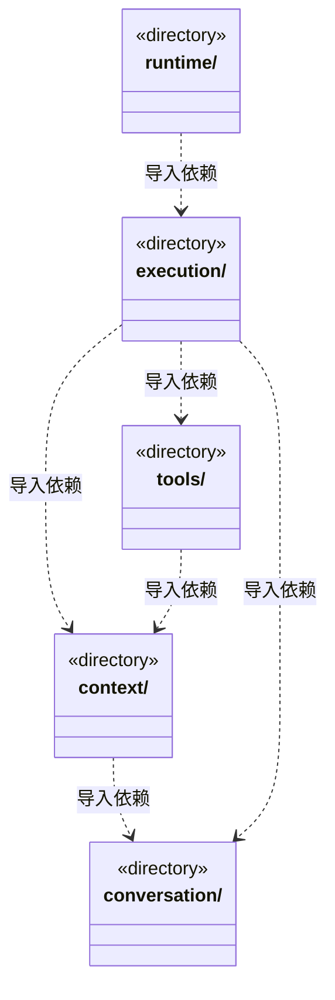

# src/backend/scheduler-engine 架构

## 目录定位

工作区调度。装配团队上下文与模型工具，协调会话、运行、用户问题和队列；只依赖自身及 Core。

本文描述当前实现。通过分析目录边界后维护的 [源码架构脚本](../../../scripts/source-architecture.mjs) 同步清单和声明；代码变更时仍须核对职责、关键成员与关系。

## 代码清单

本层无直接代码文件。

## 架构类图

各图中的同名节点表示同一目录边界；跨组及完整直接依赖如下（无边不代表继承）：

- `context` → `conversation`：导入。
- `execution` → `tools`：导入。
- `execution` → `context`：导入。
- `execution` → `conversation`：导入。
- `runtime` → `execution`：导入。
- `tools` → `context`：导入。

## 子目录导航

- [context/](context/ARCHITECTURE.md)：内置主角色可在结构异常时诊断和治理知识。默认执行角色继承 Team 根 Skill，不创建项目角色定义文件；正式任务冻结执行角色、真实模块、维护关系、Workflow 与规范，拒绝主角色执行业务。
- [conversation/](conversation/ARCHITECTURE.md)：主 Agent 的团队与技术管理指引、用户问题、运行内审批和队列。主角色按工程、架构和结构化方法管理知识并调度业务执行者；知识修改受权限控制，业务不由主角色执行。
- [execution/](execution/ARCHITECTURE.md)：每主会话一个主实例，与图根共享身份且不能执行业务。周期冻结本轮实际用户输入及受管附件引用，续聊和队列各自建立目标，成员回注保持原周期。随任务创建执行实例，周期结束释放。公开事件投影服务实时成员详情和只读履历，隐藏冻结提示及工具正文。
- [runtime/](runtime/ARCHITECTURE.md)：动态运行监管与静态角色履历各自消费已提交事实。监管按真实实例聚合活动与用量；履历按角色/Session分页索引、按需读取公开事件，不授予执行权、不合并模型上下文。恢复不假活跃，实例释放不删历史。
- [tools/](tools/ARCHITECTURE.md)：把知识 CRUD、执行者派发和图查询注册为 cbim_ 工具。主角色治理知识但不能业务写或命令；默认执行角色补足空团队，核对可信身份、周期和授权。执行者不获得递归派发权。

[返回上层](../ARCHITECTURE.md)。

每次修改本目录代码，同步维护文件头、关键契约说明及本图。未实现的治理、证据验收和自动编排能力不列入当前类图。
