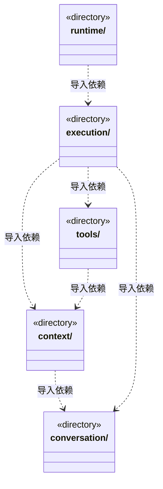

# src/backend/scheduler-engine 架构

## 目录定位

工作区调度。装配团队上下文与模型工具，协调会话、运行、用户问题和队列；只依赖自身及 Core。

本文描述当前实现。通过分析目录边界后维护的 [源码架构脚本](../../../scripts/source-architecture.mjs) 同步清单和声明；代码变更时仍须核对职责、关键成员与关系。

## 代码清单

本层无直接代码文件。

## 架构类图

各图中的同名节点表示同一目录边界；跨组及完整直接依赖如下（无边不代表继承）：

- `context` → `conversation`：导入。
- `execution` → `tools`：导入。
- `execution` → `context`：导入。
- `execution` → `conversation`：导入。
- `runtime` → `execution`：导入。
- `tools` → `context`：导入。

## 子目录导航

- [context/](context/ARCHITECTURE.md)：内置主角色可在结构异常时诊断和治理知识。默认执行角色继承 Team 根 Skill，不创建项目角色定义文件；正式任务冻结执行角色、真实模块、维护关系、Workflow 与规范，拒绝主角色执行业务。
- [conversation/](conversation/ARCHITECTURE.md)：主 Agent 的目标规划、证据审阅与团队技术管理指引，以及用户问题、审批和队列。主调度处理求助，可明确撤销未启动依赖后再申请安全等待；撤销不算成功，普通队列消息不替代人工决定或恢复。
- [execution/](execution/ARCHITECTURE.md)：主实例与图根共享身份。新周期冻结软限额，可信用量在主登记/成员领取事务核实，证明随真实运行提交；在途先结算，拒绝不额外启动模型。等待、求助、撤销和验收独立，公开统计不签发许可。
- [runtime/](runtime/ARCHITECTURE.md)：监管、履历与全局并发准入职责分离。监管消费真实用量；准入同步协调名额和本地租约，稳定票据 FIFO 等待，降额不逐出活动运行；履历不签发执行权。进程票据不从历史恢复模型。
- [tools/](tools/ARCHITECTURE.md)：把知识 CRUD、目标计划/审阅、执行者派发、图查询与未启动任务撤销注册为 cbim_ 工具。主调度工具仅在可信绑定和真实端口下提供；撤销不停止活动运行，也不能作为完成证据，执行者不获得调度权。

[返回上层](../ARCHITECTURE.md)。

每次修改本目录代码，同步维护文件头、关键契约说明及本图。未实现的治理、证据验收和自动编排能力不列入当前类图。
