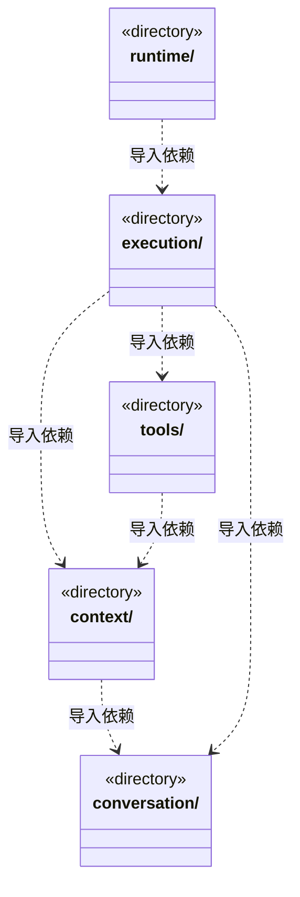

# src/backend/scheduler-engine 架构

## 目录定位

工作区调度。装配团队上下文与模型工具，协调会话、运行、用户问题和队列；只依赖自身及 Core。

本文描述当前实现。通过分析目录边界后维护的 [源码架构脚本](../../../scripts/source-architecture.mjs) 同步清单和声明；代码变更时仍须核对职责、关键成员与关系。

## 代码清单

本层无直接代码文件。

## 架构类图

各图中的同名节点表示同一目录边界；跨组及完整直接依赖如下（无边不代表继承）：

- `context` → `conversation`：导入。
- `execution` → `tools`：导入。
- `execution` → `context`：导入。
- `execution` → `conversation`：导入。
- `runtime` → `execution`：导入。
- `tools` → `context`：导入。

## 子目录导航

- [context/](context/ARCHITECTURE.md)：内置主角色诊断和治理知识，执行者冻结角色/Skill、模块/维护关系、Workflow 与规范。前置替换重验待办并保留原实例；配置过期不能借重新准备刷新旧任务，主角色仍不执行业务。
- [conversation/](conversation/ARCHITECTURE.md)：主 Agent 的规划、审阅与团队管理指引，以及提问、审批和队列。主调度可安排求助补做，再显式替换未启动前置或撤销待办；旧失败不改写，普通消息不替代人工决定或恢复。
- [execution/](execution/ARCHITECTURE.md)：主实例与图根共享身份。成员正常关闭后核实检查点，主调度显式预约，同周期新 run 消费一次且重新纳入依赖后继。启动前重核文件、知识、原生历史与前置，额度/准入等待不消费；停止和重启封存而不重放。 人工决定服务复读当前等待、可信日志、知识和选定文件，在事务中仅追加意见，不恢复执行。
- [runtime/](runtime/ARCHITECTURE.md)：监管、履历与全局并发准入职责分离。可靠提交同步周期白名单，scope-only 更新独立游标，未变投影不重复发布；检查点计待办而不占活动名额，报告用量不授予额度或恢复权。
- [tools/](tools/ARCHITECTURE.md)：把知识 CRUD、目标计划/审阅和主调度命令注册为 cbim_ 工具。续执行预约、未启动撤销/前置替换仅真实端口可用时公开，严格拒绝模型夹带身份；维护回执不算业务证据，执行者不获得调度权。

[返回上层](../ARCHITECTURE.md)。

每次修改本目录代码，同步维护文件头、关键契约说明及本图。未实现的治理、证据验收和自动编排能力不列入当前类图。
