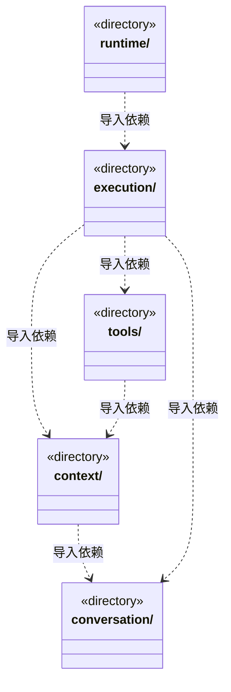

# src/backend/scheduler-engine 架构

## 目录定位

工作区调度。装配团队上下文与模型工具，协调会话、运行、用户问题和队列；只依赖自身及 Core。

本文描述当前实现。通过分析目录边界后维护的 [源码架构脚本](../../../scripts/source-architecture.mjs) 同步清单和声明；代码变更时仍须核对职责、关键成员与关系。

## 代码清单

本层无直接代码文件。

## 架构类图

各图中的同名节点表示同一目录边界；跨组及完整直接依赖如下（无边不代表继承）：

- `context` → `conversation`：导入。
- `execution` → `tools`：导入。
- `execution` → `context`：导入。
- `execution` → `conversation`：导入。
- `runtime` → `execution`：导入。
- `tools` → `context`：导入。

## 子目录导航

- [context/](context/ARCHITECTURE.md)：内置主角色诊断和治理知识，执行者冻结角色/Skill、模块/维护关系、Workflow与规范。显式流程只从本模块挂载清单解析，准备按任务原选择重核，不回退默认或刷新旧绑定；前置替换保留原实例和流程，主角色仍不执行业务。
- [conversation/](conversation/ARCHITECTURE.md)：主 Agent 的规划、审阅与团队管理指引，以及提问、审批和队列。原题与选项独立保存，公开待答列表返回副本，答案与取消只有一次消费；坏回包不重弹。主调度可安排求助补做、替换未启动前置或撤销待办；旧失败不改写，问答不替代人工决定或恢复。
- [execution/](execution/ARCHITECTURE.md)：主实例与图根共享身份；补充发送前事务预留，ACK后登记新输入；与cycle在途操作一起结算，停止仍先作用引擎，旧计划不再领取，最终门禁核对原接收日志。插入独立停止屏障，在异步准备后复核原run，停止实际引擎不排在插入串行事务之后。只在真实用户交互端口存在时装配提问工具；成员候选和目标审阅排除问答回执，但保留历史事实与真实业务证据。目标分工、派发及人工来源核对原流程选择；交付/审阅从canonical复核要求、真实passed及当前文件。检查点与前置替换不改选；额度/准入等待不消费，停止和重启封存不重放。
- [runtime/](runtime/ARCHITECTURE.md)：监管、履历与全局并发准入职责分离。可靠提交同步周期白名单，scope-only 更新独立游标，未变投影不重复发布；检查点计待办而不占活动名额，报告用量不授予额度或恢复权。
- [tools/](tools/ARCHITECTURE.md)：把知识、主调度及实际装配的用户交互注册为 cbim_ 工具。QuestionTools在等待前冻结原题，唯一wire严格核验答案或取消，坏回包不重问。主调度八工具使用固定运行身份、原命令映射与严格输出；坏回包先核实原记录。维护和问答回执不算业务证据，执行者不获得调度权。

[返回上层](../ARCHITECTURE.md)。

每次修改本目录代码，同步维护文件头、关键契约说明及本图。未实现的治理、证据验收和自动编排能力不列入当前类图。
