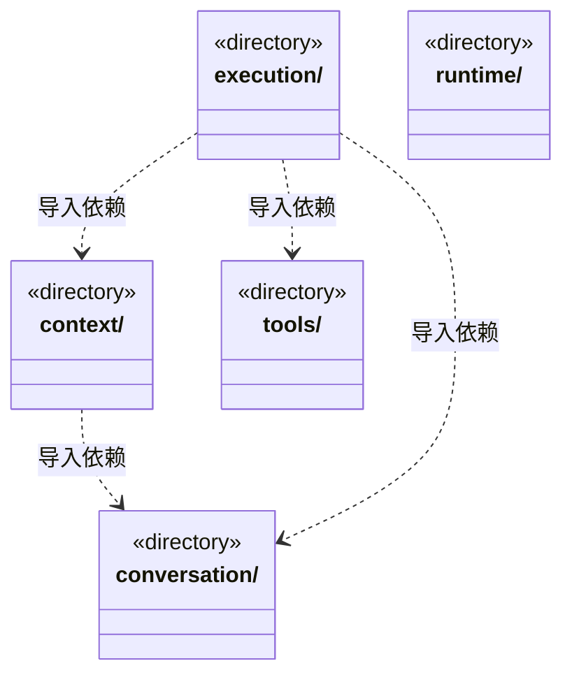

# src/backend/scheduler-engine 架构

## 目录定位

工作区调度。装配团队上下文与模型工具，协调会话、运行、用户问题和队列；只依赖自身及 Core。

本文描述当前实现。通过分析目录边界后维护的 [源码架构脚本](../../../scripts/source-architecture.mjs) 同步清单和声明；代码变更时仍须核对职责、关键成员与关系。

## 代码清单

本层无直接代码文件。

## 架构类图

各图中的同名节点表示同一目录边界；跨组及完整直接依赖如下（无边不代表继承）：

- `context` → `conversation`：导入。
- `execution` → `context`：导入。
- `execution` → `conversation`：导入。
- `execution` → `tools`：导入。

## 子目录导航

- [context/](context/ARCHITECTURE.md)：从同一知识快照解析主/自定义角色、继承 Skill 和多模块维护关系，选择各模块自己的默认 Workflow。派发固定身份与知识版本，完整可恢复执行正文仍待接入。
- [conversation/](conversation/ARCHITECTURE.md)：主 Agent 指引、用户问题、运行内审批及队列。普通问答保持轻量，实现任务记录目标、步骤和证据；停止与结束清理临时授权。
- [execution/](execution/ARCHITECTURE.md)：Loop 执行装配、工作区管理与成员派发。成员实例及独立逻辑通道通过同事务登记；派发原子写任务/边/邮箱及图增量，尚不消费邮箱启动成员大脑。
- [runtime/](runtime/ARCHITECTURE.md)：应用级动态运行索引：以工作区代际接收提交事实，聚合成员、任务、队列和真实轮次用量；重复事件不重复计费，无变化游标读取不重建快照。工作区仍持有日志与执行权限。
- [tools/](tools/ARCHITECTURE.md)：把 Core 知识能力注册为内部 cbim_ 工具；Loop 调用前核对参数、实例身份与单次 gate 授权，返回时校验工具结果。维护任务工具明确区分对话和派发任务 ID；领域事务负责版本及结构检查。

[返回上层](../ARCHITECTURE.md)。

每次修改本目录代码，同步维护文件头、关键契约说明及本图。未实现的治理、证据验收和自动编排能力不列入当前类图。
