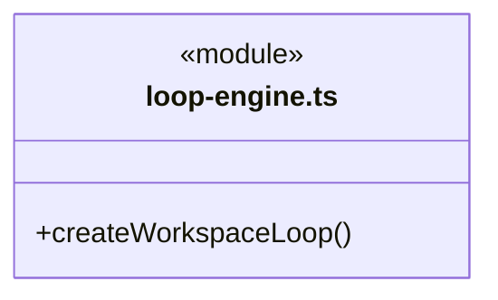
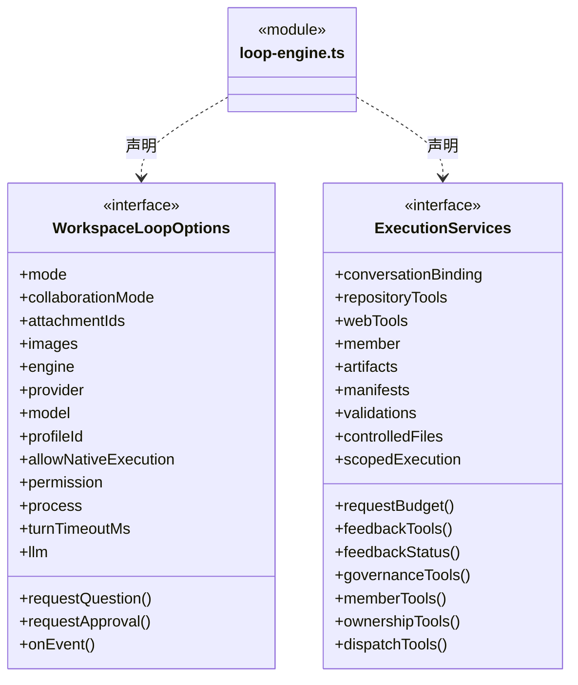
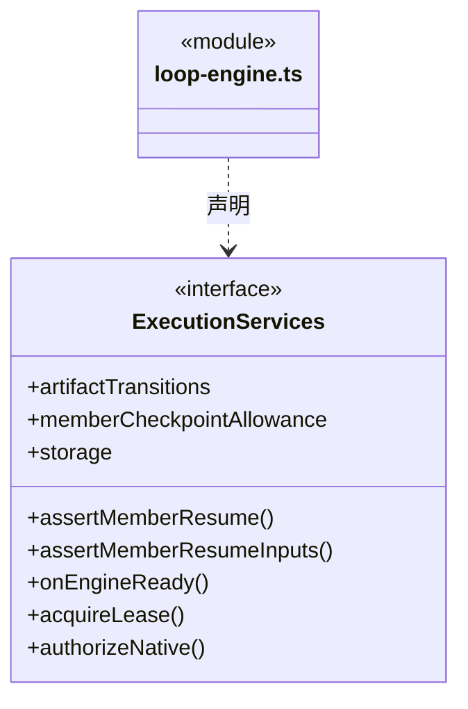

# src/backend/scheduler-engine/assembly 架构

## 目录定位

引擎装配：loop-engine 将实际 Pi/Claude/Codex、模型预算及工具能力接入 Core 运行循环。这里有意认识具体实现；高密度装配依赖仍需独立评审。

本文描述当前实现。通过分析目录边界后维护的 [源码架构脚本](../../../../scripts/source-architecture.mjs) 同步清单和声明；代码变更时仍须核对职责、关键成员与关系。

## 代码清单

| 文件 | 当前职责 |
| --- | --- |
| [loop-engine.ts](loop-engine.ts) | 调度引擎：将工作区内部知识服务、内核锁与前置策略注入独立 LoopRuntime。 |

## 架构类图

### loop-engine.ts

成员 1/2（同名节点为同一声明，跨图合并阅读）。

成员 2/2（同名节点为同一声明，跨图合并阅读）。

直接依赖：[../tools/question-tools.ts](../tools/question-tools.ts)、[../tools/web-tools.ts](../tools/web-tools.ts)、[../../core/connectors/web-tools.ts](../../core/connectors/web-tools.ts)、[../../core/foundation/paths.ts](../../core/foundation/paths.ts)、[../../core/knowledge/ports.ts](../../core/knowledge/ports.ts)、[../tools/knowledge-tools.ts](../tools/knowledge-tools.ts)、[../context/team-workflow.ts](../context/team-workflow.ts)、[../../core/foundation/errors.ts](../../core/foundation/errors.ts)、[../conversation/main-agent.ts](../conversation/main-agent.ts)、[../../core/execution/types.ts](../../core/execution/types.ts)、[../../engines/claude/engine.ts](../../engines/claude/engine.ts)、[../../engines/codex/engine.ts](../../engines/codex/engine.ts)、[../../core/models/engine.ts](../../core/models/engine.ts)、[../../core/execution/index.ts](../../core/execution/index.ts)、[../../engines/pi/engine.ts](../../engines/pi/engine.ts)、[../../engines/pi/rpc.ts](../../engines/pi/rpc.ts)、[../../core/models/ports.ts](../../core/models/ports.ts)、[../../core/tools/policy/tool-policy.ts](../../core/tools/policy/tool-policy.ts)、[../../core/evidence/progress-tools.ts](../../core/evidence/progress-tools.ts)、[../../core/tasks/member-help-tools.ts](../../core/tasks/member-help-tools.ts)、[../../core/evidence/artifact-tools.ts](../../core/evidence/artifact-tools.ts)、[../../core/execution/capabilities/artifact-capture.ts](../../core/execution/capabilities/artifact-capture.ts)、[../../core/execution/capabilities/output-manifest-capture.ts](../../core/execution/capabilities/output-manifest-capture.ts)、[../../core/evidence/output-manifest-tools.ts](../../core/evidence/output-manifest-tools.ts)、[../../core/execution/capabilities/run-controlled-file.ts](../../core/execution/capabilities/run-controlled-file.ts)、[../../core/file-operations/controlled-file-operation.ts](../../core/file-operations/controlled-file-operation.ts)、[../../core/execution/capabilities/run-artifact-transition.ts](../../core/execution/capabilities/run-artifact-transition.ts)、[../../core/file-operations/artifact-transition.ts](../../core/file-operations/artifact-transition.ts)、[../../core/execution/capabilities/run-validation.ts](../../core/execution/capabilities/run-validation.ts)、[../../core/evidence/validation-tools.ts](../../core/evidence/validation-tools.ts)、[../../core/tasks/member-checkpoint-tools.ts](../../core/tasks/member-checkpoint-tools.ts)、[../tools/dispatch-tools.ts](../tools/dispatch-tools.ts)、[../../core/execution/capabilities/run-scoped-execution.ts](../../core/execution/capabilities/run-scoped-execution.ts)、[../../core/file-operations/scoped-execution.ts](../../core/file-operations/scoped-execution.ts)、[../../core/workspace/execution-scope.ts](../../core/workspace/execution-scope.ts)、[../../core/tools/native-tools.ts](../../core/tools/native-tools.ts)、[../../core/tasks/execution-context.ts](../../core/tasks/execution-context.ts)、[../../core/connectors/repository-tools.ts](../../core/connectors/repository-tools.ts)、[../tools/feedback-tools.ts](../tools/feedback-tools.ts)、[../tools/feedback-status-tool.ts](../tools/feedback-status-tool.ts)、[../../core/connectors/github-feedback.ts](../../core/connectors/github-feedback.ts)、[../tools/repository-tools.ts](../tools/repository-tools.ts)、[../../core/governance/module-governance-tools.ts](../../core/governance/module-governance-tools.ts)、[../tools/governance-tools.ts](../tools/governance-tools.ts)、[../tools/coordination-tools.ts](../tools/coordination-tools.ts)、[../tools/workspace-member-tools.ts](../tools/workspace-member-tools.ts)、[../../core/team/workspace-member-tools.ts](../../core/team/workspace-member-tools.ts)、[../tools/module-ownership-tools.ts](../tools/module-ownership-tools.ts)、[../../core/workspace/module-ownership-tools.ts](../../core/workspace/module-ownership-tools.ts)、[../../core/models/request-budget.ts](../../core/models/request-budget.ts)、[../../core/execution/storage.ts](../../core/execution/storage.ts)。

## 子目录导航

无子目录。

[返回上层](../ARCHITECTURE.md)。

每次修改本目录代码，同步维护文件头、关键契约说明及本图。未实现的治理、证据验收和自动编排能力不列入当前类图。
