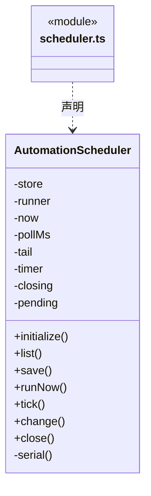
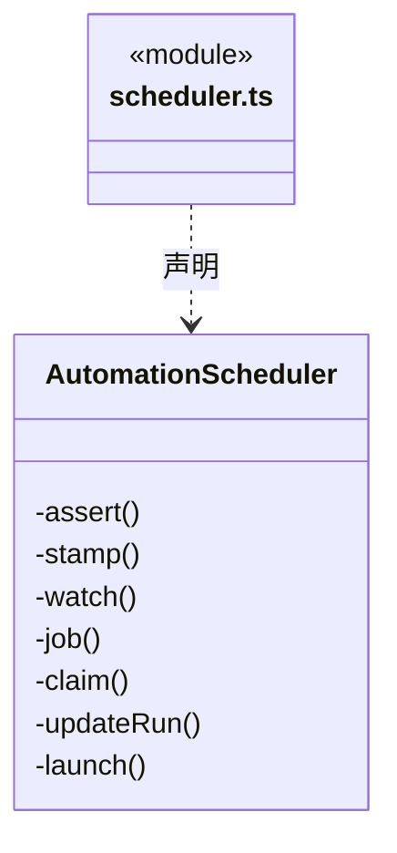

# src/backend/scheduler-engine/automation 架构

## 目录定位

串行版本配置、持久启动意图与定时调度；同项不重叠，重开跳过过期，不重放未知运行。

本文描述当前实现。通过分析目录边界后维护的 [源码架构脚本](../../../../scripts/source-architecture.mjs) 同步清单和声明；代码变更时仍须核对职责、关键成员与关系。

## 代码清单

| 文件 | 当前职责 |
| --- | --- |
| [scheduler.ts](scheduler.ts) | 工作区自动化的串行定义修改、定时触发和执行状态维护。 |

## 架构类图

### scheduler.ts

成员 1/2（同名节点为同一声明，跨图合并阅读）。

成员 2/2（同名节点为同一声明，跨图合并阅读）。

直接依赖：[../../core/foundation/errors.ts](../../core/foundation/errors.ts)、[../../core/automation/contracts.ts](../../core/automation/contracts.ts)、[../../core/automation/schedule.ts](../../core/automation/schedule.ts)。

## 子目录导航

无子目录。

[返回上层](../ARCHITECTURE.md)。

每次修改本目录代码，同步维护文件头、关键契约说明及本图。未实现的治理、证据验收和自动编排能力不列入当前类图。

## 设计契约 v1 与落地范围

以下内容区分已接通能力与后续设计；以各节的实现状态为准，不将目标图当作现状图。维护源：[CONTRACT.md](CONTRACT.md)；生成类图时同步附加，勿直接修改本附录。

# 自动化调度

唯一 AutomationScheduler 串行修改定义与运行历史，定义 CAS 拒绝旧版本。先原子保存 starting，再异步启动；启动不占串行锁，避免 bind 保存身份自锁。每个定义最多一个 starting/running/waiting/unknown 记录，错过时刻跳至未来，不排积压任务。

关闭取消启动准备并排空；工作区随后停止主/成员进程。重开无真实身份的启动标中断，有身份只观察原周期，绝不恢复模型。暂停/删除先停未来计划和准备，再停止真实原任务；停止失败不伪造取消成功。删除保留历史，编辑仅影响未来执行。最多 100 个定义、500 条运行；只清理已终结历史，不删除未结记录。

调度器不依赖工作区、UI、引擎或派发实现；Main 通过存储/执行端口装配。已有运行启动错误说明不会被后续无说明的只读状态覆盖。
