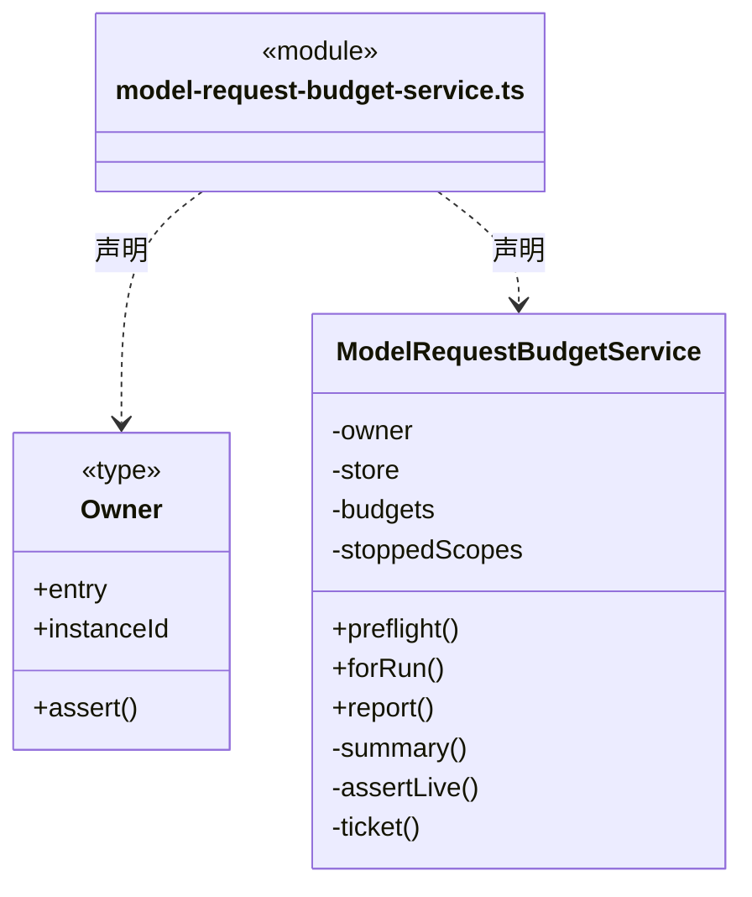
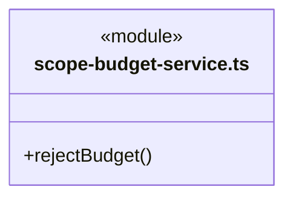
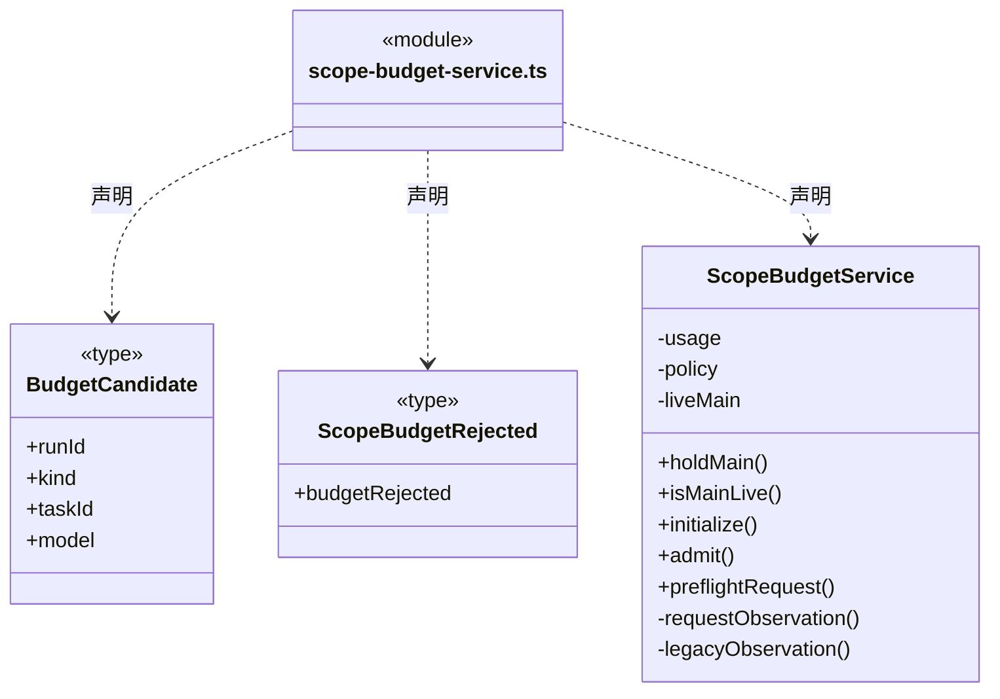
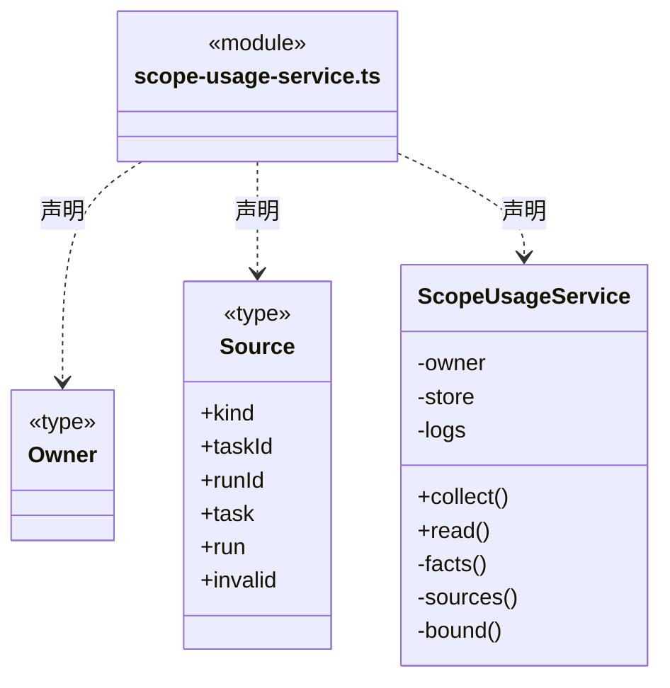
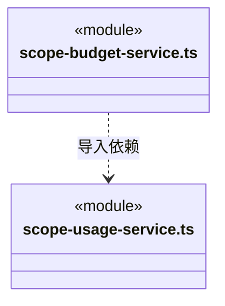

# src/backend/scheduler-engine/budget 架构

## 目录定位

预算应用服务：协调请求和目标预算预占/结算，通过明确存储端口保存结果；不直接访问共享派发 Store。

本文描述当前实现。通过分析目录边界后维护的 [源码架构脚本](../../../../scripts/source-architecture.mjs) 同步清单和声明；代码变更时仍须核对职责、关键成员与关系。

## 代码清单

| 文件 | 当前职责 |
| --- | --- |
| [model-request-budget-service.ts](model-request-budget-service.ts) | 通过专用预算端口保存每个真实主/成员请求的预留、发送意图和终态，不读取或改写其它调度领域。 |
| [scope-budget-service.ts](scope-budget-service.ts) | 在调度事务内核实周期额度，并将许可证明或拒绝事实交给同一事务保存；逐请求模式读取独立请求账本。 |
| [scope-usage-service.ts](scope-usage-service.ts) | 按指定目标周期的持久主运行清单与成员绑定，读取 canonical 日志并生成只读消耗报告。 |

## 架构类图

### model-request-budget-service.ts

直接依赖：[../../core/foundation/errors.ts](../../core/foundation/errors.ts)、[../../core/budget/model-request-budget-storage.ts](../../core/budget/model-request-budget-storage.ts)、[../../core/budget/model-request-budget.ts](../../core/budget/model-request-budget.ts)、[../../core/budget/model-request-budget-rules.ts](../../core/budget/model-request-budget-rules.ts)、[../../core/models/ports.ts](../../core/models/ports.ts)、[../../core/models/request-budget.ts](../../core/models/request-budget.ts)、[../../core/team/workspace-member-rules.ts](../../core/team/workspace-member-rules.ts)。

### scope-budget-service.ts

直接依赖：[../../core/foundation/errors.ts](../../core/foundation/errors.ts)、[../../core/foundation/serialization.ts](../../core/foundation/serialization.ts)、[../../core/execution/scope-usage.ts](../../core/execution/scope-usage.ts)、[../../core/budget/scope-budget.ts](../../core/budget/scope-budget.ts)、[../../core/tasks/dispatch-scope.ts](../../core/tasks/dispatch-scope.ts)、[../../core/dispatch/dispatch-storage.ts](../../core/dispatch/dispatch-storage.ts)、[scope-usage-service.ts](scope-usage-service.ts)、[../../core/budget/model-request-budget-rules.ts](../../core/budget/model-request-budget-rules.ts)、[../../core/budget/model-request-budget.ts](../../core/budget/model-request-budget.ts)、[../../core/budget/model-request-budget-storage.ts](../../core/budget/model-request-budget-storage.ts)。

### scope-usage-service.ts

直接依赖：[../../core/foundation/errors.ts](../../core/foundation/errors.ts)、[../../core/foundation/serialization.ts](../../core/foundation/serialization.ts)、[../../core/knowledge/ports.ts](../../core/knowledge/ports.ts)、[../../core/execution/types.ts](../../core/execution/types.ts)、[../../core/execution/scope-usage.ts](../../core/execution/scope-usage.ts)、[../../core/dispatch/dispatch-storage.ts](../../core/dispatch/dispatch-storage.ts)、[../../core/tasks/dispatch-execution.ts](../../core/tasks/dispatch-execution.ts)、[../../core/tasks/graph-types.ts](../../core/tasks/graph-types.ts)、[../../core/budget/scope-usage.ts](../../core/budget/scope-usage.ts)、[../goals/scope-goal-service.ts](../goals/scope-goal-service.ts)。

### 本目录调用边界

## 子目录导航

无子目录。

[返回上层](../ARCHITECTURE.md)。

每次修改本目录代码，同步维护文件头、关键契约说明及本图。未实现的治理、证据验收和自动编排能力不列入当前类图。
