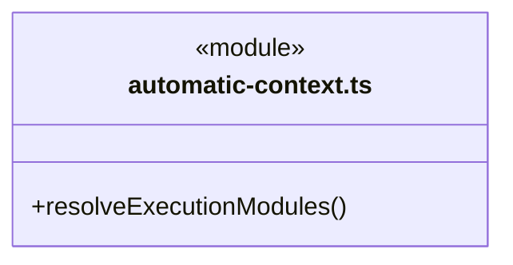
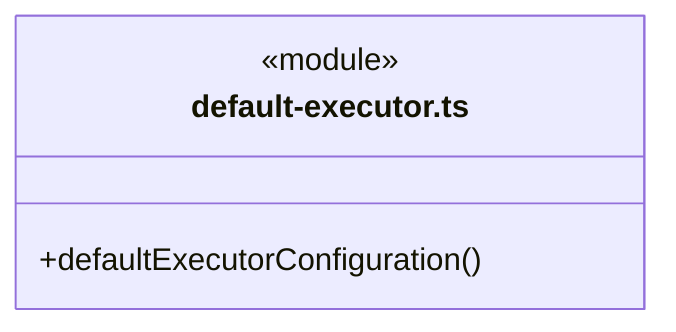
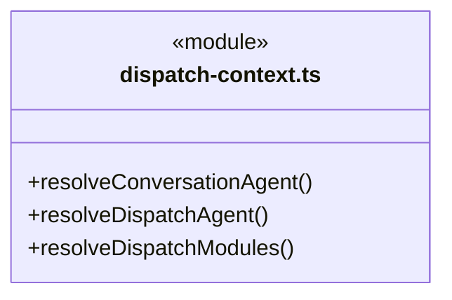
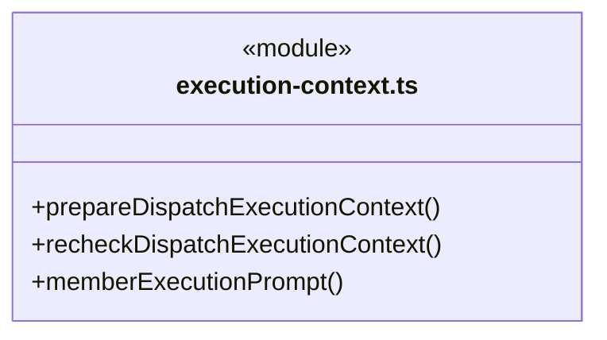
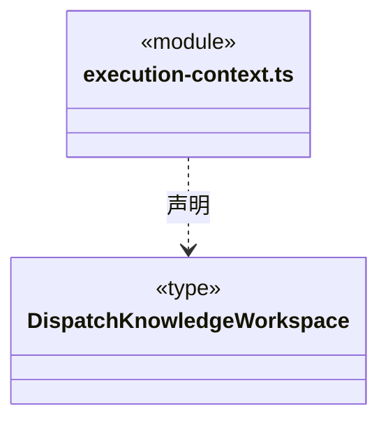
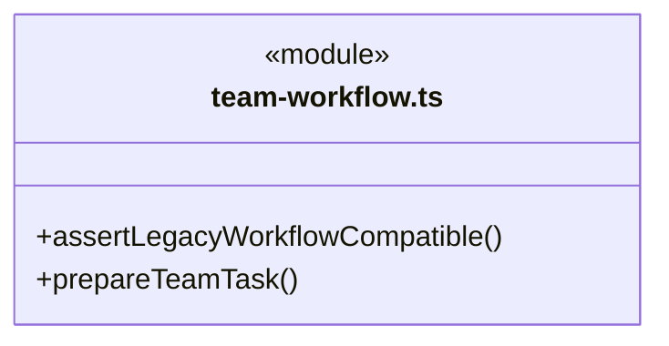
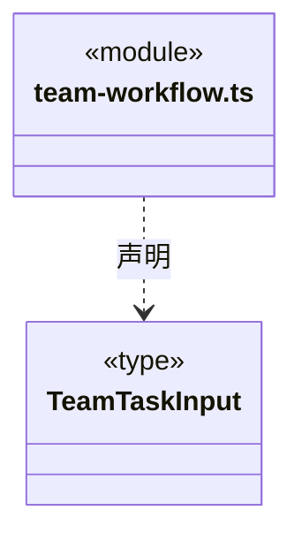
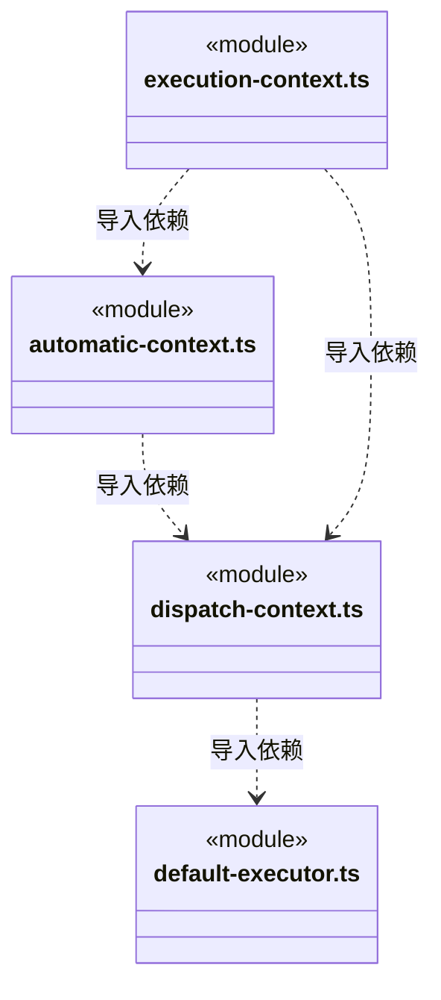
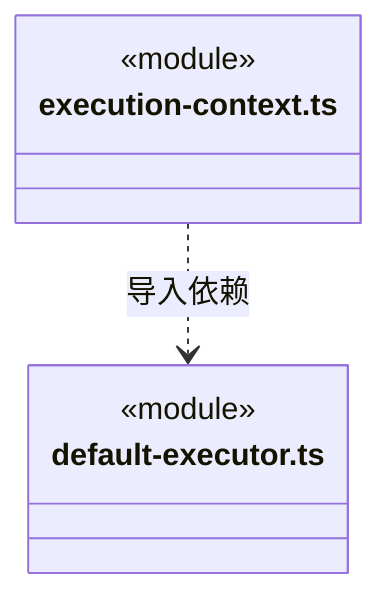
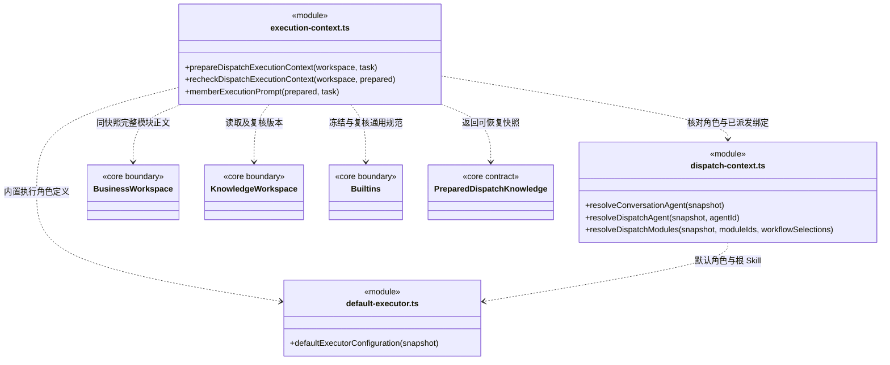

# src/backend/scheduler-engine/context 架构

## 目录定位

内置主角色诊断和治理知识，执行者冻结角色/Skill、模块/维护关系、Workflow与规范。显式流程只从本模块挂载清单解析，准备按任务原选择重核，不回退默认或刷新旧绑定；前置替换保留原实例和流程；Auto 主会话直接工作不冒充独立执行成员。 执行上下文同时冻结负责岗位、项目适配、采纳能力与模型身份，主模型不会替换成员配置。

本文描述当前实现。通过分析目录边界后维护的 [源码架构脚本](../../../../scripts/source-architecture.mjs) 同步清单和声明；代码变更时仍须核对职责、关键成员与关系。

## 代码清单

| 文件 | 当前职责 |
| --- | --- |
| [automatic-context.ts](automatic-context.ts) | 解析自动模式的隐式全项目范围，复用真实模块既有的维护与 Workflow 规则。 |
| [default-executor.ts](default-executor.ts) | 提供 CBIM 内置默认执行角色的静态定义及当前 Team 根 Skill 的只读装配。 |
| [dispatch-context.ts](dispatch-context.ts) | 解析主会话内置身份，以及正式派发所需的角色知识与多模块绑定。 |
| [execution-context.ts](execution-context.ts) | 为已派发成员任务冻结完整执行知识和各模块可选 Workflow 程序约定，并在启动、恢复或未启动依赖替换前复核基线。 |
| [team-workflow.ts](team-workflow.ts) | 调度引擎：将明确选择的模块、叶子 Agent 和本模块 Workflow 装配为执行任务。 |

## 架构类图

### automatic-context.ts



直接依赖：[../../core/foundation/errors.ts](../../core/foundation/errors.ts)、[../../core/team/automatic-execution.ts](../../core/team/automatic-execution.ts)、[../../core/knowledge/types.ts](../../core/knowledge/types.ts)、[../../core/tasks/graph-types.ts](../../core/tasks/graph-types.ts)、[../../core/tasks/workflow-selection.ts](../../core/tasks/workflow-selection.ts)、[dispatch-context.ts](dispatch-context.ts)。

### default-executor.ts



直接依赖：[../../core/foundation/errors.ts](../../core/foundation/errors.ts)、[../../core/knowledge/snapshot.ts](../../core/knowledge/snapshot.ts)、[../../core/knowledge/types.ts](../../core/knowledge/types.ts)、[../../core/team/agent-types.ts](../../core/team/agent-types.ts)。

### dispatch-context.ts



直接依赖：[../../core/foundation/errors.ts](../../core/foundation/errors.ts)、[../../core/foundation/serialization.ts](../../core/foundation/serialization.ts)、[../../core/knowledge/snapshot.ts](../../core/knowledge/snapshot.ts)、[../../core/knowledge/types.ts](../../core/knowledge/types.ts)、[../../core/team/model.ts](../../core/team/model.ts)、[../../core/team/agent-types.ts](../../core/team/agent-types.ts)、[../../core/tasks/graph-types.ts](../../core/tasks/graph-types.ts)、[../../core/tasks/workflow-selection.ts](../../core/tasks/workflow-selection.ts)、[../../core/workspace/maintenance.ts](../../core/workspace/maintenance.ts)、[../../core/workspace/model.ts](../../core/workspace/model.ts)、[../conversation/main-agent.ts](../conversation/main-agent.ts)、[default-executor.ts](default-executor.ts)。

### execution-context.ts





直接依赖：[automatic-context.ts](automatic-context.ts)、[../../core/foundation/serialization.ts](../../core/foundation/serialization.ts)、[../../core/foundation/errors.ts](../../core/foundation/errors.ts)、[../../core/knowledge/snapshot.ts](../../core/knowledge/snapshot.ts)、[../../core/knowledge/builtins.ts](../../core/knowledge/builtins.ts)、[../../core/knowledge/ports.ts](../../core/knowledge/ports.ts)、[../../core/knowledge/types.ts](../../core/knowledge/types.ts)、[../../core/team/workspace-member.ts](../../core/team/workspace-member.ts)、[../../core/workspace/model.ts](../../core/workspace/model.ts)、[../../core/tasks/graph-types.ts](../../core/tasks/graph-types.ts)、[../../core/tasks/execution-context.ts](../../core/tasks/execution-context.ts)、[dispatch-context.ts](dispatch-context.ts)、[default-executor.ts](default-executor.ts)、[../conversation/main-agent.ts](../conversation/main-agent.ts)、[../../core/workspace/workflow-contract.ts](../../core/workspace/workflow-contract.ts)、[../../core/tasks/workflow-selection.ts](../../core/tasks/workflow-selection.ts)。

### team-workflow.ts





直接依赖：[../../core/knowledge/knowledge-queries.ts](../../core/knowledge/knowledge-queries.ts)、[../../core/knowledge/builtins.ts](../../core/knowledge/builtins.ts)、[../../core/foundation/errors.ts](../../core/foundation/errors.ts)、[../../core/knowledge/ports.ts](../../core/knowledge/ports.ts)、[../../core/brain/index.ts](../../core/brain/index.ts)、[../../core/workspace/workflow-contract.ts](../../core/workspace/workflow-contract.ts)。

### 本目录调用边界






## 子目录导航

无子目录。

[返回上层](../ARCHITECTURE.md)。

每次修改本目录代码，同步维护文件头、关键契约说明及本图。未实现的治理、证据验收和自动编排能力不列入当前类图。

## 设计契约 v1 与落地范围

以下内容区分已接通能力与后续设计；以各节的实现状态为准，不将目标图当作现状图。维护源：[CONTRACT.md](CONTRACT.md)；生成类图时同步附加，勿直接修改本附录。

### 多成员、多模块任务上下文契约

`resolveDispatchModules(snapshot, moduleIds, workflowSelections?)` 只从对应模块实际挂载的 Workflow 清单解析显式 ID。部分选择只覆盖指定模块；缺省仍取该模块首项或空清单的 general，但不作为匹配任意流程的通配符。显式选择缺失、跨模块或已卸载时拒绝，不回退。`prepareDispatchExecutionContext` 按 Task 原选择重新解析并比较完整绑定和知识版本；任务原本缺省的字段不会补成空数组，旧任务不能就地改选。

`DispatchKnowledgeWorkspace` 明确只读的 `entry/assert/snapshot/read/rules` 能力。未启动依赖替换复用 `prepareDispatchExecutionContext` 逐个核对待办闭包的原角色、模块、维护关系与当前规范，并用 `recheckDispatchExecutionContext` 最后核对替代候选的冻结知识。版本变化整体拒绝，不刷新旧任务或扩大权限；仍不声称锁定外部业务产物。

已实现 `resolveDispatchAgent` 与 `resolveDispatchModules`：同快照解析自定义执行角色或静态内置默认执行角色 `cbim:executor`、继承 Skill、多个真实模块及维护关系。`cbim:main` 不承担业务执行，正式执行解析、冻结恢复和执行提示构造均拒绝该角色；主会话直接治理受控知识不通过该业务任务入口。缺失关系抛出明确错误码；默认采用各模块 Workflow 清单首项，空清单明确标为 general，不继承父模块。`prepareDispatchExecutionContext` 在执行前冻结完整角色、模块与流程正文；`recheckDispatchExecutionContext` 在启动或恢复时核对知识和内置规范版本。旧 `prepareTeamTask` 继续处理原单模块执行。新任务模型见 [core/tasks](../../core/tasks/CONTRACT.md)。

`resolveConversationAgent` 只用于主会话图根与普通对话实例登记：要求快照有工作区身份和版本，返回固定内置主角色、Team 和主指引，不加载业务 Skill。因此结构校验失败时用户仍能与主助手诊断知识问题；正式 `createMember`、`dispatchTask`、执行冻结仍使用严格解析入口，不能借普通对话身份绕过知识、维护关系或完整 Skill 校验。

#### 从分析到固定执行输入

Team 主会话对业务只调度：先理解目标，通过内部知识服务定位业务模块、维护责任、团队成员、Skill 与 Workflow，再派发给独立执行 Agent，最后核实真实返回。它同时负责团队与业务知识管理，可在当前授权范围内通过受控服务治理架构、补齐有效模块和维护关系，不必先派发业务任务。治理遵守 read/ask/execute、审批、版本和事务，不能原生读写 `.cbim/` 或借知识管理绕过业务权限。Auto 主会话可按本轮权限直接工作；此处正式成员上下文不改为主实例，也不以项目根存在放宽派发范围。没有合适自定义角色时使用 `cbim:executor`。被调度成员拥有自身会话、状态和模型思考能力，可自主探索真实 Team 环境，在目标模块内实现和验证。本目录确定性核验知识与装配输入，不把认知职责当作权限。普通问答、目标澄清及候选查找可继续，尚未定位模块时不产生假派发节点。

实际冻结契约位于 `core/tasks/execution-context.ts`，由调度与存储共同引用。权限和模型配置由可信运行入口单独准备，不混入知识快照：

```ts
interface PreparedDispatchKnowledge {
  version: 1; workspaceId: string; knowledgeRevision: string;
  agent: AgentConfigurationSnapshot;
  agentDefinition: Record<string, unknown>;
  modules: { binding: ModuleBinding; definition: Record<string, unknown>;
             overview: string; workflowText: string; workflowContract?: WorkflowContract }[];
  standards: { id: string; version: string; text: string }[];
  fingerprint: string;
}
```

所有正文从一个知识快照读取，任务中已有的维护关系、Workflow 与版本必须完全匹配；缺失正文不静默降级。`default-executor.ts` 提供静态 `defaultExecutorDefinition`、`defaultExecutorInstructions` 和 `defaultExecutorConfiguration`，后者继承 Team 根 Skill，缺正文拒绝执行；不在 `.cbim/` 创建默认角色文件。自定义角色保存实际 agent.json，角色原则及有效 Skill 正文完整保留。主会话登记使用 `mainAgentInstructions`，与独立执行角色明确分离。通用 Workflow 冻结 `business-execution` 正文，同时冻结 `common-rules`；软件内置规范不属于工作区 revision，因此启动和恢复都另外复核其内容版本，并在规范读取前后核对工作区版本。

`validatePreparedDispatchKnowledge` 校验结构、引用一致性与正文哈希；`dispatchKnowledgeFingerprint` 对字段排序后的 JSON 计算 SHA-256，保留数组顺序。每份模块 Workflow 的可选 `cbim-workflow` 约定从本模块实际正文解析并随正文冻结；保存字段必须与重新解析的内容相同，删除约定后重算指纹也不能通过。`preparedWorkflowContracts` 保留所有模块的独立出处和版本，不继承父模块、不用最新知识替代已冻结要求。无声明保持原自然语言流程。

指纹不代表来源可信或获得授权。版本变化返回 `KNOWLEDGE_CHANGED`，任务绑定变化返回 `DISPATCH_CONTEXT_CHANGED`，存储快照损坏返回 `EXECUTION_CONTEXT_INVALID`；调用者必须重新核实，不能自动覆盖旧正文。文本上下文仅进入后端运行存储与大脑，公开图只获得 ModuleBinding 和角色引用。

旧 `prepareTeamTask` 入口遇到程序约定以 `WORKFLOW_MEMBER_REQUIRED` 拒绝，必须通过主调度派发正式成员。`assertLegacyWorkflowCompatible` 在实际运行租约前同样检查旧任务的冻结正文，防止续聊跳过准备入口；不从新知识给历史无声明任务补造条件。

默认执行角色的定义与原则随应用发布，也不属于项目 revision。恢复时另行比较当前静态定义与已冻结原则，变化返回 `KNOWLEDGE_CHANGED`；旧主角色执行快照返回 `AGENT_ROLE_INVALID`，不自动改绑为默认执行者。

#### 核验规则

| 对象 | 约束 |
| --- | --- |
| 角色 | `cbim:main` 在 Team 中调度、在 Auto 中可直接实现，并共用受控知识管理；`cbim:executor` 与自定义角色承担业务执行。共享大脑内核但不同实例，内置定义不写工作区文件 |
| Team | 根是 Team，非叶子是组，叶子是 Agent；有效 Skill 来自自身及祖先 |
| 模块 | workspace 下的领域工程及模块仍遵循业务知识结构；Task 绑定一个或多个实际 moduleId |
| 维护责任 | 每个模块必须有可核实的维护关系与真人责任引用；角色执行责任不替代真人长期责任 |
| Workflow | 每模块从自身清单选择本次 Workflow；不继承父模块或其他模块的 Workflow |
| 通用流程 | 模块无专属流程且策略允许时，明确记录 general 的版本和 reason；不伪装成模块挂载流程 |
| 权限 | 本目录不签发或继承权限；可信入口独立决定本轮工具门禁，内容文字及维护关系不能签发权限 |
| 恢复 | 本目录比较知识与内置规范版本，失效时拒绝沿用；当前成员入口只续接已核实正常结束的通道，尚未实现产物文件基线比对或异常通道自动恢复 |

ModuleSchema 的 `authors` 记录作者，**不等于维护责任关系**。`maintenanceBindingId` 指向已实现的显式关系，定义见 [Core Workspace 契约](../../core/workspace/CONTRACT.md)。缺关系时抛出 `MAINTAINER_UNCONFIRMED`，由授权知识维护流程补齐；不把作者自动升级为负责人，也不冒充已认证登录身份。

角色的默认指引/Skill 与业务 Workflow 分开。调度职责是“核实现状、目标与约束 → 定位模块与团队 → 明确执行者、模块列表、目标、验收证据及依赖/风险 → 派发独立执行者 → 核实候选并安排返工或后续”；受控知识管理维护真实职责、依赖和责任关系，架构演进基于证据渐进，重大治理决策交人。执行职责是“理解已派发目标 → 自主探索 Team 与目标模块 → 实现/验证 → 报告候选或协作缺口”。个人配置与知识里的分工建议不能扩大本轮职责、模块边界、权限或改变验收基线；执行者需要范围外架构调整时报告主 Agent，不获得无限知识改写权。

`memberExecutionPrompt` 组装当前成员、当前任务的完整指引，要求使用 `cbim_task_plan`、`cbim_task_inspect`、`cbim_task_step` 和 `cbim_delivery_prepare` 形成可核实交付候选。所有正式任务只能由独立执行角色运行，不能交给 `cbim:main`；不再次派工，超出模块或需他人协作时向主调度报告事实、所需能力和限制。原单模块 `loopInstructions` 采用同一职责边界。计划目标与验收原文、顺序保持派发值；步骤可以修订，目标、范围或验收变化则报告限制并等待重新派发。模型回合结束不等于业务验收。

空闲、工作、等待和沟通状态来自可靠调度与运行/工具事件，不由模型正文自行修改。本阶段未提供执行成员的递归派发、等待或通信工具，不能把记录协作需求说成已经联系其他成员；提示词不能代替执行入口的工具门禁。

可选第三参数 `prerequisites` 由启动事务冻结，携带各前置 taskId、planRevision 和完整结果候选（摘要、证据引用、限制及 not_evaluated 状态）。提示词要求重新核实适用于本任务的事实；不能用前置候选扩大权限、改变目标或冒充已通过验收。前置快照属于 DispatchRun，独立于知识基线，不放入公开角色配置。

#### 当前冻结与复核关系



本目录不写磁盘、不发送消息、不自行启动成员；通过只读知识端口返回结果，供 execution 准备运行。测试覆盖角色继承、多模块独立 Workflow、主角色来源、绑定篡改、读取期间知识变化、内置规范更新、缺失正文和快照损坏；实际权限、通道日志及交付证据复核由运行入口测试，不能据此宣称已比对产物文件基线。

正式岗位执行从外层已锁定的同一知识 Snapshot 装配，不在 DispatchStore 回调中再次进入知识队列。memberContext 固定岗位绑定、名称、职责与项目适配，能力原则和有效 Skill 复用原解析器；适配引用只代表保存的资料引用，不声称自动读取或授权。旧快照读取不补字段，实际执行继续按原知识与 Workflow 完整复核。


### 自动与团队协作模式

automatic-context.ts 是隐式全项目范围的唯一解析位置，仅完整知识树没有模块且绑定原因为 no_modules 时生成 cbim:project。既有模块仍走 resolveDispatchModules 的维护与 Workflow 检查；execution-context 为隐式范围冻结内存说明和通用规范，不写 .cbim、不登记维护人。
