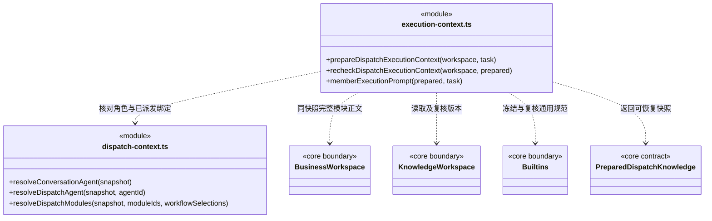

### 只读知识查询编排

`knowledge-queries.ts` 组合 Core 的 Team 与 BusinessWorkspace 视图，只接收 `KnowledgeSnapshotReader`，不持有完整工作区或写入端口。内部知识工具和 `prepareTeamTask` 使用同一个编排入口。每次方法调用读取一个完整快照；跨查询可能版本变化，`prepareTeamTask` 继续在返回前比较模块、Agent 和当前 revision，冲突时拒绝，不自动重试或换成最新正文。

索引刷新由 Core 的 `refreshKnowledgeIndexes` 单独处理，工具注册层装配读/写两条路径；旧查询类的 refresh 方法已退出。职责、状态归属和允许依赖见 [知识契约](../../../logic/knowledge/rules/CONTRACT.md#快照契约领域视图与查询编排)。新增查询通常修改所属领域视图与本层组合，不要求修改刷新事务或运行引擎。

### 多成员、多模块任务上下文契约

`resolveDispatchModules(snapshot, moduleIds, workflowSelections?)` 只从对应模块实际挂载的 Workflow 清单解析显式 ID。部分选择只覆盖指定模块；缺省仍取该模块首项或空清单的 general，但不作为匹配任意流程的通配符。显式选择缺失、跨模块或已卸载时拒绝，不回退。`prepareDispatchExecutionContext` 按 Task 原选择重新解析并比较有效模块/Workflow 绑定和知识版本（忽略已废弃的真人字段）；任务原本缺省的字段不会补成空数组，旧任务不能就地改选。

`DispatchKnowledgeWorkspace` 明确只读的 `entry/assert/snapshot/read/rules` 能力。未启动依赖替换复用 `prepareDispatchExecutionContext` 逐个核对待办闭包的原角色、模块、Workflow 与当前规范，并用 `recheckDispatchExecutionContext` 最后核对替代候选的冻结知识。版本变化整体拒绝，不刷新旧任务或扩大权限；仍不声称锁定外部业务产物。

已实现 `resolveDispatchAgent` 与 `resolveDispatchModules`：同快照解析自定义执行角色、继承 Skill、多个真实模块及各自 Workflow。`cbim:main` 与已退役的 `cbim:executor` 不能作为独立成员准备或恢复；主会话直接工作不通过该业务任务入口。缺失关系抛出明确错误码；默认采用各模块 Workflow 清单首项，空清单明确标为 general，不继承父模块。`prepareDispatchExecutionContext` 在执行前冻结完整角色、模块与流程正文；`recheckDispatchExecutionContext` 在启动或恢复时核对知识和内置规范版本。旧 `prepareTeamTask` 继续处理原单模块执行。新任务模型见 [core/tasks](../../../logic/tasks/rules/CONTRACT.md)。

`resolveConversationAgent` 只用于主会话图根与普通对话实例登记：要求快照有工作区身份和版本，返回固定内置主角色、Team 和主指引，不加载业务 Skill。因此结构校验失败时用户仍能与主助手诊断知识问题；正式 `createMember`、`dispatchTask`、执行冻结仍使用严格解析入口，不能借普通对话身份绕过知识、岗位责任或完整 Skill 校验。

#### 从分析到固定执行输入

主会话在 Auto 与 Team 中都可按本轮权限直接实现未配置自定义负责岗位的模块，同时通过受控知识服务治理架构。治理遵守 read/ask/execute、审批、版本和事务，不能原生读写 `.cbim/` 或借知识管理绕过业务权限。正式成员上下文不改为主实例，也不以项目根存在放宽派发范围。已配置自定义岗位时派给该岗位；没有自定义岗位时不创建 `cbim:executor`。被调度成员拥有自身会话、状态和模型思考能力，可自主探索真实 Team 环境，在目标模块内实现和验证。本目录确定性核验知识与装配输入，不把认知职责当作权限。普通问答、目标澄清及候选查找可继续，尚未定位模块时不产生假派发节点。

实际冻结契约位于 `core/tasks/execution-context.ts`，由调度与存储共同引用。权限和模型配置由可信运行入口单独准备，不混入知识快照：

```ts
interface PreparedDispatchKnowledge {
  version: 1; workspaceId: string; knowledgeRevision: string;
  agent: AgentConfigurationSnapshot;
  agentDefinition: Record<string, unknown>;
  modules: { binding: ModuleBinding; definition: Record<string, unknown>;
             overview: string; workflowText: string; workflowContract?: WorkflowContract }[];
  standards: { id: string; version: string; text: string }[];
  fingerprint: string;
}
```

所有正文从一个知识快照读取，任务中已有的模块、Workflow 与版本必须匹配；旧维护字段只从原任务复制进冻结快照，不用于比较当前资格，也不重写历史任务；缺失正文不静默降级。自定义角色保存实际 agent.json，角色原则及有效 Skill 正文完整保留。主会话登记使用 `mainAgentInstructions`，与独立执行角色明确分离。不再装配内置默认执行角色。通用 Workflow 冻结 `business-execution` 正文，同时冻结 `common-rules`；软件内置规范不属于工作区 revision，因此启动和恢复都另外复核其内容版本，并在规范读取前后核对工作区版本。

`validatePreparedDispatchKnowledge` 校验结构、引用一致性与正文哈希；`dispatchKnowledgeFingerprint` 对字段排序后的 JSON 计算 SHA-256，保留数组顺序。每份模块 Workflow 的可选 `cbim-workflow` 约定从本模块实际正文解析并随正文冻结；保存字段必须与重新解析的内容相同，删除约定后重算指纹也不能通过。`preparedWorkflowContracts` 保留所有模块的独立出处和版本，不继承父模块、不用最新知识替代已冻结要求。无声明保持原自然语言流程。

指纹不代表来源可信或获得授权。版本变化返回 `KNOWLEDGE_CHANGED`，任务绑定变化返回 `DISPATCH_CONTEXT_CHANGED`，存储快照损坏返回 `EXECUTION_CONTEXT_INVALID`；调用者必须重新核实，不能自动覆盖旧正文。文本上下文仅进入后端运行存储与大脑，公开图只获得 ModuleBinding 和角色引用。

旧 `prepareTeamTask` 入口遇到程序约定以 `WORKFLOW_MEMBER_REQUIRED` 拒绝，必须通过主调度派发正式成员。`assertLegacyWorkflowCompatible` 在实际运行租约前同样检查旧任务的冻结正文，防止续聊跳过准备入口；不从新知识给历史无声明任务补造条件。

已退役的内置执行角色不再随应用提供可恢复定义。恢复时 source 为 builtin 的执行快照返回 `AGENT_RETIRED`，不自动改绑为主 Agent 或重建旧默认执行者；旧主角色执行快照返回 `AGENT_ROLE_INVALID`。

#### 核验规则

| 对象 | 约束 |
| --- | --- |
| 角色 | `cbim:main` 在 Auto 与 Team 中都可直接实现未配置模块，并共用受控知识管理；只有自定义角色承担独立成员执行。主角色定义不写工作区文件，旧 `cbim:executor` 不再提供新实例 |
| Team | 根是 Team，非叶子是组，叶子是 Agent；有效 Skill 来自自身及祖先 |
| 模块 | workspace 下的领域工程及模块仍遵循业务知识结构；Task 绑定一个或多个实际 moduleId |
| 执行归属 | 使用工作区岗位与模块负责人；不要求真人花名册或旧维护确认 |
| Workflow | 每模块从自身清单选择本次 Workflow；不继承父模块或其他模块的 Workflow |
| 通用流程 | 模块无专属流程且策略允许时，明确记录 general 的版本和 reason；不伪装成模块挂载流程 |
| 权限 | 本目录不签发或继承权限；可信入口独立决定本轮工具门禁，内容文字及岗位负责人关系不能签发权限 |
| 恢复 | 本目录比较知识与内置规范版本，失效时拒绝沿用；当前成员入口只续接已核实正常结束的通道，尚未实现产物文件基线比对或异常通道自动恢复 |

ModuleSchema 的 authors 只记录来源，旧 maintenance 仅兼容读取。resolveDispatchModules 不再返回 MAINTAINER_UNCONFIRMED 或生成维护字段；有效模块和 Workflow、岗位来源、模型与权限仍分别由原入口核实。

角色的默认指引/Skill 与业务 Workflow 分开。调度职责是“核实现状、目标与约束 → 定位模块与团队 → 明确执行者、模块列表、目标、验收证据及依赖/风险 → 派发独立执行者 → 核实候选并安排返工或后续”；受控知识管理维护真实职责、依赖和责任关系，架构演进基于证据渐进，重大治理决策交人。执行职责是“理解已派发目标 → 自主探索 Team 与目标模块 → 实现/验证 → 报告候选或协作缺口”。个人配置与知识里的分工建议不能扩大本轮职责、模块边界、权限或改变验收基线；执行者需要范围外架构调整时报告主 Agent，不获得无限知识改写权。

`memberExecutionPrompt` 组装当前成员、当前任务的完整指引，要求使用 `cbim_task_plan`、`cbim_task_inspect`、`cbim_task_step` 和 `cbim_delivery_prepare` 形成可核实交付候选。所有正式任务只能由独立执行角色运行，不能交给 `cbim:main`；不再次派工，超出模块或需他人协作时向主调度报告事实、所需能力和限制。原单模块 `loopInstructions` 采用同一职责边界。计划目标与验收原文、顺序保持派发值；步骤可以修订，目标、范围或验收变化则报告限制并等待重新派发。模型回合结束不等于业务验收。

空闲、工作、等待和沟通状态来自可靠调度与运行/工具事件，不由模型正文自行修改。本阶段未提供执行成员的递归派发、等待或通信工具，不能把记录协作需求说成已经联系其他成员；提示词不能代替执行入口的工具门禁。

可选第三参数 `prerequisites` 由启动事务冻结，携带各前置 taskId、planRevision 和完整结果候选（摘要、证据引用、限制及 not_evaluated 状态）。提示词要求重新核实适用于本任务的事实；不能用前置候选扩大权限、改变目标或冒充已通过验收。前置快照属于 DispatchRun，独立于知识基线，不放入公开角色配置。

#### 当前冻结与复核关系



本目录不写磁盘、不发送消息、不自行启动成员；通过只读知识端口返回结果，供 execution 准备运行。测试覆盖角色继承、多模块独立 Workflow、主角色来源、绑定篡改、读取期间知识变化、内置规范更新、缺失正文和快照损坏；实际权限、通道日志及交付证据复核由运行入口测试，不能据此宣称已比对产物文件基线。

正式岗位执行从外层已锁定的同一知识 Snapshot 装配，不在 DispatchStore 回调中再次进入知识队列。memberContext 固定岗位绑定、名称、职责与项目适配，能力原则和有效 Skill 复用原解析器；适配引用只代表保存的资料引用，不声称自动读取或授权。旧快照读取不补字段，实际执行继续按原知识与 Workflow 完整复核。


### 自动与团队协作模式

automatic-context.ts 是隐式全项目范围的唯一解析位置，仅完整知识树没有模块且绑定原因为 no_modules 时生成 cbim:project。既有模块仍走 resolveDispatchModules 的维护与 Workflow 检查；execution-context 为隐式范围冻结内存说明和通用规范，不写 .cbim、不登记维护人。


### JSON 排序复用边界

本目录既有对象排序通过后端 utility 的 orderJsonValue 组合，字符序和省略 undefined 的原策略显式传入；原 JSON.stringify、字段选择、身份核验和哈希仍留在消费者。手工拼接 JSON 字符串的协议不直接替换，避免改变数字键次序或空值字节。
