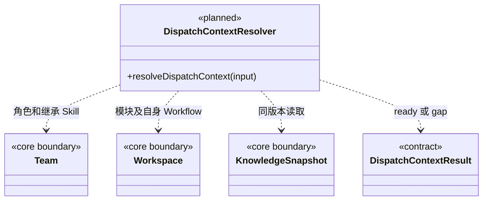

### 多成员、多模块任务上下文契约

已实现 `resolveDispatchAgent` 与 `resolveDispatchModules`：同快照解析内置/自定义角色、继承 Skill、多个真实模块及维护关系。缺失关系抛出明确错误码；默认采用各模块 Workflow 清单首项，空清单明确标为 general，不继承父模块。旧 `prepareTeamTask` 仍处理原单模块执行，新派发只保存身份与知识版本，尚未冻结完整可恢复执行正文或模型/权限配置。新任务模型见 [core/tasks](../../core/tasks/CONTRACT.md)。

#### 从分析到固定执行输入

所有成员先理解目标，再通过内部知识服务查询业务模块列表、团队成员和真人花名册。模型提出模块/成员候选；本目录负责确定性核验和装配。普通问答、目标澄清及候选查找可继续，尚未定位模块时不产生假派发节点，也不以此宣称已具备正式团队执行上下文。

后续在两个已实现解析函数上装配 `resolveDispatchContext`，扩展真实执行所需的权限快照与正文；以下联合结果仍属设计，当前入口以 Fault 错误码报告缺口：

```ts
type DispatchContextResult =
  | { kind: 'ready'; knowledgeRevision: string;
      agent: AgentConfigurationSnapshot;
      modules: ModuleBinding[];
      permissionSnapshotId: string;
      contextSections: { moduleId: string; content: string }[] }
  | { kind: 'gap'; gaps: {
      code: 'MODULE_MISSING' | 'AGENT_MISSING' | 'MAINTAINER_UNCONFIRMED'
          | 'WORKFLOW_UNAVAILABLE' | 'KNOWLEDGE_INVALID' | 'SCOPE_DENIED';
      subjectId?: string; explanation: string;
    }[] };
```

以上类型是设计，调用时从同一知识快照解析全部绑定；不允许先查模块 A、知识更新后再查模块 B 然后宣称同一基线。正式派发提交前还需核对快照版本是否变化。文本上下文返回大脑，公开图只获得已脱敏的 ModuleBinding 和角色引用。

#### 核验规则

| 对象 | 约束 |
| --- | --- |
| 角色 | 默认 `cbim:main` 与自定义角色同核；内置角色由明确来源解析，不伪造工作区 Agent 文件 |
| Team | 根是 Team，非叶子是组，叶子是 Agent；有效 Skill 来自自身及祖先 |
| 模块 | workspace 下的领域工程及模块仍遵循业务知识结构；Task 绑定一个或多个实际 moduleId |
| 维护责任 | 每个模块必须有可核实的维护关系与真人责任引用；角色执行责任不替代真人长期责任 |
| Workflow | 每模块从自身清单选择本次 Workflow；不继承父模块或其他模块的 Workflow |
| 通用流程 | 模块无专属流程且策略允许时，明确记录 general 的版本和 reason；不伪装成模块挂载流程 |
| 权限 | 工作区、发起任务作用域与接收角色策略取交集；内容文字不能签发权限 |
| 恢复 | 重用上下文前比较知识与产物基线，失效时要求重新准备，不默默更新运行中配置 |

目前 ModuleSchema 的 `authors` 记录作者，**不等于维护责任关系**。`maintenanceBindingId` 是新契约所需的显式关系，其定义见 [Core Workspace 契约](../../core/workspace/CONTRACT.md)，落地须同时维护 schema、查询、校验及迁移说明。缺关系时报告 gap，由授权的知识维护流程补齐；不把作者自动升级为负责人，也不冒充已认证登录身份。

角色的默认指引/Skill 与业务 Workflow 分开：所有角色共享“分析目标 → 定位模块 → 分工 → 执行/派发 → 核实结果”的团队约定，个性配置不能跳过可验证的授权、版本或知识边界。

#### 目标结构类图（待实现）



本目录不写磁盘、不发送消息、不自行启动成员；通过只读知识端口返回结果，供 execution 提交派发。验证须覆盖空模块、维护关系缺失、角色不存在、跨模块 Workflow、知识变更、内置角色解析及权限范围交集。
